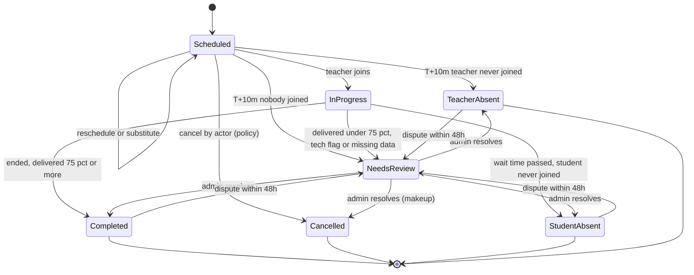

# 02 — قواعد العمل (Domain Rules)

[← الفهرس](README.md)

الملف ده بيوصف **منطق العمل** اللي بيفرق بين أكاديمية شغالة كويس وأكاديمية غرقانة في المشاكل. فيه الوقت، والمطابقة، والرصيد، والسياسات، وحالات الحصة، والمنهج، والتقييم.

---

## 1. نموذج الوقت والمناطق الزمنية

### الحقائق اللي بنينا عليها القرار (تواريخ 2027)

| المنطقة | فرق التوقيت | التوقيت الصيفي |
|---|---|---|
| مصر | UTC+2 / +3 | من آخر جمعة في أبريل (**30 أبريل**، الساعة 00:00) لآخر خميس في أكتوبر (**28 أكتوبر**، الساعة 24:00) |
| السعودية، قطر، الكويت، البحرين | +3 | مفيش |
| الإمارات، عُمان | +4 | مفيش |
| أوروبا وبريطانيا | — | آخر أحد في مارس وآخر أحد في أكتوبر (**28 مارس / 31 أكتوبر**) |
| أمريكا | — | **14 مارس / 7 نوفمبر** |
| حالات خاصة | — | الأردن وسوريا على +3 طول السنة من 2022. المغرب بيرجع لـ UTC+0 في رمضان. فلسطين قواعدها بتتغير كتير |

### القرار: الموعد المتكرر بيتثبّت على **توقيت المدرس** افتراضيًا

كل `recurring_slot` عليه `anchor_tz`. الأكاديمية تقدر تغيّر الافتراضي، أو تغيّره لتسجيل معين، ويتثبّت على توقيت الطالب.

**ليه توقيت المدرس؟**
1. المدرسين قليلين ومواعيدهم مزحومة، والطلاب متفرقين على مناطق كتير. لو المواعيد ثابتة على توقيت الطلاب، المدرس اللي في القاهرة وعنده طلاب في الرياض ولندن ونيويورك هيتلخبط جدوله **حوالي 6 مرات في السنة**، وده هيعمل حجوزات مزدوجة لازم تتحل بالإيد.
2. لما كل المواعيد على توقيت المدرس، أنماطها الأسبوعية بتتقارن من غير ما نفكّها لتواريخ. ده بيخلي **قاعدة البيانات نفسها تمنع التعارض** (القسم 2).
3. التكلفة على الطالب: ميعاده بيتحرك ساعة مرتين أو أربعة في السنة، بشكل متوقع، وبنبلّغه قبلها، وبنعرض عليه "خلّي ميعادي بتوقيتي" لو المدرس فاضي.

**مثال**: مدرس عنده حصة **19:00 بتوقيت القاهرة**. ده ميعادها عند الطلاب على مدار 2027:

| الفترة | الرياض | لندن |
|---|---|---|
| 1 يناير – 27 مارس | 20:00 | 17:00 |
| 28 مارس – 29 أبريل | 20:00 | **18:00** |
| 30 أبريل – 28 أكتوبر | **19:00** | 17:00 |
| 29 أكتوبر – 30 أكتوبر | 20:00 | **18:00** |
| من 31 أكتوبر | 20:00 | 17:00 |

### قواعد التخزين

| النوع | طريقة التخزين |
|---|---|
| **لحظات زمنية** (الحصص، والإجازات، والحجوزات المبدئية، والحضور) | `timestamptz` بتوقيت UTC. توقيت قاعدة البيانات وPHP هو UTC، وبنستخدم Carbon immutable |
| **قواعد متكررة** (الشفتات، والمواعيد المتكررة) | `weekday`، و`local_start TIME`، و`duration_min`، و`tz` (اسم IANA زي `Africa/Cairo`)، و`effective daterange`. **بنخزّن البداية والمدة مش البداية والنهاية**، عشان الحصص اللي بتعدّي نص الليل تشتغل صح |
| **حصة متولّدة من موعد متكرر** | بنخزّن كمان `anchor_tz` و`anchor_local_date` و`anchor_local_time`، عشان نقدر نعيد حساب `starts_at` لو قواعد التوقيت (tzdata) اتغيرت |
| **المستخدم** | `timezone` كاسم IANA، **مش فرق ساعات**. ولو توقيت الجهاز اختلف عن توقيت الحساب (سفر)، بنسأله |
| **إجازات الأكاديمية** | `daterange` محلي + توقيت الأكاديمية |

### الحالات الحساسة
- **ساعة مش موجودة وساعة بتتكرر**: مصر بتغيّر الساعة الساعة 12 بالليل، وده بيأثر على حصص طلاب أمريكا المتأخرة.
  - ساعة 00:00–01:00 يوم جمعة التغيير **مش موجودة**، فالحصة اللي فيها بتتأجل بنفس مقدار الفرق (ساعة).
  - ساعة 23:00–24:00 يوم خميس الرجوع **بتتكرر**، فبناخد أول مرة.
  - الحالتين بيظهروا في تقرير DST.
  - المنطق ده كله في service واحدة اسمها `LocalTimeResolver`، وعليها اختبارات للقاهرة ولندن ونيويورك وسيدني والدار البيضاء.
- **تحديثات tzdata**: الحكومات بتغيّر قواعد التوقيت فجأة؛ مصر أعلنت DST بتاع 2023 قبلها بأسابيع.
  - لازم tzdata يكون محدّث في صورة PHP وPostgres ونظام التشغيل.
  - لما إصدار tzdata يتغير، job بيعيد حساب الحصص الجاية من بياناتها المرجعية ويدوّر على تعارضات.
- **التطبيقات**: بتعرض الوقت بتوقيت الجهاز من نظام التشغيل.
  - لو الشاشة محتاجة توقيت **الطرف التاني** ("الطالب: 18:00 الرياض")، الـ API بيبعته جاهز.
  - مانعتمدش على قاعدة التوقيت اللي جوه Flutter.

### مخطِّط التوقيت الصيفي (DST Transition Planner)
- **job يومي** بيبص 45 يوم لقدام. لكل موعد نشط بيقارن الوقت المحلي عند **الطرف التاني** بين كل حصة واللي بعدها.
- لما يلاقي تغيير، بيسجله في `schedule_shift_notices`، وبيتأكد إنه مش هيعمل تعارض:
  - مع حصص الطالب التانية.
  - مع الأوقات اللي الطالب قال إنه مش فاضي فيها.
  - ولو الموعد ثابت على توقيت الطالب: مع شفت المدرس، ومع حصصه التانية.
- بيطلع **تقرير للإدارة** بإجراءات جماعية:
  - ثبّت توقيت المدرس (الافتراضي).
  - ثبّت توقيت الطالب، لو المدرس فاضي.
  - اقترح بدائل.
- **إشعارات** للطالب وولي الأمر قبلها بـ 14 يوم وبيومين (WhatsApp وPush)، فيها ميعاده الجديد بتوقيته.
- ملفات ICS فيها `TZID`، فالتقويم بيظبط نفسه.

---

## 2. التوافر والمطابقة (Matching)

### شاشة "ابحث عن مدرس" (صفحة Filament مخصصة بـ Livewire وAlpine)

**المدخلات**
- الطالب أو الـ lead، والمادة، والمستوى، والتصنيفات، والفئة العمرية.
- جنس المدرس: **لازم / يفضّل / مش فارقة**. ده غالبًا إجباري للطالبات في أكاديميات القرآن.
- لغة الشرح أو اللهجة.
- عدد الحصص في الأسبوع، والمدة، وتاريخ البداية، والفترة (8 أسابيع افتراضيًا).
- توقيت الطالب (بيتملي تلقائيًا).
- **الأوقات المفضلة**: بتتحدد على شبكة 7×24 بتوقيت الطالب.
- الحد الأدنى للتوافر: 8 من 8 أسابيع افتراضيًا، وممكن نقبل 7 من 8.

**المخرجات**
- مدرسين مترتبين، ولكل واحد: فئته، ونسبة إشغاله، ودرجة مناسبته.
- لكل يوم: **الأوقات المتاحة بتوقيت الطالب** في شكل chips.
  - لو وقفت على الـ chip تشوف توقيت المدرس وعدد الأسابيع المتاحة (مثلًا 8/8).
  - لو التوافر ناقص، بتشوف التواريخ اللي فيها تعارض.
- **نمط مقترح** لكل مدرس، مثلًا السبت 17:00 + التلات 17:00.
- لما تختار الـ chips يحصل **حجز مبدئي** (10 دقايق)، وبعده خطوات التسجيل.

### أشكال البيانات

```text
StudentPreference { tz, windows: [{weekday, start_local, end_local}], per_week, duration_min,
                    start_date, horizon_weeks, min_coverage }
TeacherWeekBits   { teacher_id, iso_week_utc, free: bitset(2016) }   // 5-min resolution = 252 bytes/week
MatchResult       { teacher, score, candidates: [{anchor_weekday, anchor_time, student_label,
                    coverage, conflict_dates[]}], suggested_patterns[] }
```

### الخوارزمية
1. **فلاتر أساسية** (SQL في شكل Pipeline من فلاتر):
   - المدرس نشط، وبيقبل طلاب جدد.
   - المادة والمستوى في نطاقه.
   - التصنيف، والجنس، واللغة، والفئة العمرية.
   - **السعة الأسبوعية المتبقية ≥ الدقائق المطلوبة**.
   - العدد بيقل من حوالي 500 مدرس لحوالي 50–150.
2. **Bitset للوقت الفاضي** لكل مدرس في كل أسبوع (UTC):
   `free = shift & ~busy & ~time_off & ~closures & ~holds`
   - الشفتات بتتفك **يوم بيوم** بتوقيت المدرس، فالـ DST بيتحسب صح.
   - `busy` = الحصص المتولّدة + **المواعيد المتكررة النشطة في الأسابيع اللي حصصها لسه ما اتولّدتش**.
   - بيتخزن في Redis بمفتاح `avail:{teacher}:{week}:v{n}`. أي domain event بيزوّد `n`، فمفيش بيانات قديمة ومفيش TTL نظبطه.
3. **الملاءمة**:
   - أوقات الطالب بتتحول لـ bits بتوقيت UTC **لكل أسبوع لوحده**.
   - لكل وقت بداية محتمل (يوم + شبكة كل 15 دقيقة بتوقيت المدرس): بنتأكد في كل أسبوع إن `[start, start+duration+buffer)` فاضي بالكامل وجوه أوقات الطالب.
   - التوافر = عدد الأسابيع اللي الوقت ده مناسب فيها.
4. **تكوين النمط**: بنختار أيام مختلفة بعدد الحصص الأسبوعية. الأولوية بالترتيب:
   - الحد الأدنى للتوافر.
   - نفس الوقت المحلي في كل الأيام.
   - يوم فاصل على الأقل بين الحصص.
5. **الترتيب (Strategy)**، والأوزان الأكاديمية تقدر تغيّرها:

| العامل | الوزن |
|---|---|
| التوافر (عدد الأسابيع المناسبة) | 35 |
| فئة المدرس ودرجته المركبة | 20 |
| توزيع الحمل (1 − نسبة الإشغال) | 15 |
| الاستمرارية: نفس مدرس الأخ أو المدرس السابق، واللهجة | 10 |
| نسبة تحويل الحصص التجريبية | 10 |
| التفضيلات المرنة | 10 |

**الأداء**:
- 150 مدرس × 8 أسابيع = query واحد عليه index بيمر على حوالي 36 ألف حصة (30–60ms)، وعمليات الـ bits أقل من 20ms.
- p95 أقل من 150ms والـ cache دافي، وحتى 500 مدرس والـ cache بارد أقل من 500ms.
- **مابنحسبش كل الاحتمالات مسبقًا، ومابنعملش المطابقة في SQL**.

### منع الحجز المزدوج (Concurrency)
1. **حجز مبدئي**: صف في `booking_holds` عمره 10 دقايق، بيتحسب وقت مشغول للمنسقين التانيين.
2. **التأكيد** (`CreateEnrollmentSchedule`) كله في transaction واحدة:
   - `pg_advisory_xact_lock` على المدرس والطالب.
   - تأكد تاني إن الوقت لسه فاضي.
   - `recurring_slots`.
   - توليد الحصص والمشاركين.
   - حجز الرصيد (قفل صف حساب الرصيد).
   - commit.
3. خطأ `23P01` (exclusion violation) بيرجع **409** ومعاه التواريخ اللي فيها تعارض.
4. `Idempotency-Key` إجباري، و`version` (optimistic locking) عند تعديل الحصص.

**القيدين دول هم الضمان الأساسي على مستوى قاعدة البيانات**:

```sql
-- النمط الأسبوعي على توقيت المدرس: نطاق "دقيقة في الأسبوع" (بيتقسم عند نهاية الأسبوع)
ALTER TABLE recurring_slots ADD EXCLUDE USING gist
  (teacher_id WITH =, minute_of_week WITH &&, effective WITH &&)
  WHERE (status = 'active' AND anchor = 'teacher');

-- الحصص الفعلية: بتمنع التعارض للمدرس وللطالب، وبتشتغل مع الحصص الجماعية بعدين
ALTER TABLE session_participants ADD EXCLUDE USING gist
  (user_id WITH =, block_period WITH &&)
  WHERE (role IN ('teacher','student') AND is_active);

-- block_period = tstzrange(starts_at, blocked_until)، وblocked_until بيتحسب في التطبيق:
-- timestamptz + interval دالة STABLE مش IMMUTABLE، فماينفعش تبقى generated column.
```

القيود دي محتاجة extension `btree_gist`.

---

## 3. الباقات والاشتراكات والرصيد

### أربع مفاهيم منفصلة

| المفهوم | بيجاوب على | الكيان |
|---|---|---|
| **التسجيل (Enrollment)** | الطالب بيتعلم إيه، ومع مين، وإمتى | `enrollments`، `recurring_slots` |
| **الاشتراك (Subscription)** | الاتفاق التجاري: الباقة، والسعر، والتجديد | `subscriptions` |
| **الرصيد (Credits)** | الطالب ليه كام دقيقة، وأنهي حصة بتستهلكها | `credit_accounts`، `credit_lots`، `credit_entries`، `credit_reservations` |
| **الفاتورة والدفع** | الفلوس | `invoices`، `payments` |

### وحدة الرصيد = **الدقيقة**
الباقة فيها عدد الحصص في البلوك × مدة الحصة، فالباقات اللي بعدد الحصص واللي بعدد الساعات بيمشوا على نفس الـ ledger. الواجهة بتعرض الاتنين: "فاضل 5 من 8 حصص (150 من 240 دقيقة)".

### التجديد بالبلوك (الافتراضي)
باقة "8 حصص في الشهر" بحصتين في الأسبوع ماتنفعش مع الشهور، لأن الشهر فيه حوالي 4.33 أسبوع، فبيطلع فيه من 8 لـ 10 حصص. عشان كده الافتراضي **بلوك**:
- فاتورة التجديد بتطلع لما الرصيد يوصل لحد معين (مثلًا حصتين).
- البلوك ليه صلاحية = الأسابيع اللازمة + فترة سماح. مثلًا 8 حصص بحصتين في الأسبوع = 4 أسابيع + 2 = 6 أسابيع.
- ده نفس اللي السوق متعود عليه ("باقة 8 حصص بتتجدد لما تخلص")، ومفيش حسابات نسبية، والمواعيد والرصيد ماشيين مع بعض.
- **التجديد الشهري (period)** بحسابات نسبية موجود كـ Strategy تانية للأكاديميات اللي عايزاه.

### حالة التمويل لكل حصة: `funded | unfunded | free | makeup`
- الحصص بتتولّد من المواعيد المتكررة سواء اتدفعت أو لأ، وبتحجز وقت المدرس.
- الحصة اللي **لسه مش مدفوعة قبلها بـ 24 ساعة** (قابلة للتعديل) بتتلغي تلقائيًا (سبب الإلغاء: مش مدفوعة).
- الموعد المتكرر بيفضل محجوز N يوم (14 افتراضيًا). بعدها التسجيل بيتوقف والموعد بيتفك.
- لما الدفع يوصل، الرصيد بيتضاف وبيتوزع **بالترتيب (FIFO)** على الحصص اللي مش مدفوعة.

### الكيانات والأعمدة الأساسية

```text
billing_accounts(id, academy_id, payer_user_id, currency, country, price_region_id, tax_id,
                 default_payment_method_id)              -- اللي بيدفع: ولي أمر أو طالب بالغ. العملة ثابتة للحساب
billing_account_students(billing_account_id, student_id) -- باقات العيلة
plans(id, academy_id, name, subject_scope, session_minutes, sessions_per_block,
      renewal_mode block|period, validity_days, rollover jsonb, policy_set_id, is_trial,
      credit_scope enrollment|student_pool)
plan_prices(plan_id, price_region_id, currency, amount_minor, tax_inclusive, valid_from, valid_to)
price_regions(id, academy_id, name, countries[])
enrollments(id, academy_id, student_id, subject_id, level_id, program_id, curriculum_version_id,
            primary_teacher_id, status, start_date, credit_account_id, policy_set_id)
subscriptions(id, academy_id, billing_account_id, enrollment_id, plan_id, plan_price_id,
              status active|past_due|paused|cancelled, auto_renew, block_no, renew_threshold_min,
              paused_from, paused_until, cancel_at)
credit_accounts(id, student_id, scope_type, scope_id, available_min, reserved_min, consumed_min,
                version)                                 -- نسخة محسوبة، وبتتطابق كل ليلة مع الـ ledger
credit_lots(id, account_id, source purchase|makeup|trial|bonus|rollover|adjustment, source_id,
            granted_min, remaining_min, expires_at)
credit_entries(id, account_id, lot_id, session_id,
               type grant|reserve|release|consume|expire|refund|adjust|transfer,
               minutes, idempotency_key UNIQUE, actor_id, reason)  -- بيتضاف عليه بس
credit_reservations(session_id UNIQUE, account_id, minutes, lot_allocations jsonb,
                    status held|consumed|released)
```

### سيناريوهات

| السيناريو | القاعدة |
|---|---|
| أكتر من مادة | لكل مادة تسجيل واشتراك وحساب رصيد. أو باقة `student_pool` ("12 حصة في أي مادة") بحساب رصيد واحد |
| عيلة وولي الأمر هو اللي بيدفع | حساب دفع واحد لأكتر من طالب. الفواتير اللي ميعادها في نفس الأسبوع بتتجمع في فاتورة واحدة. خصم الإخوات قاعدة تسعير (من التسجيل التاني) |
| ترقية الباقة | بتسري من البلوك الجاي. ولو محتاج زيادة دلوقتي، يشتري دقائق إضافية بسعر الوحدة في باقته |
| تخفيض الباقة | من البلوك الجاي، من غير استرداد |
| تغيير عدد الحصص في الأسبوع | تعديل المواعيد + تغيير الباقة من البلوك الجاي |
| إيقاف مؤقت | لحد N يوم في السنة. الحصص في الفترة دي بتتلغي والرصيد بيرجع. صلاحية الرصيد بتتمد بنفس المدة. المواعيد بتفضل محجوزة N يوم بالكتير |
| انتهاء الرصيد | كل دفعة رصيد بتنتهي في `expires_at`. اللي فاضل بسبب الطالب بينتهي، إلا لو فيه ترحيل (مثلًا لحد 25% من البلوك، مرة واحدة). رصيد التعويض 30 يوم ومابيترجعش فلوس |
| استرداد | الدقائق **المشتراة** اللي ما اتستخدمتش × سعر الوحدة الفعلي − أي رسوم مش قابلة للاسترداد. بيتعمل credit note + استرداد من البوابة + قيد `refund`. رصيد المكافآت والتعويض مالوش استرداد |
| تغيير المدرس | صف جديد في `enrollment_teacher_assignments` بتاريخ. الحصص الجاية بتتنقل بعد التأكد من مفيش تعارض. الرصيد مابيتأثرش |

---

## 4. محرك سياسات الإلغاء والتعويض والغياب

### التصميم
- **مجموعات سياسات** (`policy_sets`) على مستوى الأكاديمية، وكل باقة ممكن تغيّرها، و**ليها إصدارات** (`policy_set_versions`).
- كل إصدار فيه **إعدادات** (أرقام)، و**جدول قواعد مترتب**: أول قاعدة تنطبق هي اللي بتتنفذ.
- **الشروط** من قائمة ثابتة: الحدث، ومين عمله، وساعات الإشعار، ونوع الحصة، والمستخدم من الحد الأقصى، ومين المسؤول، ونسبة الوقت اللي اتدرّس فعلًا.
- **النتائج**: إيه اللي يحصل في الرصيد، ونسبة أجر المدرس، وحدث أداء ودرجة خطورته، وهل محتاج موافقة، وقوالب الإشعارات.
- **التنفيذ = Strategy + Specification، مش محرك قواعد عام.**
- **كل قرار بيتسجل على الحصة** ومعاه `policy_version_id` والمدخلات والنتيجة. ده أساسي لما يحصل نزاع.

### الإعدادات الافتراضية (كلها قابلة للتعديل)

| الإعداد | القيمة |
|---|---|
| مهلة إلغاء الطالب | 12 ساعة (السوق بين 2 و24 ساعة) |
| الحد الأقصى للإلغاء أو إعادة الجدولة | 2 في كل بلوك 8 حصص |
| المدرس يستنى الطالب قد إيه | 10 دقايق في حصة 30 دقيقة، و15 دقيقة في حصة 45 دقيقة أو أكتر |
| المدرس يتحسب متأخر / غايب | بعد دقيقتين / بعد 10 دقايق |
| الحصة تتحسب "اكتملت" | لو اتدرّس 75% من وقتها أو أكتر |
| صلاحية رصيد التعويض | 30 يوم |
| ميعاد التقرير | 12 ساعة |

### جدول القواعد الافتراضي

| # | الحدث | الشرط | الحالة | رصيد الطالب | أجر المدرس | حدث الأداء |
|---|---|---|---|---|---|---|
| 1 | الطالب يعيد الجدولة | قبلها بـ 12 ساعة أو أكتر، وفي حدود العدد | تتنقل لميعاد جديد | يفضل محجوز | — | — |
| 2 | الطالب يلغي | قبلها بـ 12 ساعة أو أكتر، وفي حدود العدد | ملغية | يرجع | 0% | — |
| 3 | الطالب يلغي | قبلها بـ 12 ساعة أو أكتر، وعدّى الحد | ملغية | بيضيع (الإدارة تقدر تستثني) | 0% | إلغاء متأخر من الطالب |
| 4 | الطالب يلغي | قبلها بأقل من 12 ساعة | ملغية | بيضيع | 50% | إلغاء متأخر من الطالب |
| 5 | الطالب غاب | المدرس استنى المدة المطلوبة | غياب الطالب | بيتخصم | 100% (أو 50%) | غياب الطالب |
| 6 | الطالب اتأخر | دخل قبل ما مدة الانتظار تخلص | اكتملت (وبتخلص في ميعادها) | بيتخصم | 100% | تأخير الطالب |
| 7 | المدرس يلغي | قبلها بـ 24 ساعة أو أكتر | ملغية | يرجع كـ **رصيد تعويض** | 0% | بسيط |
| 8 | المدرس يلغي | قبلها بأقل من 24 ساعة | ملغية | رصيد تعويض (+ ممكن دقائق مكافأة) | 0% | كبير |
| 9 | المدرس غاب | ما دخلش لحد الدقيقة 10 | غياب المدرس | رصيد تعويض + مكافأة لو اتكرر مرتين في 30 يوم | 0% − خصم | حرج |
| 10 | المدرس اتأخر | من 2 لـ 10 دقايق | اكتملت | بيتخصم، والدقايق الضايعة رصيد تعويض لو أكتر من 5 | بنسبة الوقت | تأخير |
| 11 | مشكلة تقنية | من المنصة أو مزوّد الفيديو، واتدرّس 75% أو أكتر | اكتملت | بيتخصم | 100% | — |
| 12 | مشكلة تقنية | من المنصة أو مزوّد الفيديو، واتدرّس أقل من 75% | تحتاج مراجعة ← ملغية من النظام | رصيد تعويض | بنسبة الوقت | — |
| 13 | مشكلة تقنية | من عند الطالب | تحتاج مراجعة | بيتخصم لو اتدرّس 50% أو أكتر، غير كده تعويض | 100% | — |
| 14 | مشكلة تقنية | من عند المدرس، واتدرّس أقل من 75% | تحتاج مراجعة | رصيد تعويض | بنسبة الوقت | ضعف الاتصال |
| 15 | إجازة أو عطلة | من تقويم الأكاديمية | ملغية من النظام | يرجع + صلاحية الرصيد تتمد | 0% (أو حسب العقد) | — |
| 16 | حصة مش مدفوعة | قبلها بـ 24 ساعة ولسه مادفعش | ملغية من النظام | — | 0% | — |
| 17 | الطالب يلغي حصة تعويضية | في أي وقت | ملغية | بيضيع (مفيش تعويض عن تعويض) | زي القاعدة 4 | — |
| 18 | حصة تجريبية | الطالب يعيد الجدولة | تتنقل | مجانية، مرة واحدة | — | نشاط في الـ CRM |
| 19 | ظرف طارئ بإثبات | بموافقة الإدارة | ملغية | يرجع | 0% | — |

---

## 5. دورة حياة الحصة

**نوع الحصة** خاصية مش حالة: `regular | trial | makeup | extra | assessment`. وفيه كمان:
- `makeup_for_session_id`: الحصة اللي دي تعويض عنها.
- `original_teacher_id`: المدرس الأصلي لو الحصة مع بديل.
- `reschedule_count`: عدد مرات إعادة الجدولة.
- `is_detached`: الحصة اتعدّلت بالإيد، فمابتتولّدش تاني من الموعد المتكرر.



### تأثير كل حالة على الرصيد

| الحالة | الرصيد |
|---|---|
| `Scheduled` و`InProgress` | محجوز |
| `Completed` و`StudentAbsent` | اتخصم |
| `TeacherAbsent` | بيرجع كرصيد تعويض |
| `Cancelled` | حسب السياسة |
| `NeedsReview` | بيفضل محجوز لحد ما الإدارة تحسم |

- لما الإدارة تحسم حصة "تحتاج مراجعة" أو اعتراض، بيتضاف **قيد عكسي** للرصيد والمرتبات. **القيود القديمة عمرها ما بتتعدل**.

### المهام الدورية (Sweepers)
- **job بيشتغل كل دقيقة** على كل الأكاديميات. بيتعامل مع المواعيد النهائية (T+2، وT+3، وT+10)، وبيقفل الحصة بعد نهايتها بـ 10 دقايق، بعد ما يطابق الحضور مع الـ room API.
- القفل بيطلّع **event واحد**: `SessionFinalized{outcome, policy_decision}`. اللي بيسمعوه: Credits، وPayroll، وEvaluation، وLearning.

### حالة التقرير (جوه الحصة)
`not_required → due → submitted | overdue → reviewed`
- لما الحصة تبقى `Completed`، بيبقى فيه تقرير مطلوب.
- لما تبقى `StudentAbsent`، بيبقى مطلوب ملاحظة غياب قصيرة.

### الحصة التجريبية والتعويضية
- **التجريبية**: نفس دورة الحياة، ومعاها `lead_id`، و`funding=free`.
  - `TrialCompleted` بيطلب تقييم التجربة في الـ CRM.
  - الـ lead بيدخل بـ **magic link موقّع** على الويب، من غير حساب ولا تطبيق.
- **التعويضية**: ليها `makeup_for_session_id`، ورصيدها من دفعة تعويض.

---

## 6. المنهج والتقدم

### النموذج

```text
programs → curriculum_versions (draft → in_review → published → retired; المنشور مابيتعدلش)
         → curriculum_nodes (level | unit | lesson | objective)
              path ltree, ordinal, weight, est_sessions, mastery_criteria jsonb,
              measure (none | quran_ayah | page), range_start, range_end
node_resources · assessment_definitions(node_id, type, rubric, pass_score) · version_node_mappings
```

- **العُقد اللي بتتقاس بنطاق** (آيات أو صفحات) بتغطي مسارات الحفظ.
- **التسجيل بيفضل على إصدار واحد** من المنهج. النقل لإصدار جديد بيحصل عن طريق `version_node_mappings`.
- **المدرسين بيشاركوا** بإنهم يكتبوا مسودات واقتراحات على الإصدار `draft`، والمشرف بيراجع، والإدارة بتنشر.

### إزاي التقرير بيحرّك التقدم
1. **قبل الحصة**: الـ Learning module بيقترح `planned_items`، وهي أول بند أو اتنين ما اتقنوش + بنود المراجعة اللي جه ميعادها (مراجعة متباعدة بسيطة: `next_review_at ≤ تاريخ الحصة`). المدرس بيشوف **"خطة اليوم"** في الشريط الجانبي للفصل.
2. **التقرير بيتملي بالخطة مسبقًا**. المدرس بيحدد لكل بند `introduced | practiced | mastered | needs_review` ودرجة من 1 لـ 5. بنود الحفظ بيتسجل فيها من فين لفين وعدد الأخطاء.
3. **`SessionReportSubmitted`** بيشغّل الـ projector:
   - يحدّث `enrollment_progress` لكل بند حسب قاعدة الإتقان بتاعته (مثلًا "اتقن" مرة واحدة، أو درجة 4 أو أكتر مرتين).
   - يحدّث `memorized_ranges int4multirange` لمسارات القرآن.
   - يحسب **مكان الطالب** = أول بند ما اتقنش.
   - **نسبة الإنجاز** = مجموع أوزان اللي اتقن ÷ مجموع كل الأوزان.
   - **السرعة** = متوسط متحرك لوزن اللي بيتقن في كل حصة.
   - **الوقت المتوقع للإنهاء** = الوزن الباقي ÷ السرعة ÷ عدد الحصص في الأسبوع.
4. **في آخر المستوى** بيبقى فيه اختبار. لو نجح: شهادة (بكود تحقق) والمستوى اللي بعده. لو ما نجحش: بنود علاجية.
5. **شاشة الـ Roadmap** (للطالب وولي الأمر والمدرس):
   - مسار فيه اللي اتقن ✓، و**انت هنا** ●، واللي جاي ○.
   - نسبة كل مستوى، والوقت المتوقع للإنهاء، وآخر تقرير وواجب.

---

## 7. التقييم ومؤشرات الأداء

### قواعد عامة
- كل مؤشر بيتحسب على **آخر 90 يوم**، وليه صورة كل شهر، وليه **حد أدنى لعدد الحالات** قبل ما يتحسب.
- **الأحداث اللي سببها المنصة أو مزوّد الفيديو مابتتحسبش** على المدرس.
- المدرس يقدر **يعترض** على أي حدث خلال 48 ساعة.

### مؤشرات المدرس

| المؤشر | المعادلة | المصدر | الهدف |
|---|---|---|---|
| الالتزام بالمواعيد | الحصص اللي دخلها في خلال دقيقتين من البداية ÷ الحصص اللي اتدرّست | الحضور | 97% أو أكتر |
| متوسط التأخير | متوسط دقايق التأخير في الحصص اللي اتأخر فيها | الحضور | — |
| الغياب | `teacher_absent` ÷ (الحصص المستحقة − اللي ألغاها الطالب أو النظام) | الحصص | 1% أو أقل |
| الإلغاء المتأخر | إلغاء المدرس قبل الحصة بأقل من المهلة ÷ الحصص المستحقة | الحصص | 2% أو أقل |
| نسبة الوقت المدرَّس | مجموع دقايق تواجد المدرس والطالب مع بعض ÷ مجموع الدقايق المحجوزة | الحضور | 95% أو أكتر |
| الخروج المبكر | الحصص اللي خرج فيها قبل نهايتها بأكتر من 3 دقايق من غير سبب ÷ الحصص اللي اتدرّست | الحضور | 2% أو أقل |
| التقارير في ميعادها | التقارير اللي اتسلمت قبل الميعاد ÷ الحصص المكتملة | التقارير | 95% أو أكتر |
| متابعة الواجبات | الواجبات اللي اتصححت خلال 48 ساعة ÷ الواجبات اللي اتسلمت | الواجبات | 90% أو أكتر |
| التقييم | متوسط Bayesian: `(C·m + Σr) / (C + n)`، وفيه C = 10، وm = متوسط الأكاديمية | التقييمات | 4.6 أو أكتر |
| مراجعة الجودة | متوسط درجات الـ rubric (مراجعتين على الأقل في الشهر) | مراجعات المشرف | 80% أو أكتر |
| سرعة تقدم الطلاب | الوزن اللي اتقن في كل 10 حصص ÷ الوزن المتوقع | Learning | 0.9 أو أكتر |
| استمرار الطلاب | التجديدات ÷ البلوكات اللي خلصت | Billing | 85% أو أكتر |
| تحويل الحصص التجريبية | التجارب اللي اشتركت ÷ التجارب اللي خلصت | CRM | 40% أو أكتر |
| الشكاوى | الشكاوى المؤكدة لكل 100 حصة | الدعم | 0.5 أو أقل |
| الإشغال (للتشغيل بس، مش داخل في الدرجة) | الدقايق المحجوزة ÷ دقايق الشفت | الجدولة | — |

### الدرجة المركبة (من 100)

| المجموعة | الوزن | المكونات |
|---|---|---|
| الالتزام | 40 | المواعيد 15، والغياب 15، والإلغاء المتأخر 10 |
| الجودة | 35 | مراجعة الجودة 15، والتقييم 10، وتقدم الطلاب 10 |
| الاحترافية | 15 | التقارير 10، والواجبات 5 |
| العمل | 10 | استمرار الطلاب 7، وتحويل التجارب 3 |
| الشكاوى | — | بتتخصم من الإجمالي |

- **تطبيع كل مؤشر**: `clamp((value − floor) / (target − floor), 0, 1) × 100`، وبيتعكس في المؤشرات اللي الأقل فيها أحسن.
- **الفئات**:
  - **A**: 90 أو أكتر.
  - **B**: من 75 لـ 89.
  - **C**: من 60 لـ 74.
  - **D**: أقل من 60، وبيتحط للمدرس خطة تحسين.
- **الفئة بتأثر على** معامل المرتب، وعلى ترتيب المدرس في المطابقة.

### مؤشرات الطالب

| المؤشر | المعادلة |
|---|---|
| الحضور | الحصص اللي حضرها ÷ (الحصص المستحقة − اللي اتلغت بسبب المدرس أو النظام) |
| الالتزام بالمواعيد | متوسط دقايق التأخير، ونسبة الحصص اللي دخلها في ميعادها (تأخير 3 دقايق أو أقل) |
| الإلغاء المتأخر | عددها في كل بلوك |
| الواجبات | اللي اتسلم في ميعاده ÷ اللي اتطلب، ومتوسط الدرجة |
| التفاعل | متوسط درجة المشاركة اللي المدرس بيحطها في كل حصة (من 1 لـ 5) |
| التقدم | نسبة الإنجاز، والسرعة مقارنة بالخطة، ومتوسط الإتقان، ودرجات اختبارات المستوى |
| القرآن | عدد الصفحات المحفوظة في الشهر، ودقة المراجعة = 1 − الأخطاء ÷ الأسطر اللي اتراجعت |

### تنبيه الطالب المعرّض للانسحاب
أي شرط من دول بيعمل **مهمة استبقاء**:
- الحضور أقل من 75% في آخر 4 أسابيع.
- غياب مرتين ورا بعض.
- الواجبات أقل من 40%.
- تقييم 3 أو أقل.
- فاتورة متأخرة.

### التقرير الشهري لولي الأمر
PDF فيه الحضور، والتقدم في الـ roadmap، والواجبات، وملخص بيتكتب تلقائيًا، وتعليق المدرس.
