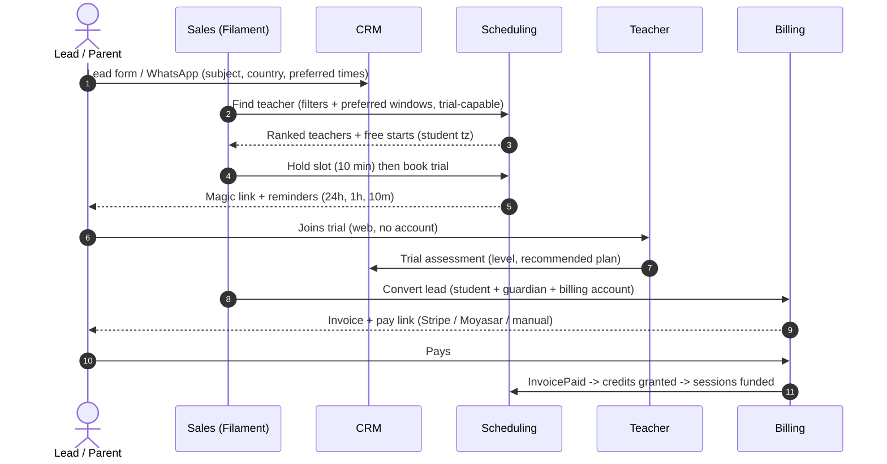
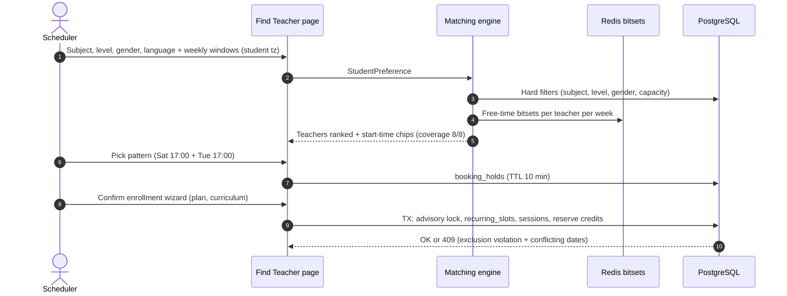
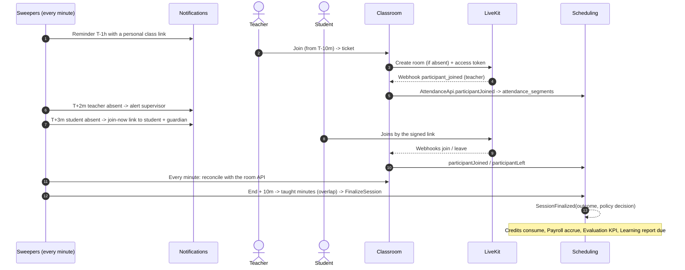
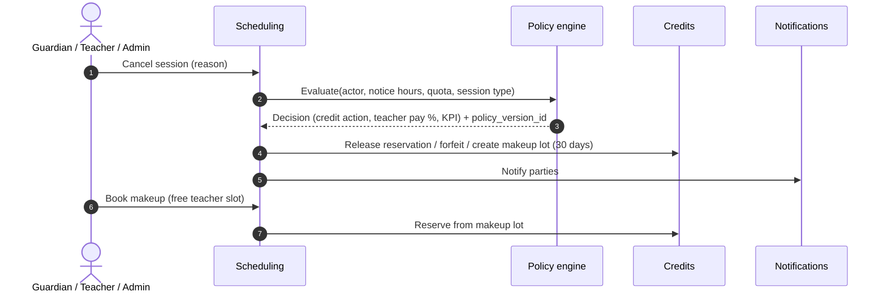
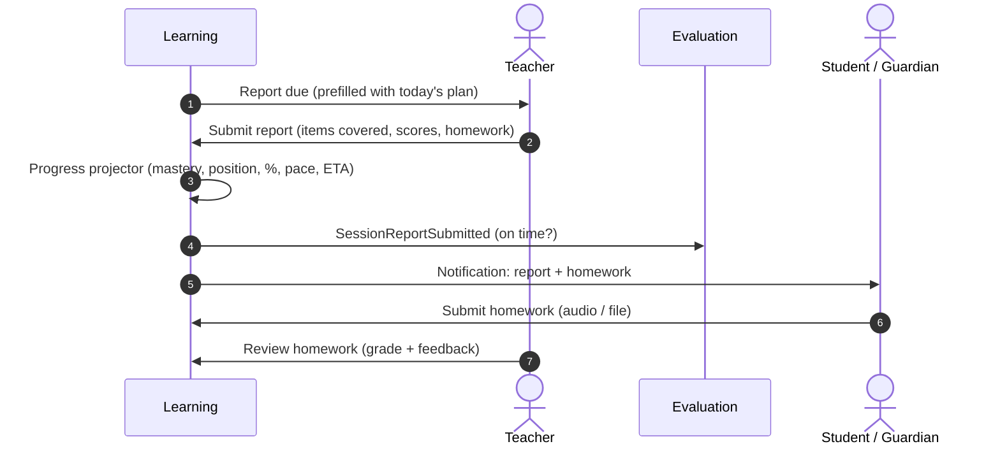
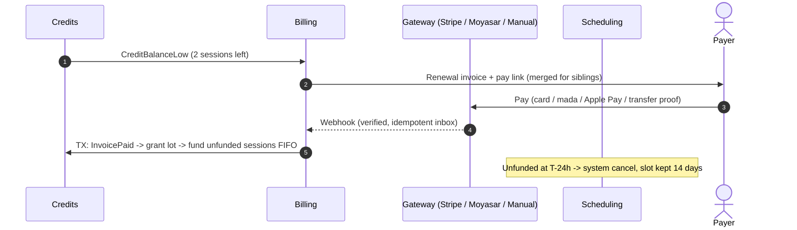
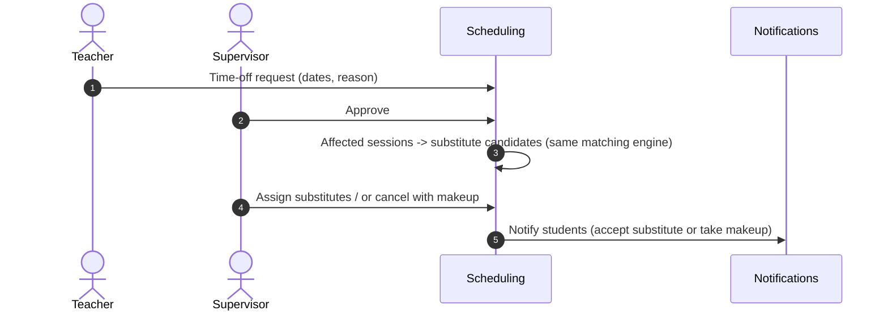
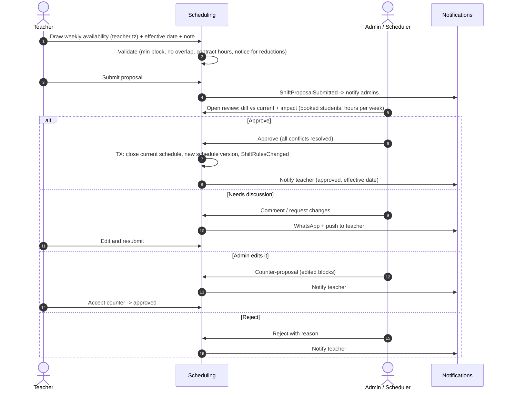

# 01 — الميزات والأدوار والتدفقات

[← الفهرس](README.md)

العلامات قدام كل ميزة بتوضح مرحلة تنفيذها، والتفاصيل في [05-roadmap.md](05-roadmap.md):
- **MVP**: الإطلاق الأول (أول 3–4 شهور).
- **P2**: من الشهر الخامس للتامن.
- **P3**: من الشهر التاسع للرابع عشر.

---

## الأدوار والصلاحيات

### الأدوار

| الدور | المستوى | الوصف |
|---|---|---|
| **Super Admin** | المنصة | فريق المنصة: يدير الأكاديميات وباقات الـ SaaS والدعم الفني. يقدر يدخل بحساب أي مستخدم (impersonation)، والدخول ده متسجل |
| **Owner (مالك الأكاديمية)** | الأكاديمية | كل صلاحيات الأكاديمية، ومنها بوابات الدفع والسياسات والضرايب |
| **Admin (مدير)** | الأكاديمية | التشغيل اليومي كله، ماعدا إعدادات الملكية والفوترة الحساسة |
| **Supervisor (مشرف جودة)** | الأكاديمية | متابعة المدرسين: يدخل الحصص من غير ما يظهر، ويراجع التقارير، ويقيّم الجودة بـ rubric |
| **Scheduler (منسّق جداول)** | الأكاديمية | يحط الشفتات، ويدوّر على مدرسين، ويحجز ويلغي ويعيد الجدولة |
| **Accountant (محاسب)** | الأكاديمية | الفواتير والمدفوعات والمرتجعات ومرتبات المدرسين |
| **Sales / Support (مبيعات ودعم)** | الأكاديمية | الـ leads والحصص التجريبية والتذاكر |
| **Teacher (مدرس)** | الأكاديمية | **يقترح شفتاته (أوقاته المتاحة)**، وجدوله، والفصل، والتقارير، والواجبات، وأرباحه، ومؤشرات أدائه |
| **Student (طالب)** | الأكاديمية | حصصه، والـ roadmap، والواجبات، والتقارير. لو بالغ ممكن يكون هو اللي بيدفع |
| **Guardian (ولي أمر)** | الأكاديمية | يتابع كل أولاده، ويدفع لهم، ويدير حسابات الصغيرين منهم |

في الـ MVP الأدوار **ثابتة**. الأدوار المخصصة لكل أكاديمية في P3.

### مصفوفة الصلاحيات

✓ كامل · ◐ محدود أو على بياناته فقط · — مالوش صلاحية

| القدرة | Super Admin | Owner | Admin | Supervisor | Scheduler | Accountant | Sales | Teacher | Student | Guardian |
|---|---|---|---|---|---|---|---|---|---|---|
| إدارة الأكاديميات وباقات SaaS | ✓ | — | — | — | — | — | — | — | — | — |
| إعدادات الأكاديمية والبوابات والسياسات | ◐ | ✓ | ◐ | — | — | — | — | — | — | — |
| المدرسين والشفتات (واعتماد مقترحات الشفتات) | — | ✓ | ✓ | ◐ | ✓ | — | — | ◐ يقترح شفتاته ويتابع حالتها | — | — |
| البحث عن مدرس والحجز | — | ✓ | ✓ | — | ✓ | — | ◐ تجريبي | — | — | — |
| الإلغاء وإعادة الجدولة | — | ✓ | ✓ | — | ✓ | — | ◐ تجريبي | ◐ حسب السياسة | ◐ حسب السياسة | ◐ حسب السياسة |
| دخول الفصل المباشر | — | — | ◐ | ◐ مخفي | ◐ | — | — | ✓ | ✓ | ◐ مكان ابنه (المتابع المنفصل P2) |
| التقارير والواجبات | — | ✓ | ✓ | ◐ مراجعة | — | — | — | ✓ يكتب | ◐ يشوف ويسلّم | ◐ يشوف |
| المنهج | — | ✓ | ✓ | ✓ مراجعة | — | — | — | ◐ مسودات واقتراحات | ◐ الـ roadmap | ◐ الـ roadmap |
| التقييم ومراجعة الجودة | — | ✓ | ✓ | ✓ | — | — | — | ◐ مؤشراته واعتراض | ◐ تقييم الحصة | ◐ تقييم الحصة |
| الفواتير والمدفوعات | ◐ | ✓ | ◐ | — | — | ✓ | — | — | ◐ لو هو اللي بيدفع | ◐ فواتيره |
| مرتبات المدرسين | — | ✓ | — | — | — | ✓ | — | ◐ كشف حسابه | — | — |
| CRM والتجارب | — | ✓ | ✓ | — | ◐ | — | ✓ | ◐ تقييم التجربة | — | — |
| الدخول بحساب مستخدم تاني | ✓ مع تسجيل | ◐ | ◐ | — | — | — | — | — | — | — |
| لوحات التحليلات | ◐ المنصة | ✓ | ✓ | ◐ الجودة | ◐ الإشغال | ◐ المالية | ◐ القمع | — | — | — |

الصلاحيات بتتنفّذ بـ Laravel Policies. والـ RLS بيضمن إن مفيش حد يشوف بيانات أكاديمية تانية، حتى لو فيه bug في الـ Policy.

---

## كتالوج الميزات

### 1. المنصة وSaaS
- **MVP**
  - إنشاء أكاديمية: الاسم بالعربي والإنجليزي، والـ subdomain (`{slug}.platform.com`)، والتوقيت الافتراضي، والعملة الأساسية، والدولة، واللغة.
  - الـ branding (شاشة **الإعدادات › الهوية والألوان**، للمالك والمدير):
    - الاسم بالعربي والإنجليزي، واللوجو، وأيقونة المتصفح.
    - **قوالب جاهزة** (النور، والسماء، والبنفسج، والرمال، والحبر). كل قالب فيه 4 ألوان ليها استخدام ثابت (أساسي، وتنبيه، وخطر، ومعلومات)، ودرجة الرمادي، وخط العناوين وخط النصوص من قائمة خطوط عربية، وشكل الحواف.
    - **قالب مخصص**: تعدّل أي لون أو خط وتشوف معاينة حية، وبعدين تطبّق، أو **تحفظه كقالب باسمك**، أو تحدّث قالبك المحفوظ. الشاشة بتنبّه لو اللون فاتح على النص الأبيض (تباين أقل من 4.5).
    - بيتطبق على Filament دلوقتي، وعلى البوابة والإيميلات والتطبيق عن طريق `GET /api/v1/branding` (من غير تسجيل دخول، عشان شاشة الدخول نفسها تتلوّن).
  - باقات SaaS للأكاديميات، بحدود (عدد المدرسين، وعدد الطلاب النشطين، ودقائق الفيديو، والتخزين) وميزات بتتفتح وتتقفل.
  - **المنفّذ دلوقتي: باقات المنصة** (التفاصيل في [02 — القسم 11](02-domain-rules.md#11-باقات-المنصة-saas-وحدودها)):
    - **الباقات** في لوحة المنصة ("الباقات"): كل باقة ليها اسم بالعربي والإنجليزي، وحدود (المدرسين، والطلاب النشطين، ودقايق الفيديو في الشهر، والمساحة؛ الفاضي يعني بلا حد)، والميزات اللي فيها (العملاء المحتملين والحصص التجريبية، والدفع الإلكتروني، واستيراد البيانات، وقوالب ألوان خاصة، ومرتبات المدرسين)، وسعرها في الشهر. باقة واحدة بتبدأ عليها الأكاديميات الجديدة، والباقة تتقفل للجديد من غير ما اللي عليها يتأثروا. وبتبدأ المنصة بأربع باقات: البداية، والنمو، والاحتراف، ومفتوحة.
    - **باقة كل أكاديمية** من صفحتها في لوحة المنصة: تغيير الباقة، وحدود خاصة بالأكاديمية فوق حدود الباقة، وميزات تتضاف أو تتقفل ليها لوحدها، وكله **بسبب** بيتسجل في سجل المنصة وسجل الأكاديمية. والباقات اللي كانت عليها بتفضل في التاريخ. وبتشوف الاستخدام قصاد كل حد، وزرار "اعدّ دلوقتي".
    - **المدرسين والطلاب النشطين بيتقفلوا عند الحد**: مدرس جديد (من أي مكان: الاستيراد أو غيره)، أو طالب جديد بيتسجل في مادة، بيترفض وبتظهر رسالة بتقول الباقة بتسمح بكام. الطالب اللي متسجل أصلًا بيتسجل في مادة تانية عادي.
    - **الفيديو والمساحة بنراقبهم بس**: مفيش حصة بتتقطع، والإدارة وفريق المنصة بيعرفوا.
    - **الميزات اللي برّه الباقة بتختفي**: شاشاتها، والـ API بتاعها (`feature-not-in-plan`)، وقوايم البوابة. الدفع الإلكتروني بيختفي من قدام اللي بيدفعوا والدفع اليدوي بيفضل، والألوان الخاصة بتتقفل والقوالب الجاهزة بتفضل. والبيانات مابتتمسحش ولا بتقف (المرتبات والعملاء المحتملين بيكملوا يتسجلوا)، فلو الباقة كبرت بعدين كل حاجة بتظهر زي ما هي.
    - **"باقة الأكاديمية"** في الإعدادات للمالك والمدير: كل حد والمستخدم منه دلوقتي. ولما حد يوصل 80% أو يخلص، بيظهر تنبيه فوق كل صفحة في لوحة الإدارة.
    - **العدّ كل ليلة** (`platform:usage`) للوحة المنصة، وكل أكاديمية في القايمة بيبان عليها باقتها ولو قرّبت أو وصلت لحد.
  - لوحة Super Admin: الأكاديميات، والاستخدام، وإيقاف أكاديمية، والدخول بحساب مستخدم مع تسجيله.
  - أكاديمية تجريبية بيانات وهمية للعروض.
  - **المنفّذ دلوقتي: لوحة المنصة** (`/console`، أو دومين خاص بيها في الـ production):
    - لفريق المنصة بس: حساباتهم في جدول لوحده بعيد عن الأكاديميات، وتطبيق مصادقة (2FA) إجباري من أول دخول، ومعاه أكواد استرجاع.
    - **الأكاديميات**: كل أكاديمية وحالتها، وعدد المدرسين والطلاب وأولياء الأمور، والحصص والساعات والفلوس اللي اتحصّلت في آخر 30 يوم، وآخر حصة. ولكل أكاديمية صفحة فيها المالك والمديرين وطرق التواصل معاهم، وآخر العمليات الحساسة.
    - **إيقاف أكاديمية** بسبب بيتسجل، وترجيعها. الأكاديمية الموقوفة لوحاتها وتطبيقها بيقفوا: الويب بيعرض "الأكاديمية متوقفة مؤقتًا"، والـ API بيرد `academy-suspended`. والبيانات مابتتمسحش.
    - **أكاديمية جديدة**: الاسم، والعنوان، والعملة، والتوقيت، واللغة، والدولة، والمالك. المالك بياخد لينك يحدد بيه كلمة السر (صالح 14 يوم)، والأدمن بينسخه ويبعته له.
    - **الدخول بحساب مستخدم** للدعم الفني:
      - تختار الأكاديمية والشخص، وتكتب السبب (10 حروف على الأقل)، وتختار المدة (15 أو 30 أو 60 دقيقة).
      - بيطلع لينك يشتغل مرة واحدة، لمدة دقيقتين، وعلى عنوان الأكاديمية نفسها بس. والمنصة مابتحتفظش غير بالـ hash بتاعه.
      - فوق كل صفحة شريط فيه مين من فريق المنصة داخل وبحساب مين، والوقت الباقي، وزرار الخروج.
      - تغيير كلمة السر مقفول طول الدخول.
      - الجلسة بتخلص بالخروج، أو لما الوقت يخلص، أو لو حد قفلها من اللوحة.
      - كل اللي بيتعمل وقتها بيتسجل باسم فريق المنصة "بحساب" الشخص.
    - **سجل المراجعة** للمنصة كلها، بفلتر بالأكاديمية، أو المنصة بس، والنوع، ومين عمل العملية.
- **P2**: تصدير كل بيانات الأكاديمية (عشان الاشتراك والخروج من المنصة)، ومواقع عامة لكل أكاديمية فيها نموذج lead.
- **P3**
  - تسجيل الأكاديمية لنفسها وفوترة SaaS تلقائية.
  - دومين خاص لكل أكاديمية (Cloudflare for SaaS).
  - تطبيقات white-label باسم كل أكاديمية.
  - Cells إقليمية.

### 2. الهوية والحسابات
- **MVP**
  - الدخول بالإيميل أو الموبايل + OTP، أو بكلمة سر، وGoogle وApple Sign-in.
  - 2FA إجباري للـ Super Admin والـ Owner والـ Admin والمحاسب، ومتاح لأي حد.
  - حسابات الأطفال: ولي الأمر بيديرها، من غير إيميل (username أو PIN)، مع **تسجيل موافقته** (consent). وولي الأمر يقدر يتنقل بين حسابات أولاده.
  - **أكتر من حساب على نفس الجهاز**: نفس الشخص ممكن يبقى ولي أمر في أكاديميتين، فيقدر يتنقل بينهم.
  - **اكتشاف الحسابات بعد التحقق**: يكتب الإيميل أو الموبايل، ويأكد بـ OTP، وبعدها بس يشوف حساباته في كل الأكاديميات.
  - إدارة الأجهزة: قائمة الأجهزة، وتسجيل الخروج عن بعد، وإجبار على تحديث التطبيق.
  - سجل مراجعة (audit log) لكل عملية حساسة.
  - **المنفّذ دلوقتي**:
    - الدخول على الويب بالإيميل أو رقم الموبايل (زي ما الشخص بيكتبه: بالكود أو من غيره) أو الـ username، بكلمة سر.
    - **رسالة ترحيب** للحساب اللي اتعمل لحد (من الاستيراد): فيها لينك خاص بيه يحدد بيه كلمة السر مرة واحدة، ويدخل على لوحته على طول. اللينك صالح 14 يوم.
    - **سجل العمليات** (الإعدادات ← سجل العمليات، للمالك والمدير):
      - كل عملية حساسة، مين عملها وإمتى: الفلوس وحسابات الدفع، وسياسة الإلغاء والاستثناءات منها، وحسم الحصص اللي تحت المراجعة، وتغيير مدرس الطالب، واعتماد الشفتات من غير موافقة المدرس، والمرتبات، والاستيراد، وكلمات السر، ودخول فريق المنصة.
      - السجل ده مابيتعدلش ومابيتمسحش، وقاعدة البيانات نفسها بتمنع ده.
      - مابيتسجلش فيه أي سر أو مفتاح أو كلمة سر أو token.
    - **"دخول فريق المنصة على حسابك"** في "إعداداتي": كل مرة فريق المنصة دخل بحساب الشخص، مين وإمتى وليه.
    - **الدخول بخطوتين** (تطبيق مصادقة زي Google Authenticator، ومعاه 8 أكواد استرجاع):
      - **إجباري للمالك والمدير والمحاسب**: أول ما يدخلوا لوحة الإدارة بيتحوّلوا لصفحة تشغيله (QR وكود يدوي، وبعدين أكواد الاسترجاع) قبل أي حاجة تانية.
      - **متاح لأي حد** (مدرس، طالب، ولي أمر، أو أي حد في الإدارة) من "إعداداتي": يشغّله، أو يقفله، أو يجدّد أكواد الاسترجاع.
      - لما يبقى شغال، بيتطلب في **كل طرق الدخول**: كلمة السر أو الكود لمرة واحدة في كل اللوحات، والـ API (كلمة السر، والكود، والحسابات اللي اتلقت بالكود في التطبيق)، والبوابة.
      - كود الاسترجاع بيشتغل مرة واحدة بس. السر متشفر في قاعدة البيانات، والأكواد متخزنة hash.
      - **فريق المنصة** وهو داخل بحساب حد مابيتسألش عن الخطوة التانية (هو أصلًا عدّاها على `/console`)، ومايقدرش يشغّلها أو يقفلها للشخص. ولو حد ضيّع موبايله وأكواده، فريق المنصة يقدر **يصفّرها** من "الدخول بحساب مستخدم" بسبب بيتسجل، والشخص يشغّلها تاني أول ما يدخل.
      - تشغيلها، وقفلها، واستخدام كود استرجاع، وتجديد الأكواد، والتصفير، كله بيتسجل في سجل العمليات.
    - **موافقة ولي الأمر على حساب الطفل** (COPPA وGDPR-K):
      - **مين محتاجها**: الطالب اللي سنه أقل من **سن الموافقة** اللي الأكاديمية حددته (18 افتراضيًا، أو 16، أو 13)، والسن محسوب بتقويم الأكاديمية. ولو تاريخ الميلاد مش معروف: الحساب اللي ولي الأمر بيديره، أو أي طالب مربوط بولي أمر.
      - **لحد ما ولي الأمر يوافق، الطفل مايقدرش يدخل** بأي طريقة: كلمة السر، أو الكود، أو التطبيق، أو البوابة، أو لينك الحصة بتاعه. وبتظهرله رسالة إن ولي أمره لازم يوافق الأول. ولي الأمر نفسه بيشوف كل حاجة عادي، والمدرس بيدخل الحصة عادي.
      - **الطلب** بيروح لولي الأمر أول ما يترِبط بالطفل (واتساب أو إيميل، وإشعار في الحساب)، وفيه لينك خاص بيه صالح 14 يوم: يقرا منه النص ويوافق من غير ما يدخل. وفي حسابه بيشوف تنبيه على كل الصفحات لحد ما يوافق.
      - **النص** بيقول بنحتفظ بإيه، والحصص المباشرة، ومين بيشوف، ولحد إمتى، وحقه. وليه رقم إصدار بيتسجل مع الموافقة، ومعاه الـ IP والمتصفح.
      - ولي الأمر يقدر **يسحب الموافقة** في أي وقت من "خصوصية الأولاد" (في `/my`، والتطبيق، والبوابة): الطفل بيخرج من كل الأجهزة، ومايدخلش تاني لحد ما حد يوافق من جديد، والإدارة بيوصلها إشعار.
      - **شاشة "موافقات أولياء الأمور"** في الإدارة (للمالك والمدير والمشرف)، فيها تلات تبويبات: مستنيين، واتسحبت، وموجودة. ومنها الإدارة تقدر:
        - تبعت الطلب تاني.
        - تسجل موافقة ورقية أو بالتليفون، بملاحظة بتقول هي معاها إيه.
        - تسحب موافقة لو ولي الأمر طلب كده.
        - تشوف التاريخ كله.
        - تغيّر سن الموافقة (للمالك والمدير بس).
      - الموافقات بتتضاف بس ومابتتمسحش. السحب بيتسجل على نفس السطر مرة واحدة بس، وقاعدة البيانات بتمنع أي تعديل غير كده. وكل موافقة، أو تسجيل، أو سحب، أو تغيير في السن، بيتسجل في سجل العمليات.
      - فريق المنصة وهو داخل بحساب الطفل (للدعم) مابيتمنعش.
    - **الدخول بجوجل وأبل** (التفاصيل في [02 — القسم 14](02-domain-rules.md#14-الدخول-بجوجل-وأبل)):
      - زرار "ادخل بحساب جوجل" و"ادخل بحساب أبل" تحت صفحة الدخول في كل اللوحات والبوابة، وفي التطبيق بالدخول اللي على الموبايل نفسه (وزرار أبل الرسمي على الآيفون).
      - **بيدخّل الحسابات اللي الأكاديمية عاملاها بس، ومابيعملش حساب جديد**: حساب جوجل أو أبل المربوط، وإلا الحساب اللي إيميله هو نفس الإيميل اللي جوجل أو أبل أكّدوه (وبيترِبط ساعتها لوحده).
      - الدخول بخطوتين وموافقة ولي الأمر بيتطلبوا زي أي دخول.
      - في التطبيق: جوجل أو أبل بيلاقوا حسابات الشخص في كل الأكاديميات، زي الكود بالظبط.
      - **"الدخول بجوجل وأبل"** في "إعداداتي" (اللوحات)، و"حسابي" (البوابة)، و"أنا" (التطبيق): مربوط بأنهي إيميل وآخر دخول بيه، والربط (مفيد لو إيميل أبل مخفي)، والفصل (إلا لو هو الطريقة الوحيدة للدخول). والربط والفصل في سجل العمليات.
      - بيشتغل لما المنصة تحط حساباتها عند جوجل وأبل (بالإعدادات بس).
    - **الدخول بكود لمرة واحدة** بدل كلمة السر، في كل اللوحات ("ادخل بكود بدل كلمة السر") وفي الـ API:
      - الكود 6 أرقام، بيوصل على واتساب (قالب authentication فيه زرار "نسخ الكود")، أو SMS، أو الإيميل. وتقدر تطلب كود جديد بطريقة تانية ("ابعته SMS").
      - صالح 10 دقايق، و5 محاولات غلط وبعدها لازم كود جديد، وكود واحد كل دقيقة، و5 أكواد في الساعة لنفس الرقم أو الإيميل، و20 في الساعة لنفس الـ IP.
      - الرد واحد سواء الرقم عليه حساب أو لأ، والرسالة بتطلع بعد الرد، فمحدش يعرف من الرد أو من وقته إن فيه حساب.
      - الكود والإيميل أو الرقم مش متخزنين كنص: الكود hash، والرقم متشفر، وكل ده بيتمسح بعد يوم.
    - **اكتشاف الحسابات** للتطبيق المشترك: الشخص يكتب إيميله أو رقمه بكود الدولة، ويأكد بالكود، وبعدها بس يشوف حساباته في كل الأكاديميات الشغالة (اسم الأكاديمية ولوجوها ودوره)، ويضيف كل حساب على الجهاز.
    - **أجهزتي**: الـ API بيرجع كل جهاز داخل على الحساب (اسمه، وآخر استخدام)، والشخص يقدر يخرّج أي جهاز منهم (موبايل ضاع مثلًا).
- **P3**: أدوار مخصصة لكل أكاديمية، وSSO للمؤسسات.

### 3. المواد والمستويات والتصنيفات
- **MVP**
  - المواد بالعربي والإنجليزي، وكل مادة ليها مستويات بترتيب، وقالب تقرير افتراضي.
  - **تصنيفات** مرنة: الفئة العمرية، والمسار (حفظ، تجويد، تأسيس، محادثة)، واللهجة، والمنهج الدراسي (بريطاني، أمريكي، سعودي).
- **المنفّذ دلوقتي: شاشة "المواد"** (في "التعليم"، للمالك والمدير):
  - كل مادة باسمها بالعربي والإنجليزي، و**مستوياتها بالترتيب** (مثلًا: القاعدة النورانية ← جزء عمّ ← … ← القرآن كامل)، و**تصنيفاتها** (مسارات أو مناهج: حفظ جديد، مراجعة، إجازة؛ أو منهج بريطاني، IELTS).
  - المستوى أو التصنيف بيفضل بنفس الـ id لما يتغير اسمه أو ترتيبه، فالمدرسين اللي عليه بيفضلوا عليه. واللي عليه مدرسين مايتمسحش (قاعدة البيانات نفسها بتمنع ده)، والشاشة بتقول ليه.
  - مفيش مادتين بنفس الاسم، وجنب كل مادة عدد مدرسينها.
  - الفئة العمرية **ثابتة** مش تصنيف: أطفال (أقل من 12)، وإعدادي (12–14)، وثانوي (15–18)، وكبار، بنفس حدود شكل حساب الطالب. واللهجة في ملف المدرس.
- **P2**: ربط المادة بأكتر من برنامج منهج.

### 4. الباقات والأسعار
- **MVP**
  - الباقة = مدة الحصة (30/45/60 دقيقة) × عدد الحصص في البلوك، وعدد الحصص في الأسبوع.
  - التجديد بالبلوك.
  - **مناطق سعرية** (الخليج، أوروبا، أمريكا، مصر)، ولكل منطقة عملتها وسعرها. شامل الضريبة أو لأ، حسب إعدادات الأكاديمية.
  - كوبونات وخصم الإخوات (من الاشتراك التاني وانت طالع).
  - باقة "رصيد مشترك": مثلًا 12 حصة في أي مادة.
  - إضافة دقائق لما الطالب يحتاج حصص زيادة.
- **المنفّذ دلوقتي: الخصومات والحصص الزيادة.**
  - **خصم الإخوات** من "الباقات والأسعار" ← "خصم الإخوات": نسبة للابن التاني، ونسبة تانية للتالت وبعده (0 يقفله). اللي بيدفع لأكتر من ابن: أول ابن بيدفع كامل، وكل ابن بعده بياخد الخصم على فواتيره (البلوك والحصص الزيادة). الترتيب بأول اشتراك لكل ابن لسه شغال.
  - **الكوبونات** (شاشة "الكوبونات" للمالك والمحاسب): كود (`RAMADAN15`)، نسبة أو مبلغ بعملة، لكام فاتورة (الأولى بس، أو N، أو كل فاتورة)، من وإلى تاريخ، وأقصى عدد مرات، والباقات اللي ينفع عليها، وهل بيتجمع مع خصم الإخوات (لو لأ، الأكبر فيهم هو اللي بيتطبق، ولو متساويين خصم الإخوات، والكوبون بيستنى لفاتورة جاية). كل اللي بيدفع بيستخدم الكوبون مرة واحدة. الحالة: شغال، لسه مابدأش، خلص، اتستخدم كله، مقفول. قفل الكوبون بيوقف الاستخدام الجديد، واللي عليه بيكمّل.
    - في **التسجيل** من "ابحث عن مدرس": خانة كوبون، والسعر بيتحسب قدامك (السعر · الخصومات = أول فاتورة)، والكود اللي مينفعش بيقول ليه.
    - على **حساب الطالب**: "كوبون" يحط كوبون على الكورس (الفواتير الجاية بيه)، ولو فيه فاتورة بلوك مستنية من غير أي دفع أو إثبات أو دفع أونلاين شغال، بتتلغي (بإشعار دائن لو ضريبية) وبتطلع تاني بالكوبون. ونفس الزرار يشيله.
  - **الخصم سطر في الفاتورة** بقيمة بالسالب ووصفه ("خصم الإخوات (10%)"، "كوبون FALL10 (10%)")، والضريبة على اللي فاضل، والفاتورة مابتتغيرش بعد ما تطلع. لو الفاتورة طلعت بصفر (منحة 100%)، بتتعلّم مدفوعة على طول والرصيد بيتضاف.
  - **الحصص الزيادة**: الحصة بسعر حصة من البلوك المتفق عليه (سعر البلوك ÷ عدد حصصه) ناقص خصم الإخوات. من 1 لـ 10 حصص، فاتورة واحدة مستنية في المرة لكل كورس، ومابتأخرش فاتورة التجديد. بعد الدفع دقايقها بتتضاف لرصيد الكورس (بنفس صلاحية البلوك)، وبتموّل الحصص المستنية الأول، وبعدين **"احجز حصة زيادة"** من حساب الطالب (مع نفس المدرس في وقت فاضي، من الرصيد العادي مش رصيد التعويض).
    - الإدارة: "حصص زيادة" على حساب الطالب.
    - اللي بيدفع: "حصص زيادة" على كارت الكورس في "الرصيد والفواتير" (`/my`)، والتطبيق (الفلوس)، والبوابة (الفلوس). والفاتورة بتظهر فوق مع المطلوب دفعه.
  - كل ده بيتسجل في سجل العمليات (حفظ كوبون، تطبيقه، شيله، خصم الإخوات، الحصص الزيادة).
  - **لسه**: الأسرة تكتب كوبون بنفسها.
- **المنفّذ دلوقتي: فاتورة العيلة والباقة المشتركة.**
  - **فاتورة واحدة للعيلة**: لما تجديد ابن يطلع (رصيده وصل لحد التجديد)، أي أخ ليه على نفس حساب الدفع وتجديده جاي خلال أسبوع بينزل معاه في نفس الفاتورة. "خلال أسبوع" معناه إن الحصص اللي فاضلة له هتوصل لحد تجديده بحصص أسبوع بسرعة باقته. كل ابن ليه سطر بلوك باسمه ومادته، وخصمه هو (خصم الإخوات أو الكوبون) تحته، والضريبة على الفاتورة كلها. ولما تتدفع، كل كورس بياخد بلوكه. المدة بتتغير من "الباقات والأسعار" ← "العيلة" (من 0 لـ 14 يوم؛ 0 يخلّي كل ابن بفاتورته)، و7 أيام افتراضيًا. والابن اللي تجديده بعيد، أو اللي عليه فاتورة بلوك مستنية، بيفضل لوحده. والفاتورة اللي طلعت مابتتغيرش: لو كوبون اتحط على كورس فيها، بتتلغي وتطلع تاني بنفس الولاد كلهم.
    - بتبان في الإدارة ("فاتورة العيلة (كورسين)" في قايمة الفواتير، والطلاب ولينك كل كورس في الفاتورة، و"فاتورة العيلة" في حساب كل طالب)، وفي `/my` والتطبيق والبوابة (علامة "فاتورة العيلة" وأسماء الولاد)، وفي الرسالة ولينك الدفع.
  - **الباقة المشتركة** ("12 حصة في أي مادة"): الباقة نفسها بتتعلّم "باقة مشتركة" من "الباقات والأسعار" (النوع مايتغيرش بعد ما حد يشترك). أول كورس للطالب عليها بيفتحها بفاتورة، وأي كورس تاني ليه على نفس الباقة ونفس اللي بيدفع بيدخل عليها: بيسحب من نفس الرصيد، ومن غير فاتورة جديدة ولا كوبون، ولو الباقة مدفوعة بيبدأ على طول. الحصص في الأسبوع في الباقة المشتركة للمواد كلها مع بعض، فالكورس بيطابقها في مدة الحصة بس. الرصيد بيموّل حصص كل المواد بترتيب ميعادها، والتجديد بيطلع لما الرصيد كله يوصل لحده.
    - "ابحث عن مدرس" بيقول إن الكورس هيدخل على باقة الطالب، وحساب الطالب بيقول "باقة مشتركة مع: عربي، إنجليزي" بلينك كل كورس، والأسرة بتشوف الباقة كرت واحد بموادها ("إنجليزي، عربي · باقة مشتركة") في `/my` والتطبيق والبوابة.
- **المنفّذ دلوقتي: الدفع الإلكتروني.** الأكاديمية هي التاجر، والفلوس بتروح على حساباتها هي في البوابات على طول:
  - **البوابات**:
    - **Stripe**: كارت وApple Pay وGoogle Pay، بأغلب العملات.
    - **Moyasar**: مدى والكارت وApple Pay وSTC Pay، بالريال.
    - **Tap**: KNET وBENEFIT ومدى والكارت، بعملات الخليج، والدينار بـ 3 خانات عشرية.
    - **Paymob**: الكارت والمحافظ الإلكترونية، بالجنيه المصري، على صفحة الدفع الموحدة بتاعتهم (Unified Checkout).
    - **حساب Stripe بتاع الأكاديمية مربوط بالمنصة (Stripe Connect Standard)**: زرار "اربط حساب Stripe" بيودّي المالك على Stripe يدخل بحساب الأكاديمية ويوافق، ويرجع. مفيش مفاتيح بتتكتب، والفلوس بتروح على حساب الأكاديمية على طول (direct charges)، والمنصة ممكن تاخد نسبة لو اتظبطت. وفيه زرار "افصل الحساب".
    - **بوابة تجريبية** بصفحة خاصة بيها، عشان تجرّب الرحلة كلها من غير مفاتيح. مابتظهرش في الإنتاج.
  - **شاشة "الدفع الإلكتروني"** للمالك والمحاسب:
    - تضيف حساب البوابة بمفاتيحه، وتختار وضع تجربة أو حقيقي، والعملات اللي ياخدها.
    - كل حساب ليه رابط webhook خاص بيه تنسخه، ومعاه شرح للإعداد في كل بوابة، وزرار يختبر المفاتيح.
    - إزاي الناس يدفعوا يدوي (رقم الحساب، أو InstaPay، أو المحفظة).
    - آخر محاولات الدفع.
  - **المفاتيح بتتحفظ متشفرة ومابتظهرش تاني.** الخانة اللي بتتساب فاضية بتسيب المفتاح المحفوظ زي ما هو. ومفتاح التجربة مابيتقبلش على حساب حقيقي، والعكس.
  - **لينك دفع لكل فاتورة** في رسالتها، خاص باللي بيدفع وموقّع، فبيفتح من غير تسجيل دخول:
    - بيفتح على صفحة بشكل الأكاديمية فيها الفاتورة، وزرار لكل طريقة دفع متاحة لعملتها، وطريقة الدفع اليدوي.
    - بعد الدفع بيرجع لنفس الصفحة، ويبان عليها "وصلنا الدفع".
    - الإدارة كمان تقدر تنسخ اللينك من صفحة الفاتورة.
  - **"ادفع دلوقتي"** في صفحة الرصيد والفواتير عند ولي الأمر:
    - لو فيه أكتر من طريقة، بيختار منهم.
    - بعد الدفع بيرجع لحسابه ومعاه النتيجة، والصفحة بتتحدّث لوحدها أول ما البوابة تأكد الدفع.
  - **الدفع اليدوي بإثبات** (تحويل بنكي، InstaPay، محفظة): لما الأكاديمية تكتب إزاي الناس يدفعوا يدوي، بيظهر زرار **"دفعت بالتحويل"** في حساب ولي الأمر (`/my`)، والتطبيق، والبوابة، ولينك الدفع من غير تسجيل دخول:
    - اللي دفع بيختار الطريقة، والمبلغ (لحد الباقي، ومسموح بجزء)، ويوم الدفع بتقويمه هو، ورقم التحويل، و**الإيصال** (صورة أو سكرين شوت أو PDF، لحد 10 ميجا).
    - مفيش حاجة بتتدفع لسه: الإثبات بيستنى الأكاديمية. ومفيش غير **إثبات واحد مستني** لكل فاتورة.
    - المحاسب والمدير والمالك بيوصلهم إشعار، وبيلاقوا تاب **"إثباتات مستنية مراجعة"** أول تاب في الفواتير (ورقمها على القايمة). في صفحة الفاتورة بيشوفوا الإيصال جنب بياناته:
      - **"وافق"**: بعد ما الفلوس توصل الحساب، بيتسجل الدفع بالمبلغ اللي وصل فعلًا (ممكن يكون أقل)، ولو الفاتورة اتدفعت كلها الحصص بتتأكد على طول.
      - **"ارفض"** بسبب مكتوب: اللي دفع بيقراه في رسالة فيها لينك يبعت إثبات تاني.
    - اللي دفع بيشوف إثباته فين على الفاتورة (مستني، اتوافق عليه، اترفض وليه)، والصفحة بتتحدث لوحدها.
    - الإيصال بيتحفظ في مكان خاص، ومحدش بيشوفه غير اللي بعته واللي بيتابعوا فلوس الأكاديمية.
  - **الدفع مابيتسجلش غير لما البوابة نفسها تقول إنه اتدفع.** ده بيحصل في رجوع العميل، وفي الـ webhook، وفي فحص كل 5 دقايق للمحاولات اللي الـ webhook بتاعها ضاع.
  - **كل دفعة بتتسجل مرة واحدة بس.** كل webhook بيتحفظ مرة واحدة، وكل محاولة دفع ليها دفعة واحدة بس، وقاعدة البيانات نفسها بتمنع التكرار.
  - لو الفلوس وصلت لفاتورة كانت اتدفعت بطريقة تانية، أو المبلغ مختلف، المحاولة بتتعلّم "محتاجة استرداد"، ومفيش حاجة بتتسجل مرتين.
  - **فواتير ZATCA (المرحلة الأولى)** لأكاديمية سعودية مسجلة في ضريبة القيمة المضافة. بتتشغل من "الباقات والأسعار" ← "الضريبة والفواتير"، ومحتاجة رقم ضريبي سعودي صحيح:
    - كل فاتورة بتبقى **"فاتورة ضريبية مبسطة"**، وفيها الاسم المسجل في الضريبة، والرقم الضريبي، وتاريخ ووقت الإصدار، والضريبة، و**رمز QR** بالصيغة اللي ZATCA طالباها (TLV).
    - الفاتورة بتفضل زي ما طلعت: لو الإعدادات اتغيرت بعدين، الفواتير القديمة مابتتغيرش.
    - إلغاء الفاتورة بيطلّع **إشعار دائن** برقمه المتسلسل ورمز QR بتاعه، وبيفضل زي ما هو.
    - اللي بيدفع يقدر يشوف الفاتورة كاملة ويطبعها من لينك الدفع، ومن "الرصيد والفواتير" في حسابه.
  - **لسه**: الكروت المحفوظة والتجديد التلقائي، والاسترداد من البوابة، وPayPal، والتشفير بـ KMS. وفي ZATCA: الضريبة بالريال على الفواتير اللي بعملة تانية، والمرحلة التانية (الربط مع منصة فاتورة)، والفاتورة الضريبية الكاملة (B2B).
- **P2**
  - تجديد تلقائي بكارت محفوظ، ومتابعة الدفع اللي فشل (dunning).
  - التجديد الشهري (period) كخيار تاني.
  - ترحيل جزء من الرصيد اللي ماخلصش (rollover).
  - برنامج إحالة.

### 5. المدرسين والشفتات
- **MVP**
  - ملف المدرس: الجنس، واللهجة، واللغات، والفئات العمرية، والمواد بنطاق المستويات (من–إلى)، والتصنيفات، والحد الأقصى من الدقائق في الأسبوع ومن الحصص في اليوم.
  - **بيقبل طلاب جدد؟** **بيقبل حصص تجريبية؟**
  - **المنفّذ دلوقتي: شاشة "المدرسين"** (في "المدرسين والأسر"، للمالك والمدير والمنسّق):
    - القايمة: الاسم وطرق التواصل، والمواد، والنوع، والأعمار، والساعات في الأسبوع، وبياخد طلاب جداد ولا لأ، والحساب (شغال، مقفول، أو لسه ماختارش كلمة السر). وفلتر بالمادة والنوع والحساب، وبحث بالاسم أو الإيميل أو الرقم.
    - **"مدرس جديد"** وصفحة كل مدرس: الاسم والإيميل والموبايل (بكود الدولة، أو محلي وكود دولة التوقيت بيتحط لوحده)، والتوقيت ولغة الرسائل، والنوع، ولغات الشرح، واللهجة، **والأعمار اللي بيدرّسها**، وبياخد طلاب جداد وتجريبي، وأقصى ساعات في الأسبوع، و**أقصى حصص في اليوم**، و**كل مادة من مستوى لحد مستوى وتصنيفاتها** (من غير اختيار = أي مستوى أو كل التصنيفات).
    - المدرس الجديد بيعدّي على حد المدرسين في باقة الأكاديمية، وبتوصله **رسالة ترحيب** فيها لينك يختار بيه كلمة السر (نفس رسالة الاستيراد، وبقت بتاعة People). وتقدر تبعتها تاني من صفحته.
    - تغيير الإيميل أو الرقم في سجل العمليات (من غير العناوين نفسها)، لأنهم طرق دخول.
    - **قفل الحساب** من صفحته: مش هيقدر يدخل، وبيخرج من كل الأجهزة، وفي سجل العمليات. **مايتقفلش** لو عنده كورسات شغالة أو حصص جاية: تتنقل لمدرس تاني الأول.
  - **جدول الشفتات**: قواعد أسبوعية (اليوم، ووقت البداية المحلي، والمدة، وتوقيت المدرس). ليه **نسخ**، وكل نسخة ليها تاريخ سريان، وكل تعديل متسجل.
  - **المدرس يقترح شفتاته بنفسه** (الوضع الافتراضي، والأكاديمية تقدر تخلي الإدارة بس هي اللي تحط الشفتات):
    - المدرس بيرسم أوقاته المتاحة على شبكة أسبوعية في التطبيق أو الويب، ويحدد من إمتى تبدأ، ويكتب ملاحظة لو عايز، ويبعت المقترح.
    - **الإدارة بتراجع** المقترح على شاشة فيها مقارنة بين الجدول الحالي والجديد، و**أثر التغيير** على الطلاب المحجوزين والساعات في الأسبوع. بعدها الإدارة:
      - توافق.
      - أو ترفض بسبب.
      - أو تطلب تعديل.
      - أو **تعدّل بنفسها وتبعت للمدرس عرض مضاد**.
    - **التواصل** بيحصل في محادثة خاصة بالمقترح، ومعاها إشعارات WhatsApp وPush.
    - الجدول الجديد مابيسريش غير بعد موافقة الطرفين.
    - **تقليل الساعات** محتاج إشعار مسبق (14 يوم افتراضيًا).
    - **الاعتماد بيتمنع** لو فيه طلاب محجوزين برّه الشفت الجديد، لحد ما الإدارة تحل كل تعارض: تنقل الطالب، أو تسيب الموعد استثناء، أو تأخر تاريخ البداية.
    - التفاصيل في [02 › مصدر الشفتات](02-domain-rules.md#مصدر-الشفتات-اقتراح-المدرس-واعتماد-الإدارة).
  - تعديل الشفت مابيمسحش الحصص المحجوزة أبدًا. النظام بيطلع **تقرير تعارضات** لازم يتحل الأول.
  - **إجازات المدرسين**: المدرس يطلب، والمشرف يوافق أو يرفض، والنظام يقترح مدرس بديل للحصص اللي في الفترة دي.
  - إجازات الأكاديمية والعطلات الرسمية (العيدين، اليوم الوطني)، بتلغي الحصص بالجملة حسب السياسة.
  - **المنفّذ دلوقتي في الإجازات والبديل**:
    - **المدرس بيطلب إجازة** من "إجازاتي" في `/teach`: يوم أو أكتر (من نص الليل لنص الليل بتوقيته)، أو ساعات في يوم. قبل ما يبعت بيشوف عدد الحصص اللي في الوقت ده. يقدر يسحب الطلب طول ما لسه مستني رد، والإدارة بيوصلها إشعار.
    - **"إجازات المدرسين"** في لوحة الإدارة، وفيها 4 مجموعات: مستنية رد، محتاجة بديل، جاية، وآخر 30 يوم. والرقم اللي على القائمة بيعد الطلبات المستنية والحصص اللي لسه محتاجة بديل.
    - **صفحة الإجازة**:
      - وافق أو ارفض بملاحظة، أو ألغِ إجازة اتوافق عليها.
      - لكل حصة في الإجازة: اختار مدرس بديل، أو ألغِها بتعويض.
      - البدلاء هم مدرسين نفس المادة الفاضيين في شفتهم طول وقت الحصة. اللي درّس للطالب قبل كده بيظهر الأول، وبعده الأقل ضغط، وجنب كل اسم ميعاد الحصة بتوقيت المدرس ده.
      - زرار "غطّي كل الحصص" بيوزّعهم مرة واحدة.
      - الإدارة تقدر كمان تسجّل إجازة لمدرس بنفسها (لو اتصل وقال إنه عيان)، فبتبقى موافق عليها من الأول.
    - **الإجازة اللي اتوافق عليها بتطلع من توافر المدرس**، فمحدش يقدر يحجز عليه في "ابحث عن مدرس" ولا في التعويض ولا وهو بيغيّر مدرس.
    - **الحصة مع البديل بتفتكر مدرسها الأصلي.** الأسرة بيوصلها إشعار وبتشوف "بديل عن أ. ..." في صفحة الحصص، ومعاه زرار "ارفض البديل": الحصة بتتلغي، وبياخدوا رصيد تعويض يحجزوا بيه مع مدرسهم بعد ما يرجع.
    - **الحصة اللي محدش غطّاها بتتلغي لوحدها قبلها بساعة**، والطالب ياخد تعويض. وده بيتحسب على الأكاديمية، مش غياب على المدرس.
    - **"إجازات الأكاديمية"** في الإعدادات:
      - الإجازة أيام بتوقيت الأكاديمية. قبل ما تضيفها بتشوف هتلغي كام حصة لكام طالب.
      - الحصص في الأيام دي بتتلغي بالقاعدة 15: الدقايق بترجع، وصلاحية الرصيد بتتمد بعدد أيام الإجازة.
      - كل طالب ومدرس بيوصله رسالة واحدة، مش رسالة لكل حصة.
      - مابيتعملش حصص جديدة في الأيام دي.
      - الأسرة بتشوف الإجازة الجاية فوق صفحة الحصص.
  - لوحة المدرس: جدوله بتوقيته، ومعاه توقيت كل طالب.
  - **المنفّذ دلوقتي في منطقة المدرس على الويب** (`/teach`):
    - **حصصي النهارده**، و**جدولي** (أسبوع بأسبوع بتوقيته، وعدد الحصص والساعات).
    - **طلابي**: كل طالب، ووصل فين في المنهج، وآخر تقرير، والواجبات اللي مستنية تصحيح. ولكل طالب صفحة فيها الـ roadmap وتقاريره، ومعاها الملاحظات الداخلية.
    - **تقاريري**، و**الواجبات**.
    - **أوقاتي المتاحة**: الجدول الحالي، واقتراح أوقات جديدة بتاريخ بداية. المدرس يقدر يحفظ مسودة أو يبعتها للإدارة. وفيه رد على تعليقات الإدارة، وقبول العرض المضاد، وسحب المقترح، بنفس Actions الـ API بتاع التطبيق.
- **P2**
  - **تعيين المدرسين**: طلب التقديم، وحصة تجريبية قدام لجنة، والمستندات (الهوية، والفيش الجنائي، والعقد).
  - وضع رمضان: إزاحة جدول الأكاديمية كله في فترة معينة.
  - **جولات جمع التوافر**: الإدارة تطلب من كل المدرسين يبعتوا جداولهم لفترة جاية (رمضان، ترم جديد، الصيف) قبل ميعاد معين، وتتابع مين بعت ومين لأ.
  - **اعتماد تلقائي لزيادة الساعات**: لو المقترح بيزوّد وقت بس، يتعتمد لوحده. أي تقليل أو تغيير يفضل محتاج موافقة.

### 6. الطلاب وأولياء الأمور
- **MVP**
  - ملف الطالب: تاريخ الميلاد، والجنس، والدولة، والتوقيت، والصف الدراسي، و**تفضيل جنس المدرس** (لازم / يفضّل / مش فارقة).
  - **ولي الأمر ← كذا ابن**: كل علاقة فيها نوع القرابة، وهل هو ولي الأمر الأساسي، وهل يقدر يدير الحساب، وهل يستلم التقارير.
  - **حساب دفع واحد للعيلة**: ولي الأمر بيدفع لكل أولاده، والفواتير اللي ميعادها قريب من بعض بتتجمع في فاتورة واحدة. ✅ (تجديدات الأولاد اللي في نفس الأسبوع، في القسم 5.)
  - لوحة ولي الأمر: جدول كل الأولاد، والحضور، والتقارير، والواجبات، والتقدم في الـ roadmap، والفواتير.
  - تقييم الحصة بضغطة واحدة (من الطالب أو ولي الأمر).
  - **المنفّذ دلوقتي: شاشتين "الطلاب" و"أولياء الأمور"** (في "المدرسين والأسر"، للمالك والمدير والمشرف والمنسّق):
    - **"طالب جديد"**: الكبير بيدخل بإيميله أو رقمه، والطفل حسابه **تحت ولي أمره** (من غير دخول خاص بيه، وولي الأمر هو اللي بيدخل). ولي الأمر يا موجود (بحث بالاسم أو الإيميل أو الرقم)، يا جديد بياناته في نفس الصفحة، وصلة القرابة. وتاريخ الميلاد، وشكل الحساب (من السن أو اختيار)، والنوع، والبلد، والصف الدراسي، و**جنس المدرس** (ست بس، راجل بس، يفضّل، مش فارقة).
    - الربط بولي الأمر بيطلب موافقته على حساب الطفل لو محتاجها، ورسالة الترحيب بتروح للي يقدر يدخل بس (ولي الأمر الجديد، أو الطالب الكبير).
    - **صفحة الطالب**: نفس البيانات، و**أولياء أمره**: يضيف واحد موجود أو جديد، أو يعدّل صلة القرابة والأساسي ومين بتوصله التقارير، أو يشيله. الطفل اللي مالوش دخول بنفسه لازم يفضل له ولي أمر واحد على الأقل، ولو الأساسي اتشال اللي بعده بياخد مكانه.
    - **صفحة ولي الأمر**: بياناته، و**أولاده**: "ضيف ابن" (حساب تحت ولي الأمر ده)، أو "اربط طالب موجود"، أو تعديل الربط أو شيله.
    - قفل الحساب زي المدرس: الطالب اللي عنده كورسات شغالة مايتقفلش، ولا ولي الأمر الوحيد لطفل عنده كورسات شغالة.
    - **لسه**: "يقدر يدير الحساب" لكل ولي أمر، ولوحة فيها جداول كل الأولاد مع بعض.
  - **المنفّذ دلوقتي: "حسابي" على الويب** (`/my`) للطالب وولي الأمر، بشكل الأكاديمية، ومعمول للموبايل الأول:
    - **ولي الأمر بيتنقّل بين أولاده** من شريط فوق كل صفحة. الطالب بيشوف حسابه هو بس.
    - **الرئيسية**: الحصص الجاية وزرار "ادخل الحصة" لما الفصل يفتح، والتقدم في كل مادة، والواجبات المطلوبة، وآخر تقرير، والحصص الباقية في الرصيد، والمبلغ المطلوب.
    - **الحصص**: الجاية والقديمة بتوقيت اللي فاتح الصفحة.
      - **إلغاء الحصة حسب السياسة**: قبل التأكيد بيقوله النتيجة بكلام بسيط (ترجع للرصيد / هتتحسب عليك لأن الإلغاء متأخر أو لأن الإلغاءات المسموحة خلصت / تجريبية / تعويضية)، من غير أجر المدرس ولا المؤشرات.
      - تغيير الميعاد لسه بيتعمل عن طريق الأكاديمية.
    - **التقدم**: الـ roadmap، والنسبة، و"انت هنا"، والوقت المتوقع للإنهاء.
    - **التقارير**: من غير الملاحظات الداخلية.
    - **الواجبات**: التسليم بالكتابة، أو ملف، أو **تسجيل صوتي من المتصفح نفسه** (تلاوة أو قراءة)، ومعاها التصحيح والدرجة.
    - **الرصيد والفواتير**: الحصص الباقية لكل مادة. واللي بيدفع بيشوف فواتيره والمبلغ المطلوب منه.
    - **إعداداتي**: اللغة، والتوقيت، والإشعارات. والجرس بيتحدث لحظيًا.
  - **المنفّذ دلوقتي: شكل لكل مرحلة عمرية.** حساب الطالب نفسه بياخد شكل مرحلته. المرحلة بتتحدد من تاريخ الميلاد، والأكاديمية تقدر تختارها بنفسها من حساب الطالب (زرار "السن وشكل الحساب"). ولي الأمر والكبار بيفضل عندهم الشكل العادي.
    - **أطفال (أقل من 12)**:
      - الرئيسية **خريطة مغامرة**: كل مستوى جزيرة، وكل درس محطة على طريق متعرّج.
      - المحطات: ⭐ للدرس اللي اتقنه، و**"انت هنا!"** على علامته هو، و↻ للدرس اللي محتاج مراجعة، والرمادي لسه جاي، وفي آخر الجزيرة كنز 🎁.
      - عدد النجوم، وعدد الحصص ورا بعض، والمحطة الجاية، والواجب. والكلام بسيط ومشجّع.
      - الخط Baloo Bhaijaan 2، والكروت مدوّرة، والأزرار كبيرة وباينة إنها بتتداس.
      - **شريط تبويب تحت على الموبايل** فيه تلات حاجات بس: رحلتي، وحصصي، وواجباتي. التقارير والفلوس مش ظاهرة للطفل، ومايقدرش يلغي حصة بنفسه: ولي أمره هو اللي بيلغي.
    - **إعدادي (12–14)**:
      - شكل لعبة: كل مستوى **"عالم"**، وكل درس **"مرحلة"**، والمراحل متوصّلة ببعض، ومعاها "انت هنا".
      - **نقط ورتبة**: مبتدئ ← مستكشف ← نجم ← بطل ← أسطورة. ومعاها شريط لحد الرتبة الجاية.
      - النقط بتيجي كده: الدرس اللي اتقنه 100، والحصة اللي حضرها 20، والواجب اللي سلّمه في ميعاده 30.
      - 🔥 عدد الحصص ورا بعض، و**شارات**: المكسوبة ملوّنة، واللي لسه مقفولة بيتكتب جنبها إزاي تتكسب.
      - الخط Rubik.
    - **ثانوي (15–18)**:
      - شكل **خطة مذاكرة** هادية: مراحل البرنامج على خط زمني، والنسبة مقسومة على المستويات.
      - **الهدف**: "على السرعة دي هتخلّص حوالي <تاريخ>"، والسرعة، والوقت المتوقع للمرحلة الحالية.
      - أول 3 دروس جاية، واللي محتاج مراجعة، والأرقام (اللي اتقنه، والحضور، والواجبات في ميعادها، والحضور المتتالي).
      - الخط IBM Plex Sans Arabic.
    - **الأرقام كلها حقيقية**: جاية من التقارير والواجبات، والغياب بيصفّر عدد الحصص ورا بعض. والألوان ألوان الأكاديمية نفسها.
    - **الخطوط محفوظة على السيرفر بتاعنا**، فمفيش أي جهة تانية تعرف مين الأطفال اللي بيستخدموا الموقع.
    - الفلوس مش ظاهرة للطالب إلا لو هو اللي بيدفع.
    - **حركة لكل مرحلة**:
      - **الأطفال**: الطريق بيترسم، والمحطات بتطلع ورا بعض (النجوم بتلف وهي داخلة)، وعلامة الطفل بتنزل وتتنطط، والكنز بيتهز كل شوية، وعدد النجوم بيعدّ. ولما ياخد نجمة جديدة بيطلع احتفال (confetti) ومعاه كلمة تشجيع.
      - **الإعدادي**: كارت اللاعب بيدخل، وبار النقط بيتملي وعليه لمعة، والنقط والأرقام بتعدّ، والدايرة بتتملي، والمراحل بتطلع ورا بعض والخطوط بينها بتترسم، والشارات بتتقلب وهي داخلة. ولما ياخد رتبة أو شارة جديدة بيطلع احتفال.
      - **الثانوي**: حركة هادية: المراحل والخط الزمني بيتملوا ورا بعض، والأرقام بتعدّ.
    - **التحديات (طبقة اللعب)**: كل مرحلة ليها تحديات أسبوعية بكلامها هي، وكلها بتتحسب من اللي حصل فعلًا (الحضور، والدخول في الميعاد، والواجب في ميعاده، والدروس اللي اتقنها، ودرجة التركيز من المدرس). مفيش حاجة الطالب بيعلّم عليها بنفسه، فمفيش غش. القواعد في [02-domain-rules.md](02-domain-rules.md#9-التحديات-طبقة-اللعب).
      - **الأطفال، "مهماتي"**: 3 مهمات في الأسبوع (احضر حصصك، سلّم واجبك، ادخل في الميعاد) وكل واحدة بجواهر، وأما يخلصوا كلهم **صندوق الكنز** يتفتح. الطفل بيدوس عليه، فالغطا بيتفتح والنجوم بتطير، وجواه **ستيكر مفاجأة** بيروح **ألبوم الستيكرز** (24 ستيكر).
      - **الإعدادي، "تحدياتي"**: تحديات أسبوعية بـ XP (سلسلة النار، والواجبات في الميعاد، وأتقن درس جديد، وتركيز عالي)، و**تحدي الزعيم** لكل مستوى: "صحة" الزعيم بتقل مع كل درس بيخلّصه، ولما يكسبه ياخد 300 XP. والـ XP بيطلّع الرتبة، والرتبة الجديدة ليها احتفال.
      - **الثانوي والكبار، "أهدافي"**: أهداف أسبوعية هادية بدواير بتتملي، وهدف الشهر (شهر من غير غياب).
      - الجايزة بتتاخد بزرار "استلم"، والطالب بس هو اللي بيستلم. النقط بتعدّ، وفيه احتفال، ولو جت رتبة جديدة بتظهر. جوايز الأسبوع اللي فات والشهر اللي فات بتفضل مستنياه لحد ما يستلمها.
      - **ولي الأمر** بيشوف تحديات ابنه من غير ما يستلم، وبيبعتله **تشجيع** (تصفيقة، أو نجمة، أو قلب، أو شعلة حماس)، لحد 5 في اليوم. الطالب بيوصله push، وأول ما يفتح التطبيق أو الموقع التشجيع بيظهرله مرة واحدة.
      - موجودة في التطبيق (تاب لكل مرحلة، ورقم على التاب بعدد الجوايز المستنية) وفي الصفحة الرئيسية في الموقع.
  - **التطبيق (Flutter) فيه حركة في كل حاجة**: الشاشات بتدخل وهي بتكبر شوية، والتابات بتتبدل بحركة وكل تاب بيفتكر مكانه، والكروت بتطلع ورا بعض، والأرقام بتعدّ، وأيقونة التاب بتنط لما تتداس، وزرار "ادخل الحصة" بيلمع لما الفصل يفتح، وطريق رحلة الطفل بيترسم قدامه. ومعاها **أصوات خفيفة** (دوسة، وعملة، وصندوق، ورتبة جديدة، وتشجيع) واهتزاز خفيف. الأصوات بتتقفل من "حسابي"، والحركة كلها بتقف لو الموبايل طالب تقليل الحركة.
  - **حركة في كل الشاشات** (الإدارة والمدرس وولي الأمر):
    - الصفحة بتدخل بنعومة، والكروت بتطلع ورا بعض، والبارات بتتملي.
    - الأزرار بتتداس، والكروت اللي بتتفتح بتترفع شوية لما الماوس يعدّي عليها، وشريط التحميل فوق بلون الأكاديمية.
    - الحركة كلها `transform` و `opacity` بس، فمفيش أي حاجة في الصفحة بتتنطط (CLS = صفر)، ومفيش طلبات زيادة على السيرفر.
    - الحركة بتقف خالص لو الجهاز طالب "تقليل الحركة".
  - **شكل اللوحات نفسها (الإطار)** في اللوحات التلاتة، بألوان الأكاديمية:
    - **القائمة الجانبية كارت لوحدها**: فوقها تحية بالاسم الأول حسب الوقت عند الشخص نفسه (صباح الخير / نهارك سعيد / مساء الخير، وشمس أو قمر)، وتاريخ النهارده. كل أيقونة في خانة صغيرة، ولما الماوس يعدّي على عنصر الصف بيتلوّن والأيقونة بتميل، والصفحة المفتوحة "حبّاية" بلون الأكاديمية وفيها لمعة وهي داخلة. أول ما اللوحة تفتح العناصر بتدخل ورا بعض، وكده برضه كل ما قائمة الموبايل تتفتح. لما القائمة تتطوي بتفضل الأيقونات بس، والقائمة بتفتكر هي كانت نازلة لحد فين.
    - **التنقل بين الصفحات (View Transitions)**: الصفحة القديمة بتطلع لفوق وتختفي، والجديدة بتظهر وهي طالعة، و"الحبّاية" بتتزحلق من العنصر القديم للجديد، في القائمة الجانبية وفي القائمة اللي فوق وفي شريط التابات بتاع الطالب على الموبايل. العنصر اللي اتداس عليه بيرد على طول قبل ما الصفحة توصل.
    - **الشريط اللي فوق** شفاف وفيه blur، وعليه خط رفيع بلون الأكاديمية، وبياخد ظل لما الصفحة تنزل تحته. اسم الأكاديمية مكتوب بتدرّج من لونها.
    - **عنوان كل صفحة** جنبه علامة بلون الأكاديمية. صفوف الجداول بتدخل ورا بعض، والأزرار الملونة فيها لمعة لما الماوس يعدّي عليها.
    - **صفحة الدخول**: ألوان ناعمة بتتحرك في الخلفية، والكارت بيطلع، وجواه اسم الأكاديمية والحقول بيدخلوا ورا بعض.
    - تصميم كل مرحلة دراسية بيفضل هو صاحب الكلمة الأخيرة على شكله. وفيه وضع ليلي (dark mode)، ومفيش أي حاجة بتتنطط في الصفحة (CLS = صفر). المتصفح اللي مابيدعمش View Transitions والجهاز اللي طالب تقليل الحركة بيتنقلوا بين الصفحات عادي من غير حركة.
- **P2**: تقرير شهري (PDF) لولي الأمر، وتنبيه لو الطالب معرّض للانسحاب.

### 7. الجدولة والتوزيع
- **MVP**
  - **شاشة "ابحث عن مدرس"**: فلاتر (المادة، والمستوى، والتصنيف، والجنس، واللغة، والفئة العمرية) + الأوقات اللي الطالب يفضّلها، بتتحدد على شبكة أسبوعية بتوقيت الطالب.
    - النتيجة: مدرسين مترتبين حسب مناسبتهم، ولكل يوم الأوقات المتاحة بتوقيت الطالب، ومدى توافرها على 8 أسابيع.
    - التفاصيل في [02 › المطابقة](02-domain-rules.md#2-التوافر-والمطابقة-matching).
  - **حجز مبدئي** لمدة 10 دقايق، وبعدها خطوات التسجيل (wizard): الباقة، والمواعيد، والمنهج، والدفع.
  - **توليد الحصص تلقائيًا** من المواعيد المتكررة على فترة متحركة (4–8 أسابيع لقدام).
  - ✅ **تقويم الأكاديمية** (المالك والمدير والمشرف والمنسّق):
    - كل الحصص بتوقيت اللي بيشوفها، أو أي توقيت يختاره. فيه عرض باليوم، وبالأسبوع (من السبت للجمعة)، وبالشهر.
    - **الأسبوع**: كل حصة في مكانها بالساعة، ولونها حسب حالتها. الحصص اللي في نفس الوقت بتتحط جنب بعض، ولو كتير بيظهر "+عدد" ولما تدوس عليه بيفتح اليوم.
    - **اليوم**: كل مدرس في صف، ومعاهم المدرسين اللي عندهم شفت ومن غير حصص.
    - **الشهر**: عدد الحصص في كل يوم، وشريط بحالاتها.
    - **فلاتر**: المدرس، والطالب، والمادة، والنوع، والحالات.
      - فلتر المدرس هو "تقويم المدرس": ساعات الشفت بتاعته بتبان في الخلفية، وإجازاته وإجازات الأكاديمية متخططة.
      - فلتر الطالب هو "تقويم الطالب".
    - **تفاصيل الحصة**: الساعة كام عند المدرس وعند الطالب، والدفع، وسبب الإلغاء. ومنها توصل لحساب الطالب في الكورس وللعمليات اللحظية.
    - صفحة المدرس والطالب وحساب الكورس فيها زرار بيفتح الحصص على التقويم.
    - بيتحدث لحظيًا مع أي تغيير في الحصص.
  - المدرس بيشوف أسبوعه في "أسبوعي" والبوابة والتطبيق، والأسرة بتشوف حصصها في صفحتها.
  - **تغيير مدرس التسجيل**: الحصص الجاية بتتنقل للمدرس الجديد بعد التأكد من مفيش تعارض.
  - **مخطِّط التوقيت الصيفي**: شاشة "تغيير التوقيت" بتبص 45 يوم لقدام.
    - فيها كل حصة ميعادها هيتحرك عند الطالب، مع ميعاده قبل وبعد، ولحد إمتى.
    - القرار لكل صف أو لكذا صف مع بعض: يا نثبّت ميعاد المدرس، يا نثبّت ميعاد الطالب لو المدرس فاضي.
    - الأسرة بيوصلها إشعار قبلها بـ 14 يوم وبيومين، والتغيير بيظهر في صفحة حصصها.
    - التفاصيل في [02](02-domain-rules.md#1-نموذج-الوقت-والمناطق-الزمنية).
  - **إعادة جدولة جماعية**: كل حصص المدرس الأسبوعية بتتنقل بنفس المقدار لفترة (زي مواعيد رمضان)، وبعدها بترجع لميعادها. الشاشة بتعرض الأثر قبل التنفيذ، والنقل يا كله يا مفيش. ولو المدرس هيغيب فترة طويلة، ده من شاشة إجازات المدرسين.
- **P2**
  - **خريطة السعة**: كام مدرس متاح يناسب الفلاتر في كل ساعة من الأسبوع. دي مفيدة للمبيعات والتعيين.
  - قائمة انتظار: طلبات ماليش مدرس مناسب.
  - الطالب يعيد جدولة حصته بنفسه في حدود السياسة.
  - ملفات ICS للتقويم.
- **P3**: الطالب يحجز لنفسه من أوقات المدرسين المتاحة (لو الأكاديمية عايزة كده).

### 8. الإلغاء والتعويض والتجربة والبديل
- **MVP**
  - إلغاء من الطالب أو ولي الأمر أو المدرس أو الإدارة، بسبب لازم يتكتب، ويتطبق عليه **محرك السياسات** (مدة الإشعار، والحد الأقصى في البلوك، ومصير الرصيد، ونسبة أجر المدرس).
  - **إعادة جدولة** (نقل الحصة) غير الإلغاء، وليها حد أقصى.
  - **رصيد تعويض** (makeup lot) صالح 30 يوم، والحصة التعويضية بتتحجز على وقت فاضي عند المدرس.
  - **حصة تجريبية**: مجانية، والـ lead بيدخل بـ magic link من غير حساب، وبعدها المدرس بيقيّم المستوى ويقترح باقة.
  - **مدرس بديل**: لو المدرس غاب أو طلب إجازة، النظام بيقترح بدلاء متاحين. الطالب يقدر يرفض البديل وياخد تعويض.
  - **حالة "تحتاج مراجعة"** للحالات الملتبسة (مشكلة تقنية، أو بيانات حضور ناقصة).
  - ✅ **اعتراض** على نتيجة الحصة خلال 48 ساعة:
    - الأسرة (الطالب أو ولي أمره، ما عدا شكل الأطفال) أو مدرس الحصة بيعترض على حصة اتسجلت "اتعملت" أو "غياب الطالب" أو "غياب المدرس"، خلال 48 ساعة من آخرها، **ومرة واحدة لكل حصة**. بيختار سبب يناسب نتيجتها (الأسرة: المدرس ما حضرش، الحصة خلصت بدري، الطالب حضر فعلًا...؛ المدرس: أنا حضرت، الطالب ما حضرش...) ويكتب اللي حصل. من `/my` و`/teach` والبوابة والتطبيق.
    - الحصة بترجع **"تحتاج مراجعة"**: أجر المدرس عليها بيتشال لحد القرار، واللي بيديروا الحصص بيوصلهم إشعار.
    - صفحة **"الاعتراضات"** في لوحة الإدارة: المستنية الأول، بكلام كل طرف، وحضور المدرس والطالب في الفصل (كام دقيقة من الحصة ودخل إمتى)، ولينك للحصة في التقويم. **الحسم** = الحصة كانت إيه في الآخر، ورد بيوصل لصاحب الاعتراض. الرصيد والأجر بيمشوا ورا القرار: لو بقت "غياب المدرس" الدقايق بترجع رصيد تعويض، ولو بقت "اتعملت" بعد ما كانت تعويض بيتشال اللي فاضل من التعويض (واللي الأسرة حجزته خلاص بيفضل ليها). الاعتراض **اتقبل** لو النتيجة اتغيرت، و**اترفض** لو فضلت. الطرف التاني بيتبلّغ بالنتيجة الجديدة لو اتغيرت، من غير كلام الطرف الأول.
    - "افتح مراجعة" من لوحة العمليات بيمشي بنفس التصحيح.
- الجدول الافتراضي للقواعد في [02 › محرك السياسات](02-domain-rules.md#4-محرك-سياسات-الإلغاء-والتعويض-والغياب).

### 9. الفصل المباشر
- **MVP**
  - فيديو وصوت ومشاركة شاشة على الويب (Next.js) وFlutter (LiveKit).
  - فحص الكاميرا والمايك والشبكة قبل الدخول.
  - صوت بس لو الشبكة ضعيفة.
  - **الحضور بيتسجل تلقائيًا** (مين دخل ومين خرج وإمتى)، والتأخير والغياب بيتحسبوا من غير ما حد يدخلهم.
  - شريط جانبي فيه **خطة اليوم** من المنهج، والواجب اللي فات.
  - تسجيل الحصة بموافقة.
  - **لينك خارجي** (Zoom أو Meet) كخطة بديلة، والحضور بيتسجل يدوي.
  - المشرف يدخل الحصة من غير ما يظهر.
- **المنفّذ دلوقتي**:
  - **صفحة الفصل على الويب** (`/class/{lesson}`) بـ LiveKit:
    - فحص الكاميرا والمايك قبل الدخول، والدخول بالصوت بس.
    - مشاركة الشاشة، وزرار "صوت بس" بيوقف فيديو الطرف التاني لو النت ضعيف، ومؤشر جودة الاتصال.
    - لو النت فصل بيرجع لوحده، ولو حد خرج يقدر يرجع.
    - الصفحة بشعار الأكاديمية ولونها، وبلغة اللي داخل.
  - **الفصل بيفتح قبل الحصة بـ 10 دقايق ويقفل بعد نهايتها بـ 10.** الحصة الملغية أو اللي اتقفلت مابتفتحش.
  - **مين يدخل**:
    - المدرس والطالب.
    - ولي الأمر بيدخل مكان ابنه (من اللينك اللي في رسالته).
    - المشرف بيدخل **مخفي** من زرار "ادخل كمراقب" في العمليات اللحظية، ومايقدرش يبث.
    - أي حد تاني بيشوف صفحة "مش مسموح".
  - **الطالب وولي الأمر من غير تسجيل دخول**: اللينك اللي في رسالة التذكير و"ادخل دلوقتي" لينك موقّع خاص بكل شخص، وصالح للحصة دي بس لحد بعد نهايتها بنص ساعة. المدرس بيدخل من **"حصصي النهارده"** في منطقة المدرس.
  - **الحضور بيتسجل لوحده**:
    - من webhooks بتاعة LiveKit في `attendance_segments` (فترة لكل دخول وخروج).
    - مهمة كل دقيقة بتطابقها مع قايمة اللي في الغرفة، لو webhook ضاع.
    - **الوقت المدرَّس** = تقاطع فترات المدرس مع الطالب جوه وقت الحصة، وده اللي بيحسم "اكتملت" أو "مراجعة".
  - **خطة اليوم** جنب الفيديو للمدرس والمشرف.
  - **لينك خارجي** (Zoom أو Meet) لكل مدرس، والأكاديمية تختار من "إعدادات ← الفصل". في الحالة دي الضغطة على "ادخل" بتتسجل حضور، وبعدها بيتحوّل للينك.
  - من العمليات اللحظية كمان: "ابعت الرابط تاني" للطالب وولي الأمر.
  - التطبيقات بتاخد تذكرة الدخول من `POST /api/v1/lessons/{id}/join`.
  - الفصل نفسه في البوابة (`/teach` والأسرة) وفي التطبيق، والشريط الجانبي فيه الواجب اللي فات كمان.
  - **تسجيل الحصة بموافقة** (التفاصيل في [02 — القسم 13](02-domain-rules.md#13-تسجيل-الحصص)):
    - الأكاديمية تختار من "إعدادات ← الفصل": **مقفول** (الافتراضي)، أو **المدرس بيبدأه**، أو **كل حصة لوحدها** (أول ما المدرس والطالب يبقوا جوه). وتختار فيديو، أو صوت بس، أو **حسب السن** (فيديو لو الطالب طفل عشان أمانه، وصوت للكبار)، وعدد أيام الاحتفاظ (30 افتراضيًا)، وهل الأسرة والمدرس يتفرجوا.
    - **مفيش تسجيل من غير موافقة كل اللي في الحصة**: المدرس عن نفسه، والطالب الكبير عن نفسه، والطفل عن طريق ولي أمره بس. والإدارة تسجّل موافقة من ورق أو عقد بملاحظة. وكل واحد يسحب موافقته في أي وقت، والتسجيل الشغال بيقف.
    - المدرس (أو المشرف جوه الحصة) يبدأ ويوقف من زرار في الفصل. وكل اللي في الحصة بيشوفوا علامة **"بيسجل"** طول ما هو شغال. والأسرة بتشوف قبلها إن "الحصة دي ممكن تتسجل".
    - التسجيل بيتعمل بـ LiveKit Egress (ملف واحد MP4 أو OGG بجودة خفيفة)، وبيتحفظ في مساحة الأكاديمية الخاصة.
    - **الاحتفاظ**: بعد الأيام المحددة الملف بيتمسح لوحده، والسطر بيفضل. إلا لو الإدارة **حفظته** بسبب، أو فيه **شكوى مفتوحة** على الحصة.
    - **المشاهدة جوه الصفحة بس** (من غير تحميل)، بلينك موقّع لكل مرة، و**كل فتحة بتتسجل** (مين، وإمتى، وبصفته إيه). الإدارة بتشوف السجل ده.
    - الشاشات:
      - الإدارة: صفحة "التسجيلات" فيها التسجيلات، واللي لسه ماوافقوش، واللي وافقوا. ومنها الحفظ، والمسح، وتسجيل موافقة ورقية، وسحبها.
      - المدرس: "تسجيلاتي" في `/teach` والبوابة والتطبيق.
      - الأسرة: "التسجيلات" في `/my` والبوابة والتطبيق (مش للأطفال). فيها الموافقة وتسجيلات الحصص.
- **P2**: عارض محتوى متزامن (صفحات المصحف أو PDF)، ووضع "متابع" لولي الأمر، وسبورة.
- **P3**: حصص جماعية، وAI لتصحيح التلاوة.

### 10. التقارير والواجبات
- **MVP**
  - **تقرير بعد كل حصة** إجباري، من قالب حسب المادة (JSON Schema بإصدارات).
    - البنود اللي اتغطت من المنهج، ولكل بند: اتقدّم / اتدرّب / اتقن / محتاج مراجعة، وتقييم من 1 لـ 5.
    - تقييم التفاعل، وملاحظات للطالب، وملاحظات داخلية للإدارة.
  - **التقرير ليه ميعاد** (12 ساعة افتراضيًا). التأخير بيتحسب في مؤشرات المدرس.
  - **الواجب**: نص، أو ملفات، أو **تسجيل صوتي** (مهم للقرآن واللغات)، وليه ميعاد تسليم.
    - الطالب بيسلّم، والمدرس بيصحح ويكتب ملاحظاته.
  - الطالب وولي الأمر بيوصلهم إشعار بالتقرير والواجب.
- **P2**: اختبارات أونلاين وبنك أسئلة، و AI يكتب مسودة التقرير من تفريغ الحصة (P3).
- **المنفّذ دلوقتي**: التقرير وملاحظة الغياب، وميعاد 12 ساعة وتعليم المتأخر، ومراجعة المشرف (شاشة "التقارير")، والواجب بالنص أو الملف أو التسجيل الصوتي مع التصحيح بدرجة وتعليق، والـ API للمدرس والطالب وولي الأمر. المدرس بيكتب من **منطقة المدرس** (`/teach`)، والبوابة، والتطبيق.
  - **أسئلة التقرير لكل مادة** (شاشة "أسئلة التقرير"، لصلاحية `curriculum.manage`): الأكاديمية بتضيف لحد 12 سؤال بعد الأجزاء الثابتة في كل تقرير حصة. كل سؤال بالعربي والإنجليزي (لغة واحدة كفاية)، وإجابته: **نجوم 1–5**، أو **رقم** (أقل وأكتر، ووحدة زي "آية" و"آيات" من 3 لـ 10)، أو **اختيار** من 2 لـ 8، أو **أيوه/لأ**، أو **كلام قصير**. وكل سؤال: لازم يتجاوب أو لأ، والأسرة بتشوف إجابته أو للأكاديمية بس.
  - **بإصدارات**: كل حفظ إصدار جديد، والإصدار مابيتعدلش. التقرير بيفضل بالإصدار اللي اتسلّم بيه حتى لو اتصحح، والتقارير اللي لسه هتتكتب بتسأل الإصدار الجديد. وجنب الشاشة الإصدارات اللي قبل كده وعدد التقارير اللي جاوبت على كل واحد.
  - الإجابات بتظهر للمشرف (مراجعة التقرير، وحساب الطالب)، وللأسرة (`/my`، والبوابة، والتطبيق) من غير اللي للأكاديمية بس، ومكتوبة بلغة اللي بيقرا ("6 آيات"، "ممتاز").
  - **آخر واجب في صفحة الفصل**: جنب خطة اليوم، المدرس بيشوف آخر واجب اتطلب من الطالب قبل الحصة دي، وحالته (لسه ماتسلّمش، اتسلّم ومستني تصحيحك، اتصحح بدرجة، فات ميعاده) وكلمة التصحيح.

### 11. المنهج وخريطة التعلم
- **MVP**
  - برنامج ← مستوى ← وحدة ← درس، وفي كل درس أهداف وموارد (PDF وفيديو وصوت).
  - الإدارة بتنشره.
  - **Roadmap ظاهرة** للطالب وولي الأمر والمدرس: اللي اتقن، والحالي، واللي جاي، ونسبة الإنجاز في كل مستوى.
  - **التقدم بيتحسب تلقائيًا** من تقارير الحصص.
- **P2**
  - **إصدارات** للمنهج: مسودة ← مراجعة ← منشور. المدرسين بيقترحوا والإدارة بتعتمد. التسجيل بيفضل على إصدار واحد ثابت.
  - اختبار تحديد مستوى، واختبار نهاية مستوى، و**شهادات** بصفحة تحقق.
  - **نطاقات القرآن** (آيات وصفحات)، ومراجعة متباعدة (spaced repetition).
  - توقع ميعاد الإنهاء.
- **المنفّذ دلوقتي**: شاشة "المناهج" (برامج ومحتوى ونشر)، والـ roadmap في حساب الطالب وفي الـ API، والتقدم من التقارير، ومعاهم من الـ P2: مراجعة متباعدة بسيطة، وتوقع ميعاد الإنهاء.
  - **مواد الدرس**: في شاشة "المناهج" كل درس ليه "المواد": ملف (PDF لحد 20 ميجا، صورة 10، تسجيل 40، فيديو قصير 50) أو لينك (فيديو على يوتيوب أو درايف، صفحة)، لحد 12 على الدرس، بالترتيب، بالعربي والإنجليزي، وكل واحدة **للكل** أو **للمدرسين بس** (دليل المدرس، الإجابات). تتضاف وتتعدّل وتتشال في أي وقت، حتى في نسخة منشورة.
  - بتظهر **جنب الفيديو في صفحة الفصل**: المدرس بيشوف مواد كل درس في خطة اليوم، والطالب (حتى اللي جاي بلينك) بيشوف "مواد الحصة" اللي للكل. وفي الـ roadmap عند الإدارة والمدرس والأسرة (`/my`، والبوابة)، وفي التطبيق مع الدرس الحالي (التقدم للأسرة، وطلابي للمدرس).
  - الملف بيتفتح من لينك موقّع على دومين الأكاديمية صالح 12 ساعة، من غير تسجيل دخول، وبيتقلّب جواه (الصوت والفيديو). المادة اللي للمدرسين بس عمرها ما بتطلع لأسرة.

### 12. التقييم
- **MVP**
  - **تقييم الحصة بضغطة واحدة**:
    - الطالب أو ولي أمره يقيّم الحصة من 1 لـ 5 نجوم. يقدر يضيف كلمات سريعة وتعليق، وكل واحد بيقيّم مرة ويقدر يغيّر رأيه.
    - النجوم بتظهر تحت الحصص اللي اتعملت في صفحة "الحصص" عند الأسرة.
    - كمان بتوصل رسالة "إزاي كانت الحصة؟" فيها لينك لكل شخص، والتقييم منه بضغطة من غير تسجيل دخول. الرسالة دي بتوصل بعد أول حصة في الأسبوع بس، مش بعد كل حصة.
    - التقييم من 3 أو أقل بيوصل للي بيتابعوا أداء المدرسين، ومعاه التعليق.
    - المدرس بيشوف التقييمات من غير أسماء.
  - **أحداث الأداء ولوحة المؤشرات**:
    - "أداء المدرسين": كل المدرسين ومؤشراتهم في آخر 90 يوم. كل مؤشر قدامه هدفه، والأخضر في الهدف والأحمر محتاج متابعة.
    - صفحة لكل مدرس فيها مؤشراته، واللي أثّر عليها (دخول متأخر، غياب، إلغاء متأخر، خروج بدري، تقرير متأخر، تقييم منخفض)، والتقييمات بأسماء الأسر.
    - الحصة اللي سببها المنصة أو مزوّد الفيديو بتتشال من أرقام المدرس، والسبب بيتسجل.
    - المدرس بيشوف مؤشراته في "أدائي".
- **P2**
  - **درجة مركبة للمدرس من 100 وفئات A–D**.
  - مراجعة الجودة بـ rubric على التسجيلات.
  - المدرس يقدر يعترض على أي حدث.
  - **تقييم الطالب**: الحضور، والواجبات، والتفاعل، والتقدم.
  - تقرير شهري وتنبيهات للطلاب المعرّضين للانسحاب.
- المعادلات في [02 › التقييم](02-domain-rules.md#7-التقييم-ومؤشرات-الأداء).

### 13. مرتبات المدرسين
- **MVP**
  - أرباح بتتسجل تلقائيًا من كل حصة اتقفلت، حسب **جدول الأسعار** (بالدقيقة أو بالحصة، حسب المادة ونوع الحصة).
  - تصدير شهري، والمدرس يشوف أرباحه.
  - **المنفّذ دلوقتي**:
    - **أسعار المدرسين** (الإعدادات):
      - كل جدول أسعار بعملة واحدة. فيه سعر بالساعة (بيتدفع بالدقيقة) أو بالحصة لكل مادة ونوع حصة، أو "أي حصة".
      - السعر الأقرب للحصة هو اللي بيتطبق.
      - كل مدرس على جدول واحد، والجدول الافتراضي للباقيين.
    - **أجر كل حصة بيتسجل لوحده** لما الحصة تتقفل أو تتلغي، بنسبة الأجر اللي السياسة قررتها:
      - اتعملت: 100%.
      - غياب الطالب: حسب الإعداد.
      - إلغاء متأخر من الطالب: 50%.
      - غياب المدرس: 0%.
      - المدرس البديل بياخد أجر الحصة اللي درّسها، من جدوله هو.
    - **الحصة اللي مالهاش سعر** بتظهر في الشهر، والإدارة تحسبها بعد ما تحط السعر.
    - **شاشة "المرتبات"**: شهر بشهر.
      - إجمالي كل مدرس بكل عملة: الحصص، والساعات، والمكافآت، والخصومات.
      - كشف لكل مدرس بالحصص، وإزاي كل حصة اتحسبت.
    - **مكافأة أو خصم** بسبب المدرس بيشوفه. لو اتسجل غلط، بيتلغي بقيد عكسي.
    - **قفل الشهر** بعد ما يخلص، وبالترتيب:
      - أرقام الشهر المقفول مابتتغيرش.
      - أي حصة تتحسم أو تتصحح بعد القفل بتتحسب في أول شهر مفتوح.
      - كل مدرس بيوصله إجمالي أرباحه.
    - **ملف Excel للشهر** فيه 3 أجزاء: الملخص، والحصص، والمكافآت والخصومات.
    - **"أرباحي" للمدرس**: كل شهر بحصصه، ومكافآته وخصوماته بأسبابها، وأسعاره.
- **P2**
  - كشوف حساب شهرية فيها مكافآت وخصومات مربوطة بفئة المدرس.
  - سجل التحويلات.
- القواعد في [02 › مرتبات المدرسين](02-domain-rules.md#8-مرتبات-المدرسين).
- **P3**: ربط بأنظمة الدفع للمدرسين والمحاسبة (قيود، وافق، Xero).

### 14. CRM والحصص التجريبية
- **MVP**
  - **الـ lead**:
    - الاسم، والموبايل (واتساب)، والدولة، والتوقيت، ولغة الرسايل.
    - الحصص لمين: الشخص نفسه، أو ابنه أو بنته (الاسم وسنة الميلاد).
    - المادة، والأيام والساعات المناسبة بتوقيته.
    - المصدر وبيانات الحملة (UTM)، والملاحظات، والمسؤول عنه من المبيعات.
    - الرقم مايتكررش طول ما فيه lead مفتوح بيه.
  - **المراحل**: جديد ← اتواصلنا ← حجز تجريبية ← حضر ← اتقيّم ← اشترك، أو اتفقد (بسبب).
    - أغلب الانتقالات بتحصل لوحدها من أحداث الجدولة والتسجيل. الإدارة بتسجّل بإيدها التواصل، والفقد، والرجوع.
  - **لوحة العملاء**:
    - عمود لكل مرحلة.
    - أرقام آخر 30 يوم: عملاء جداد، وتجارب اتحجزت، وحضروا، واشتركوا، ونسبة الاشتراك بعد التجربة.
    - بحث، وفلتر بالمسؤول والمصدر.
  - **صفحة العميل**:
    - التواصل (واتساب واتصال)، والساعة عنده دلوقتي، والمطلوب.
    - الحصص التجريبية وتقييمها.
    - سجل بكل اللي حصل، ومنه بيتسجل التواصل.
  - **حجز التجربة** من شاشة "ابحث عن مدرس" في وضع "حصة تجريبية":
    - الشاشة بتفتح جاهزة ببيانات العميل.
    - بتعرض أقرب المواعيد الفاضية في الأسبوعين الجايين عند المدرسين اللي بيدّوا تجارب.
    - الترتيب حسب الملاءمة، ومعاها نسبة اشتراك طلاب التجربة مع كل مدرس.
    - المبيعات تقدر تحجز التجربة. التسجيل في باقة للمجدول.
  - **تقييم التجربة** من المدرس، في "الحصص التجريبية" في منطقته:
    - المستوى، والباقة المقترحة، وكام حصة في الأسبوع، وملاحظات للأكاديمية.
    - التقييم بيوصل للمبيعات، والأسرة مابتشوفهوش.
  - **التحويل**: "سجّله في باقة" بيفتح "ابحث عن مدرس" جاهزة بالطالب وعدد الحصص المقترح. أول ما التسجيل يتعمل، العميل بيبقى "اشترك" لوحده.
- **P2**: مهام متابعة واستبقاء، وقمع التحويل التفصيلي، ونموذج lead على الموقع العام، وبرنامج إحالة.

### 15. التواصل والإشعارات
- **MVP**
  - القنوات: **WhatsApp** (قوالب معتمدة من Meta)، وPush (FCM/APNs)، وإيميل، وإشعارات داخل التطبيق (Reverb)، وSMS للـ OTP.
  - تذكير قبل الحصة بـ 24 ساعة، وساعة، و10 دقايق.
  - "ادخل دلوقتي": لو الطالب ما دخلش بعد 3 دقايق من البداية، يوصله هو وولي أمره لينك مباشر للحصة.
  - تفضيلات لكل مستخدم: القنوات، والأوقات الهادية.
  - القوالب بالعربي والإنجليزي، والأكاديمية تقدر تعدّلها.
- **المنفّذ دلوقتي**:
  - كل إشعار بيتكتب **بلغة كل شخص وبتوقيته**، وبيتحفظ في صندوق الإشعارات بتاعه (الجرس في لوحة الإدارة ومنطقة المدرس، و`/api/v1/notifications` للتطبيقات). الجرس بيتحدث لحظيًا لما رسالة توصل أو تتقري من جهاز تاني، ومن غير ما يسأل السيرفر كل دقيقة.
  - القنوات: إيميل (Mailpit على الجهاز)، وواتساب (Meta Cloud API بقالب معتمد واحد `academy_notification`)، وPush (FCM HTTP v1). على الجهاز، الواتساب والـ Push بيتكتبوا في الـ log.
  - تذكير قبل الحصة بيوم وبساعة و**بـ 10 دقايق لما الفصل يفتح** (push للأسرة والمدرس، ومعاه لينك الدخول)، و**"ادخل دلوقتي"** بعد 3 دقايق للطالب وأولياء أمره حتى في الأوقات الهادية، وتنبيه للمدرس المتأخر بعد دقيقتين وللمشرفين. تذكير الساعة و"ادخل دلوقتي" فيهم **لينك الفصل الخاص بكل شخص**.
  - التقرير والواجب وتصحيحه والإتقان للأسرة، والفاتورة وتأكيد الدفع للي بيدفع، والإلغاء والتأجيل للأسرة والمدرس (من غير اللي عمل التغيير)، ومقترحات الشفتات للمراجعين والمدرس.
  - **التفضيلات**: لكل نوع (الحصص، والتقارير والواجبات، والفواتير، والشغل) يا كل القنوات، يا من غير واتساب، يا داخل التطبيق بس. ومعاها **الأوقات الهادية** بتوقيت الشخص. بتظهر في "إعداداتي" وفي الـ API.
  - **القوالب**: الأكاديمية تعدّل صيغة أي رسالة بالعربي والإنجليزي، بالمتغيرات المسموحة بس، وتقدر ترجع للأصل. وتقفل أو تفتح كل قناة.
  - **سجل الرسائل**: كل رسالة لكل شخص وحصلها إيه في كل قناة، وإعادة إرسال اللي فشل.
  - لسه: SMS للـ OTP، ورقم واتساب خاص بكل أكاديمية، والإشعارات اللحظية بـ Reverb، والإعلانات.
- **P2**
  - **محادثة مراقبة** بين المدرس والطالب، وولي الأمر بيكون فيها افتراضيًا. **أرقام التليفون واللينكات بتتخفي تلقائيًا**، عشان المدرس مايسحبش الطالب برّه المنصة.
  - إعلانات من الأكاديمية.

### 16. الدعم والشكاوى
- **MVP**: تذاكر دعم (شكوى، فوترة، تقني) مربوطة بالحصة، ولها أولوية ومسؤول وميعاد رد (SLA). الشكوى بعد ما تتأكد بتأثر على تقييم المدرس.
  - **المنفّذ دلوقتي** (التفاصيل في [02 — القسم 12](02-domain-rules.md#12-الدعم-والشكاوى)):
    - **الأسرة** تكتب للأكاديمية من "المساعدة" (`/my`، والتطبيق، والبوابة) عن الطالب اللي على الشاشة: شكوى، أو الدفع والفواتير، أو مشكلة تقنية، أو حاجة تانية، ومعاها حصة من آخر شهرين لو حابة، وصورة أو PDF. الطفل في شكل الأطفال مابيكتبش (ولي أمره بيكتب)، والفلوس في الشكل الكلاسيك بس.
    - **المدرس** يكتب من "الدعم" عن مشكلة تقنية، أو مرتبه، أو أي حاجة تانية (مش شكوى على مدرس).
    - كل تذكرة ليها **رقم** الأكاديمية (‏`#12`)، ومحادثة في الاتجاهين، والأسرة تقدر ترد، أو تفتحها تاني لو اتحلّت من أقل من أسبوع، أو تقفلها. والتذكرة اللي اتحلّت بتتقفل لوحدها بعد أسبوع من غير رد.
    - **الإدارة** ("الدعم" في لوحة الإدارة): طابور فيه "محتاجة رد" (المتأخر في أول رد فوق)، و"بتوعي"، و"من غير مسؤول"، و"مستنيين ردهم"، و"شكاوى محتاجة قرار"، و"خلصت"، مع بحث وفلاتر. وفي صفحة التذكرة: الرد، أو الرد مع "اتحلّت"، و**ملاحظة داخلية** الأسرة عمرها ما بتشوفها، وتغيير النوع والأولوية، والمسؤول ("خدها انت")، وتسجيل تذكرة بالنيابة عن أسرة أو مدرس كلّم الأكاديمية.
    - **مواعيد الرد (SLA)** بالأولوية (عاجل، مهم، عادي، عادي جدًا): أول رد والحل بالساعات، والمالك والمدير يغيّروها. التذكرة اللي أول رد فيها اتأخر بتطلع فوق، وبيتبعت تنبيه مرة واحدة للمسؤول (أو اللي النوع يخصهم).
    - **الشكوى** بتستنى قرار من اللي بيتابع المدرسين (المالك، والمدير، ومشرف الجودة): **تتأكد** (بتتحسب في مؤشر "الشكاوى المؤكدة لكل 100 حصة" بتاع المدرس، والمدرس بيوصله إن فيه شكوى على حصته اتأكدت من غير اسم الأسرة) أو **تترفض**، ودايمًا بسبب داخلي، والقرار يتغير بسبب تاني. كل قرار في سجل النشاط. ومافيش تذكرة شكوى تتقفل من الإدارة قبل القرار.
    - الإشعارات: تذكرة جديدة لللي نوعها يخصهم (الشكوى لللي بيتابع المدرسين، والدفع للي بيسجل المدفوعات، والباقي لكل اللي بيرد على التذاكر)، والرد للأسرة أو للمسؤول، و"اتحلّت" للأسرة. وكل الشاشات بتتحدث لحظيًا.
- **P2**: زرار "الإبلاغ عن مشكلة" في الفصل، والإبلاغ عن مخاوف تخص سلامة الأطفال.

### 17. لوحات المؤشرات والتحليلات
- **MVP**
  - **لوحة العمليات اللحظية**: حصص النهارده، ومين دخل ومين ما دخلش، وتنبيه للمشرف لو المدرس ما دخلش بعد دقيقتين.
    - **بتتحدث لحظيًا**: أي تغيير (دخول، أو خروج، أو إلغاء، أو قرار من مشرف تاني) بيظهر في أقل من ثانية من غير ما حد يعمل refresh. وكمان بتتحدث في اللحظة اللي الوقت بيغيّر فيها حاجة (بداية حصة، أو تأخير مدرس). ولو مفيش تغيير، مابتطلبش حاجة من السيرفر خالص. ولو الاتصال اللحظي وقع، بترجع تتحدث كل 30 ثانية وتكتب كده.
    - شكلين، وكل مستخدم يختار من الشاشة نفسها أو من **إعداداتي**، والاختيار بيتحفظ لحسابه: **جدول** (كل الحصص في قائمة واحدة بفلاتر، والمشاكل فوق)، و**التدخّل أولًا** (المشاكل مرتبة بالوقت الفاضل قبل ما النظام يتصرف لوحده، والتفاصيل في لوحة جانبية).
    - كل مشكلة ليها إجراء موصى بيه وإجراء تاني، وكل إجراء بيتسجل في سجل الحصة: تواصل مع المدرس أو ولي الأمر ونتيجته، وإلغاء بتعويض، وتسجيل غياب الطالب، ومدّ الحصة، وتحويلها للمراجعة، والسماح بحصة غير مدفوعة كاستثناء.
  - إيرادات بسيطة، والحصص حسب حالتها.
    - ✅ **الحصص حسب حالتها** (من التقويم):
      - عدد الحصص في كل حالة، وساعاتها، في الفترة اللي على الشاشة. تدوس على حالة تشوف حصصها بس.
      - جدول لكل مدرس ولكل مادة بالحالات، والإجمالي، والساعات من غير الحصص اللي اتلغت.
      - Excel فيه الملخص وكل حصص الفترة.
    - ✅ **لوحة الإيرادات** (المالك والمدير والمحاسب، والمحاسب بيفتح عليها): اللي دخل ومنه الضريبة والصافي، واللي اتفوتر، والمستحق والمتأخر منه، والخصومات، والتجديدات الجاية في 30 يوم بمبالغها؛ كل رقم مقارن بالفترة اللي قبله. رسم يوم بيوم (أو أسبوع أو شهر) للي دخل واللي اتفوتر، والتوزيع بطرق الدفع ونوع البيع والمواد والباقات (فاتورة العيلة بتتقسم على كورساتها)، والفواتير المتأخرة، وآخر المدفوعات. الفترات على تقويم الأكاديمية، وكل عملة لوحدها، وبتتحدث لحظيًا مع كل دفعة، وExcel للمحاسب. التفاصيل في [02 — القسم 3](02-domain-rules.md#3-الباقات-والاشتراكات-والرصيد).
- **P2**
  - الإيراد الشهري المتكرر (MRR) ونسبة الانسحاب (churn).
  - إشغال المدرسين: الساعات المحجوزة ÷ ساعات الشفت.
  - تحويل الحصص التجريبية، والحضور، والاستبقاء حسب المدرس.

---

## الميزات المضافة من منظور الخبرة

دي ميزات ما اتطلبتش صراحة، بس من غيرها الأكاديمية الأونلاين بتخسر فلوس أو بتتعب في التشغيل:

| # | الميزة | المرحلة | ليه ضرورية |
|---|---|---|---|
| 1 | **لوحة العمليات اللحظية** + تنبيهات "ادخل دلوقتي" | MVP | الغياب أكبر سبب لخسارة الإيراد، وتنبيه بعد 3 دقايق بيرجّع جزء كبير منه |
| 2 | **مخطِّط التوقيت الصيفي** + إجازات الأكاديمية + إعادة جدولة جماعية | MVP | أول تغييرات DST (مارس وأبريل 2027) ورمضان جايين بعد الإطلاق على طول |
| 3 | **الدفع اليدوي** (تحويل بنكي، InstaPay، محافظ) برفع إثبات واعتماده ✅ | MVP | طريقة دفع منتشرة جدًا في السوق |
| 4 | **WhatsApp** كقناة أساسية | MVP | الإيميل تقريبًا محدش بيقراه في الخليج ومصر |
| 5 | **استيراد من CSV/Excel** (المدرسين، والطلاب، وأولياء الأمور، والجداول) | MVP | الأكاديميات جاية من شغل على شيتات |
| 6 | إجازات المدرسين + مدرس بديل | MVP | من غيرها مفيش طريقة نتعامل بيها مع غياب المدرسين |
| 6ب | **تحليل أثر تعديل الشفتات** قبل اعتماده، + عرض مضاد من الإدارة، + جولات جمع التوافر | MVP / P2 | لو الشفت اتعدّل من غير ما نشوف أثره، مواعيد طلاب شغالين بتبوظ. والجولات بتخلي جدول رمضان والترم الجديد يتجهز بدري |
| 7 | الدخول بحساب مستخدم + سجل مراجعة كامل | MVP | الدعم الفني وحل النزاعات |
| 8 | حسابات أطفال يديرها ولي الأمر + تسجيل الموافقة (الموافقة ✅) | MVP | قوانين حماية بيانات الأطفال (COPPA وGDPR-K) |
| 9 | تقييم الحصة بضغطة واحدة | MVP | تكلفته صغيرة، وبيغذّي تقييم المدرسين |
| 10 | حدود باقة SaaS وميزاتها لكل أكاديمية ✅ | MVP | من غيرها ماينفعش نبيع باقات SaaS |
| 11 | حصة تجريبية بـ magic link | MVP | كل خطوة إضافية بتقلل التحويل |
| 12 | إجبار تحديث التطبيق + إعدادات عن بعد (remote config) | MVP | السيطرة على نسخ التطبيق عند المستخدمين |
| 13 | المشرف يدخل الحصة من غير ما يظهر + وضع متابع لولي الأمر | MVP / P2 | الجودة وسلامة الأطفال |
| 14 | **إخفاء أرقام التواصل في المحادثة** | P2 | يمنع إن المدرس ياخد الطلاب برّه المنصة، ودي مشكلة معروفة في المجال |
| 15 | وضع رمضان | P2 | أكاديميات القرآن بتغيّر جداولها في رمضان |
| 16 | تقرير شهري + تنبيه لو الطالب معرّض للانسحاب + مهام استبقاء | P2 | تقليل الانسحاب |
| 17 | خريطة السعة + قائمة انتظار | P2 | تخطيط المبيعات وتعيين المدرسين |
| 18 | شهادات وإجازات بصفحة تحقق | P2 | تسويق وثقة |
| 19 | تعيين المدرسين بمستندات (منها الفيش الجنائي) | P2/P3 | سلامة الأطفال، والتوسع |
| 20 | **حصص جماعية**: نموذج البيانات جاهز من دلوقتي (`session_participants`) | P3 | مصدر دخل جديد |
| 21 | **AI**: مسودة تقرير من تفريغ الحصة، وتصحيح التلاوة | P3 | تميّز، ويوفر وقت المدرسين (بموافقة) |

**المنفّذ دلوقتي (الدخول بحساب مستخدم وسجل المراجعة، رقم 7)**: في القسمين 1 و2 فوق (لوحة المنصة، وسجل العمليات).

**المنفّذ دلوقتي (الاستيراد، رقم 5)** في "الإعدادات" ← "استيراد البيانات":
- **3 أنواع شيتات**، وبيتعملوا بالترتيب ده:
  - **المدرسين**: الاسم، والإيميل أو الموبايل، والنوع، والتوقيت، والمواد، ولغة الشرح، والتجريبي. المادة اللي مش موجودة بتتضاف. المدرس اللي موجود ملفه بيتحدّث.
  - **الطلاب وأولياء الأمور**: صف لكل طالب. ولي الأمر بيتعرف برقمه أو إيميله، فالإخوات بيتجمعوا تحته. الطفل اللي مالوش رقم بياخد حساب تحت ولي أمره من غير دخول، والطالب الكبير بيدخل برقمه أو إيميله.
  - **الجداول**: الطالب، والمدرس، والمادة، ومدة الحصة، والمواعيد الأسبوعية بالعربي أو الإنجليزي ("الأحد 5 م، الأربعاء 17:00"). المواعيد بتتحسب بتوقيت المدرس أو الطالب أو بلد معينة. ومعاهم الحصص المتبقية من اللي دفعه، والباقة (اختياري).
    - بيتعمل اشتراك شغال على طول، والحصص المتبقية بتبقى رصيد بيموّل أول الحصص الجاية.
    - لو فيه باقة، الفاتورة الجاية بتطلع لوحدها لما الرصيد يقرب يخلص، من غير فاتورة للباقة اللي اتدفعت قبل كده.
- **الخطوات**:
  1. ترفع ملف xlsx أو csv. الـ csv ممكن يكون UTF-8 أو عربي ويندوز، ولحد 2000 صف.
  2. الأعمدة بتتعرف لوحدها من عناوينها بالعربي أو الإنجليزي، وتقدر تعدّلها. ومعاها كود الدولة للأرقام اللي من غيره.
  3. **معاينة**: الملف كله بيتجرب من غير ما حاجة تتكتب. كل صف بيقول هيحصل فيه إيه: جديد، أو هيتحدّث، أو موجود، أو فيه مشكلة وإيه هي.
  4. **الاستيراد**: كل صف لوحده، فالصف اللي فيه مشكلة مابيبوّظش الباقي.
     - ملف بالصفوف اللي ماتعملتش وسببها، تصلحه وترفعه تاني.
     - رسالة ترحيب للحسابات الجديدة (اختياري).
- **نموذج Excel** لكل نوع، فيه الأعمدة ومثالين.
- **سجل** بكل اللي اتستورد قبل كده.
- **الصلاحية**: المالك والأدمن.

---

## التدفقات الأساسية

### أ. من Lead لحصة تجريبية لاشتراك

### ب. البحث عن مدرس وحجز مواعيد ثابتة

### ج. يوم الحصة

### د. إلغاء ثم حصة تعويضية

### هـ. التقرير وتحديث التقدم

### و. التجديد والدفع

### ز. إجازة المدرس والبديل

### ح. المدرس يقترح شفتاته والإدارة تراجع

