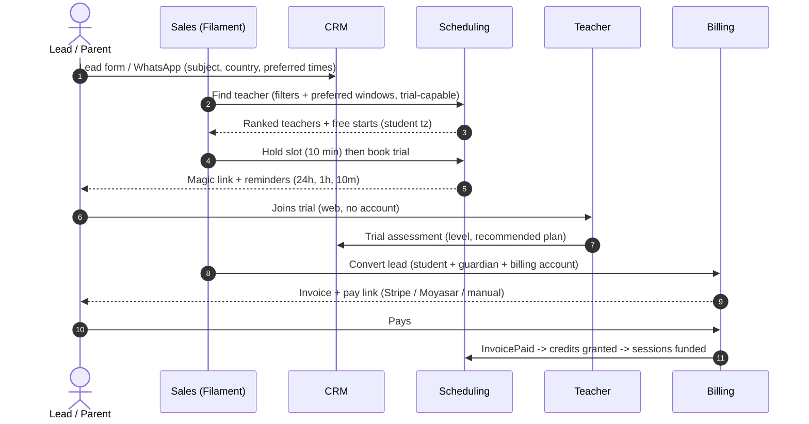
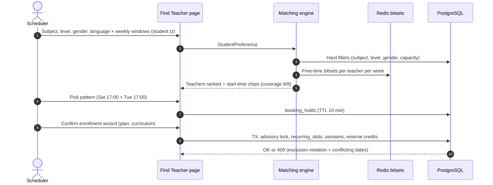
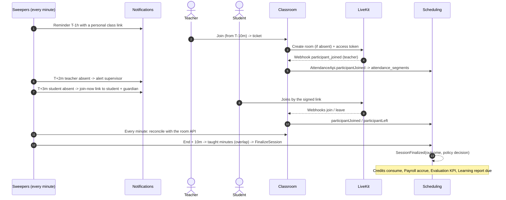
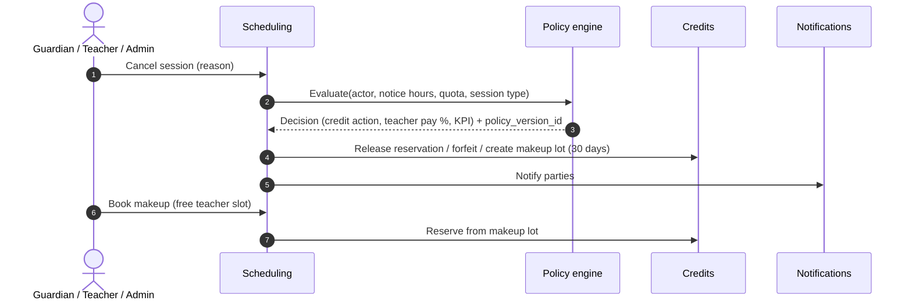
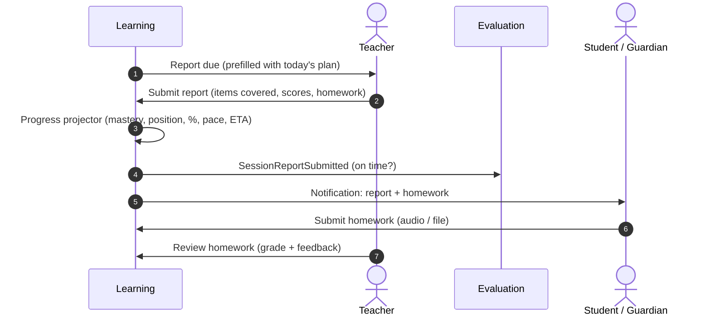
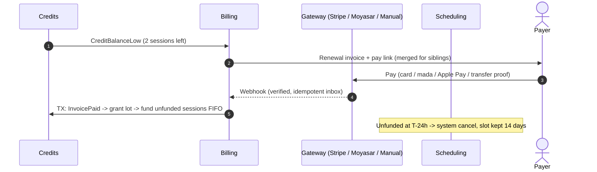
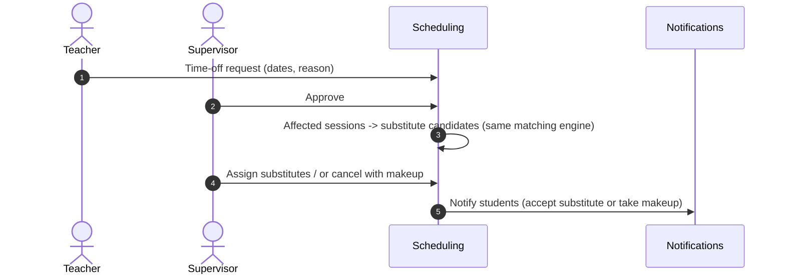
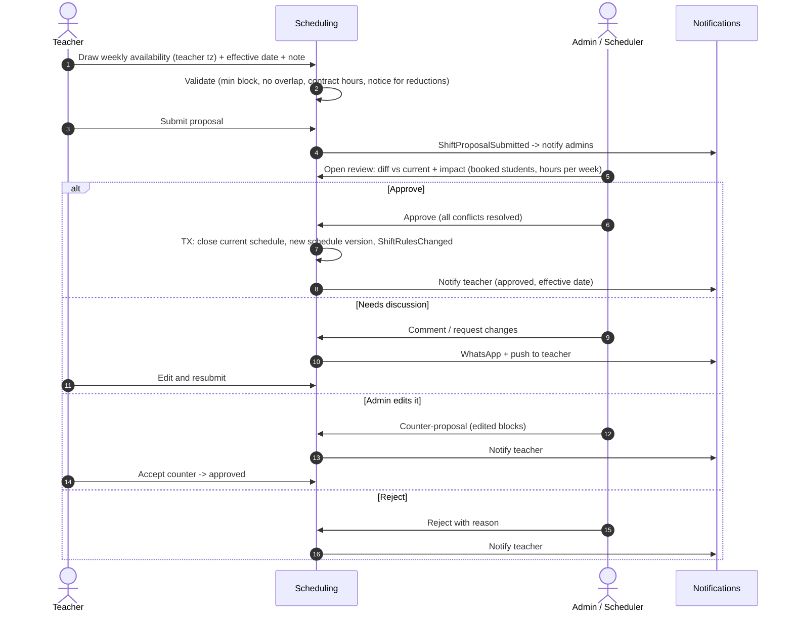

# 01 — الميزات والأدوار والتدفقات

[← الفهرس](README.md)

العلامات قدام كل ميزة بتوضح مرحلة تنفيذها، والتفاصيل في [05-roadmap.md](05-roadmap.md):
- **MVP**: الإطلاق الأول (أول 3–4 شهور).
- **P2**: من الشهر الخامس للتامن.
- **P3**: من الشهر التاسع للرابع عشر.

---

## الأدوار والصلاحيات

### الأدوار

| الدور | المستوى | الوصف |
|---|---|---|
| **Super Admin** | المنصة | فريق المنصة: يدير الأكاديميات وباقات الـ SaaS والدعم الفني. يقدر يدخل بحساب أي مستخدم (impersonation)، والدخول ده متسجل |
| **Owner (مالك الأكاديمية)** | الأكاديمية | كل صلاحيات الأكاديمية، ومنها بوابات الدفع والسياسات والضرايب |
| **Admin (مدير)** | الأكاديمية | التشغيل اليومي كله، ماعدا إعدادات الملكية والفوترة الحساسة |
| **Supervisor (مشرف جودة)** | الأكاديمية | متابعة المدرسين: يدخل الحصص من غير ما يظهر، ويراجع التقارير، ويقيّم الجودة بـ rubric |
| **Scheduler (منسّق جداول)** | الأكاديمية | يحط الشفتات، ويدوّر على مدرسين، ويحجز ويلغي ويعيد الجدولة |
| **Accountant (محاسب)** | الأكاديمية | الفواتير والمدفوعات والمرتجعات ومرتبات المدرسين |
| **Sales / Support (مبيعات ودعم)** | الأكاديمية | الـ leads والحصص التجريبية والتذاكر |
| **Teacher (مدرس)** | الأكاديمية | **يقترح شفتاته (أوقاته المتاحة)**، وجدوله، والفصل، والتقارير، والواجبات، وأرباحه، ومؤشرات أدائه |
| **Student (طالب)** | الأكاديمية | حصصه، والـ roadmap، والواجبات، والتقارير. لو بالغ ممكن يكون هو اللي بيدفع |
| **Guardian (ولي أمر)** | الأكاديمية | يتابع كل أولاده، ويدفع لهم، ويدير حسابات الصغيرين منهم |

في الـ MVP الأدوار **ثابتة**. الأدوار المخصصة لكل أكاديمية في P3.

### مصفوفة الصلاحيات

✓ كامل · ◐ محدود أو على بياناته فقط · — مالوش صلاحية

| القدرة | Super Admin | Owner | Admin | Supervisor | Scheduler | Accountant | Sales | Teacher | Student | Guardian |
|---|---|---|---|---|---|---|---|---|---|---|
| إدارة الأكاديميات وباقات SaaS | ✓ | — | — | — | — | — | — | — | — | — |
| إعدادات الأكاديمية والبوابات والسياسات | ◐ | ✓ | ◐ | — | — | — | — | — | — | — |
| المدرسين والشفتات (واعتماد مقترحات الشفتات) | — | ✓ | ✓ | ◐ | ✓ | — | — | ◐ يقترح شفتاته ويتابع حالتها | — | — |
| البحث عن مدرس والحجز | — | ✓ | ✓ | — | ✓ | — | ◐ تجريبي | — | — | — |
| الإلغاء وإعادة الجدولة | — | ✓ | ✓ | — | ✓ | — | ◐ تجريبي | ◐ حسب السياسة | ◐ حسب السياسة | ◐ حسب السياسة |
| دخول الفصل المباشر | — | — | ◐ | ◐ مخفي | ◐ | — | — | ✓ | ✓ | ◐ مكان ابنه (المتابع المنفصل P2) |
| التقارير والواجبات | — | ✓ | ✓ | ◐ مراجعة | — | — | — | ✓ يكتب | ◐ يشوف ويسلّم | ◐ يشوف |
| المنهج | — | ✓ | ✓ | ✓ مراجعة | — | — | — | ◐ مسودات واقتراحات | ◐ الـ roadmap | ◐ الـ roadmap |
| التقييم ومراجعة الجودة | — | ✓ | ✓ | ✓ | — | — | — | ◐ مؤشراته واعتراض | ◐ تقييم الحصة | ◐ تقييم الحصة |
| الفواتير والمدفوعات | ◐ | ✓ | ◐ | — | — | ✓ | — | — | ◐ لو هو اللي بيدفع | ◐ فواتيره |
| مرتبات المدرسين | — | ✓ | — | — | — | ✓ | — | ◐ كشف حسابه | — | — |
| CRM والتجارب | — | ✓ | ✓ | — | ◐ | — | ✓ | ◐ تقييم التجربة | — | — |
| الدخول بحساب مستخدم تاني | ✓ مع تسجيل | ◐ | ◐ | — | — | — | — | — | — | — |
| لوحات التحليلات | ◐ المنصة | ✓ | ✓ | ◐ الجودة | ◐ الإشغال | ◐ المالية | ◐ القمع | — | — | — |

الصلاحيات بتتنفّذ بـ Laravel Policies. والـ RLS بيضمن إن مفيش حد يشوف بيانات أكاديمية تانية، حتى لو فيه bug في الـ Policy.

---

## كتالوج الميزات

### 1. المنصة وSaaS
- **MVP**
  - إنشاء أكاديمية: الاسم بالعربي والإنجليزي، والـ subdomain (`{slug}.platform.com`)، والتوقيت الافتراضي، والعملة الأساسية، والدولة، واللغة.
  - الـ branding (شاشة **الإعدادات › الهوية والألوان**، للمالك والمدير):
    - الاسم بالعربي والإنجليزي، واللوجو، وأيقونة المتصفح.
    - **قوالب جاهزة** (النور، والسماء، والبنفسج، والرمال، والحبر). كل قالب فيه 4 ألوان ليها استخدام ثابت (أساسي، وتنبيه، وخطر، ومعلومات)، ودرجة الرمادي، وخط العناوين وخط النصوص من قائمة خطوط عربية، وشكل الحواف.
    - **قالب مخصص**: تعدّل أي لون أو خط وتشوف معاينة حية، وبعدين تطبّق، أو **تحفظه كقالب باسمك**، أو تحدّث قالبك المحفوظ. الشاشة بتنبّه لو اللون فاتح على النص الأبيض (تباين أقل من 4.5).
    - بيتطبق على Filament دلوقتي، وعلى البوابة والإيميلات والتطبيق عن طريق `GET /api/v1/branding` (من غير تسجيل دخول، عشان شاشة الدخول نفسها تتلوّن).
  - باقات SaaS للأكاديميات، بحدود (عدد المدرسين، وعدد الطلاب النشطين، ودقائق الفيديو، والتخزين) وميزات بتتفتح وتتقفل بـ Laravel Pennant.
  - لوحة Super Admin: الأكاديميات، والاستخدام، وإيقاف أكاديمية، والدخول بحساب مستخدم مع تسجيله.
  - أكاديمية تجريبية بيانات وهمية للعروض.
- **P2**: تصدير كل بيانات الأكاديمية (عشان الاشتراك والخروج من المنصة)، ومواقع عامة لكل أكاديمية فيها نموذج lead.
- **P3**
  - تسجيل الأكاديمية لنفسها وفوترة SaaS تلقائية.
  - دومين خاص لكل أكاديمية (Cloudflare for SaaS).
  - تطبيقات white-label باسم كل أكاديمية.
  - Cells إقليمية.

### 2. الهوية والحسابات
- **MVP**
  - الدخول بالإيميل أو الموبايل + OTP، أو بكلمة سر، وGoogle وApple Sign-in.
  - 2FA إجباري للـ Super Admin والـ Owner والـ Admin.
  - حسابات الأطفال: ولي الأمر بيديرها، من غير إيميل (username أو PIN)، مع **تسجيل موافقته** (consent). وولي الأمر يقدر يتنقل بين حسابات أولاده.
  - **أكتر من حساب على نفس الجهاز**: نفس الشخص ممكن يبقى ولي أمر في أكاديميتين، فيقدر يتنقل بينهم.
  - **اكتشاف الحسابات بعد التحقق**: يكتب الإيميل أو الموبايل، ويأكد بـ OTP، وبعدها بس يشوف حساباته في كل الأكاديميات.
  - إدارة الأجهزة: قائمة الأجهزة، وتسجيل الخروج عن بعد، وإجبار على تحديث التطبيق.
  - سجل مراجعة (audit log) لكل عملية حساسة.
- **P3**: أدوار مخصصة لكل أكاديمية، وSSO للمؤسسات.

### 3. المواد والمستويات والتصنيفات
- **MVP**
  - المواد بالعربي والإنجليزي، وكل مادة ليها مستويات بترتيب، وقالب تقرير افتراضي.
  - **تصنيفات** مرنة: الفئة العمرية، والمسار (حفظ، تجويد، تأسيس، محادثة)، واللهجة، والمنهج الدراسي (بريطاني، أمريكي، سعودي).
- **P2**: ربط المادة بأكتر من برنامج منهج.

### 4. الباقات والأسعار
- **MVP**
  - الباقة = مدة الحصة (30/45/60 دقيقة) × عدد الحصص في البلوك، وعدد الحصص في الأسبوع.
  - التجديد بالبلوك.
  - **مناطق سعرية** (الخليج، أوروبا، أمريكا، مصر)، ولكل منطقة عملتها وسعرها. شامل الضريبة أو لأ، حسب إعدادات الأكاديمية.
  - كوبونات وخصم الإخوات (من الاشتراك التاني وانت طالع).
  - باقة "رصيد مشترك": مثلًا 12 حصة في أي مادة.
  - إضافة دقائق لما الطالب يحتاج حصص زيادة.
- **المنفّذ دلوقتي: الدفع الإلكتروني.** الأكاديمية هي التاجر، والفلوس بتروح على حساباتها هي في البوابات على طول:
  - **البوابات**:
    - **Stripe**: كارت وApple Pay وGoogle Pay، بأغلب العملات.
    - **Moyasar**: مدى والكارت وApple Pay وSTC Pay، بالريال.
    - **Tap**: KNET وBENEFIT ومدى والكارت، بعملات الخليج، والدينار بـ 3 خانات عشرية.
    - **بوابة تجريبية** بصفحة خاصة بيها، عشان تجرّب الرحلة كلها من غير مفاتيح. مابتظهرش في الإنتاج.
  - **شاشة "الدفع الإلكتروني"** للمالك والمحاسب:
    - تضيف حساب البوابة بمفاتيحه، وتختار وضع تجربة أو حقيقي، والعملات اللي ياخدها.
    - كل حساب ليه رابط webhook خاص بيه تنسخه، ومعاه شرح للإعداد في كل بوابة، وزرار يختبر المفاتيح.
    - إزاي الناس يدفعوا يدوي (رقم الحساب، أو InstaPay، أو المحفظة).
    - آخر محاولات الدفع.
  - **المفاتيح بتتحفظ متشفرة ومابتظهرش تاني.** الخانة اللي بتتساب فاضية بتسيب المفتاح المحفوظ زي ما هو. ومفتاح التجربة مابيتقبلش على حساب حقيقي، والعكس.
  - **لينك دفع لكل فاتورة** في رسالتها، خاص باللي بيدفع وموقّع، فبيفتح من غير تسجيل دخول:
    - بيفتح على صفحة بشكل الأكاديمية فيها الفاتورة، وزرار لكل طريقة دفع متاحة لعملتها، وطريقة الدفع اليدوي.
    - بعد الدفع بيرجع لنفس الصفحة، ويبان عليها "وصلنا الدفع".
    - الإدارة كمان تقدر تنسخ اللينك من صفحة الفاتورة.
  - **"ادفع دلوقتي"** في صفحة الرصيد والفواتير عند ولي الأمر:
    - لو فيه أكتر من طريقة، بيختار منهم.
    - بعد الدفع بيرجع لحسابه ومعاه النتيجة، والصفحة بتتحدّث لوحدها أول ما البوابة تأكد الدفع.
  - **الدفع مابيتسجلش غير لما البوابة نفسها تقول إنه اتدفع.** ده بيحصل في رجوع العميل، وفي الـ webhook، وفي فحص كل 5 دقايق للمحاولات اللي الـ webhook بتاعها ضاع.
  - **كل دفعة بتتسجل مرة واحدة بس.** كل webhook بيتحفظ مرة واحدة، وكل محاولة دفع ليها دفعة واحدة بس، وقاعدة البيانات نفسها بتمنع التكرار.
  - لو الفلوس وصلت لفاتورة كانت اتدفعت بطريقة تانية، أو المبلغ مختلف، المحاولة بتتعلّم "محتاجة استرداد"، ومفيش حاجة بتتسجل مرتين.
  - **لسه**: الكروت المحفوظة والتجديد التلقائي، والاسترداد من البوابة، وStripe Connect (حساب الأكاديمية يتربط بالمنصة)، وPaymob وPayPal، والتشفير بـ KMS.
- **P2**
  - تجديد تلقائي بكارت محفوظ، ومتابعة الدفع اللي فشل (dunning).
  - التجديد الشهري (period) كخيار تاني.
  - ترحيل جزء من الرصيد اللي ماخلصش (rollover).
  - برنامج إحالة.

### 5. المدرسين والشفتات
- **MVP**
  - ملف المدرس: الجنس، واللهجة، واللغات، والفئات العمرية، والمواد بنطاق المستويات (من–إلى)، والتصنيفات، والحد الأقصى من الدقائق في الأسبوع ومن الحصص في اليوم.
  - **بيقبل طلاب جدد؟** **بيقبل حصص تجريبية؟**
  - **جدول الشفتات**: قواعد أسبوعية (اليوم، ووقت البداية المحلي، والمدة، وتوقيت المدرس). ليه **نسخ**، وكل نسخة ليها تاريخ سريان، وكل تعديل متسجل.
  - **المدرس يقترح شفتاته بنفسه** (الوضع الافتراضي، والأكاديمية تقدر تخلي الإدارة بس هي اللي تحط الشفتات):
    - المدرس بيرسم أوقاته المتاحة على شبكة أسبوعية في التطبيق أو الويب، ويحدد من إمتى تبدأ، ويكتب ملاحظة لو عايز، ويبعت المقترح.
    - **الإدارة بتراجع** المقترح على شاشة فيها مقارنة بين الجدول الحالي والجديد، و**أثر التغيير** على الطلاب المحجوزين والساعات في الأسبوع. بعدها الإدارة:
      - توافق.
      - أو ترفض بسبب.
      - أو تطلب تعديل.
      - أو **تعدّل بنفسها وتبعت للمدرس عرض مضاد**.
    - **التواصل** بيحصل في محادثة خاصة بالمقترح، ومعاها إشعارات WhatsApp وPush.
    - الجدول الجديد مابيسريش غير بعد موافقة الطرفين.
    - **تقليل الساعات** محتاج إشعار مسبق (14 يوم افتراضيًا).
    - **الاعتماد بيتمنع** لو فيه طلاب محجوزين برّه الشفت الجديد، لحد ما الإدارة تحل كل تعارض: تنقل الطالب، أو تسيب الموعد استثناء، أو تأخر تاريخ البداية.
    - التفاصيل في [02 › مصدر الشفتات](02-domain-rules.md#مصدر-الشفتات-اقتراح-المدرس-واعتماد-الإدارة).
  - تعديل الشفت مابيمسحش الحصص المحجوزة أبدًا. النظام بيطلع **تقرير تعارضات** لازم يتحل الأول.
  - **إجازات المدرسين**: المدرس يطلب، والمشرف يوافق أو يرفض، والنظام يقترح مدرس بديل للحصص اللي في الفترة دي.
  - إجازات الأكاديمية والعطلات الرسمية (العيدين، اليوم الوطني)، بتلغي الحصص بالجملة حسب السياسة.
  - لوحة المدرس: جدوله بتوقيته، ومعاه توقيت كل طالب.
  - **المنفّذ دلوقتي في منطقة المدرس على الويب** (`/teach`):
    - **حصصي النهارده**، و**جدولي** (أسبوع بأسبوع بتوقيته، وعدد الحصص والساعات).
    - **طلابي**: كل طالب، ووصل فين في المنهج، وآخر تقرير، والواجبات اللي مستنية تصحيح. ولكل طالب صفحة فيها الـ roadmap وتقاريره، ومعاها الملاحظات الداخلية.
    - **تقاريري**، و**الواجبات**.
    - **أوقاتي المتاحة**: الجدول الحالي، واقتراح أوقات جديدة بتاريخ بداية. المدرس يقدر يحفظ مسودة أو يبعتها للإدارة. وفيه رد على تعليقات الإدارة، وقبول العرض المضاد، وسحب المقترح، بنفس Actions الـ API بتاع التطبيق.
- **P2**
  - **تعيين المدرسين**: طلب التقديم، وحصة تجريبية قدام لجنة، والمستندات (الهوية، والفيش الجنائي، والعقد).
  - وضع رمضان: إزاحة جدول الأكاديمية كله في فترة معينة.
  - **جولات جمع التوافر**: الإدارة تطلب من كل المدرسين يبعتوا جداولهم لفترة جاية (رمضان، ترم جديد، الصيف) قبل ميعاد معين، وتتابع مين بعت ومين لأ.
  - **اعتماد تلقائي لزيادة الساعات**: لو المقترح بيزوّد وقت بس، يتعتمد لوحده. أي تقليل أو تغيير يفضل محتاج موافقة.

### 6. الطلاب وأولياء الأمور
- **MVP**
  - ملف الطالب: تاريخ الميلاد، والجنس، والدولة، والتوقيت، والصف الدراسي، و**تفضيل جنس المدرس** (لازم / يفضّل / مش فارقة).
  - **ولي الأمر ← كذا ابن**: كل علاقة فيها نوع القرابة، وهل هو ولي الأمر الأساسي، وهل يقدر يدير الحساب، وهل يستلم التقارير.
  - **حساب دفع واحد للعيلة**: ولي الأمر بيدفع لكل أولاده، والفواتير اللي ميعادها قريب من بعض بتتجمع في فاتورة واحدة.
  - لوحة ولي الأمر: جدول كل الأولاد، والحضور، والتقارير، والواجبات، والتقدم في الـ roadmap، والفواتير.
  - تقييم الحصة بضغطة واحدة (من الطالب أو ولي الأمر).
  - **المنفّذ دلوقتي: "حسابي" على الويب** (`/my`) للطالب وولي الأمر، بشكل الأكاديمية، ومعمول للموبايل الأول:
    - **ولي الأمر بيتنقّل بين أولاده** من شريط فوق كل صفحة. الطالب بيشوف حسابه هو بس.
    - **الرئيسية**: الحصص الجاية وزرار "ادخل الحصة" لما الفصل يفتح، والتقدم في كل مادة، والواجبات المطلوبة، وآخر تقرير، والحصص الباقية في الرصيد، والمبلغ المطلوب.
    - **الحصص**: الجاية والقديمة بتوقيت اللي فاتح الصفحة.
      - **إلغاء الحصة حسب السياسة**: قبل التأكيد بيقوله النتيجة بكلام بسيط (ترجع للرصيد / هتتحسب عليك لأن الإلغاء متأخر أو لأن الإلغاءات المسموحة خلصت / تجريبية / تعويضية)، من غير أجر المدرس ولا المؤشرات.
      - تغيير الميعاد لسه بيتعمل عن طريق الأكاديمية.
    - **التقدم**: الـ roadmap، والنسبة، و"انت هنا"، والوقت المتوقع للإنهاء.
    - **التقارير**: من غير الملاحظات الداخلية.
    - **الواجبات**: التسليم بالكتابة، أو ملف، أو **تسجيل صوتي من المتصفح نفسه** (تلاوة أو قراءة)، ومعاها التصحيح والدرجة.
    - **الرصيد والفواتير**: الحصص الباقية لكل مادة. واللي بيدفع بيشوف فواتيره والمبلغ المطلوب منه.
    - **إعداداتي**: اللغة، والتوقيت، والإشعارات. والجرس بيتحدث لحظيًا.
  - **المنفّذ دلوقتي: شكل لكل مرحلة عمرية.** حساب الطالب نفسه بياخد شكل مرحلته. المرحلة بتتحدد من تاريخ الميلاد، والأكاديمية تقدر تختارها بنفسها من حساب الطالب (زرار "السن وشكل الحساب"). ولي الأمر والكبار بيفضل عندهم الشكل العادي.
    - **أطفال (أقل من 12)**:
      - الرئيسية **خريطة مغامرة**: كل مستوى جزيرة، وكل درس محطة على طريق متعرّج.
      - المحطات: ⭐ للدرس اللي اتقنه، و**"انت هنا!"** على علامته هو، و↻ للدرس اللي محتاج مراجعة، والرمادي لسه جاي، وفي آخر الجزيرة كنز 🎁.
      - عدد النجوم، وعدد الحصص ورا بعض، والمحطة الجاية، والواجب. والكلام بسيط ومشجّع.
      - الخط Baloo Bhaijaan 2، والكروت مدوّرة، والأزرار كبيرة وباينة إنها بتتداس.
      - **شريط تبويب تحت على الموبايل** فيه تلات حاجات بس: رحلتي، وحصصي، وواجباتي. التقارير والفلوس مش ظاهرة للطفل، ومايقدرش يلغي حصة بنفسه: ولي أمره هو اللي بيلغي.
    - **إعدادي (12–14)**:
      - شكل لعبة: كل مستوى **"عالم"**، وكل درس **"مرحلة"**، والمراحل متوصّلة ببعض، ومعاها "انت هنا".
      - **نقط ورتبة**: مبتدئ ← مستكشف ← نجم ← بطل ← أسطورة. ومعاها شريط لحد الرتبة الجاية.
      - النقط بتيجي كده: الدرس اللي اتقنه 100، والحصة اللي حضرها 20، والواجب اللي سلّمه في ميعاده 30.
      - 🔥 عدد الحصص ورا بعض، و**شارات**: المكسوبة ملوّنة، واللي لسه مقفولة بيتكتب جنبها إزاي تتكسب.
      - الخط Rubik.
    - **ثانوي (15–18)**:
      - شكل **خطة مذاكرة** هادية: مراحل البرنامج على خط زمني، والنسبة مقسومة على المستويات.
      - **الهدف**: "على السرعة دي هتخلّص حوالي <تاريخ>"، والسرعة، والوقت المتوقع للمرحلة الحالية.
      - أول 3 دروس جاية، واللي محتاج مراجعة، والأرقام (اللي اتقنه، والحضور، والواجبات في ميعادها، والحضور المتتالي).
      - الخط IBM Plex Sans Arabic.
    - **الأرقام كلها حقيقية**: جاية من التقارير والواجبات، والغياب بيصفّر عدد الحصص ورا بعض. والألوان ألوان الأكاديمية نفسها.
    - **الخطوط محفوظة على السيرفر بتاعنا**، فمفيش أي جهة تانية تعرف مين الأطفال اللي بيستخدموا الموقع.
    - الفلوس مش ظاهرة للطالب إلا لو هو اللي بيدفع.
    - **حركة لكل مرحلة**:
      - **الأطفال**: الطريق بيترسم، والمحطات بتطلع ورا بعض (النجوم بتلف وهي داخلة)، وعلامة الطفل بتنزل وتتنطط، والكنز بيتهز كل شوية، وعدد النجوم بيعدّ. ولما ياخد نجمة جديدة بيطلع احتفال (confetti) ومعاه كلمة تشجيع.
      - **الإعدادي**: كارت اللاعب بيدخل، وبار النقط بيتملي وعليه لمعة، والنقط والأرقام بتعدّ، والدايرة بتتملي، والمراحل بتطلع ورا بعض والخطوط بينها بتترسم، والشارات بتتقلب وهي داخلة. ولما ياخد رتبة أو شارة جديدة بيطلع احتفال.
      - **الثانوي**: حركة هادية: المراحل والخط الزمني بيتملوا ورا بعض، والأرقام بتعدّ.
  - **حركة في كل الشاشات** (الإدارة والمدرس وولي الأمر):
    - الصفحة بتدخل بنعومة، والكروت بتطلع ورا بعض، والبارات بتتملي.
    - الأزرار بتتداس، والكروت اللي بتتفتح بتترفع شوية لما الماوس يعدّي عليها، وشريط التحميل فوق بلون الأكاديمية.
    - الحركة كلها `transform` و `opacity` بس، فمفيش أي حاجة في الصفحة بتتنطط (CLS = صفر)، ومفيش طلبات زيادة على السيرفر.
    - الحركة بتقف خالص لو الجهاز طالب "تقليل الحركة".
  - **شكل اللوحات نفسها (الإطار)** في اللوحات التلاتة، بألوان الأكاديمية:
    - **القائمة الجانبية كارت لوحدها**: فوقها تحية بالاسم الأول حسب الوقت عند الشخص نفسه (صباح الخير / نهارك سعيد / مساء الخير، وشمس أو قمر)، وتاريخ النهارده. كل أيقونة في خانة صغيرة، ولما الماوس يعدّي على عنصر الصف بيتلوّن والأيقونة بتميل، والصفحة المفتوحة "حبّاية" بلون الأكاديمية وفيها لمعة وهي داخلة. أول ما اللوحة تفتح العناصر بتدخل ورا بعض، وكده برضه كل ما قائمة الموبايل تتفتح. لما القائمة تتطوي بتفضل الأيقونات بس، والقائمة بتفتكر هي كانت نازلة لحد فين.
    - **التنقل بين الصفحات (View Transitions)**: الصفحة القديمة بتطلع لفوق وتختفي، والجديدة بتظهر وهي طالعة، و"الحبّاية" بتتزحلق من العنصر القديم للجديد، في القائمة الجانبية وفي القائمة اللي فوق وفي شريط التابات بتاع الطالب على الموبايل. العنصر اللي اتداس عليه بيرد على طول قبل ما الصفحة توصل.
    - **الشريط اللي فوق** شفاف وفيه blur، وعليه خط رفيع بلون الأكاديمية، وبياخد ظل لما الصفحة تنزل تحته. اسم الأكاديمية مكتوب بتدرّج من لونها.
    - **عنوان كل صفحة** جنبه علامة بلون الأكاديمية. صفوف الجداول بتدخل ورا بعض، والأزرار الملونة فيها لمعة لما الماوس يعدّي عليها.
    - **صفحة الدخول**: ألوان ناعمة بتتحرك في الخلفية، والكارت بيطلع، وجواه اسم الأكاديمية والحقول بيدخلوا ورا بعض.
    - تصميم كل مرحلة دراسية بيفضل هو صاحب الكلمة الأخيرة على شكله. وفيه وضع ليلي (dark mode)، ومفيش أي حاجة بتتنطط في الصفحة (CLS = صفر). المتصفح اللي مابيدعمش View Transitions والجهاز اللي طالب تقليل الحركة بيتنقلوا بين الصفحات عادي من غير حركة.
- **P2**: تقرير شهري (PDF) لولي الأمر، وتنبيه لو الطالب معرّض للانسحاب.

### 7. الجدولة والتوزيع
- **MVP**
  - **شاشة "ابحث عن مدرس"**: فلاتر (المادة، والمستوى، والتصنيف، والجنس، واللغة، والفئة العمرية) + الأوقات اللي الطالب يفضّلها، بتتحدد على شبكة أسبوعية بتوقيت الطالب.
    - النتيجة: مدرسين مترتبين حسب مناسبتهم، ولكل يوم الأوقات المتاحة بتوقيت الطالب، ومدى توافرها على 8 أسابيع.
    - التفاصيل في [02 › المطابقة](02-domain-rules.md#2-التوافر-والمطابقة-matching).
  - **حجز مبدئي** لمدة 10 دقايق، وبعدها خطوات التسجيل (wizard): الباقة، والمواعيد، والمنهج، والدفع.
  - **توليد الحصص تلقائيًا** من المواعيد المتكررة على فترة متحركة (4–8 أسابيع لقدام).
  - تقويم المدرس، وتقويم الطالب، وتقويم الأكاديمية، وفلتر بالمدرس والمادة.
  - **تغيير مدرس التسجيل**: الحصص الجاية بتتنقل للمدرس الجديد بعد التأكد من مفيش تعارض.
  - **مخطِّط التوقيت الصيفي**: تقرير قبلها بـ 45 يوم، وإجراءات جماعية، وإشعارات (التفاصيل في [02](02-domain-rules.md#1-نموذج-الوقت-والمناطق-الزمنية)).
  - **إعادة جدولة جماعية**: لما المدرس يغيب فترة طويلة، أو لما مواعيد الأكاديمية تتغير.
- **P2**
  - **خريطة السعة**: كام مدرس متاح يناسب الفلاتر في كل ساعة من الأسبوع. دي مفيدة للمبيعات والتعيين.
  - قائمة انتظار: طلبات ماليش مدرس مناسب.
  - الطالب يعيد جدولة حصته بنفسه في حدود السياسة.
  - ملفات ICS للتقويم.
- **P3**: الطالب يحجز لنفسه من أوقات المدرسين المتاحة (لو الأكاديمية عايزة كده).

### 8. الإلغاء والتعويض والتجربة والبديل
- **MVP**
  - إلغاء من الطالب أو ولي الأمر أو المدرس أو الإدارة، بسبب لازم يتكتب، ويتطبق عليه **محرك السياسات** (مدة الإشعار، والحد الأقصى في البلوك، ومصير الرصيد، ونسبة أجر المدرس).
  - **إعادة جدولة** (نقل الحصة) غير الإلغاء، وليها حد أقصى.
  - **رصيد تعويض** (makeup lot) صالح 30 يوم، والحصة التعويضية بتتحجز على وقت فاضي عند المدرس.
  - **حصة تجريبية**: مجانية، والـ lead بيدخل بـ magic link من غير حساب، وبعدها المدرس بيقيّم المستوى ويقترح باقة.
  - **مدرس بديل**: لو المدرس غاب أو طلب إجازة، النظام بيقترح بدلاء متاحين. الطالب يقدر يرفض البديل وياخد تعويض.
  - **حالة "تحتاج مراجعة"** للحالات الملتبسة (مشكلة تقنية، أو بيانات حضور ناقصة).
  - **اعتراض** على نتيجة الحصة خلال 48 ساعة.
- الجدول الافتراضي للقواعد في [02 › محرك السياسات](02-domain-rules.md#4-محرك-سياسات-الإلغاء-والتعويض-والغياب).

### 9. الفصل المباشر
- **MVP**
  - فيديو وصوت ومشاركة شاشة على الويب (Next.js) وFlutter (LiveKit).
  - فحص الكاميرا والمايك والشبكة قبل الدخول.
  - صوت بس لو الشبكة ضعيفة.
  - **الحضور بيتسجل تلقائيًا** (مين دخل ومين خرج وإمتى)، والتأخير والغياب بيتحسبوا من غير ما حد يدخلهم.
  - شريط جانبي فيه **خطة اليوم** من المنهج، والواجب اللي فات.
  - تسجيل الحصة بموافقة.
  - **لينك خارجي** (Zoom أو Meet) كخطة بديلة، والحضور بيتسجل يدوي.
  - المشرف يدخل الحصة من غير ما يظهر.
- **المنفّذ دلوقتي**:
  - **صفحة الفصل على الويب** (`/class/{lesson}`) بـ LiveKit:
    - فحص الكاميرا والمايك قبل الدخول، والدخول بالصوت بس.
    - مشاركة الشاشة، وزرار "صوت بس" بيوقف فيديو الطرف التاني لو النت ضعيف، ومؤشر جودة الاتصال.
    - لو النت فصل بيرجع لوحده، ولو حد خرج يقدر يرجع.
    - الصفحة بشعار الأكاديمية ولونها، وبلغة اللي داخل.
  - **الفصل بيفتح قبل الحصة بـ 10 دقايق ويقفل بعد نهايتها بـ 10.** الحصة الملغية أو اللي اتقفلت مابتفتحش.
  - **مين يدخل**:
    - المدرس والطالب.
    - ولي الأمر بيدخل مكان ابنه (من اللينك اللي في رسالته).
    - المشرف بيدخل **مخفي** من زرار "ادخل كمراقب" في العمليات اللحظية، ومايقدرش يبث.
    - أي حد تاني بيشوف صفحة "مش مسموح".
  - **الطالب وولي الأمر من غير تسجيل دخول**: اللينك اللي في رسالة التذكير و"ادخل دلوقتي" لينك موقّع خاص بكل شخص، وصالح للحصة دي بس لحد بعد نهايتها بنص ساعة. المدرس بيدخل من **"حصصي النهارده"** في منطقة المدرس.
  - **الحضور بيتسجل لوحده**:
    - من webhooks بتاعة LiveKit في `attendance_segments` (فترة لكل دخول وخروج).
    - مهمة كل دقيقة بتطابقها مع قايمة اللي في الغرفة، لو webhook ضاع.
    - **الوقت المدرَّس** = تقاطع فترات المدرس مع الطالب جوه وقت الحصة، وده اللي بيحسم "اكتملت" أو "مراجعة".
  - **خطة اليوم** جنب الفيديو للمدرس والمشرف.
  - **لينك خارجي** (Zoom أو Meet) لكل مدرس، والأكاديمية تختار من "إعدادات ← الفصل". في الحالة دي الضغطة على "ادخل" بتتسجل حضور، وبعدها بيتحوّل للينك.
  - من العمليات اللحظية كمان: "ابعت الرابط تاني" للطالب وولي الأمر.
  - التطبيقات بتاخد تذكرة الدخول من `POST /api/v1/lessons/{id}/join`.
  - **لسه**: التسجيل، وتطبيقات Flutter وNext.js، والواجب اللي فات في الشريط الجانبي.
- **P2**: عارض محتوى متزامن (صفحات المصحف أو PDF)، ووضع "متابع" لولي الأمر، وسبورة.
- **P3**: حصص جماعية، وAI لتصحيح التلاوة.

### 10. التقارير والواجبات
- **MVP**
  - **تقرير بعد كل حصة** إجباري، من قالب حسب المادة (JSON Schema بإصدارات).
    - البنود اللي اتغطت من المنهج، ولكل بند: اتقدّم / اتدرّب / اتقن / محتاج مراجعة، وتقييم من 1 لـ 5.
    - تقييم التفاعل، وملاحظات للطالب، وملاحظات داخلية للإدارة.
  - **التقرير ليه ميعاد** (12 ساعة افتراضيًا). التأخير بيتحسب في مؤشرات المدرس.
  - **الواجب**: نص، أو ملفات، أو **تسجيل صوتي** (مهم للقرآن واللغات)، وليه ميعاد تسليم.
    - الطالب بيسلّم، والمدرس بيصحح ويكتب ملاحظاته.
  - الطالب وولي الأمر بيوصلهم إشعار بالتقرير والواجب.
- **P2**: اختبارات أونلاين وبنك أسئلة، و AI يكتب مسودة التقرير من تفريغ الحصة (P3).
- **المنفّذ دلوقتي**: التقرير وملاحظة الغياب، وميعاد 12 ساعة وتعليم المتأخر، ومراجعة المشرف (شاشة "التقارير")، والواجب بالنص أو الملف أو التسجيل الصوتي مع التصحيح بدرجة وتعليق، والـ API للمدرس والطالب وولي الأمر. المدرس بيكتب من **منطقة المدرس** (`/teach`) لحد ما تطبيق الموبايل يتعمل. قالب التقرير لكل مادة (JSON Schema) والإشعارات (Communication) لسه.

### 11. المنهج وخريطة التعلم
- **MVP**
  - برنامج ← مستوى ← وحدة ← درس، وفي كل درس أهداف وموارد (PDF وفيديو وصوت).
  - الإدارة بتنشره.
  - **Roadmap ظاهرة** للطالب وولي الأمر والمدرس: اللي اتقن، والحالي، واللي جاي، ونسبة الإنجاز في كل مستوى.
  - **التقدم بيتحسب تلقائيًا** من تقارير الحصص.
- **P2**
  - **إصدارات** للمنهج: مسودة ← مراجعة ← منشور. المدرسين بيقترحوا والإدارة بتعتمد. التسجيل بيفضل على إصدار واحد ثابت.
  - اختبار تحديد مستوى، واختبار نهاية مستوى، و**شهادات** بصفحة تحقق.
  - **نطاقات القرآن** (آيات وصفحات)، ومراجعة متباعدة (spaced repetition).
  - توقع ميعاد الإنهاء.
- **المنفّذ دلوقتي**: شاشة "المناهج" (برامج ومحتوى ونشر)، والـ roadmap في حساب الطالب وفي الـ API، والتقدم من التقارير، ومعاهم من الـ P2: مراجعة متباعدة بسيطة، وتوقع ميعاد الإنهاء.

### 12. التقييم
- **MVP**: أحداث الأداء (تأخير المدرس، وغيابه، وإلغاؤه المتأخر، وتأخير التقرير، وغياب الطالب، وتأخيره)، ولوحة فيها الالتزام بالمواعيد والغياب وتسليم التقارير في ميعادها.
- **P2**
  - **درجة مركبة للمدرس من 100 وفئات A–D**.
  - مراجعة الجودة بـ rubric على التسجيلات.
  - المدرس يقدر يعترض على أي حدث.
  - **تقييم الطالب**: الحضور، والواجبات، والتفاعل، والتقدم.
  - تقرير شهري وتنبيهات للطلاب المعرّضين للانسحاب.
- المعادلات في [02 › التقييم](02-domain-rules.md#7-التقييم-ومؤشرات-الأداء).

### 13. مرتبات المدرسين
- **MVP**
  - أرباح بتتسجل تلقائيًا من كل حصة اتقفلت، حسب **جدول الأسعار** (بالدقيقة أو بالحصة، حسب المادة ونوع الحصة).
  - تصدير شهري، والمدرس يشوف أرباحه.
- **P2**
  - كشوف حساب شهرية فيها مكافآت وخصومات مربوطة بفئة المدرس.
  - قفل فترة المرتبات.
  - سجل التحويلات.
- **P3**: ربط بأنظمة الدفع للمدرسين والمحاسبة (قيود، وافق، Xero).

### 14. CRM والحصص التجريبية
- **MVP**
  - الـ lead: الاسم، والموبايل، والدولة، والتوقيت، والمصدر (UTM)، والمادة، والأوقات المفضلة.
  - المراحل: جديد ← تم التواصل ← حجز تجريبي ← حضر ← اتقيّم ← اشترك أو اتفقد.
  - حجز التجربة من شاشة "ابحث عن مدرس"، بأولوية للمدرسين اللي بيحوّلوا تجارب أكتر.
  - **تقييم التجربة** من المدرس: المستوى المقترح، والباقة المقترحة، والملاحظات.
  - تحويل الـ lead لطالب (وولي أمر) واشتراك، بضغطة واحدة.
- **P2**: مهام متابعة واستبقاء، وقمع التحويل، ونموذج lead على الموقع العام، وبرنامج إحالة.

### 15. التواصل والإشعارات
- **MVP**
  - القنوات: **WhatsApp** (قوالب معتمدة من Meta)، وPush (FCM/APNs)، وإيميل، وإشعارات داخل التطبيق (Reverb)، وSMS للـ OTP.
  - تذكير قبل الحصة بـ 24 ساعة، وساعة، و10 دقايق.
  - "ادخل دلوقتي": لو الطالب ما دخلش بعد 3 دقايق من البداية، يوصله هو وولي أمره لينك مباشر للحصة.
  - تفضيلات لكل مستخدم: القنوات، والأوقات الهادية.
  - القوالب بالعربي والإنجليزي، والأكاديمية تقدر تعدّلها.
- **المنفّذ دلوقتي**:
  - كل إشعار بيتكتب **بلغة كل شخص وبتوقيته**، وبيتحفظ في صندوق الإشعارات بتاعه (الجرس في لوحة الإدارة ومنطقة المدرس، و`/api/v1/notifications` للتطبيقات). الجرس بيتحدث لحظيًا لما رسالة توصل أو تتقري من جهاز تاني، ومن غير ما يسأل السيرفر كل دقيقة.
  - القنوات: إيميل (Mailpit على الجهاز)، وواتساب (Meta Cloud API بقالب معتمد واحد `academy_notification`)، وPush (FCM HTTP v1). على الجهاز، الواتساب والـ Push بيتكتبوا في الـ log.
  - تذكير قبل الحصة بيوم وبساعة، و**"ادخل دلوقتي"** بعد 3 دقايق للطالب وأولياء أمره حتى في الأوقات الهادية، وتنبيه للمدرس المتأخر بعد دقيقتين وللمشرفين. تذكير الساعة و"ادخل دلوقتي" فيهم **لينك الفصل الخاص بكل شخص**.
  - التقرير والواجب وتصحيحه والإتقان للأسرة، والفاتورة وتأكيد الدفع للي بيدفع، والإلغاء والتأجيل للأسرة والمدرس (من غير اللي عمل التغيير)، ومقترحات الشفتات للمراجعين والمدرس.
  - **التفضيلات**: لكل نوع (الحصص، والتقارير والواجبات، والفواتير، والشغل) يا كل القنوات، يا من غير واتساب، يا داخل التطبيق بس. ومعاها **الأوقات الهادية** بتوقيت الشخص. بتظهر في "إعداداتي" وفي الـ API.
  - **القوالب**: الأكاديمية تعدّل صيغة أي رسالة بالعربي والإنجليزي، بالمتغيرات المسموحة بس، وتقدر ترجع للأصل. وتقفل أو تفتح كل قناة.
  - **سجل الرسائل**: كل رسالة لكل شخص وحصلها إيه في كل قناة، وإعادة إرسال اللي فشل.
  - لسه: SMS للـ OTP، ورقم واتساب خاص بكل أكاديمية، والإشعارات اللحظية بـ Reverb، والإعلانات.
- **P2**
  - **محادثة مراقبة** بين المدرس والطالب، وولي الأمر بيكون فيها افتراضيًا. **أرقام التليفون واللينكات بتتخفي تلقائيًا**، عشان المدرس مايسحبش الطالب برّه المنصة.
  - إعلانات من الأكاديمية.

### 16. الدعم والشكاوى
- **MVP**: تذاكر دعم (شكوى، فوترة، تقني) مربوطة بالحصة، ولها أولوية ومسؤول وميعاد رد (SLA). الشكوى بعد ما تتأكد بتأثر على تقييم المدرس.
- **P2**: زرار "الإبلاغ عن مشكلة" في الفصل، والإبلاغ عن مخاوف تخص سلامة الأطفال.

### 17. لوحات المؤشرات والتحليلات
- **MVP**
  - **لوحة العمليات اللحظية**: حصص النهارده، ومين دخل ومين ما دخلش، وتنبيه للمشرف لو المدرس ما دخلش بعد دقيقتين.
    - **بتتحدث لحظيًا**: أي تغيير (دخول، أو خروج، أو إلغاء، أو قرار من مشرف تاني) بيظهر في أقل من ثانية من غير ما حد يعمل refresh. وكمان بتتحدث في اللحظة اللي الوقت بيغيّر فيها حاجة (بداية حصة، أو تأخير مدرس). ولو مفيش تغيير، مابتطلبش حاجة من السيرفر خالص. ولو الاتصال اللحظي وقع، بترجع تتحدث كل 30 ثانية وتكتب كده.
    - شكلين، وكل مستخدم يختار من الشاشة نفسها أو من **إعداداتي**، والاختيار بيتحفظ لحسابه: **جدول** (كل الحصص في قائمة واحدة بفلاتر، والمشاكل فوق)، و**التدخّل أولًا** (المشاكل مرتبة بالوقت الفاضل قبل ما النظام يتصرف لوحده، والتفاصيل في لوحة جانبية).
    - كل مشكلة ليها إجراء موصى بيه وإجراء تاني، وكل إجراء بيتسجل في سجل الحصة: تواصل مع المدرس أو ولي الأمر ونتيجته، وإلغاء بتعويض، وتسجيل غياب الطالب، ومدّ الحصة، وتحويلها للمراجعة، والسماح بحصة غير مدفوعة كاستثناء.
  - إيرادات بسيطة، والحصص حسب حالتها.
- **P2**
  - الإيراد الشهري المتكرر (MRR) ونسبة الانسحاب (churn).
  - إشغال المدرسين: الساعات المحجوزة ÷ ساعات الشفت.
  - تحويل الحصص التجريبية، والحضور، والاستبقاء حسب المدرس.

---

## الميزات المضافة من منظور الخبرة

دي ميزات ما اتطلبتش صراحة، بس من غيرها الأكاديمية الأونلاين بتخسر فلوس أو بتتعب في التشغيل:

| # | الميزة | المرحلة | ليه ضرورية |
|---|---|---|---|
| 1 | **لوحة العمليات اللحظية** + تنبيهات "ادخل دلوقتي" | MVP | الغياب أكبر سبب لخسارة الإيراد، وتنبيه بعد 3 دقايق بيرجّع جزء كبير منه |
| 2 | **مخطِّط التوقيت الصيفي** + إجازات الأكاديمية + إعادة جدولة جماعية | MVP | أول تغييرات DST (مارس وأبريل 2027) ورمضان جايين بعد الإطلاق على طول |
| 3 | **الدفع اليدوي** (تحويل بنكي، InstaPay، محافظ) برفع إثبات واعتماده | MVP | طريقة دفع منتشرة جدًا في السوق |
| 4 | **WhatsApp** كقناة أساسية | MVP | الإيميل تقريبًا محدش بيقراه في الخليج ومصر |
| 5 | **استيراد من CSV/Excel** (المدرسين، والطلاب، وأولياء الأمور، والجداول) | MVP | الأكاديميات جاية من شغل على شيتات |
| 6 | إجازات المدرسين + مدرس بديل | MVP | من غيرها مفيش طريقة نتعامل بيها مع غياب المدرسين |
| 6ب | **تحليل أثر تعديل الشفتات** قبل اعتماده، + عرض مضاد من الإدارة، + جولات جمع التوافر | MVP / P2 | لو الشفت اتعدّل من غير ما نشوف أثره، مواعيد طلاب شغالين بتبوظ. والجولات بتخلي جدول رمضان والترم الجديد يتجهز بدري |
| 7 | الدخول بحساب مستخدم + سجل مراجعة كامل | MVP | الدعم الفني وحل النزاعات |
| 8 | حسابات أطفال يديرها ولي الأمر + تسجيل الموافقة | MVP | قوانين حماية بيانات الأطفال (COPPA وGDPR-K) |
| 9 | تقييم الحصة بضغطة واحدة | MVP | تكلفته صغيرة، وبيغذّي تقييم المدرسين |
| 10 | حدود باقة SaaS وميزاتها لكل أكاديمية | MVP | من غيرها ماينفعش نبيع باقات SaaS |
| 11 | حصة تجريبية بـ magic link | MVP | كل خطوة إضافية بتقلل التحويل |
| 12 | إجبار تحديث التطبيق + إعدادات عن بعد (remote config) | MVP | السيطرة على نسخ التطبيق عند المستخدمين |
| 13 | المشرف يدخل الحصة من غير ما يظهر + وضع متابع لولي الأمر | MVP / P2 | الجودة وسلامة الأطفال |
| 14 | **إخفاء أرقام التواصل في المحادثة** | P2 | يمنع إن المدرس ياخد الطلاب برّه المنصة، ودي مشكلة معروفة في المجال |
| 15 | وضع رمضان | P2 | أكاديميات القرآن بتغيّر جداولها في رمضان |
| 16 | تقرير شهري + تنبيه لو الطالب معرّض للانسحاب + مهام استبقاء | P2 | تقليل الانسحاب |
| 17 | خريطة السعة + قائمة انتظار | P2 | تخطيط المبيعات وتعيين المدرسين |
| 18 | شهادات وإجازات بصفحة تحقق | P2 | تسويق وثقة |
| 19 | تعيين المدرسين بمستندات (منها الفيش الجنائي) | P2/P3 | سلامة الأطفال، والتوسع |
| 20 | **حصص جماعية**: نموذج البيانات جاهز من دلوقتي (`session_participants`) | P3 | مصدر دخل جديد |
| 21 | **AI**: مسودة تقرير من تفريغ الحصة، وتصحيح التلاوة | P3 | تميّز، ويوفر وقت المدرسين (بموافقة) |

---

## التدفقات الأساسية

### أ. من Lead لحصة تجريبية لاشتراك

### ب. البحث عن مدرس وحجز مواعيد ثابتة

### ج. يوم الحصة

### د. إلغاء ثم حصة تعويضية

### هـ. التقرير وتحديث التقدم

### و. التجديد والدفع

### ز. إجازة المدرس والبديل

### ح. المدرس يقترح شفتاته والإدارة تراجع

