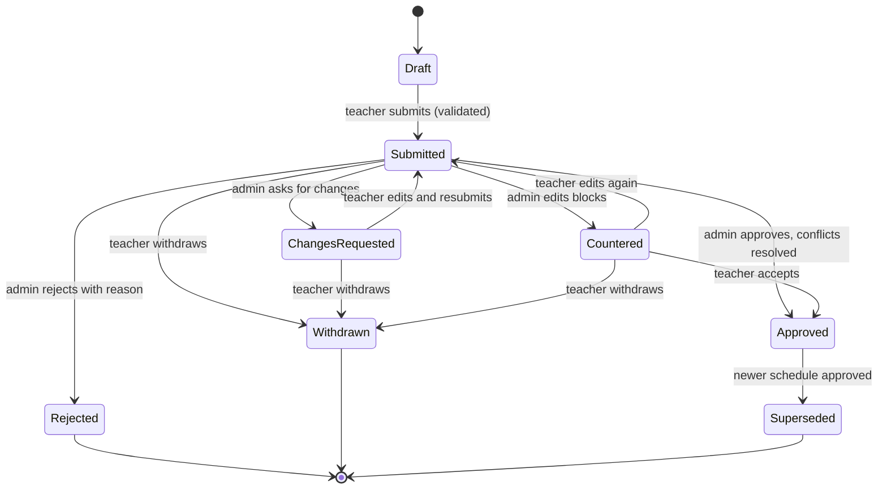
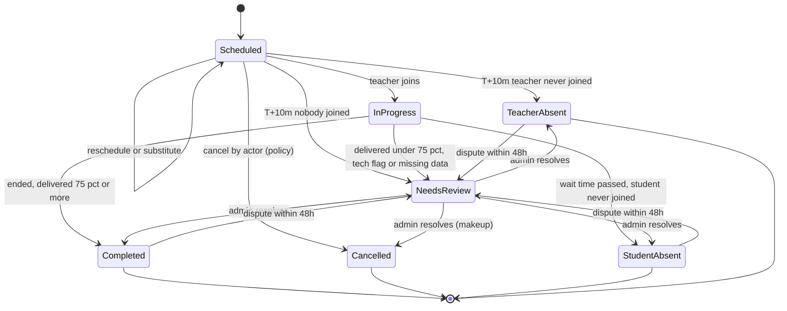
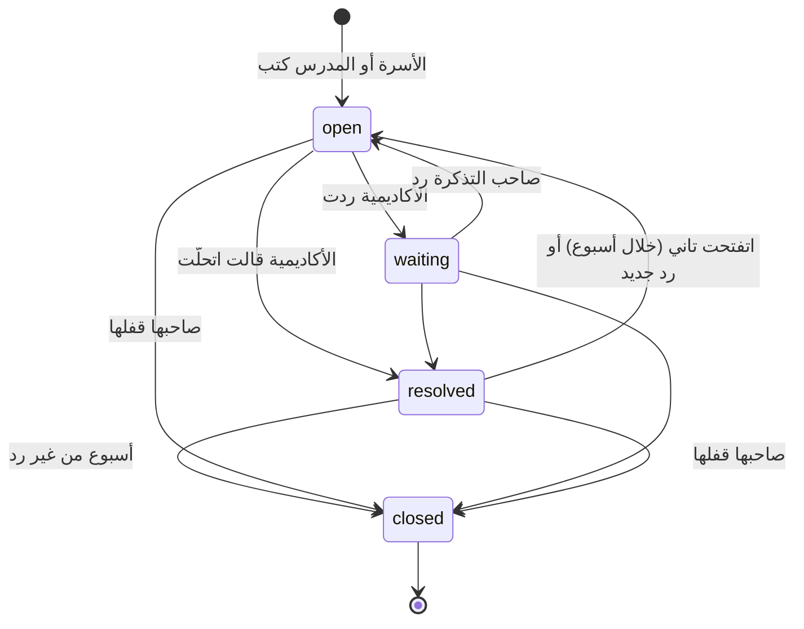

# 02 — قواعد العمل (Domain Rules)

[← الفهرس](README.md)

الملف ده بيوصف **منطق العمل** اللي بيفرق بين أكاديمية شغالة كويس وأكاديمية غرقانة في المشاكل. فيه الوقت، والمطابقة، والرصيد، والسياسات، وحالات الحصة، والمنهج، والتقييم، والمرتبات، والتحديات، وموافقة ولي الأمر، وباقات المنصة.

---

## 1. نموذج الوقت والمناطق الزمنية

### الحقائق اللي بنينا عليها القرار (تواريخ 2027)

| المنطقة | فرق التوقيت | التوقيت الصيفي |
|---|---|---|
| مصر | UTC+2 / +3 | من آخر جمعة في أبريل (**30 أبريل**، الساعة 00:00) لآخر خميس في أكتوبر (**28 أكتوبر**، الساعة 24:00) |
| السعودية، قطر، الكويت، البحرين | +3 | مفيش |
| الإمارات، عُمان | +4 | مفيش |
| أوروبا وبريطانيا | — | آخر أحد في مارس وآخر أحد في أكتوبر (**28 مارس / 31 أكتوبر**) |
| أمريكا | — | **14 مارس / 7 نوفمبر** |
| حالات خاصة | — | الأردن وسوريا على +3 طول السنة من 2022. المغرب بيرجع لـ UTC+0 في رمضان. فلسطين قواعدها بتتغير كتير |

### القرار: الموعد المتكرر بيتثبّت على **توقيت المدرس** افتراضيًا

كل `recurring_slot` عليه `anchor_tz`. الأكاديمية تقدر تغيّر الافتراضي، أو تغيّره لتسجيل معين، ويتثبّت على توقيت الطالب.

**ليه توقيت المدرس؟**
1. المدرسين قليلين ومواعيدهم مزحومة، والطلاب متفرقين على مناطق كتير. لو المواعيد ثابتة على توقيت الطلاب، المدرس اللي في القاهرة وعنده طلاب في الرياض ولندن ونيويورك هيتلخبط جدوله **حوالي 6 مرات في السنة**، وده هيعمل حجوزات مزدوجة لازم تتحل بالإيد.
2. لما كل المواعيد على توقيت المدرس، أنماطها الأسبوعية بتتقارن من غير ما نفكّها لتواريخ. ده بيخلي **قاعدة البيانات نفسها تمنع التعارض** (القسم 2).
3. التكلفة على الطالب: ميعاده بيتحرك ساعة مرتين أو أربعة في السنة، بشكل متوقع، وبنبلّغه قبلها، وبنعرض عليه "خلّي ميعادي بتوقيتي" لو المدرس فاضي.

**مثال**: مدرس عنده حصة **19:00 بتوقيت القاهرة**. ده ميعادها عند الطلاب على مدار 2027:

| الفترة | الرياض | لندن |
|---|---|---|
| 1 يناير – 27 مارس | 20:00 | 17:00 |
| 28 مارس – 29 أبريل | 20:00 | **18:00** |
| 30 أبريل – 28 أكتوبر | **19:00** | 17:00 |
| 29 أكتوبر – 30 أكتوبر | 20:00 | **18:00** |
| من 31 أكتوبر | 20:00 | 17:00 |

### قواعد التخزين

| النوع | طريقة التخزين |
|---|---|
| **لحظات زمنية** (الحصص، والإجازات، والحجوزات المبدئية، والحضور) | `timestamptz` بتوقيت UTC. توقيت قاعدة البيانات وPHP هو UTC، وبنستخدم Carbon immutable |
| **قواعد متكررة** (الشفتات، والمواعيد المتكررة) | `weekday`، و`local_start TIME`، و`duration_min`، و`tz` (اسم IANA زي `Africa/Cairo`)، و`effective daterange` (في الشفتات فترة السريان على نسخة الجدول كلها). **بنخزّن البداية والمدة مش البداية والنهاية**، عشان الحصص اللي بتعدّي نص الليل تشتغل صح |
| **حصة متولّدة من موعد متكرر** | بنخزّن كمان `anchor_tz` و`anchor_local_date` و`anchor_local_time`، عشان نقدر نعيد حساب `starts_at` لو قواعد التوقيت (tzdata) اتغيرت |
| **المستخدم** | `timezone` كاسم IANA، **مش فرق ساعات**. ولو توقيت الجهاز اختلف عن توقيت الحساب (سفر)، بنسأله |
| **إجازات الأكاديمية** | `daterange` محلي + توقيت الأكاديمية |

### الحالات الحساسة
- **ساعة مش موجودة وساعة بتتكرر**: مصر بتغيّر الساعة الساعة 12 بالليل، وده بيأثر على حصص طلاب أمريكا المتأخرة.
  - ساعة 00:00–01:00 يوم جمعة التغيير **مش موجودة**، فالحصة اللي فيها بتتأجل بنفس مقدار الفرق (ساعة).
  - ساعة 23:00–24:00 يوم خميس الرجوع **بتتكرر**، فبناخد أول مرة.
  - الحالتين بيظهروا في تقرير DST.
  - المنطق ده كله في service واحدة اسمها `LocalTimeResolver`، وعليها اختبارات للقاهرة ولندن ونيويورك وسيدني والدار البيضاء.
- **تحديثات tzdata**: الحكومات بتغيّر قواعد التوقيت فجأة؛ مصر أعلنت DST بتاع 2023 قبلها بأسابيع.
  - لازم tzdata يكون محدّث في صورة PHP وPostgres ونظام التشغيل.
  - لما إصدار tzdata يتغير، job بيعيد حساب الحصص الجاية من بياناتها المرجعية ويدوّر على تعارضات.
- **التطبيقات**: بتعرض الوقت بتوقيت الجهاز من نظام التشغيل.
  - لو الشاشة محتاجة توقيت **الطرف التاني** ("الطالب: 18:00 الرياض")، الـ API بيبعته جاهز.
  - مانعتمدش على قاعدة التوقيت اللي جوه Flutter.

### مخطِّط التوقيت الصيفي (DST Transition Planner)
- **job يومي** (`scheduling:dst`، الساعة 01:40) بيبص 45 يوم لقدام.
  - لكل تسجيل، بيحط كل حصة أسبوعية جنب نفس الحصة قبلها بأسبوع، ولو إجازة شالت الأسبوع ده بيبص على اللي قبلها بأسبوعين. المقارنة بتتعمل بتوقيت **الطالب**.
  - لو ساعة الطالب اتغيرت وساعة المدرس ثابتة، يبقى السبب تغيير الساعة. ساعتها بيتسجل صف واحد في `schedule_shift_notices` لكل تسجيل وحصة.
  - الصف فيه: الميعاد قبل وبعد عند الطالب، والفرق بالدقايق، والمنطقة اللي ساعتها اتغيرت، وعدد الحصص المحجوزة.
  - وفيه كمان **لحد إمتى** الفرق ده هيفضل. ده بيتحسب من تغييرات المنطقتين الاتنين، لأول لحظة الفرق بينهم يتغير فيها تاني.
  - الحصص بتتقارن بالوقت، مش بالموعد الأسبوعي، فلو الموعد اتقسم (بنقل أو بمدرس جديد) المتابعة بتكمل عادي.
  - لما يشتغل تاني، بيحدّث اللي لقاه، وبيشيل التغييرات اللي مابقتش هتحصل. اللي الإدارة ثبّتت فيه ميعاد الطالب بيفضل كسجل.
- **شاشة "تغيير التوقيت"** للإدارة: التغييرات متجمّعة حسب تغيير الساعة (المدينة والليلة). كل صف بيوضح:
  - الميعاد قبل وبعد عند الطالب، والميعاد عند المدرس.
  - الفترة، وعدد الحصص.
  - الأسرة اتبلّغت، ولا هتتبلّغ إمتى.
  - المدرس هيبقى فاضي ولا لأ لو ثبّتنا ميعاد الطالب.
- **القرارات**، لصف واحد أو لكذا صف مع بعض:
  - **ثبّت ميعاد المدرس** (الافتراضي): ميعاد الطالب بيتحرك، والأسرة بتتبلّغ.
  - **ثبّت ميعاد الطالب**: ميعاد المدرس بيتحرك عكس الفرق طول الفترة اللي الفرق فيها ثابت، وبعدها بيرجع (`ShiftSlotTimes`، شوف تحت). ده بيحصل بس لو المدرس في شفته وفاضي، والطالب فاضي، في كل الحصص، وإلا بيترفض. والقرار ده نهائي، لأن الحصص بتكون اتنقلت خلاص.
  - لو المدرس مش فاضي، الإدارة تقدر تنقل الطالب لمدرس تاني أو تغيّر ميعاده من حسابه.
- **الإشعارات**:
  - الطالب وولي الأمر بيتبلّغوا قبلها بـ 14 يوم وبيومين (WhatsApp وPush)، والرسالة فيها ميعادهم الجديد بتوقيتهم. التغيير اللي يتعرف متأخر بيتبلّغ مرة واحدة.
  - لو الإدارة ثبّتت ميعاد الطالب بعد ما الأسرة اتبلّغت، بيوصلهم إن ميعادهم مش هيتغير.
  - المدرس بيوصله ميعاده الجديد بتوقيته.
  - صفحة "الحصص" عند الأسرة بتعرض التغيير فوق الحصص في الأسبوعين اللي قبله.
- (P2) ملفات ICS فيها `TZID`، فالتقويم بيظبط نفسه.

### نقل المواعيد لفترة وإعادة الجدولة الجماعية
- `ShiftSlotTimes` بيحرّك مواعيد أسبوعية لنفس المدرس بعدد دقايق، على ساعة المدرس، لفترة معينة:
  - الموعد الأصلي بينتهي قبل الفترة.
  - نسخة متحركة بتغطي الفترة.
  - الموعد الأصلي بيرجع بعدها.
  - المواعيد بتفضل على ساعة المدرس، فالـ exclusion constraint بيفضل يقارن حاجات من نفس النوع.
- الحصص:
  - الحصص المحجوزة في الفترة بتتنقل برصيدها.
  - كل حصص الموعد من أول الفترة بتتبع الموعد الجديد حسب تاريخها. فمفيش حصة بتتولّد مرتين، والحصة الملغية مابترجعش.
  - الحصص اللي بتتنقل مابتتحسبش ضد نفسها.
- **إعادة جدولة جماعية** (`ShiftTeacherLessons`، من شاشة "تغيير التوقيت"، زي مواعيد رمضان):
  - الإدارة بتختار المدرس، ومن يوم لحد يوم بتوقيته، وساعة أو نص ساعة بدري أو متأخر.
  - الشاشة بتقول قبل التنفيذ هيتنقل كام حصة لكام طالب، أو أنهي حصص مش هينفع.
  - النقل يا كله يا مفيش.
  - كل أسرة بيوصلها ميعادها الجديد بتوقيتها، والمدرس بتوصله رسالة واحدة.

---

## 2. التوافر والمطابقة (Matching)

### شاشة "ابحث عن مدرس" (صفحة Filament مخصصة بـ Livewire وAlpine)

**المدخلات**
- الطالب أو الـ lead، والمادة، والمستوى، والتصنيفات، والفئة العمرية.
- جنس المدرس: **لازم / يفضّل / مش فارقة**. ده غالبًا إجباري للطالبات في أكاديميات القرآن.
- لغة الشرح أو اللهجة.
- عدد الحصص في الأسبوع، والمدة، وتاريخ البداية، والفترة (8 أسابيع افتراضيًا).
- توقيت الطالب (بيتملي تلقائيًا).
- **الأوقات المفضلة**: بتتحدد على شبكة 7×24 بتوقيت الطالب.
- الحد الأدنى للتوافر: 8 من 8 أسابيع افتراضيًا، وممكن نقبل 7 من 8.

**المخرجات**
- مدرسين مترتبين، ولكل واحد: فئته، ونسبة إشغاله، ودرجة مناسبته.
- لكل يوم: **الأوقات المتاحة بتوقيت الطالب** في شكل chips.
  - لو وقفت على الـ chip تشوف توقيت المدرس وعدد الأسابيع المتاحة (مثلًا 8/8).
  - لو التوافر ناقص، بتشوف التواريخ اللي فيها تعارض.
- **نمط مقترح** لكل مدرس، مثلًا السبت 17:00 + التلات 17:00.
- لما تختار الـ chips يحصل **حجز مبدئي** (10 دقايق)، وبعده خطوات التسجيل.

### أشكال البيانات

```text
StudentPreference { tz, windows: [{weekday, start_local, end_local}], per_week, duration_min,
                    start_date, horizon_weeks, min_coverage }
TeacherWeekBits   { teacher_id, iso_week_utc, free: bitset(2016) }   // 5-min resolution = 252 bytes/week
MatchResult       { teacher, score, candidates: [{anchor_weekday, anchor_time, student_label,
                    coverage, conflict_dates[]}], suggested_patterns[] }
```

### الخوارزمية
1. **فلاتر أساسية** (SQL في شكل Pipeline من فلاتر):
   - المدرس نشط، وبيقبل طلاب جدد.
   - المادة والمستوى في نطاقه.
   - التصنيف، والجنس، واللغة، والفئة العمرية.
   - **السعة الأسبوعية المتبقية ≥ الدقائق المطلوبة**.
   - العدد بيقل من حوالي 500 مدرس لحوالي 50–150.
2. **Bitset للوقت الفاضي** لكل مدرس في كل أسبوع (UTC):
   `free = shift & ~busy & ~time_off & ~closures & ~holds`
   - الشفتات بتتفك **يوم بيوم** بتوقيت المدرس، فالـ DST بيتحسب صح.
   - `busy` = الحصص المتولّدة + **المواعيد المتكررة النشطة في الأسابيع اللي حصصها لسه ما اتولّدتش**.
   - بيتخزن في Redis بمفتاح `avail:{teacher}:{week}:v{n}`. أي domain event بيزوّد `n`، فمفيش بيانات قديمة ومفيش TTL نظبطه.
3. **الملاءمة**:
   - أوقات الطالب بتتحول لـ bits بتوقيت UTC **لكل أسبوع لوحده**.
   - لكل وقت بداية محتمل (يوم + شبكة كل 15 دقيقة بتوقيت المدرس): بنتأكد في كل أسبوع إن `[start, start+duration+buffer)` فاضي بالكامل وجوه أوقات الطالب.
   - التوافر = عدد الأسابيع اللي الوقت ده مناسب فيها.
4. **تكوين النمط**: بنختار أيام مختلفة بعدد الحصص الأسبوعية. الأولوية بالترتيب:
   - الحد الأدنى للتوافر.
   - نفس الوقت المحلي في كل الأيام.
   - يوم فاصل على الأقل بين الحصص.
5. **الترتيب (Strategy)**، والأوزان الأكاديمية تقدر تغيّرها:

| العامل | الوزن |
|---|---|
| التوافر (عدد الأسابيع المناسبة) | 35 |
| فئة المدرس ودرجته المركبة | 20 |
| توزيع الحمل (1 − نسبة الإشغال) | 15 |
| الاستمرارية: نفس مدرس الأخ أو المدرس السابق، واللهجة | 10 |
| نسبة تحويل الحصص التجريبية | 10 |
| التفضيلات المرنة | 10 |

**المنفّذ دلوقتي**: التوافر بيتحسب عند الطلب (`AvailabilityQuery` + `Matcher`) من النسخة السارية في كل يوم، ناقص الحصص والحجوزات المبدئية. الترتيب بيستخدم اللي نقدر نقيسه النهارده: التوافر 35، وتوزيع الحمل 15، والتفضيلات 10، متحولين لـ 100. الـ bitsets في Redis بتيجي لما عدد المدرسين يحتاجها.

**الأداء**:
- 150 مدرس × 8 أسابيع = query واحد عليه index بيمر على حوالي 36 ألف حصة (30–60ms)، وعمليات الـ bits أقل من 20ms.
- p95 أقل من 150ms والـ cache دافي، وحتى 500 مدرس والـ cache بارد أقل من 500ms.
- **مابنحسبش كل الاحتمالات مسبقًا، ومابنعملش المطابقة في SQL**.

### منع الحجز المزدوج (Concurrency)
1. **حجز مبدئي**: صف في `booking_holds` عمره 10 دقايق، بيتحسب وقت مشغول للمنسقين التانيين.
2. **التأكيد** (`CreateEnrollmentSchedule`، اسمه في الكود `EnrollStudent`) كله في transaction واحدة:
   - `pg_advisory_xact_lock` على المدرس والطالب.
   - تأكد تاني إن الوقت لسه فاضي.
   - `recurring_slots`.
   - توليد الحصص والمشاركين.
   - حجز الرصيد (قفل صف حساب الرصيد).
   - commit.
3. خطأ `23P01` (exclusion violation) بيرجع **409** ومعاه التواريخ اللي فيها تعارض.
4. `Idempotency-Key` إجباري، و`version` (optimistic locking) عند تعديل الحصص.

**القيدين دول هم الضمان الأساسي على مستوى قاعدة البيانات**:

```sql
-- النمط الأسبوعي على توقيت المدرس: نطاق "دقيقة في الأسبوع" (بيتقسم عند نهاية الأسبوع)
ALTER TABLE recurring_slots ADD EXCLUDE USING gist
  (teacher_id WITH =, minute_of_week WITH &&, effective WITH &&)
  WHERE (status = 'active' AND anchor = 'teacher');

-- الحصص الفعلية: بتمنع التعارض للمدرس وللطالب، وبتشتغل مع الحصص الجماعية بعدين
ALTER TABLE session_participants ADD EXCLUDE USING gist
  (user_id WITH =, block_period WITH &&)
  WHERE (role IN ('teacher','student') AND is_active);

-- block_period = tstzrange(starts_at, blocked_until)، وblocked_until بيتحسب في التطبيق:
-- timestamptz + interval دالة STABLE مش IMMUTABLE، فماينفعش تبقى generated column.
```

القيود دي محتاجة extension `btree_gist`.

### مصدر الشفتات: اقتراح المدرس واعتماد الإدارة

الشفتات هي المادة الخام للتوافر كله، فأي تغيير فيها لازم يمر بمراجعة. الطريقة الأساسية إن **المدرس هو اللي بيقترح أوقاته المتاحة، والإدارة بتعتمدها أو بتتناقش معاه وتعدّلها**.

#### أوضاع الأكاديمية (`shift_mode`)

| الوضع | مين بيحط الشفتات | المرحلة |
|---|---|---|
| `teacher_proposes` (**الافتراضي**) | المدرس يقترح، والإدارة توافق أو ترفض أو تطلب تعديل أو تعدّل بنفسها | MVP |
| `admin_only` | الإدارة بس، والمدرس يشوف ويقدر يطلب تعديل في محادثة | MVP |
| `auto_approve_additions` | زي الافتراضي، بس المقترح اللي **بيزوّد وقت بس** بيتعتمد لوحده | P2 |

**مسار كود واحد**: حتى لما الإدارة تعدّل الجدول بنفسها، التعديل بيتعمل كمقترح.
- في وضع `admin_only`: المقترح بيتعتمد على طول.
- في الوضع الافتراضي: المدرس لازم يوافق عليه، إلا لو الإدارة عملت **override بسبب مكتوب**. الـ override بيتسجل في الـ audit log، والمدرس بيوصله إشعار.
- كده كل تغيير بيعدّي على نفس الـ validation ونفس تحليل الأثر.

#### المقترح
- **نسخة كاملة** من الجدول الأسبوعي (مش تعديلات متفرقة)، بتوقيت المدرس.
- معاها: تاريخ البداية (`effective_from`)، وملاحظة، وأقل وأقصى ساعات في الأسبوع.
- المدرس بيبدأ من نسخة من جدوله الحالي، ويعدّل عليها على شبكة أسبوعية.
- **مقترح مفتوح واحد** لكل مدرس. لو بعت مقترح جديد، القديم بيتسحب تلقائيًا.
- المقترح **مابيأثرش على التوافر** غير بعد ما يتعتمد.

**الـ validation وقت الإرسال** (قيمها من إعدادات الأكاديمية):

| القاعدة | الافتراضي |
|---|---|
| أقل مدة للبلوك الواحد | 60 دقيقة |
| مفيش تداخل بين البلوكات | — |
| الساعات في الأسبوع في حدود عقد المدرس (`max_weekly_min`) | حسب العقد |
| **تقليل الساعات أو حذف أوقات** محتاج إشعار مسبق | `effective_from` بعد 14 يوم على الأقل |
| زيادة الوقت بس | ممكن تبدأ من بكرة |

#### حالات المقترح



**"التواصل والتعديل"**:
- كل مقترح ليه **محادثة خاصة بيه** (`shift_proposal_comments`) بين المدرس والإدارة، وكل رد بيبعت WhatsApp وPush.
- الإدارة تقدر تعدّل البلوكات بنفسها (**عرض مضاد**)، والمدرس يقبله بضغطة أو يعدّل عليه.
- **ميعاد للرد**: لو المقترح فضل من غير رد أكتر من 48 ساعة، بيروح تذكير للمنسقين، ولوحة الإدارة بتعرض المقترحات المتأخرة.

#### شاشة المراجعة (Filament)
- **مقارنة على شبكة أسبوعية**: المضاف بالأخضر، والمحذوف بالأحمر، والمتغير بلون تالت، والساعات في الأسبوع قبل وبعد.
- **تحليل الأثر**، وده بيتحسب بنفس كود التوافر في القسم ده:
  - كل **موعد متكرر محجوز** هيطلع برّه الشفت الجديد: اسم الطالب، والمادة، والموعد بتوقيت الطالب.
  - الحصص الفعلية اللي في الفترة دي.
  - الحجوزات المبدئية والحصص التجريبية اللي جاية.
  - **P2**: مقارنة بخريطة الطلب، يعني هل الأوقات اللي اتشالت كان عليها طلب عالي.
  - **المنفّذ دلوقتي**: التعارضات بتتحسب من الحصص المحجوزة فعلًا من تاريخ البداية (الحصص بتتولّد من المواعيد الأسبوعية لحد 8 أسابيع لقدام)، ومتجمعة لكل طالب ويوم وساعة (بتوقيت المدرس). النقل لمدرس تاني بيتفعّل مع Enrollment؛ لحد كده الحلين: استثناء متفق عليه، أو تأخير البداية لبعد آخر حصة متأثرة.
- **قواعد الاعتماد**:
  - **الاعتماد بيتمنع** طول ما فيه تعارض واحد ما اتحلش. كل تعارض بيتحل بواحد من دول:
    1. **نقل الطالب لمدرس تاني**، بشاشة "ابحث عن مدرس" نفسها، ومعاه إشعار للطالب وولي الأمر.
    2. **تثبيت الموعد كاستثناء**: الموعد بيفضل والمدرس متفق عليه. بيتسجل في `availability_overrides`.
    3. **تأخير `effective_from`** لحد ما المواعيد المتأثرة تخلص أو تتنقل.
  - **الحصص المحجوزة عمرها ما بتتمسح** بسبب تعديل شفت.

#### النسخ والتطبيق
- الاعتماد بيتم في Action اسمه `ApproveShiftProposal`، في transaction واحدة:
  1. يقفل فترة النسخة الحالية في `effective_from`.
  2. يعمل نسخة جديدة في `teacher_shift_schedules`، ويحط قواعدها في `teacher_shift_rules` مربوطة بـ `schedule_id`.
  3. يحوّل المقترح لـ `approved`، والقديم لـ `superseded`.
  4. يبعت `ShiftProposalApproved` و`ShiftRulesChanged`. الـ event التاني بيزوّد إصدار cache التوافر للأسابيع المتأثرة.
- **التوافر بيقرا النسخة السارية في كل يوم**. يعني جدول معتمد يبدأ الشهر الجاي بيظهر في المطابقة من التاريخ ده بس.

```sql
-- نسخة واحدة سارية لكل مدرس في أي يوم
ALTER TABLE teacher_shift_schedules ADD EXCLUDE USING gist
  (teacher_id WITH =, effective WITH &&) WHERE (status = 'active');

-- مقترح مفتوح واحد لكل مدرس
CREATE UNIQUE INDEX one_open_shift_proposal ON shift_proposals (teacher_id)
  WHERE status IN ('submitted', 'changes_requested', 'countered');
```

---

## 3. الباقات والاشتراكات والرصيد

### أربع مفاهيم منفصلة

| المفهوم | بيجاوب على | الكيان |
|---|---|---|
| **التسجيل (Enrollment)** | الطالب بيتعلم إيه، ومع مين، وإمتى | `enrollments`، `recurring_slots` |
| **الاشتراك (Subscription)** | الاتفاق التجاري: الباقة، والسعر، والتجديد | `subscriptions` |
| **الرصيد (Credits)** | الطالب ليه كام دقيقة، وأنهي حصة بتستهلكها | `credit_accounts`، `credit_lots`، `credit_entries`، `credit_reservations` |
| **الفاتورة والدفع** | الفلوس | `invoices`، `payments` |

### وحدة الرصيد = **الدقيقة**
الباقة فيها عدد الحصص في البلوك × مدة الحصة، فالباقات اللي بعدد الحصص واللي بعدد الساعات بيمشوا على نفس الـ ledger. الواجهة بتعرض الاتنين: "فاضل 5 من 8 حصص (150 من 240 دقيقة)".

### التجديد بالبلوك (الافتراضي)
باقة "8 حصص في الشهر" بحصتين في الأسبوع ماتنفعش مع الشهور، لأن الشهر فيه حوالي 4.33 أسبوع، فبيطلع فيه من 8 لـ 10 حصص. عشان كده الافتراضي **بلوك**:
- فاتورة التجديد بتطلع لما الرصيد يوصل لحد معين (مثلًا حصتين).
- البلوك ليه صلاحية = الأسابيع اللازمة + فترة سماح. مثلًا 8 حصص بحصتين في الأسبوع = 4 أسابيع + 2 = 6 أسابيع.
- ده نفس اللي السوق متعود عليه ("باقة 8 حصص بتتجدد لما تخلص")، ومفيش حسابات نسبية، والمواعيد والرصيد ماشيين مع بعض.
- **التجديد الشهري (period)** بحسابات نسبية موجود كـ Strategy تانية للأكاديميات اللي عايزاه.

### حالة التمويل لكل حصة: `funded | unfunded | free | makeup`
- الحصص بتتولّد من المواعيد المتكررة سواء اتدفعت أو لأ، وبتحجز وقت المدرس.
- الحصة اللي **لسه مش مدفوعة قبلها بـ 24 ساعة** (قابلة للتعديل) بتتلغي تلقائيًا (سبب الإلغاء: مش مدفوعة).
- الموعد المتكرر بيفضل محجوز N يوم (14 افتراضيًا). بعدها التسجيل بيتوقف والموعد بيتفك.
- لما الدفع يوصل، الرصيد بيتضاف وبيتوزع **بالترتيب (FIFO)** على الحصص اللي مش مدفوعة.

### الكيانات والأعمدة الأساسية

```text
billing_accounts(id, academy_id, payer_user_id, currency, country, price_region_id, tax_id,
                 default_payment_method_id)              -- اللي بيدفع: ولي أمر أو طالب بالغ. العملة ثابتة للحساب
billing_account_students(billing_account_id, student_id) -- باقات العيلة
plans(id, academy_id, name, subject_scope, session_minutes, sessions_per_block,
      renewal_mode block|period, validity_days, rollover jsonb, policy_set_id, is_trial,
      credit_scope enrollment|student_pool)
plan_prices(plan_id, price_region_id, currency, amount_minor, tax_inclusive, valid_from, valid_to)
price_regions(id, academy_id, name, countries[])
enrollments(id, academy_id, student_id, subject_id, level_id, program_id, curriculum_version_id,
            primary_teacher_id, status, start_date, credit_account_id, policy_set_id)
subscriptions(id, academy_id, billing_account_id, enrollment_id, plan_id, plan_price_id,
              status active|past_due|paused|cancelled, auto_renew, block_no, renew_threshold_min,
              paused_from, paused_until, cancel_at)
credit_accounts(id, student_id, scope_type, scope_id, available_min, reserved_min, consumed_min,
                version)                                 -- نسخة محسوبة، وبتتطابق كل ليلة مع الـ ledger
credit_lots(id, account_id, source purchase|makeup|trial|bonus|rollover|adjustment, source_id,
            granted_min, remaining_min, expires_at)
credit_entries(id, account_id, lot_id, session_id,
               type grant|reserve|release|consume|expire|refund|adjust|transfer,
               minutes, idempotency_key UNIQUE, actor_id, reason)  -- بيتضاف عليه بس
credit_reservations(session_id UNIQUE, account_id, minutes, lot_allocations jsonb,
                    status held|consumed|released)
```

### سيناريوهات

| السيناريو | القاعدة |
|---|---|
| أكتر من مادة | لكل مادة تسجيل واشتراك وحساب رصيد. أو باقة `student_pool` ("12 حصة في أي مادة") بحساب رصيد واحد |
| عيلة وولي الأمر هو اللي بيدفع | حساب دفع واحد لأكتر من طالب. الفواتير اللي ميعادها في نفس الأسبوع بتتجمع في فاتورة واحدة. خصم الإخوات قاعدة تسعير (من التسجيل التاني) |
| ترقية الباقة | بتسري من البلوك الجاي. ولو محتاج زيادة دلوقتي، يشتري دقائق إضافية بسعر الوحدة في باقته |
| تخفيض الباقة | من البلوك الجاي، من غير استرداد |
| تغيير عدد الحصص في الأسبوع | تعديل المواعيد + تغيير الباقة من البلوك الجاي |
| إيقاف مؤقت | لحد N يوم في السنة. الحصص في الفترة دي بتتلغي والرصيد بيرجع. صلاحية الرصيد بتتمد بنفس المدة. المواعيد بتفضل محجوزة N يوم بالكتير |
| انتهاء الرصيد | كل دفعة رصيد بتنتهي في `expires_at`. اللي فاضل بسبب الطالب بينتهي، إلا لو فيه ترحيل (مثلًا لحد 25% من البلوك، مرة واحدة). رصيد التعويض 30 يوم ومابيترجعش فلوس |
| استرداد | الدقائق **المشتراة** اللي ما اتستخدمتش × سعر الوحدة الفعلي − أي رسوم مش قابلة للاسترداد. بيتعمل credit note + استرداد من البوابة + قيد `refund`. رصيد المكافآت والتعويض مالوش استرداد |
| تغيير المدرس | صف جديد في `enrollment_teacher_assignments` بتاريخ. الحصص الجاية بتتنقل بعد التأكد من مفيش تعارض. الرصيد مابيتأثرش |

**المنفّذ دلوقتي**:
- **التسجيل** من "ابحث عن مدرس" بعد الحجز المبدئي: الباقة (لازم مدة الحصة وعددها في الأسبوع يطابقوا المواعيد اللي اتختارت)، ومين اللي هيدفع (ولي أمر أو الطالب)، والمنطقة السعرية. كله في transaction واحدة (`EnrollStudent`): التسجيل بحالة `pending_payment`، وحساب رصيد للتسجيل، والاشتراك بسعر المنطقة، وفاتورة البلوك الأول، والمواعيد الأسبوعية في `recurring_slots` على ساعة المدرس، والحصص لحد الأفق (8 أسابيع، وبتتمد كل ليلة).
- **الحصص بتتولّد مش مدفوعة**، ولما الفاتورة تتدفع: رصيد البلوك بيتضاف (صالح `validity_days` من يوم الدفع)، والاشتراك بينتقل للبلوك ده، والتسجيل بيبقى `active`، والحصص المستنية بتتمول **بالترتيب** لحد ما الرصيد يخلص (أول حصة مايكفيهاش الرصيد بتوقف التمويل).
- **فاتورة التجديد** بتطلع لوحدها لما الدقايق المدفوعة الفاضلة (الحرة + المحجوزة لحصص جاية، **من غير رصيد التعويض**) توصل لـ `renew_at_sessions` × مدة الحصة، ومفيش غير فاتورة تجديد واحدة مستحقة في نفس الوقت.
- **الدفع اليدوي** (تحويل، InstaPay، محفظة، كاش، ماكينة كارت) بيتسجل من الفاتورة، ومسموح بدفع جزء. **أو اللي بيدفع يبعت إثبات** (`SubmitPaymentProof`): الطريقة، والمبلغ لحد الباقي، ويوم الدفع (يوم تقويمي زي ما كتبه، مش لحظة)، ورقم التحويل، والإيصال. الإثبات مابيسجلش فلوس؛ **إثبات واحد مستني** لكل فاتورة (index في قاعدة البيانات). `ApprovePaymentProof` بيسجل الدفعة بـ `RecordPayment` في نفس الـ transaction بالمبلغ اللي وصل فعلًا، والإثبات بيشاور على الدفعة (`payment_id`). `RejectPaymentProof` بسبب بيقراه اللي دفع، وبيتسجل في سجل العمليات. الموافقة على فاتورة اتلغت أو اتدفعت مابتنفعش، والرفض بينفع. الفاتورة مابتتعدلش بعد ما تصدر؛ اللي مفيش عليها دفع ممكن تتلغي، ورقمها بيفضل محجوز. الضريبة شاملة أو مضافة حسب إعداد الأكاديمية، وبتتقرّب مرة واحدة على الإجمالي.
- **رصيد التعويض** مابيمولش حصص عادية؛ بيفضل للحصة التعويضية، والحصة التعويضية مابتتمولش غير منه.
- **تغيير المدرس** من حساب الطالب (أو من مراجعة مقترح الشفتات): المدرس الجديد لازم يكون فاضي وفي شفته في كل الحصص من التاريخ ده. المواعيد الأسبوعية القديمة بتنتهي اليوم اللي قبله، وبتتعمل مواعيد جديدة على ساعة المدرس الجديد، والحصص المحجوزة بتتنقل برصيدها. لو البلدين بيغيّروا التوقيت الصيفي في أيام مختلفة، الحصص اللي بعد التغيير بتتحرك ساعة على ساعة المدرس الجديد، والشاشة بتقول كام حصة اتأثرت.
- **الفاتورة بعد ما تصدر مابتتغيرش خالص**: الأرقام، والبايع، والرقم الضريبي، والـ QR. الموديل نفسه بيرفض أي تعديل. في أكاديمية على ZATCA، إلغاء الفاتورة بيطلّع **إشعار دائن** بالمبلغ كله، برقم متسلسل من غير فجوات في سلسلة خاصة بيه (`CN-`)، والإشعار ده كمان مابيتغيرش (trigger في قاعدة البيانات).
- **الخصومات** (`Billing\Domain\Discounts`، حساب صافي من غير قاعدة بيانات):
  - **خصم الإخوات**: `billing_settings.sibling_second_bp` للابن التاني و`sibling_more_bp` للتالت وبعده. ترتيب الابن (`SiblingRank`) = مكانه بين طلاب حساب الدفع اللي ليهم اشتراك مش ملغي وتسجيل مش منتهي، بأقدم اشتراك ليهم. الابن اللي لسه مش على الحساب بييجي بعدهم.
  - **الكوبون** (`coupons`): نسبة (`percent_bp`) أو مبلغ (`amount_minor` + `currency`)، و`blocks` (عدد الفواتير، أو null لكل فاتورة)، و`starts_on`/`ends_on` على تقويم الأكاديمية، و`max_uses`، و`plan_ids`، و`with_sibling`. الكود بالحروف الكبيرة ومن غير مسافات، وفريد في الأكاديمية. لو اتستخدم، الكود وقيمة الخصم وعدد الفواتير وعملته مابيتغيروش.
  - **على الاشتراك** (`coupon_redemptions`): كوبون واحد شغال لكل اشتراك، والكوبون مرة واحدة لكل حساب دفع (index جزئي). عدد الفواتير اللي خصمها بيتحسب من سطور الفواتير نفسها (`meta.redemption_id` على فواتير مستحقة أو مدفوعة)، فالفاتورة اللي اتلغت بترجّع دورها. "اتستخدم" = لسه عليه، أو اتشال بعد ما خصم فاتورة.
  - **إزاي بيتجمعوا**: من غير `with_sibling` الأكبر فيهم بس (التساوي لخصم الإخوات، فالكوبون مابيضيعش). ومعاه، خصم الإخوات الأول وبعده الكوبون على اللي فاضل. كل خصم مقرّب half up، ومابيعديش السعر.
  - **في الفاتورة**: سطر `discount` بالسالب ووصف بالعربي والإنجليزي، والضريبة على المجموع بعد الخصم (`WriteInvoice`). الفاتورة اللي بصفر بتتسجل مدفوعة من غير دفعة (`RecordPayment::nothingDue`) وبيتضاف رصيدها.
  - **كوبون على فاتورة طالعة**: الفاتورة مابتتغيرش، فـ `ApplyCoupon` بـ `reissue` بيلغي فاتورة البلوك المستنية (`VoidInvoice`، بإشعار دائن لو ضريبية) ويطلّع نفس البلوك تاني بالكوبون، بشرط مفيش عليها دفع، ولا إثبات مستني، ولا دفع أونلاين مفتوح.
- **الحصص الزيادة** (`BuyExtraLessons`): سطر `extra` بعدد الحصص × سعر الحصة (`amount_minor` للاشتراك ÷ `sessions_per_block`، half up)، وخصم الإخوات (من غير كوبون). للتسجيل الشغال بس، ومن 1 لـ 10، وفاتورة `extra` واحدة مستنية لكل اشتراك. لما تتدفع، `RecordPayment` بيضيف دقايقها كدفعة شراء صالحة `validity_days` الباقة، من غير ما يغيّر `block_no`، وفاتورة التجديد بتطلع عادي حتى لو فيه فاتورة حصص زيادة مستنية. وبعدها `BookExtraLesson` بيحجز حصة نوعها `extra` مع مدرس التسجيل في وقت فاضي، من الرصيد العادي (مش رصيد التعويض).
- لسه: التجميد المؤقت، وتغيير الباقة، والاسترداد وإشعار الدائن لجزء من فاتورة مدفوعة، والـ rollover، وباقة الرصيد المشترك، وتجميع فواتير العيلة في فاتورة واحدة.

---

## 4. محرك سياسات الإلغاء والتعويض والغياب

### التصميم
- **مجموعات سياسات** (`policy_sets`) على مستوى الأكاديمية، وكل باقة ممكن تغيّرها، و**ليها إصدارات** (`policy_set_versions`).
- كل إصدار فيه **إعدادات** (أرقام)، و**جدول قواعد مترتب**: أول قاعدة تنطبق هي اللي بتتنفذ.
- **الشروط** من قائمة ثابتة: الحدث، ومين عمله، وساعات الإشعار، ونوع الحصة، والمستخدم من الحد الأقصى، ومين المسؤول، ونسبة الوقت اللي اتدرّس فعلًا.
- **النتائج**: إيه اللي يحصل في الرصيد، ونسبة أجر المدرس، وحدث أداء ودرجة خطورته، وهل محتاج موافقة، وقوالب الإشعارات.
- **التنفيذ = Strategy + Specification، مش محرك قواعد عام.**
- **كل قرار بيتسجل على الحصة** ومعاه `policy_version_id` والمدخلات والنتيجة. ده أساسي لما يحصل نزاع.

### الإعدادات الافتراضية (كلها قابلة للتعديل)

| الإعداد | القيمة |
|---|---|
| مهلة إلغاء الطالب | 12 ساعة (السوق بين 2 و24 ساعة) |
| الحد الأقصى للإلغاء أو إعادة الجدولة | 2 في كل بلوك 8 حصص |
| المدرس يستنى الطالب قد إيه | 10 دقايق في حصة 30 دقيقة، و15 دقيقة في حصة 45 دقيقة أو أكتر |
| المدرس يتحسب متأخر / غايب | بعد دقيقتين / بعد 10 دقايق |
| الحصة تتحسب "اكتملت" | لو اتدرّس 75% من وقتها أو أكتر |
| صلاحية رصيد التعويض | 30 يوم |
| ميعاد التقرير | 12 ساعة |

### جدول القواعد الافتراضي

| # | الحدث | الشرط | الحالة | رصيد الطالب | أجر المدرس | حدث الأداء |
|---|---|---|---|---|---|---|
| 1 | الطالب يعيد الجدولة | قبلها بـ 12 ساعة أو أكتر، وفي حدود العدد | تتنقل لميعاد جديد | يفضل محجوز | — | — |
| 2 | الطالب يلغي | قبلها بـ 12 ساعة أو أكتر، وفي حدود العدد | ملغية | يرجع | 0% | — |
| 3 | الطالب يلغي | قبلها بـ 12 ساعة أو أكتر، وعدّى الحد | ملغية | بيضيع (الإدارة تقدر تستثني) | 0% | إلغاء متأخر من الطالب |
| 4 | الطالب يلغي | قبلها بأقل من 12 ساعة | ملغية | بيضيع | 50% | إلغاء متأخر من الطالب |
| 5 | الطالب غاب | المدرس استنى المدة المطلوبة | غياب الطالب | بيتخصم | 100% (أو 50%) | غياب الطالب |
| 6 | الطالب اتأخر | دخل قبل ما مدة الانتظار تخلص | اكتملت (وبتخلص في ميعادها) | بيتخصم | 100% | تأخير الطالب |
| 7 | المدرس يلغي | قبلها بـ 24 ساعة أو أكتر | ملغية | يرجع كـ **رصيد تعويض** | 0% | بسيط |
| 8 | المدرس يلغي | قبلها بأقل من 24 ساعة | ملغية | رصيد تعويض (+ ممكن دقائق مكافأة) | 0% | كبير |
| 9 | المدرس غاب | ما دخلش لحد الدقيقة 10 | غياب المدرس | رصيد تعويض + مكافأة لو اتكرر مرتين في 30 يوم | 0% − خصم | حرج |
| 10 | المدرس اتأخر | من 2 لـ 10 دقايق | اكتملت | بيتخصم، والدقايق الضايعة رصيد تعويض لو أكتر من 5 | بنسبة الوقت | تأخير |
| 11 | مشكلة تقنية | من المنصة أو مزوّد الفيديو، واتدرّس 75% أو أكتر | اكتملت | بيتخصم | 100% | — |
| 12 | مشكلة تقنية | من المنصة أو مزوّد الفيديو، واتدرّس أقل من 75% | تحتاج مراجعة ← ملغية من النظام | رصيد تعويض | بنسبة الوقت | — |
| 13 | مشكلة تقنية | من عند الطالب | تحتاج مراجعة | بيتخصم لو اتدرّس 50% أو أكتر، غير كده تعويض | 100% | — |
| 14 | مشكلة تقنية | من عند المدرس، واتدرّس أقل من 75% | تحتاج مراجعة | رصيد تعويض | بنسبة الوقت | ضعف الاتصال |
| 15 | إجازة أو عطلة | من تقويم الأكاديمية | ملغية من النظام | يرجع + صلاحية الرصيد تتمد | 0% (أو حسب العقد) | — |
| 16 | حصة مش مدفوعة | قبلها بـ 24 ساعة ولسه مادفعش | ملغية من النظام | — | 0% | — |
| 17 | الطالب يلغي حصة تعويضية | في أي وقت | ملغية | بيضيع (مفيش تعويض عن تعويض) | زي القاعدة 4 | — |
| 18 | حصة تجريبية | الطالب يعيد الجدولة | تتنقل | مجانية، مرة واحدة | — | نشاط في الـ CRM |
| 19 | ظرف طارئ بإثبات | بموافقة الإدارة | ملغية | يرجع | 0% | — |

**المنفّذ دلوقتي**:
- **الأرقام** في شاشة "سياسة الإلغاء والتعويض" (الإعدادات): كل حفظ بيعمل إصدار جديد في `policy_versions`، ومحدش يقدر يعدّل إصدار قديم. الشاشة بتعرض جدول القواعد بالأرقام الحالية.
- **المحرك** (`Domain\Policy\PolicyEngine`) بيطبّق القواعد 1–5 و7–9 و15–19 بالترتيب، ومعاهم قاعدتين للأكاديمية: 20 (الأكاديمية بتأجّل من غير حد) و21 (الأكاديمية بتلغي = رصيد تعويض للطالب). القواعد 6 و10–14 (التأخير والمشاكل التقنية) لسه بتتحسم يدوي من "تحتاج مراجعة".
- **كل قرار بيتسجل** على الحصة (`policy_version_id` + القاعدة + الرصيد + أجر المدرس + ساعات الإشعار)، وفي سجل الحصة بالمدخلات كاملة.
- **الحد الأقصى في البلوك** بيتعد من آخر دفعة اتضافت لرصيد التسجيل (أول البلوك الحالي)، وبيشمل إلغاءات وتأجيلات الطالب اللي القاعدة بتحسبها.
- **الاستثناء**: الإدارة تقدر ترجّع رصيد حصة كانت هتضيع، أو تأجّل رغم السياسة، والاستثناء بيتسجل.
- **الحصة المش مدفوعة** (القاعدة 16) بتتلغي لوحدها قبلها بـ 24 ساعة (المهمة اللي بتشتغل كل دقيقة)، **للطلاب المسجلين على باقة بس**. وقبلها النظام بيحاول يموّلها لو الرصيد وصل. لو الإدارة سمحت بالحصة استثناء، مابتتلغيش. ولو الرقم 0 الإلغاء التلقائي بيتقفل.
- **الحصة التعويضية** بتتحجز من **رصيد التعويض بس**، على وقت فاضي عند نفس المدرس قبل ما الرصيد ينتهي. ولو الطالب لغاها مفيش تعويض تاني (القاعدة 17).
- **أجر المدرس** بيتسجل في القرار (`teacher_pay_pct`)، وPayroll بيحسب منه أجر الحصة ([القسم 8](#8-مرتبات-المدرسين)). وحسم المراجعة بيسجّله كمان: اكتملت 100%، وغياب الطالب حسب الإعداد، وغياب المدرس أو الإلغاء بتعويض 0%.
- **إجازة الأكاديمية** (القاعدة 15): بتلغي الحصص من النظام بسبب `holiday`، والدقايق بترجع، وصلاحية لوتات الطالب اللي لسه مخلصتش بتتمد بعدد أيام الإجازة. المد بيحصل الأول، عشان الدقايق اللي رجعت تقدر تموّل حصة بعد كده.
- **إجازة المدرس**: الحصة اللي بتتلغي بسببها بتتحسب على الأكاديمية (القاعدة 21)، والطالب ياخد تعويض والمدرس مايتحسبش عليه غياب. بيحصل ده في 3 حالات:
  - الإدارة لغت الحصة بتعويض.
  - الأسرة رفضت المدرس البديل (`family` / `substitute_refused`).
  - محدش غطّى الحصة لحد قبلها بساعة.

---

## 5. دورة حياة الحصة

**نوع الحصة** خاصية مش حالة: `regular | trial | makeup | extra | assessment`. وفيه كمان:
- `makeup_for_session_id`: الحصة اللي دي تعويض عنها.
- `original_teacher_id`: المدرس الأصلي لو الحصة مع بديل.
- `reschedule_count`: عدد مرات إعادة الجدولة.
- `is_detached`: الحصة اتعدّلت بالإيد، فمابتتولّدش تاني من الموعد المتكرر.



### تأثير كل حالة على الرصيد

| الحالة | الرصيد |
|---|---|
| `Scheduled` و`InProgress` | محجوز |
| `Completed` و`StudentAbsent` | اتخصم |
| `TeacherAbsent` | بيرجع كرصيد تعويض |
| `Cancelled` | حسب السياسة |
| `NeedsReview` | بيفضل محجوز لحد ما الإدارة تحسم |

- لما الإدارة تحسم حصة "تحتاج مراجعة" أو اعتراض، بيتضاف **قيد عكسي** للرصيد والمرتبات. **القيود القديمة عمرها ما بتتعدل**.
- **المنفّذ دلوقتي**: `SettleSessionCredits` بيتنادى من كل طريقة بتقفل الحصة (المهام الدورية، وغياب الطالب، وحسم المراجعة، والإلغاء من الإدارة) في نفس الـ transaction: اكتملت أو غياب الطالب = خصم، وغياب المدرس أو إلغاء بتعويض = رصيد تعويض 30 يوم، وإلغاء من غير تعويض = الدقايق بترجع وتموّل أول حصة مستنية. الحصة التجريبية والحصة اللي مش مدفوعة مابيتغيرش فيهم رصيد.

### المهام الدورية (Sweepers)
- **job بيشتغل كل دقيقة** على كل الأكاديميات. بيتعامل مع المواعيد النهائية (T+2، وT+3، وT+10)، وبيقفل الحصة بعد نهايتها بـ 10 دقايق، بعد ما يطابق الحضور مع الـ room API.
- القفل بيطلّع **event واحد**: `SessionFinalized{outcome, policy_decision}`. اللي بيسمعوه: Credits، وPayroll، وEvaluation، وLearning.

### حالة التقرير (جوه الحصة)
`not_required → due → submitted | overdue → reviewed`
- لما الحصة تبقى `Completed`، بيبقى فيه تقرير مطلوب.
- لما تبقى `StudentAbsent`، بيبقى مطلوب ملاحظة غياب قصيرة.
- **المنفّذ دلوقتي**: الحالة في جدول `session_reports` بتاع Learning (`due → overdue → submitted → reviewed`)، مش عمود على الحصة، عشان Scheduling مايعرفش Learning.

### الحصة التجريبية والتعويضية
- **التجريبية**: نفس دورة الحياة، و`type=trial` و`funding=free`، فمابيتغيرش فيها رصيد. التعويض والغياب بيمشوا على قاعدة 18 والقواعد العادية.
  - **حساب من غير كلمة سر**: لما التجربة أو التسجيل يحتاجوا حساب، الـ CRM بيعمل للطالب حساب (`PrepareLearner`).
    - الطفل بيبقى تحت ولي أمره، وولي الأمر هو اللي معاه الرقم.
    - لو الرقم موجود في الأكاديمية لولي أمر عنده ابن تاني، بيتستخدم نفس الحساب. ولو بتاع طالب، بيترفض.
  - **الدخول**: الأسرة بتدخل بـ **لينك موقّع لكل شخص** على الويب، من غير حساب ولا تطبيق. الرسالة "اتحجزت الحصة التجريبية" فيها اللينك، والتذكيرات كمان.
  - الحجز بيطلّع `TrialLessonBooked`، والـ CRM بيربطه بالـ lead اللي الطالب ده بتاعه (`lead_trials`).
  - **لما الحصة تتقفل**:
    - لو حضر: المدرس بيتطلب منه **تقييم التجربة** بدل تقرير الحصة.
    - لو ماحضرش أو الحصة اتلغت: الـ lead بيرجع "اتواصلنا"، والمبيعات بتتبلّغ.
  - **نسبة التحويل لكل مدرس**:
    - = التجارب اللي حضرها الطالب واشترك بعدها ÷ التجارب اللي حضرها، في آخر 6 شهور.
    - الاشتراك بيتحسب لمدرس آخر تجربة حضرها الـ lead.
    - أقل من 3 تجارب: لسه مالهاش نسبة.
    - بتدخل بوزن 10 في ترتيب "ابحث عن مدرس" للتجارب بس. المدرس اللي لسه مالوش نسبة بيتحسب على الهدف (40%).
    - Scheduling بيسأل عنها من عقده هو (`TrialConversionRates`)، والـ CRM هو اللي بينفّذها.
- **التعويضية**: ليها `makeup_for_session_id`، ورصيدها من دفعة تعويض.

---

## 6. المنهج والتقدم

### النموذج

```text
programs → curriculum_versions (draft → in_review → published → retired; المنشور مابيتعدلش)
         → curriculum_nodes (level | unit | lesson | objective)
              path ltree, ordinal, weight, est_sessions, mastery_criteria jsonb,
              measure (none | quran_ayah | page), range_start, range_end
node_resources · assessment_definitions(node_id, type, rubric, pass_score) · version_node_mappings
```

- **العُقد اللي بتتقاس بنطاق** (آيات أو صفحات) بتغطي مسارات الحفظ.
- **التسجيل بيفضل على إصدار واحد** من المنهج. النقل لإصدار جديد بيحصل عن طريق `version_node_mappings`.
- **المدرسين بيشاركوا** بإنهم يكتبوا مسودات واقتراحات على الإصدار `draft`، والمشرف بيراجع، والإدارة بتنشر.

### إزاي التقرير بيحرّك التقدم
1. **قبل الحصة**: الـ Learning module بيقترح `planned_items`، وهي أول بند أو اتنين ما اتقنوش + بنود المراجعة اللي جه ميعادها (مراجعة متباعدة بسيطة: `next_review_at ≤ تاريخ الحصة`). المدرس بيشوف **"خطة اليوم"** في الشريط الجانبي للفصل.
2. **التقرير بيتملي بالخطة مسبقًا**. المدرس بيحدد لكل بند `introduced | practiced | mastered | needs_review` ودرجة من 1 لـ 5. بنود الحفظ بيتسجل فيها من فين لفين وعدد الأخطاء.
3. **`SessionReportSubmitted`** بيشغّل الـ projector:
   - يحدّث `enrollment_progress` لكل بند حسب قاعدة الإتقان بتاعته (مثلًا "اتقن" مرة واحدة، أو درجة 4 أو أكتر مرتين).
   - يحدّث `memorized_ranges int4multirange` لمسارات القرآن.
   - يحسب **مكان الطالب** = أول بند ما اتقنش.
   - **نسبة الإنجاز** = مجموع أوزان اللي اتقن ÷ مجموع كل الأوزان.
   - **السرعة** = متوسط متحرك لوزن اللي بيتقن في كل حصة.
   - **الوقت المتوقع للإنهاء** = الوزن الباقي ÷ السرعة ÷ عدد الحصص في الأسبوع.
4. **في آخر المستوى** بيبقى فيه اختبار. لو نجح: شهادة (بكود تحقق) والمستوى اللي بعده. لو ما نجحش: بنود علاجية.
5. **شاشة الـ Roadmap** (للطالب وولي الأمر والمدرس):
   - مسار فيه اللي اتقن ✓، و**انت هنا** ●، واللي جاي ○.
   - نسبة كل مستوى، والوقت المتوقع للإنهاء، وآخر تقرير وواجب.

**المنفّذ دلوقتي**:
- **المنهج**: برنامج لكل مادة، ونسخة منشورة واحدة لكل برنامج، وشجرة مستويات ← وحدات ← دروس (الدرس ممكن يبقى في المستوى على طول). لكل درس وزن، وعدد الحصص المتوقع، وقاعدة إتقان (`mastered_once` أو `score_twice`)، وأهداف. الدروس المنشورة مابتتمسحش. الإصدارات المتعددة ونقل الطلاب بينها (`version_node_mappings`) والـ `ltree` ونطاقات القرآن والاختبارات والشهادات لسه.
- **التسجيل بيتربط ببرنامج**: لو المادة ليها برنامج منشور واحد، التسجيل بيمشي عليه من الأول، وإلا الإدارة بتختار من حساب الطالب. التسجيل بيفضل على النسخة اللي كانت منشورة وقتها.
- **التقرير**: `SessionFinalized` بيفتح تقرير (اكتملت) أو ملاحظة غياب (الطالب غاب)، ميعاده 12 ساعة بعد نهاية الحصة (أو بعد دلوقتي لو الحصة اتقفلت متأخر من المراجعة). المهمة كل 5 دقايق بتعلّم المتأخر. المدرس يقدر يعدّل التقرير لحد ما المشرف يراجعه.
- **خطة اليوم**: أول درس ما اتقنش، والدرس اللي بعده لو الأول خد عدد الحصص المتوقع، وأقدم مراجعتين جه ميعادهم.
- **المراجعة المتباعدة البسيطة**: الدرس اللي اتقن بيرجع للمراجعة بعد 7 أيام، وبعدين 14 و28 (لحد 60) طول ما المراجعة كويسة. لو "محتاج مراجعة" أو درجة 2 أو أقل، بيرجع الحصة الجاية والعداد يبدأ من الأول، وبيفضل محسوب في النسبة.
- **الـ projector** بيعيد كل التقارير بالترتيب عند كل تسليم (مش بيزوّد على اللي قبله)، فتعديل تقرير أو تغيير البرنامج بيطلع النتيجة الصح. السرعة = متوسط الوزن اللي اتقن في آخر 6 تقارير، والأسبوع = عدد المواعيد الأسبوعية السارية.
- **الواجب**: نص أو ملف أو تسجيل صوتي على الـ disk الخاص، وبيتنزل بس للطالب وأولياء أمره ومدرسه والإدارة. التسليم المتأخر مقبول، والواجب اللي فات ميعاده بيتعلّم "فات ميعاده".

---

## 7. التقييم ومؤشرات الأداء

### قواعد عامة
- كل مؤشر بيتحسب على **آخر 90 يوم**، وليه صورة كل شهر (P2)، وليه **حد أدنى لعدد الحالات** قبل ما يتحسب.
- **الأحداث اللي سببها المنصة أو مزوّد الفيديو مابتتحسبش** على المدرس.
- المدرس يقدر **يعترض** على أي حدث خلال 48 ساعة (P2).

### المنفّذ دلوقتي (MVP)
- **المؤشرات بتتحسب وقت ما تتطلب** (`TeacherKpis`): من الحصص، والحضور، والتقارير، والواجبات، والتقييمات، على آخر 90 يوم.
  - مفيش جدول أحداث بيتخزن. فلو نتيجة حصة اتعدّلت بعد اعتراض، الرقم بيتعدّل لوحده.
  - حصة المدرس البديل بتتحسب للبديل.
- **التفاصيل**:
  - **الالتزام بالمواعيد**: الدخول بعد البداية بمدة أقل من "التأخير بعد" اللي في السياسة (دقيقتين افتراضيًا).
  - **الغياب والإلغاء المتأخر** على الحصص المستحقة: اللي اتدرّست، أو المدرس غاب فيها، أو المدرس ألغاها.
  - **الوقت اللي اتدرّس**: من وقت الاتنين مع بعض في الحصص اللي اتعملت.
  - **الخروج بدري**: قبل النهاية بأكتر من 3 دقايق.
  - **الواجبات**: اتصحّحت خلال 48 ساعة من أول تسليم.
  - **التقييم**: متوسط Bayesian بـ C = 10، ومتوسط الأكاديمية هو m.
  - **التحويل**: من عقد Scheduling (`TrialConversionRates`).
  - الحد الأدنى: 5 حالات لأغلب المؤشرات، و3 للواجبات.
- **الاستثناء** (`kpi_exclusions`):
  - المشرف بيشيل حصة من أرقام المدرس، بسبب: المنصة، أو مزوّد الفيديو، أو قرار من الأكاديمية، أو سبب تاني، ومعاه ملاحظة.
  - الحصة دي مابتتحسبش في أي مؤشر، وتقدر ترجع تاني.
- **الشكاوى**: الشكاوى اللي الأكاديمية أكدتها لكل 100 حصة اتدرّست، على نفس الـ 90 يوم (بوقت الشكوى). بتيجي من Support عن طريق عقد Evaluation ‏`TeacherComplaints` (التفاصيل في [القسم 12](#12-الدعم-والشكاوى)). الشكوى اللي اترفضت بعدين مابتتحسبش.
- **لسه (P2)**:
  - مراجعة الجودة.
  - تقدم الطلاب.
  - الاستمرار.
  - الدرجة المركبة والفئات.

### مؤشرات المدرس

| المؤشر | المعادلة | المصدر | الهدف |
|---|---|---|---|
| الالتزام بالمواعيد | الحصص اللي دخلها في خلال دقيقتين من البداية ÷ الحصص اللي اتدرّست | الحضور | 97% أو أكتر |
| متوسط التأخير | متوسط دقايق التأخير في الحصص اللي اتأخر فيها | الحضور | — |
| الغياب | `teacher_absent` ÷ (الحصص المستحقة − اللي ألغاها الطالب أو النظام) | الحصص | 1% أو أقل |
| الإلغاء المتأخر | إلغاء المدرس قبل الحصة بأقل من المهلة ÷ الحصص المستحقة | الحصص | 2% أو أقل |
| نسبة الوقت المدرَّس | مجموع دقايق تواجد المدرس والطالب مع بعض ÷ مجموع الدقايق المحجوزة | الحضور | 95% أو أكتر |
| الخروج المبكر | الحصص اللي خرج فيها قبل نهايتها بأكتر من 3 دقايق من غير سبب ÷ الحصص اللي اتدرّست | الحضور | 2% أو أقل |
| التقارير في ميعادها | التقارير اللي اتسلمت قبل الميعاد ÷ الحصص المكتملة | التقارير | 95% أو أكتر |
| متابعة الواجبات | الواجبات اللي اتصححت خلال 48 ساعة ÷ الواجبات اللي اتسلمت | الواجبات | 90% أو أكتر |
| التقييم | متوسط Bayesian: `(C·m + Σr) / (C + n)`، وفيه C = 10، وm = متوسط الأكاديمية | التقييمات | 4.6 أو أكتر |
| مراجعة الجودة | متوسط درجات الـ rubric (مراجعتين على الأقل في الشهر) | مراجعات المشرف | 80% أو أكتر |
| سرعة تقدم الطلاب | الوزن اللي اتقن في كل 10 حصص ÷ الوزن المتوقع | Learning | 0.9 أو أكتر |
| استمرار الطلاب | التجديدات ÷ البلوكات اللي خلصت | Billing | 85% أو أكتر |
| تحويل الحصص التجريبية | التجارب اللي اشتركت ÷ التجارب اللي خلصت | CRM | 40% أو أكتر |
| الشكاوى | الشكاوى المؤكدة لكل 100 حصة | الدعم | 0.5 أو أقل |
| الإشغال (للتشغيل بس، مش داخل في الدرجة) | الدقايق المحجوزة ÷ دقايق الشفت | الجدولة | — |

### الدرجة المركبة (من 100)

| المجموعة | الوزن | المكونات |
|---|---|---|
| الالتزام | 40 | المواعيد 15، والغياب 15، والإلغاء المتأخر 10 |
| الجودة | 35 | مراجعة الجودة 15، والتقييم 10، وتقدم الطلاب 10 |
| الاحترافية | 15 | التقارير 10، والواجبات 5 |
| العمل | 10 | استمرار الطلاب 7، وتحويل التجارب 3 |
| الشكاوى | — | بتتخصم من الإجمالي |

- **تطبيع كل مؤشر**: `clamp((value − floor) / (target − floor), 0, 1) × 100`، وبيتعكس في المؤشرات اللي الأقل فيها أحسن.
- **الفئات**:
  - **A**: 90 أو أكتر.
  - **B**: من 75 لـ 89.
  - **C**: من 60 لـ 74.
  - **D**: أقل من 60، وبيتحط للمدرس خطة تحسين.
- **الفئة بتأثر على** معامل المرتب، وعلى ترتيب المدرس في المطابقة.

### مؤشرات الطالب

| المؤشر | المعادلة |
|---|---|
| الحضور | الحصص اللي حضرها ÷ (الحصص المستحقة − اللي اتلغت بسبب المدرس أو النظام) |
| الالتزام بالمواعيد | متوسط دقايق التأخير، ونسبة الحصص اللي دخلها في ميعادها (تأخير 3 دقايق أو أقل) |
| الإلغاء المتأخر | عددها في كل بلوك |
| الواجبات | اللي اتسلم في ميعاده ÷ اللي اتطلب، ومتوسط الدرجة |
| التفاعل | متوسط درجة المشاركة اللي المدرس بيحطها في كل حصة (من 1 لـ 5) |
| التقدم | نسبة الإنجاز، والسرعة مقارنة بالخطة، ومتوسط الإتقان، ودرجات اختبارات المستوى |
| القرآن | عدد الصفحات المحفوظة في الشهر، ودقة المراجعة = 1 − الأخطاء ÷ الأسطر اللي اتراجعت |

### تنبيه الطالب المعرّض للانسحاب
أي شرط من دول بيعمل **مهمة استبقاء**:
- الحضور أقل من 75% في آخر 4 أسابيع.
- غياب مرتين ورا بعض.
- الواجبات أقل من 40%.
- تقييم 3 أو أقل.
- فاتورة متأخرة.

### التقرير الشهري لولي الأمر
PDF فيه الحضور، والتقدم في الـ roadmap، والواجبات، وملخص بيتكتب تلقائيًا، وتعليق المدرس.

---

## 8. مرتبات المدرسين

### أجر الحصة
- **جدول الأسعار** بعملة واحدة، وفيه سطور. كل سطر: مادة معينة أو أي مادة، × نوع حصة معين أو أي نوع، ← سعر بالساعة أو بالحصة.
- **السطر الأقرب للحصة هو اللي بيتطبق**، بالترتيب ده:
  1. المادة ونوع الحصة.
  2. المادة.
  3. نوع الحصة.
  4. أي حصة.
- كل مدرس على جدول واحد. اللي مالوش جدول بيتحاسب من **الجدول الافتراضي** (واحد بس لكل أكاديمية).
- **الأجر = السعر × نسبة الأجر**:
  - بالساعة: `السعر × دقايق الحصة المحجوزة ÷ 60 × النسبة`.
  - بالحصة: `السعر × النسبة`.
  - التقريب نص لفوق لأصغر وحدة في العملة، بأرقام صحيحة من غير float.
- **نسبة الأجر** بتيجي من قرار السياسة على الحصة (`teacher_pay_pct`):

  | الحالة | النسبة |
  |---|---|
  | اكتملت | 100% |
  | غياب الطالب | حسب الإعداد (100% افتراضيًا) |
  | إلغاء متأخر من الطالب | حسب الإعداد (50%) |
  | غياب المدرس، أو إلغاء المدرس أو الأكاديمية | 0% |

- الأجر بيتحسب للمدرس اللي درّس الحصة فعلًا، يعني البديل لو فيه بديل.

### الدفتر (Ledger)
- `teacher_earnings` **بيتضاف عليه بس**، وقاعدة البيانات بترفض أي تعديل أو مسح (trigger).
- **أنواع القيود**:
  - `lesson`: أجر حصة.
  - `reversal`: عكس قيد قديم، ومينفعش يتعكس أكتر من مرة.
  - `bonus`: مكافأة.
  - `deduction`: خصم.
- كل ما Scheduling يقول إن حصة اتحسمت أو اتلغت أو رجعت للمراجعة، Payroll بيقارن اللي المفروض يتدفع دلوقتي باللي متسجل:
  - **لو مفيش تغيير**: مابيكتبش حاجة، فلو نفس الحدث وصل مرتين مفيش مشكلة.
  - **لو اتغير** (النتيجة، أو النسبة، أو المدرس): بيعمل قيد عكسي للقديم، وقيد جديد.
- **القيد بيحتفظ بالسعر اللي اتكتب بيه**:
  - تغيير جدول الأسعار بيسري على الحصص الجاية بس.
  - إعادة تسعير شهر مفتوح بالأسعار الحالية بتحصل لو الإدارة طلبتها بس، والفرق بيتسجل كقيود تصحيح.
- **الحصة اللي مالهاش سعر** مالهاش قيد. بتظهر في الشهر "من غير سعر"، لحد ما الإدارة تحط السعر وتحسبها.

### الشهور
- الشهر **شهر ميلادي بتوقيت الأكاديمية**، والحصة بتتحسب في الشهر اللي فيه يومها.
- الشهر بيفضل مفتوح لحد ما يتقفل. **القفل**:
  - بيحصل بعد ما الشهر يخلص.
  - بيمشي بالترتيب: مينفعش تقفل أكتوبر وسبتمبر لسه مفتوح وفيه قيود.
  - مالوش رجوع.
  - بعده قاعدة البيانات بترفض أي قيد جديد في الشهر ده.
- أي قيد لشهر مقفول بيروح **لأول شهر مفتوح بعده**: حصة اتحسمت متأخر، أو تصحيح، أو مكافأة. كده ملف الشهر المقفول مابيتغيرش.
- لما الشهر يتقفل، كل مدرس اتدفعله فيه حاجة بيوصله إجمالي أرباحه، بالـ push والإيميل (مش WhatsApp).

## 9. التحديات (طبقة اللعب)

### المبدأ
- التحديات **بتتحسب كل مرة من اللي حصل فعلًا** (`ChallengesQuery`)، ومفيش جدول بيتحدث بعدّاد:
  - الحصص من Scheduling عن طريق `AttendanceApi::lessonsOfStudent`.
  - الواجبات وميعاد تسليمها.
  - `enrollment_progress.mastered_at` للدروس اللي اتقنها.
  - درجة التركيز (`engagement`) في تقرير المدرس.
  - مستويات المنهج من `JourneyQuery`.
- اللي بيتحفظ هو **الاستلام** بس (`challenge_claims`). ومفيش حاجة الطالب أو التطبيق بيقولها بتتصدق: `ClaimChallenge` بيحسب التحدي من الأول قبل ما يسجّل.
- الحصة اللي اتلغت أو المدرس غاب فيها مابتتحسبش على الطالب.

### الأسبوع والشهر
- **الأسبوع بيبدأ السبت**، والشهر ميلادي، و**الاتنين بتوقيت الطالب** (توقيت حسابه، ولو مش موجود توقيت الأكاديمية).
- **الدخول في الميعاد**: لحد 3 دقايق بعد بداية الحصة.

### التحديات لكل مرحلة (`ChallengeCatalog`)
| المرحلة | التحدي | الهدف | الجايزة |
|---|---|---|---|
| أطفال | احضر حصصك كلها | كل حصص الأسبوع | 50 جوهرة |
| أطفال | سلّم واجبك | كل واجبات الأسبوع (التسليم في أي وقت) | 30 |
| أطفال | ادخل في الميعاد | حصتين (أو كل الحصص لو أقل) | 30 |
| أطفال | صندوق الكنز | المهمات اللي فاتت كلها | 50 + ستيكر |
| إعدادي | سلسلة النار / واجبات في الميعاد | كل الحصص / كل الواجبات قبل ميعادها | 100 / 80 XP |
| إعدادي | أتقن درس جديد / تركيز عالي | درس واحد / حصتين بتركيز 4 أو 5 | 120 / 60 XP |
| إعدادي | تحدي الزعيم | كل دروس المستوى | 300 XP |
| ثانوي وكبار | حضور كامل / واجبات في ميعادها / دروس متقنة | الأسبوع | 80 / 80 / 150 |
| ثانوي وكبار | شهر من غير غياب | كل حصص الشهر | 300 |

- التحدي مابيظهرش في أسبوع مالوش فيه حاجة (مثلًا مفيش واجب).
- **الحالات**: شغال، و**خلص** (مستني الاستلام)، و**استلمه**، و**المرة الجاية** (لو اتأكد إنه مش هيخلص، زي غياب أو واجب عدّى ميعاده).

### الاستلام
- **الطالب بس** هو اللي بيستلم. ولي الأمر بيشوف بس، ولو حاول يستلم الـ API بيرد 403.
- كل تحدي بيتستلم **مرة واحدة في الفترة بتاعته**، وده محمي بـ unique في قاعدة البيانات. وطلب التطبيق بيبعت `Idempotency-Key`.
- **جوايز الأسبوع اللي فات والشهر اللي فات** بتفضل قابلة للاستلام، وبتظهر الأول. و**المستوى اللي خلص** بيفضل مستني لحد ما يستلم جايزته.
- نقط التحديات **بتتجمع على نقط الرحلة** (`JourneyQuery`)، فبتطلّع الرتبة. والرد بيقول لو الرتبة اتغيرت.
- **صندوق الكنز** بيجيب الستيكر اللي عليه الدور من الـ 24، بالترتيب، ولما يخلصوا بيلفوا من الأول. والستيكر بيفضل مخفي لحد ما الصندوق يتفتح.

### التشجيع
- ولي الأمر بيبعت لابن من ولاده بس (`FamilyView::follows`): تصفيقة، أو نجمة، أو قلب، أو شعلة حماس. **لحد 5 في اليوم** لكل ابن، والطالب مايشجعش نفسه.
- الطالب بيوصله push (`learning.cheer`)، والتشجيع اللي لسه ماشافوش بيظهرله مرة واحدة في التطبيق أو الموقع، وبعدها بيتعلّم إنه اتشاف.


## 10. موافقة ولي الأمر على حساب الطفل

### مين محتاجها (`ConsentRules`)
- **طالب** (مش ولي أمر ولا مدرس)، و**سنه أقل من سن الموافقة** (`people_settings.consent_age`: ‏18 افتراضيًا، أو 16، أو 13).
  - السن بيتحسب من تاريخ الميلاد **بتقويم الأكاديمية** (توقيتها)، فالطفل بيكبر يوم عيد ميلاده في بلد الأكاديمية.
- لو **تاريخ الميلاد مش معروف**، يبقى محتاج موافقة لو حسابه بيديره ولي الأمر (`is_managed_minor`)، أو لو مربوط بأي ولي أمر.
- الطالب اللي كِبر عن السن، أو السن اتغير، مابقاش محتاج موافقة، من غير ما حاجة تتمسح.

### البوابة (`SignInGate`)
- Identity بيسأل `SignInGate` قبل أي دخول، والـ contract ده بتاع Identity، وPeople بيربطه (`ConsentSignInGate`)، بنفس طريقة `OtpSender`. كده Identity مابيعرفش حاجة عن الأولاد والأعمار.
- الأماكن اللي البوابة بتتسأل فيها:
  - `IssueAccessToken::handle()` بيرد 403 من نوع `guardian-consent-required`.
  - `User::canAccessPanel('family')`.
  - صفحة الدخول بتقول السبب نفسه.
  - Classroom مابيدّيش الطفل مكانه في الحصة (`ClassroomAccess`). المدرس وولي الأمر والإدارة بيدخلوا عادي.
- فريق المنصة وهو داخل بحساب الطفل (`AuditActor::current()->onBehalfOf`) بيعدّي.

### الموافقة (`guardian_consents`)
- **سطر لكل موافقة**، وقاعدة البيانات بتضمن **موافقة واحدة شغالة** لكل طفل (partial unique index).
- في كل سطر:
  - ولي الأمر.
  - رقم إصدار النص (`GuardianConsent::VERSION`). لو معنى النص اتغير، الرقم بيزيد.
  - الطريقة: من حسابه (`family`)، أو من اللينك (`link`)، أو سجلتها الإدارة (`staff`، ومعاها مين سجلها والملاحظة).
  - الـ IP والمتصفح.
- **مابتتمسحش ومابتتعدلش**: صلاحية الحذف مسحوبة، والـ trigger بيسمح بحاجة واحدة بس: السحب يتسجل مرة واحدة (مين، وإمتى، وملاحظة).
- **الطرق**:
  - `GrantConsent`: ولي أمر الطفل بس. والموافقة التانية وواحدة شغالة مابتغيرش حاجة.
  - `RecordConsent`: الإدارة، بملاحظة 10 حروف على الأقل.
  - `WithdrawConsent`: ولي الأمر أو الإدارة. الطفل بيخرج من كل الأجهزة على طول (`IdentityApi::endSessions`: الـ tokens وجلسات الويب).
  - `SaveConsentAge`: المالك والمدير.
  - كل دول بيتسجلوا في سجل العمليات (`people.*`).

### الطلب
- لما ولي أمر **يترِبط** بطفل محتاج موافقة (`LinkGuardian`، وده بيحصل من الإدارة، أو الاستيراد، أو الـ CRM)، `RequestConsent` بيبعتله رسالة **بعد الـ commit**. كده التجربة الجافة للاستيراد مابتبعتش حاجة.
- الـ listener بيتأكد تاني قبل ما يبعت: لو الطفل طلع مش محتاج موافقة، أو حد وافق خلاص، مابيبعتش.
- الرسالة فيها لينك موقّع خاص بولي الأمر (`NotificationLinks::registerPersonal('guardian_consent')`)، صالح 14 يوم. بيعرض النص و"موافق"، من غير ما يدخل.
- **الطلب مابيتكررش** لنفس ولي الأمر في نفس اليوم. أما "ابعت تاني" من الإدارة فبيوصل دايمًا.
- لما الموافقة تتسحب، الإدارة (`consents.manage`) بيوصلها إشعار.

### الشاشات
- كلها بتقرا من نفس الـ queries:
  - `FamilyConsents`: ولي الأمر في `/my` والتطبيق والبوابة (`GET family/consents`).
  - `ConsentBoard`: الإدارة.
- الشاشات بتتحدث لوحدها: الـ trigger بيبعت `consents` لعيلة الطفل (`lms_notify_family`)، والإشارة اسمها `consents.changed`.

## 11. باقات المنصة (SaaS) وحدودها

### الباقة وشروط الأكاديمية
- **الباقة** (`saas_plans`، بتاعة Platform): الحدود، والميزات اللي فيها، والسعر في الشهر للعرض. الحد الفاضي (`null`) يعني بلا حد.
- كل أكاديمية على **باقة واحدة** في أي وقت (`saas_subscriptions`، وقاعدة البيانات بتضمن واحدة شغالة لكل أكاديمية). ومعاها شروطها الخاصة: حدود فوق حدود الباقة (`limits`، والـ `null` فيها يعني بلا حد للأكاديمية دي)، وميزات زيادة (`features_on`) أو مقفولة (`features_off`)، والسبب، ومين من فريق المنصة غيرها.
- تغيير الباقة أو شروطها = سطر جديد، والقديم بيتقفل (`ended_at`). والـ trigger بيمنع أي تعديل تاني على سطر قديم، والحذف مسحوب. ده بيتعمل بـ `ChangeAcademyPlan` بس، بسبب 5 حروف على الأقل، وبيتسجل في سجل المنصة وسجل الأكاديمية (`academy.plan_changed`).
- تعديل الباقة نفسها (`SavePlan`) بيمشي على كل الأكاديميات اللي عليها، وكل واحدة بتحتفظ بشروطها الخاصة.
- أكاديمية جديدة بتبدأ على الباقة اللي اختارها فريق المنصة، أو على **الباقة الافتراضية** (واحدة بس، والـ index بيضمن ده). والأكاديميات اللي كانت موجودة قبل الباقات اتحطت على "مفتوحة"، فمفيش حاجة وقفت.
- **أي أكاديمية من غير باقة مابيتحدّلهاش حاجة**، ونفس الكلام لو مفيش أكاديمية (اللوحة، والأوامر بين الأكاديميات).

### الحدود
| الحد | بيتعد إزاي | مين بيعده | عند الحد |
|---|---|---|---|
| المدرسين | اللي عندهم دور مدرس وحسابهم شغال (`users.status = active`) | Identity (`ActiveTeachers`) | **مدرس جديد بيترفض** في `CreateUser`، يعني من كل مكان: الاستيراد، والـ seeders، وأي شاشة جاية |
| الطلاب النشطين | الطلاب اللي ليهم تسجيل شغال أو مستني أول دفعة | Enrollment (`ActiveStudents`) | **طالب جديد بيترفض** في `CreateEnrollment`. اللي متسجل أصلًا ياخد مادة تانية عادي |
| دقايق الفيديو في الشهر | طول الحصص اللي غرفة LiveKit بتاعتها اتفتحت، والحصة مش ملغية، في الشهر الميلادي بتوقيت الأكاديمية. الحصص على لينك خارجي (Zoom أو Meet) مابتتحسبش | Classroom (`VideoMinutes`) | **مراقبة بس**: مفيش حصة بتتقطع ولا بتترفض |
| المساحة | أحجام الواجبات المسلّمة (`homework_submissions.size`)، وإيصالات الدفع (`manual_payment_proofs.size`)، ومرفقات التذاكر (`ticket_messages.size`)، واللوجو والأيقونة | Learning وBilling وSupport وPlatform، كل واحد بيضيف جزءه | **مراقبة بس** |

- كل module بيسجّل عدّاده في `UsageMeters` (SharedKernel) من الـ provider بتاعه. والـ module اللي بيقفل عند الحد بيعدّ بنفس العدّاد.
- القفل جوه نفس الـ transaction ومعاه `pg_advisory_xact_lock` لكل أكاديمية، فاتنين في نفس اللحظة مايقدروش ياخدوا آخر مكان.
- الرفض بيبقى `PlanLimitReached` (خطأ validation، فصف الاستيراد بيقول السبب)، وفي الـ API بيبقى 403 `plan-limit-reached` ومعاه `limit` و`max`، وفي أي شاشة في اللوحات بيبقى رسالة (`Livewire` exception hook في Platform) بدل ما الصفحة تقع.
- `platform:usage` (كل ليلة 02:10) بيعدّ كل أكاديمية شغالة ويحفظ في `usage_counters` (الأكاديمية، والحد، والشهر، والعدد، والحد وقتها). لوحة المنصة بتقرا منه، وبتقدر "تعدّ دلوقتي".
- **التنبيه** فوق كل صفحة في لوحة الإدارة للمالك والمدير (`academy.view-plan`): أعلى حد وصل 80% (قرّب) أو 100% (وصل)، والعدّ بيتعمل كل 10 دقايق بالكتير لكل أكاديمية.

### الميزات
| الميزة | بتقفل إيه | وبيفضل إيه |
|---|---|---|
| `crm` | الـ abilities: `leads.manage`، و`trials.book`، و`trials.assess` (الشاشات والـ routes) | الـ CRM بيكمل يتابع الأحداث |
| `payroll` | `payroll.manage` و`payroll.view-own` | أجر الحصص بيتسجل عادي (`AccrueLessonPay`)، فلو الباقة كبرت الشهور بتظهر كاملة |
| `import` | `data.import` | — |
| `online_payments` | `OnlinePayments` مابيعرضش بوابات (البوابة، و`/my`، والـ API، ولينك الدفع)، و`StartCheckout` و`SaveGatewayAccount` و`ConnectStripeAccount` بيرفضوا | الدفع اليدوي وإثباته، والـ checkouts اللي بدأت قبل كده بتكمّل (الـ webhooks والـ settle) |
| `custom_branding` | الألوان والخطوط الخاصة، وحفظ قالب خاص أو تعديله | القوالب الجاهزة، والاسم واللوجو، والشكل اللي الأكاديمية عاملاه أصلًا |

- الـ ability بتعرف الميزة بتاعتها (`Ability::feature()`)، و`AbilityMatrix` بيدّيها بس لو الباقة فيها الميزة. فـ `canAccess` و`can:` بيقفلوا مع بعض.
- routes التطبيقات بتاعة ميزة ليها `plan.feature:{feature}` قبل الـ `can:`، فبترد 403 `feature-not-in-plan` ومعاه `feature`.
- `GET /v1/me` فيه `plan_features`، والبوابة بتخفي "الحصص التجريبية" و"أرباحي" من قوايم المدرس لو مش في الباقة.

---

## 12. الدعم والشكاوى

### التذكرة
- **مين يكتب** (`SupportRules`):
  - **الأسرة**: عن الطالب اللي على الشاشة (ولي الأمر عن أي واحد من ولاده، والطالب عن نفسه). الأنواع: شكوى، والدفع والفواتير، ومشكلة تقنية، وحاجة تانية. الفلوس في الشكل الكلاسيك بس (أولياء الأمور والكبار)، والطفل في شكل الأطفال مابيكتبش (ولي أمره بيكتب).
  - **المدرس**: مشكلة تقنية، أو مرتبه، أو حاجة تانية. التذكرة بتاعته ماتبقاش شكوى على مدرس.
  - **الإدارة** تسجّل تذكرة بالنيابة عن أسرة أو مدرس (مكالمة، زيارة)، والرد بيروح للشخص ده في حسابه، وبيبان إن فلان من الأكاديمية سجّلها.
- **الحصة** اختيارية: حصة الطالب نفسه (أو حصة المدرس نفسه) من آخر شهرين لحد الشهر الجاي. الشكوى على حصة بتبقى على **مدرس الحصة**، ومن غير حصة الإدارة تحدد المدرس.
- **رقم** لكل أكاديمية بيزيد واحد واحد (‏`#12`)، بـ advisory lock جوه الـ transaction.
- **المحادثة** (`ticket_messages`) مابتتعدلش ولا بتتمسح (الصلاحيات مسحوبة من قاعدة البيانات): رسايل في الاتجاهين، و**ملاحظات داخلية** للإدارة بس، و**أحداث** (اتدّت لمين، والنوع، والأولوية، واتحلّت، واتفتحت تاني، واتقفلت، وقرار الشكوى). الأسرة والمدرس بيشوفوا الرسايل و"اتحلّت/اتفتحت/اتقفلت" بس.
- **مرفق** واحد في كل رسالة: صورة أو PDF لحد 10 ميجا، على الـ disk الخاص، وبيتقري للشخص صاحب التذكرة وللإدارة بس. وبيتحسب في مساحة الباقة.

### الدور على مين (الحالة)

- الملاحظة الداخلية مابتغيّرش الدور على مين.
- `ResolveTicket` مابيقفلش شكوى لسه مستنية قرار. وصاحب الشكوى يقدر يقفلها، والقرار بيفضل مستني.
- `FollowUpTickets` (‏`support:follow-up` كل 5 دقايق في كل أكاديمية) بيقفل اللي اتحلّت من أسبوع، وبينبّه على أول رد اتأخر.

### مواعيد الرد (SLA)
| الأولوية | أول رد (افتراضي) | الحل (افتراضي) |
|---|---|---|
| عاجل | ساعة | 8 ساعات |
| مهم (الشكوى بتبدأ هنا) | 4 ساعات | 24 ساعة |
| عادي (الباقي بيبدأ هنا) | 24 ساعة | 72 ساعة |
| عادي جدًا | 48 ساعة | 168 ساعة |

- الساعات من وقت ما التذكرة وصلت، وساعات اليوم كله (مش ساعات العمل) في الـ MVP.
- المالك والمدير يغيّروها (`SaveSupportTargets`، في سجل النشاط)، والتذاكر الجديدة بس بتاخدها. وتغيير أولوية تذكرة (`ClassifyTicket`) بيعيد حساب ميعادها من وقت ما وصلت (أول رد بس لو لسه ماحدش رد).
- أول رد من الأكاديمية (مش ملاحظة داخلية) بيسجّل `first_response_at`. وأول رد متأخر بيطلع أول الطابور، وبيتبعت عنه تنبيه **مرة واحدة** للمسؤول، أو لللي النوع يخصهم لو مفيش مسؤول.

### الشكوى
- بتستنى **قرار** (`DecideComplaint`) من اللي بيتابع المدرسين (`complaints.decide`: المالك، والمدير، ومشرف الجودة): **تتأكد** أو **تترفض**، ودايمًا بسبب داخلي (5 حروف على الأقل) الأسرة عمرها ما بتشوفه. القرار يتغير بعدين بسبب جديد، وكل قرار حدث في التذكرة وفي سجل النشاط (`support.complaint_validated` / `support.complaint_dismissed`).
- التأكيد محتاج مدرس (من الحصة، أو اللي بيأكد يختاره).
- **المؤكدة بتتحسب** في مؤشر المدرس "الشكاوى المؤكدة لكل 100 حصة" (الهدف 0.5 أو أقل، في مجموعة الجودة). Evaluation بيسأل عقده `TeacherComplaints`، وSupport بيربط التنفيذ (`ConfirmedComplaints`)، فـ Evaluation مايعرفش Support.
- المدرس بيوصله إشعار إن فيه شكوى على حصته (المادة والميعاد) اتأكدت، **من غير اسم الأسرة**، وبيشوف الرقم في "أدائي". والأسرة مابتشوفش القرار ولا المؤشرات.

### مين بيرد
| القدرة | الأدوار |
|---|---|
| `tickets.handle`: الطابور، والرد، والملاحظات، والتكليف، والتسجيل بالنيابة | المالك، والمدير، ومشرف الجودة، والمنسّق، والمحاسب، والمبيعات |
| `complaints.decide`: قرار الشكوى | المالك، والمدير، ومشرف الجودة |
| `support.manage`: مواعيد الرد | المالك، والمدير |

- التذكرة الجديدة بتتبعت لللي نوعها يخصهم: الشكوى لـ `complaints.decide`، والدفع لـ `billing.record-payments`، والباقي لـ `tickets.handle`. وبعد ما حد ياخدها، الرد الجديد بيروح للمسؤول بس.

