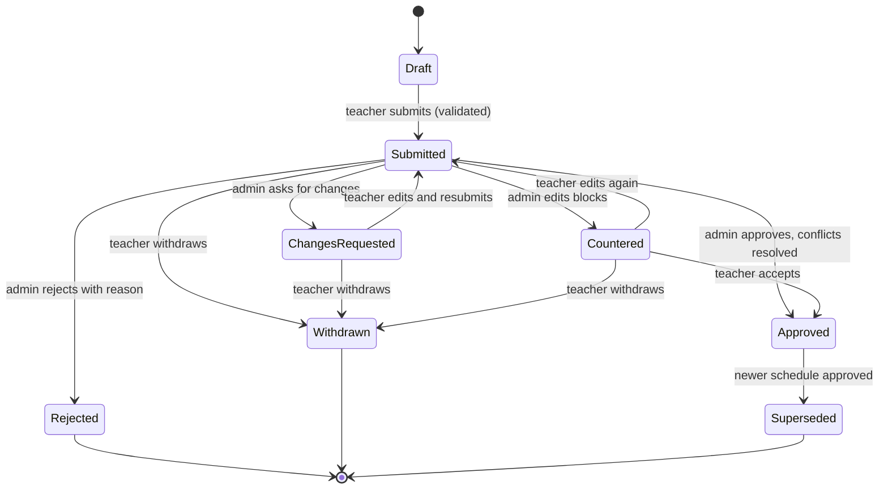
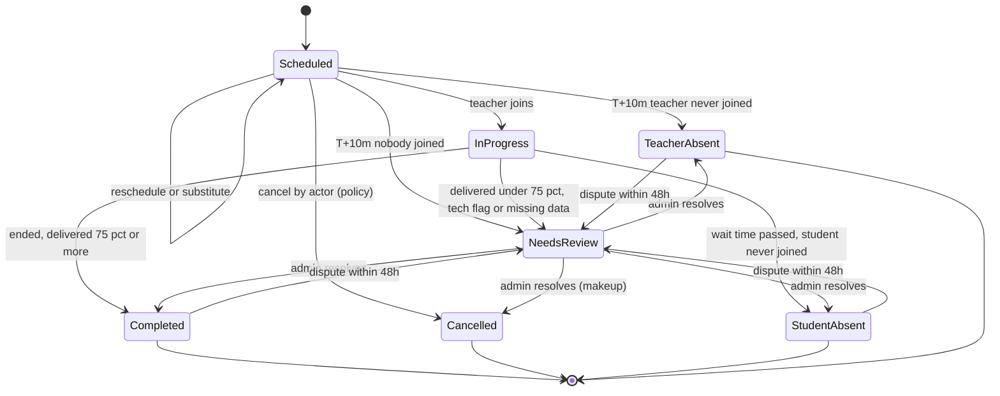
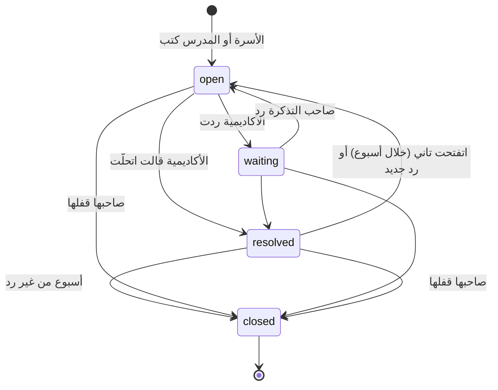

# 02 — قواعد العمل (Domain Rules)

[← الفهرس](README.md)

الملف ده بيوصف **منطق العمل** اللي بيفرق بين أكاديمية شغالة كويس وأكاديمية غرقانة في المشاكل. فيه الوقت، والمطابقة، والرصيد، والسياسات، وحالات الحصة، والمنهج، والتقييم، والمرتبات، والتحديات، وموافقة ولي الأمر، وباقات المنصة، والدعم، وتسجيل الحصص، والدخول بجوجل وأبل، وحماية الأطفال، وإعلانات الأكاديمية.

---

## 1. نموذج الوقت والمناطق الزمنية

### الحقائق اللي بنينا عليها القرار (تواريخ 2027)

| المنطقة | فرق التوقيت | التوقيت الصيفي |
|---|---|---|
| مصر | UTC+2 / +3 | من آخر جمعة في أبريل (**30 أبريل**، الساعة 00:00) لآخر خميس في أكتوبر (**28 أكتوبر**، الساعة 24:00) |
| السعودية، قطر، الكويت، البحرين | +3 | مفيش |
| الإمارات، عُمان | +4 | مفيش |
| أوروبا وبريطانيا | — | آخر أحد في مارس وآخر أحد في أكتوبر (**28 مارس / 31 أكتوبر**) |
| أمريكا | — | **14 مارس / 7 نوفمبر** |
| حالات خاصة | — | الأردن وسوريا على +3 طول السنة من 2022. المغرب بيرجع لـ UTC+0 في رمضان. فلسطين قواعدها بتتغير كتير |

### القرار: الموعد المتكرر بيتثبّت على **توقيت المدرس** افتراضيًا

كل `recurring_slot` عليه `anchor_tz`. الأكاديمية تقدر تغيّر الافتراضي، أو تغيّره لتسجيل معين، ويتثبّت على توقيت الطالب.

**ليه توقيت المدرس؟**
1. المدرسين قليلين ومواعيدهم مزحومة، والطلاب متفرقين على مناطق كتير. لو المواعيد ثابتة على توقيت الطلاب، المدرس اللي في القاهرة وعنده طلاب في الرياض ولندن ونيويورك هيتلخبط جدوله **حوالي 6 مرات في السنة**، وده هيعمل حجوزات مزدوجة لازم تتحل بالإيد.
2. لما كل المواعيد على توقيت المدرس، أنماطها الأسبوعية بتتقارن من غير ما نفكّها لتواريخ. ده بيخلي **قاعدة البيانات نفسها تمنع التعارض** (القسم 2).
3. التكلفة على الطالب: ميعاده بيتحرك ساعة مرتين أو أربعة في السنة، بشكل متوقع، وبنبلّغه قبلها، وبنعرض عليه "خلّي ميعادي بتوقيتي" لو المدرس فاضي.

**مثال**: مدرس عنده حصة **19:00 بتوقيت القاهرة**. ده ميعادها عند الطلاب على مدار 2027:

| الفترة | الرياض | لندن |
|---|---|---|
| 1 يناير – 27 مارس | 20:00 | 17:00 |
| 28 مارس – 29 أبريل | 20:00 | **18:00** |
| 30 أبريل – 28 أكتوبر | **19:00** | 17:00 |
| 29 أكتوبر – 30 أكتوبر | 20:00 | **18:00** |
| من 31 أكتوبر | 20:00 | 17:00 |

### قواعد التخزين

| النوع | طريقة التخزين |
|---|---|
| **لحظات زمنية** (الحصص، والإجازات، والحجوزات المبدئية، والحضور) | `timestamptz` بتوقيت UTC. توقيت قاعدة البيانات وPHP هو UTC، وبنستخدم Carbon immutable |
| **قواعد متكررة** (الشفتات، والمواعيد المتكررة) | `weekday`، و`local_start TIME`، و`duration_min`، و`tz` (اسم IANA زي `Africa/Cairo`)، و`effective daterange` (في الشفتات فترة السريان على نسخة الجدول كلها). **بنخزّن البداية والمدة مش البداية والنهاية**، عشان الحصص اللي بتعدّي نص الليل تشتغل صح |
| **حصة متولّدة من موعد متكرر** | بنخزّن كمان `anchor_tz` و`anchor_local_date` و`anchor_local_time`، عشان نقدر نعيد حساب `starts_at` لو قواعد التوقيت (tzdata) اتغيرت |
| **المستخدم** | `timezone` كاسم IANA، **مش فرق ساعات**. ولو توقيت الجهاز اختلف عن توقيت الحساب (سفر)، بنسأله |
| **إجازات الأكاديمية** | `daterange` محلي + توقيت الأكاديمية |

### الحالات الحساسة
- **ساعة مش موجودة وساعة بتتكرر**: مصر بتغيّر الساعة الساعة 12 بالليل، وده بيأثر على حصص طلاب أمريكا المتأخرة.
  - ساعة 00:00–01:00 يوم جمعة التغيير **مش موجودة**، فالحصة اللي فيها بتتأجل بنفس مقدار الفرق (ساعة).
  - ساعة 23:00–24:00 يوم خميس الرجوع **بتتكرر**، فبناخد أول مرة.
  - الحالتين بيظهروا في تقرير DST.
  - المنطق ده كله في service واحدة اسمها `LocalTimeResolver`، وعليها اختبارات للقاهرة ولندن ونيويورك وسيدني والدار البيضاء.
- **تحديثات tzdata**: الحكومات بتغيّر قواعد التوقيت فجأة؛ مصر أعلنت DST بتاع 2023 قبلها بأسابيع.
  - لازم tzdata يكون محدّث في صورة PHP وPostgres ونظام التشغيل.
  - لما إصدار tzdata يتغير، job بيعيد حساب الحصص الجاية من بياناتها المرجعية ويدوّر على تعارضات.
- **التطبيقات**: بتعرض الوقت بتوقيت الجهاز من نظام التشغيل.
  - لو الشاشة محتاجة توقيت **الطرف التاني** ("الطالب: 18:00 الرياض")، الـ API بيبعته جاهز.
  - مانعتمدش على قاعدة التوقيت اللي جوه Flutter.

### مخطِّط التوقيت الصيفي (DST Transition Planner)
- **job يومي** (`scheduling:dst`، الساعة 01:40) بيبص 45 يوم لقدام.
  - لكل تسجيل، بيحط كل حصة أسبوعية جنب نفس الحصة قبلها بأسبوع، ولو إجازة شالت الأسبوع ده بيبص على اللي قبلها بأسبوعين. المقارنة بتتعمل بتوقيت **الطالب**.
  - لو ساعة الطالب اتغيرت وساعة المدرس ثابتة، يبقى السبب تغيير الساعة. ساعتها بيتسجل صف واحد في `schedule_shift_notices` لكل تسجيل وحصة.
  - الصف فيه: الميعاد قبل وبعد عند الطالب، والفرق بالدقايق، والمنطقة اللي ساعتها اتغيرت، وعدد الحصص المحجوزة.
  - وفيه كمان **لحد إمتى** الفرق ده هيفضل. ده بيتحسب من تغييرات المنطقتين الاتنين، لأول لحظة الفرق بينهم يتغير فيها تاني.
  - الحصص بتتقارن بالوقت، مش بالموعد الأسبوعي، فلو الموعد اتقسم (بنقل أو بمدرس جديد) المتابعة بتكمل عادي.
  - لما يشتغل تاني، بيحدّث اللي لقاه، وبيشيل التغييرات اللي مابقتش هتحصل. اللي الإدارة ثبّتت فيه ميعاد الطالب بيفضل كسجل.
- **شاشة "تغيير التوقيت"** للإدارة: التغييرات متجمّعة حسب تغيير الساعة (المدينة والليلة). كل صف بيوضح:
  - الميعاد قبل وبعد عند الطالب، والميعاد عند المدرس.
  - الفترة، وعدد الحصص.
  - الأسرة اتبلّغت، ولا هتتبلّغ إمتى.
  - المدرس هيبقى فاضي ولا لأ لو ثبّتنا ميعاد الطالب.
- **القرارات**، لصف واحد أو لكذا صف مع بعض:
  - **ثبّت ميعاد المدرس** (الافتراضي): ميعاد الطالب بيتحرك، والأسرة بتتبلّغ.
  - **ثبّت ميعاد الطالب**: ميعاد المدرس بيتحرك عكس الفرق طول الفترة اللي الفرق فيها ثابت، وبعدها بيرجع (`ShiftSlotTimes`، شوف تحت). ده بيحصل بس لو المدرس في شفته وفاضي، والطالب فاضي، في كل الحصص، وإلا بيترفض. والقرار ده نهائي، لأن الحصص بتكون اتنقلت خلاص.
  - لو المدرس مش فاضي، الإدارة تقدر تنقل الطالب لمدرس تاني أو تغيّر ميعاده من حسابه.
- **الإشعارات**:
  - الطالب وولي الأمر بيتبلّغوا قبلها بـ 14 يوم وبيومين (WhatsApp وPush)، والرسالة فيها ميعادهم الجديد بتوقيتهم. التغيير اللي يتعرف متأخر بيتبلّغ مرة واحدة.
  - لو الإدارة ثبّتت ميعاد الطالب بعد ما الأسرة اتبلّغت، بيوصلهم إن ميعادهم مش هيتغير.
  - المدرس بيوصله ميعاده الجديد بتوقيته.
  - صفحة "الحصص" عند الأسرة بتعرض التغيير فوق الحصص في الأسبوعين اللي قبله.
- (P2) ملفات ICS فيها `TZID`، فالتقويم بيظبط نفسه.

### نقل المواعيد لفترة وإعادة الجدولة الجماعية
- `ShiftSlotTimes` بيحرّك مواعيد أسبوعية لنفس المدرس بعدد دقايق، على ساعة المدرس، لفترة معينة:
  - الموعد الأصلي بينتهي قبل الفترة.
  - نسخة متحركة بتغطي الفترة.
  - الموعد الأصلي بيرجع بعدها.
  - المواعيد بتفضل على ساعة المدرس، فالـ exclusion constraint بيفضل يقارن حاجات من نفس النوع.
- الحصص:
  - الحصص المحجوزة في الفترة بتتنقل برصيدها.
  - كل حصص الموعد من أول الفترة بتتبع الموعد الجديد حسب تاريخها. فمفيش حصة بتتولّد مرتين، والحصة الملغية مابترجعش.
  - الحصص اللي بتتنقل مابتتحسبش ضد نفسها.
- **إعادة جدولة جماعية** (`ShiftTeacherLessons`، من شاشة "تغيير التوقيت"، زي مواعيد رمضان):
  - الإدارة بتختار المدرس، ومن يوم لحد يوم بتوقيته، وساعة أو نص ساعة بدري أو متأخر.
  - الشاشة بتقول قبل التنفيذ هيتنقل كام حصة لكام طالب، أو أنهي حصص مش هينفع.
  - النقل يا كله يا مفيش.
  - كل أسرة بيوصلها ميعادها الجديد بتوقيتها، والمدرس بتوصله رسالة واحدة.

---

## 2. التوافر والمطابقة (Matching)

### شاشة "ابحث عن مدرس" (صفحة Filament مخصصة بـ Livewire وAlpine)

**المدخلات**
- الطالب أو الـ lead، والمادة، والمستوى، والتصنيفات، والفئة العمرية.
- جنس المدرس: **لازم / يفضّل / مش فارقة**. ده غالبًا إجباري للطالبات في أكاديميات القرآن.
- لغة الشرح أو اللهجة.
- عدد الحصص في الأسبوع، والمدة، وتاريخ البداية، والفترة (8 أسابيع افتراضيًا).
- توقيت الطالب (بيتملي تلقائيًا).
- **الأوقات المفضلة**: بتتحدد على شبكة 7×24 بتوقيت الطالب.
- الحد الأدنى للتوافر: 8 من 8 أسابيع افتراضيًا، وممكن نقبل 7 من 8.

**المخرجات**
- مدرسين مترتبين، ولكل واحد: فئته، ونسبة إشغاله، ودرجة مناسبته.
- لكل يوم: **الأوقات المتاحة بتوقيت الطالب** في شكل chips.
  - لو وقفت على الـ chip تشوف توقيت المدرس وعدد الأسابيع المتاحة (مثلًا 8/8).
  - لو التوافر ناقص، بتشوف التواريخ اللي فيها تعارض.
- **نمط مقترح** لكل مدرس، مثلًا السبت 17:00 + التلات 17:00.
- لما تختار الـ chips يحصل **حجز مبدئي** (10 دقايق)، وبعده خطوات التسجيل.

### أشكال البيانات

```text
StudentPreference { tz, windows: [{weekday, start_local, end_local}], per_week, duration_min,
                    start_date, horizon_weeks, min_coverage }
TeacherWeekBits   { teacher_id, iso_week_utc, free: bitset(2016) }   // 5-min resolution = 252 bytes/week
MatchResult       { teacher, score, candidates: [{anchor_weekday, anchor_time, student_label,
                    coverage, conflict_dates[]}], suggested_patterns[] }
```

### الخوارزمية
1. **فلاتر أساسية** (SQL في شكل Pipeline من فلاتر):
   - المدرس نشط، وبيقبل طلاب جدد.
   - المادة والمستوى في نطاقه.
   - التصنيف، والجنس، واللغة، والفئة العمرية.
   - **السعة الأسبوعية المتبقية ≥ الدقائق المطلوبة**.
   - العدد بيقل من حوالي 500 مدرس لحوالي 50–150.
2. **Bitset للوقت الفاضي** لكل مدرس في كل أسبوع (UTC):
   `free = shift & ~busy & ~time_off & ~closures & ~holds`
   - الشفتات بتتفك **يوم بيوم** بتوقيت المدرس، فالـ DST بيتحسب صح.
   - `busy` = الحصص المتولّدة + **المواعيد المتكررة النشطة في الأسابيع اللي حصصها لسه ما اتولّدتش**.
   - بيتخزن في Redis بمفتاح `avail:{teacher}:{week}:v{n}`. أي domain event بيزوّد `n`، فمفيش بيانات قديمة ومفيش TTL نظبطه.
3. **الملاءمة**:
   - أوقات الطالب بتتحول لـ bits بتوقيت UTC **لكل أسبوع لوحده**.
   - لكل وقت بداية محتمل (يوم + شبكة كل 15 دقيقة بتوقيت المدرس): بنتأكد في كل أسبوع إن `[start, start+duration+buffer)` فاضي بالكامل وجوه أوقات الطالب.
   - التوافر = عدد الأسابيع اللي الوقت ده مناسب فيها.
4. **تكوين النمط**: بنختار أيام مختلفة بعدد الحصص الأسبوعية. الأولوية بالترتيب:
   - الحد الأدنى للتوافر.
   - نفس الوقت المحلي في كل الأيام.
   - يوم فاصل على الأقل بين الحصص.
5. **الترتيب (Strategy)**، والأوزان الأكاديمية تقدر تغيّرها:

| العامل | الوزن |
|---|---|
| التوافر (عدد الأسابيع المناسبة) | 35 |
| فئة المدرس ودرجته المركبة | 20 |
| توزيع الحمل (1 − نسبة الإشغال) | 15 |
| الاستمرارية: نفس مدرس الأخ أو المدرس السابق، واللهجة | 10 |
| نسبة تحويل الحصص التجريبية | 10 |
| التفضيلات المرنة | 10 |

**المنفّذ دلوقتي**: التوافر بيتحسب عند الطلب (`AvailabilityQuery` + `Matcher`) من النسخة السارية في كل يوم، ناقص الحصص والحجوزات المبدئية، وناقص **الأيام اللي وصل فيها المدرس لأقصى حصص في اليوم** (بتوقيته؛ ده بيمشي على أي حجز بيعدّي على `AvailabilityQuery`: التسجيل، والتعويض، والبديل). الفلاتر في SQL: المادة و**مستواها** (جوه نطاق المدرس من–إلى، والطرف المفتوح يعني من الأول أو لحد الآخر) و**تصنيفها** (من تصنيفات المدرس في المادة، أو المدرس اللي ماختارش تصنيفات = كلها) و**الفئة العمرية** (من أعمار المدرس، أو أي سن)، والجنس، واللغة. الشاشة بتبدأ بجنس المدرس وسن الطالب من ملفه. الترتيب بيستخدم اللي نقدر نقيسه النهارده: التوافر 35، وتوزيع الحمل 15، والتفضيلات 10، متحولين لـ 100. الـ bitsets في Redis بتيجي لما عدد المدرسين يحتاجها.

**الأداء**:
- 150 مدرس × 8 أسابيع = query واحد عليه index بيمر على حوالي 36 ألف حصة (30–60ms)، وعمليات الـ bits أقل من 20ms.
- p95 أقل من 150ms والـ cache دافي، وحتى 500 مدرس والـ cache بارد أقل من 500ms.
- **مابنحسبش كل الاحتمالات مسبقًا، ومابنعملش المطابقة في SQL**.

### منع الحجز المزدوج (Concurrency)
1. **حجز مبدئي**: صف في `booking_holds` عمره 10 دقايق، بيتحسب وقت مشغول للمنسقين التانيين.
2. **التأكيد** (`CreateEnrollmentSchedule`، اسمه في الكود `EnrollStudent`) كله في transaction واحدة:
   - `pg_advisory_xact_lock` على المدرس والطالب.
   - تأكد تاني إن الوقت لسه فاضي.
   - `recurring_slots`.
   - توليد الحصص والمشاركين.
   - حجز الرصيد (قفل صف حساب الرصيد).
   - commit.
3. خطأ `23P01` (exclusion violation) بيرجع **409** ومعاه التواريخ اللي فيها تعارض.
4. `Idempotency-Key` إجباري، و`version` (optimistic locking) عند تعديل الحصص.

**القيدين دول هم الضمان الأساسي على مستوى قاعدة البيانات**:

```sql
-- النمط الأسبوعي على توقيت المدرس: نطاق "دقيقة في الأسبوع" (بيتقسم عند نهاية الأسبوع)
ALTER TABLE recurring_slots ADD EXCLUDE USING gist
  (teacher_id WITH =, minute_of_week WITH &&, effective WITH &&)
  WHERE (status = 'active' AND anchor = 'teacher');

-- الحصص الفعلية: بتمنع التعارض للمدرس وللطالب، وبتشتغل مع الحصص الجماعية بعدين
ALTER TABLE session_participants ADD EXCLUDE USING gist
  (user_id WITH =, block_period WITH &&)
  WHERE (role IN ('teacher','student') AND is_active);

-- block_period = tstzrange(starts_at, blocked_until)، وblocked_until بيتحسب في التطبيق:
-- timestamptz + interval دالة STABLE مش IMMUTABLE، فماينفعش تبقى generated column.
```

القيود دي محتاجة extension `btree_gist`.

### مصدر الشفتات: اقتراح المدرس واعتماد الإدارة

الشفتات هي المادة الخام للتوافر كله، فأي تغيير فيها لازم يمر بمراجعة. الطريقة الأساسية إن **المدرس هو اللي بيقترح أوقاته المتاحة، والإدارة بتعتمدها أو بتتناقش معاه وتعدّلها**.

#### أوضاع الأكاديمية (`shift_mode`)

| الوضع | مين بيحط الشفتات | المرحلة |
|---|---|---|
| `teacher_proposes` (**الافتراضي**) | المدرس يقترح، والإدارة توافق أو ترفض أو تطلب تعديل أو تعدّل بنفسها | MVP |
| `admin_only` | الإدارة بس، والمدرس يشوف ويقدر يطلب تعديل في محادثة | MVP |
| `auto_approve_additions` | زي الافتراضي، بس المقترح اللي **بيزوّد وقت بس** بيتعتمد لوحده | P2 |

**مسار كود واحد**: حتى لما الإدارة تعدّل الجدول بنفسها، التعديل بيتعمل كمقترح.
- في وضع `admin_only`: المقترح بيتعتمد على طول.
- في الوضع الافتراضي: المدرس لازم يوافق عليه، إلا لو الإدارة عملت **override بسبب مكتوب**. الـ override بيتسجل في الـ audit log، والمدرس بيوصله إشعار.
- كده كل تغيير بيعدّي على نفس الـ validation ونفس تحليل الأثر.

#### المقترح
- **نسخة كاملة** من الجدول الأسبوعي (مش تعديلات متفرقة)، بتوقيت المدرس.
- معاها: تاريخ البداية (`effective_from`)، وملاحظة، وأقل وأقصى ساعات في الأسبوع.
- المدرس بيبدأ من نسخة من جدوله الحالي، ويعدّل عليها على شبكة أسبوعية.
- **مقترح مفتوح واحد** لكل مدرس. لو بعت مقترح جديد، القديم بيتسحب تلقائيًا.
- المقترح **مابيأثرش على التوافر** غير بعد ما يتعتمد.

**الـ validation وقت الإرسال** (قيمها من إعدادات الأكاديمية):

| القاعدة | الافتراضي |
|---|---|
| أقل مدة للبلوك الواحد | 60 دقيقة |
| مفيش تداخل بين البلوكات | — |
| الساعات في الأسبوع في حدود عقد المدرس (`max_weekly_min`) | حسب العقد |
| **تقليل الساعات أو حذف أوقات** محتاج إشعار مسبق | `effective_from` بعد 14 يوم على الأقل |
| زيادة الوقت بس | ممكن تبدأ من بكرة |

#### حالات المقترح



**"التواصل والتعديل"**:
- كل مقترح ليه **محادثة خاصة بيه** (`shift_proposal_comments`) بين المدرس والإدارة، وكل رد بيبعت WhatsApp وPush.
- الإدارة تقدر تعدّل البلوكات بنفسها (**عرض مضاد**)، والمدرس يقبله بضغطة أو يعدّل عليه.
- **ميعاد للرد**: لو المقترح فضل من غير رد أكتر من 48 ساعة، بيروح تذكير للمنسقين، ولوحة الإدارة بتعرض المقترحات المتأخرة.

#### شاشة المراجعة (Filament)
- **مقارنة على شبكة أسبوعية**: المضاف بالأخضر، والمحذوف بالأحمر، والمتغير بلون تالت، والساعات في الأسبوع قبل وبعد.
- **تحليل الأثر**، وده بيتحسب بنفس كود التوافر في القسم ده:
  - كل **موعد متكرر محجوز** هيطلع برّه الشفت الجديد: اسم الطالب، والمادة، والموعد بتوقيت الطالب.
  - الحصص الفعلية اللي في الفترة دي.
  - الحجوزات المبدئية والحصص التجريبية اللي جاية.
  - **P2**: مقارنة بخريطة الطلب، يعني هل الأوقات اللي اتشالت كان عليها طلب عالي.
  - **المنفّذ دلوقتي**: التعارضات بتتحسب من الحصص المحجوزة فعلًا من تاريخ البداية (الحصص بتتولّد من المواعيد الأسبوعية لحد 8 أسابيع لقدام)، ومتجمعة لكل طالب ويوم وساعة (بتوقيت المدرس). النقل لمدرس تاني بيتفعّل مع Enrollment؛ لحد كده الحلين: استثناء متفق عليه، أو تأخير البداية لبعد آخر حصة متأثرة.
- **قواعد الاعتماد**:
  - **الاعتماد بيتمنع** طول ما فيه تعارض واحد ما اتحلش. كل تعارض بيتحل بواحد من دول:
    1. **نقل الطالب لمدرس تاني**، بشاشة "ابحث عن مدرس" نفسها، ومعاه إشعار للطالب وولي الأمر.
    2. **تثبيت الموعد كاستثناء**: الموعد بيفضل والمدرس متفق عليه. بيتسجل في `availability_overrides`.
    3. **تأخير `effective_from`** لحد ما المواعيد المتأثرة تخلص أو تتنقل.
  - **الحصص المحجوزة عمرها ما بتتمسح** بسبب تعديل شفت.

#### النسخ والتطبيق
- الاعتماد بيتم في Action اسمه `ApproveShiftProposal`، في transaction واحدة:
  1. يقفل فترة النسخة الحالية في `effective_from`.
  2. يعمل نسخة جديدة في `teacher_shift_schedules`، ويحط قواعدها في `teacher_shift_rules` مربوطة بـ `schedule_id`.
  3. يحوّل المقترح لـ `approved`، والقديم لـ `superseded`.
  4. يبعت `ShiftProposalApproved` و`ShiftRulesChanged`. الـ event التاني بيزوّد إصدار cache التوافر للأسابيع المتأثرة.
- **التوافر بيقرا النسخة السارية في كل يوم**. يعني جدول معتمد يبدأ الشهر الجاي بيظهر في المطابقة من التاريخ ده بس.

```sql
-- نسخة واحدة سارية لكل مدرس في أي يوم
ALTER TABLE teacher_shift_schedules ADD EXCLUDE USING gist
  (teacher_id WITH =, effective WITH &&) WHERE (status = 'active');

-- مقترح مفتوح واحد لكل مدرس
CREATE UNIQUE INDEX one_open_shift_proposal ON shift_proposals (teacher_id)
  WHERE status IN ('submitted', 'changes_requested', 'countered');
```

---

## 3. الباقات والاشتراكات والرصيد

### أربع مفاهيم منفصلة

| المفهوم | بيجاوب على | الكيان |
|---|---|---|
| **التسجيل (Enrollment)** | الطالب بيتعلم إيه، ومع مين، وإمتى | `enrollments`، `recurring_slots` |
| **الاشتراك (Subscription)** | الاتفاق التجاري: الباقة، والسعر، والتجديد | `subscriptions` |
| **الرصيد (Credits)** | الطالب ليه كام دقيقة، وأنهي حصة بتستهلكها | `credit_accounts`، `credit_lots`، `credit_entries`، `credit_reservations` |
| **الفاتورة والدفع** | الفلوس | `invoices`، `payments` |

### وحدة الرصيد = **الدقيقة**
الباقة فيها عدد الحصص في البلوك × مدة الحصة، فالباقات اللي بعدد الحصص واللي بعدد الساعات بيمشوا على نفس الـ ledger. الواجهة بتعرض الاتنين: "فاضل 5 من 8 حصص (150 من 240 دقيقة)".

### التجديد بالبلوك (الافتراضي)
باقة "8 حصص في الشهر" بحصتين في الأسبوع ماتنفعش مع الشهور، لأن الشهر فيه حوالي 4.33 أسبوع، فبيطلع فيه من 8 لـ 10 حصص. عشان كده الافتراضي **بلوك**:
- فاتورة التجديد بتطلع لما الرصيد يوصل لحد معين (مثلًا حصتين).
- البلوك ليه صلاحية = الأسابيع اللازمة + فترة سماح. مثلًا 8 حصص بحصتين في الأسبوع = 4 أسابيع + 2 = 6 أسابيع.
- ده نفس اللي السوق متعود عليه ("باقة 8 حصص بتتجدد لما تخلص")، ومفيش حسابات نسبية، والمواعيد والرصيد ماشيين مع بعض.
- **التجديد الشهري (period)** بحسابات نسبية موجود كـ Strategy تانية للأكاديميات اللي عايزاه.

### حالة التمويل لكل حصة: `funded | unfunded | free | makeup`
- الحصص بتتولّد من المواعيد المتكررة سواء اتدفعت أو لأ، وبتحجز وقت المدرس.
- الحصة اللي **لسه مش مدفوعة قبلها بـ 24 ساعة** (قابلة للتعديل) بتتلغي تلقائيًا (سبب الإلغاء: مش مدفوعة).
- الموعد المتكرر بيفضل محجوز N يوم (14 افتراضيًا). بعدها التسجيل بيتوقف والموعد بيتفك.
- لما الدفع يوصل، الرصيد بيتضاف وبيتوزع **بالترتيب (FIFO)** على الحصص اللي مش مدفوعة.

### الكيانات والأعمدة الأساسية

```text
billing_accounts(id, academy_id, payer_user_id, currency, country, price_region_id, tax_id,
                 default_payment_method_id)              -- اللي بيدفع: ولي أمر أو طالب بالغ. العملة ثابتة للحساب
billing_account_students(billing_account_id, student_id) -- باقات العيلة
plans(id, academy_id, name, subject_scope, session_minutes, sessions_per_block,
      renewal_mode block|period, validity_days, rollover jsonb, policy_set_id, is_trial,
      credit_scope enrollment|student_pool)
plan_prices(plan_id, price_region_id, currency, amount_minor, tax_inclusive, valid_from, valid_to)
price_regions(id, academy_id, name, countries[])
enrollments(id, academy_id, student_id, subject_id, level_id, program_id, curriculum_version_id,
            primary_teacher_id, status, start_date, credit_account_id, policy_set_id)
subscriptions(id, academy_id, billing_account_id, enrollment_id, plan_id, plan_price_id,
              status active|past_due|paused|cancelled, auto_renew, block_no, renew_threshold_min,
              paused_from, paused_until, cancel_at)
credit_accounts(id, student_id, scope_type, scope_id, available_min, reserved_min, consumed_min,
                version)                                 -- نسخة محسوبة، وبتتطابق كل ليلة مع الـ ledger
credit_lots(id, account_id, source purchase|makeup|trial|bonus|rollover|adjustment, source_id,
            granted_min, remaining_min, expires_at)
credit_entries(id, account_id, lot_id, session_id,
               type grant|reserve|release|consume|expire|refund|adjust|transfer,
               minutes, idempotency_key UNIQUE, actor_id, reason)  -- بيتضاف عليه بس
credit_reservations(session_id UNIQUE, account_id, minutes, lot_allocations jsonb,
                    status held|consumed|released)
```

### سيناريوهات

| السيناريو | القاعدة |
|---|---|
| أكتر من مادة | لكل مادة تسجيل واشتراك وحساب رصيد. أو باقة `student_pool` ("12 حصة في أي مادة") بحساب رصيد واحد |
| عيلة وولي الأمر هو اللي بيدفع | حساب دفع واحد لأكتر من طالب. التجديدات اللي ميعادها في نفس الأسبوع بتتجمع في فاتورة واحدة (✅ `IssueRenewal`). خصم الإخوات قاعدة تسعير (من التسجيل التاني) |
| ترقية الباقة | بتسري من البلوك الجاي. ولو محتاج زيادة دلوقتي، يشتري دقائق إضافية بسعر الوحدة في باقته |
| تخفيض الباقة | من البلوك الجاي، من غير استرداد |
| تغيير عدد الحصص في الأسبوع | تعديل المواعيد + تغيير الباقة من البلوك الجاي |
| إيقاف مؤقت | لحد N يوم في السنة. الحصص في الفترة دي بتتلغي والرصيد بيرجع. صلاحية الرصيد بتتمد بنفس المدة. المواعيد بتفضل محجوزة N يوم بالكتير (✅ لحد 120 يوم للمرة والمواعيد محجوزة طوله؛ حد السنة لسه: [إيقاف الكورس وإنهاؤه](#إيقاف-الكورس-وإنهاؤه)) |
| انتهاء الرصيد | كل دفعة رصيد بتنتهي في `expires_at`. اللي فاضل بسبب الطالب بينتهي، إلا لو فيه ترحيل (مثلًا لحد 25% من البلوك، مرة واحدة). رصيد التعويض 30 يوم ومابيترجعش فلوس |
| استرداد | الدقائق **المشتراة** اللي ما اتستخدمتش × سعر الوحدة الفعلي − أي رسوم مش قابلة للاسترداد. بيتعمل credit note + استرداد من البوابة + قيد `refund`. رصيد المكافآت والتعويض مالوش استرداد |
| تغيير المدرس | صف جديد في `enrollment_teacher_assignments` بتاريخ. الحصص الجاية بتتنقل بعد التأكد من مفيش تعارض. الرصيد مابيتأثرش |

**المنفّذ دلوقتي**:
- **التسجيل** من "ابحث عن مدرس" بعد الحجز المبدئي: الباقة (لازم مدة الحصة وعددها في الأسبوع يطابقوا المواعيد اللي اتختارت)، ومين اللي هيدفع (ولي أمر أو الطالب)، والمنطقة السعرية. كله في transaction واحدة (`EnrollStudent`): التسجيل بحالة `pending_payment`، وحساب رصيد للتسجيل، والاشتراك بسعر المنطقة، وفاتورة البلوك الأول، والمواعيد الأسبوعية في `recurring_slots` على ساعة المدرس، والحصص لحد الأفق (8 أسابيع، وبتتمد كل ليلة).
- **الحصص بتتولّد مش مدفوعة**، ولما الفاتورة تتدفع: رصيد البلوك بيتضاف (صالح `validity_days` من يوم الدفع)، والاشتراك بينتقل للبلوك ده، والتسجيل بيبقى `active`، والحصص المستنية بتتمول **بالترتيب** لحد ما الرصيد يخلص (أول حصة مايكفيهاش الرصيد بتوقف التمويل).
- **فاتورة التجديد** بتطلع لوحدها لما الدقايق المدفوعة الفاضلة (الحرة + المحجوزة لحصص جاية، **من غير رصيد التعويض**) توصل لـ `renew_at_sessions` × مدة الحصة، ومفيش غير فاتورة تجديد واحدة مستحقة في نفس الوقت.
- **الدفع اليدوي** (تحويل، InstaPay، محفظة، كاش، ماكينة كارت) بيتسجل من الفاتورة، ومسموح بدفع جزء. **أو اللي بيدفع يبعت إثبات** (`SubmitPaymentProof`): الطريقة، والمبلغ لحد الباقي، ويوم الدفع (يوم تقويمي زي ما كتبه، مش لحظة)، ورقم التحويل، والإيصال. الإثبات مابيسجلش فلوس؛ **إثبات واحد مستني** لكل فاتورة (index في قاعدة البيانات). `ApprovePaymentProof` بيسجل الدفعة بـ `RecordPayment` في نفس الـ transaction بالمبلغ اللي وصل فعلًا، والإثبات بيشاور على الدفعة (`payment_id`). `RejectPaymentProof` بسبب بيقراه اللي دفع، وبيتسجل في سجل العمليات. الموافقة على فاتورة اتلغت أو اتدفعت مابتنفعش، والرفض بينفع. الفاتورة مابتتعدلش بعد ما تصدر؛ اللي مفيش عليها دفع ممكن تتلغي، ورقمها بيفضل محجوز. الضريبة شاملة أو مضافة حسب إعداد الأكاديمية، وبتتقرّب مرة واحدة على الإجمالي.
- **بيانات التحويل** (`SaveTransferDetails`، `Queries\TransferDetails`): الأكاديمية بتكتب الأهالي يحوّلوا فين (البنك، واسم صاحب الحساب والـ IBAN، أو رقم InstaPay أو فودافون كاش أو STC Pay، ويبعتوا الإيصال لمين)، نص عادي من كام سطر لحد 1000 حرف ومن غير HTML: نص لكل اللي بيدفعوا (`billing_settings.manual_payment_note`)، ونص اختياري لكل منطقة سعرية (`price_regions.transfer_details`) بيكسب للي حساب الدفع بتاعهم في المنطقة دي. بيتكتب من "المدفوعات الأونلاين" في لوحة الأكاديمية، والتعديل بيتسجل في سجل العمليات من غير النص. بيظهر **بس مع فاتورة لسه عليها فلوس**، وفي الشكل الكلاسيك بس (الفلوس مش في شكل الطالب)، escaped وبسطوره ومعاه زرار نسخ: صفحة الرصيد والفواتير في `/my` ونموذج الإثبات، وصفحة الدفع الموقّعة والفاتورة نفسها (بيتقرا زي ما هو النهارده، مش جزء من اللي صدر)، والـ API (`transfer_details` لكل فاتورة)، والبوابة والتطبيق. الفاتورة اللي مالهاش بيانات تحويل مافيهاش إثبات (`can_send_proof`). رسالة الفاتورة مابتشيلش النص (نفس الكلام بيروح واتساب وإشعار، وقالب واتساب مابيقبلش سطور): فيها لينك صفحة الدفع اللي عليها البيانات.
- **رصيد التعويض** مابيمولش حصص عادية؛ بيفضل للحصة التعويضية، والحصة التعويضية مابتتمولش غير منه.
- **تغيير المدرس** من حساب الطالب (أو من مراجعة مقترح الشفتات): المدرس الجديد لازم يكون فاضي وفي شفته في كل الحصص من التاريخ ده. المواعيد الأسبوعية القديمة بتنتهي اليوم اللي قبله، وبتتعمل مواعيد جديدة على ساعة المدرس الجديد، والحصص المحجوزة بتتنقل برصيدها. لو البلدين بيغيّروا التوقيت الصيفي في أيام مختلفة، الحصص اللي بعد التغيير بتتحرك ساعة على ساعة المدرس الجديد، والشاشة بتقول كام حصة اتأثرت.
- **الفاتورة بعد ما تصدر مابتتغيرش خالص**: الأرقام، والبايع، والرقم الضريبي، والـ QR. الموديل نفسه بيرفض أي تعديل. في أكاديمية على ZATCA، إلغاء الفاتورة بيطلّع **إشعار دائن** بالمبلغ كله، برقم متسلسل من غير فجوات في سلسلة خاصة بيه (`CN-`)، والإشعار ده كمان مابيتغيرش (trigger في قاعدة البيانات).
- **الخصومات** (`Billing\Domain\Discounts`، حساب صافي من غير قاعدة بيانات):
  - **خصم الإخوات**: `billing_settings.sibling_second_bp` للابن التاني و`sibling_more_bp` للتالت وبعده. ترتيب الابن (`SiblingRank`) = مكانه بين طلاب حساب الدفع اللي ليهم اشتراك مش ملغي وتسجيل مش منتهي، بأقدم اشتراك ليهم. الابن اللي لسه مش على الحساب بييجي بعدهم.
  - **الكوبون** (`coupons`): نسبة (`percent_bp`) أو مبلغ (`amount_minor` + `currency`)، و`blocks` (عدد الفواتير، أو null لكل فاتورة)، و`starts_on`/`ends_on` على تقويم الأكاديمية، و`max_uses`، و`plan_ids`، و`with_sibling`. الكود بالحروف الكبيرة ومن غير مسافات، وفريد في الأكاديمية. لو اتستخدم، الكود وقيمة الخصم وعدد الفواتير وعملته مابيتغيروش.
  - **على الاشتراك** (`coupon_redemptions`): كوبون واحد شغال لكل اشتراك، والكوبون مرة واحدة لكل حساب دفع (index جزئي). عدد الفواتير اللي خصمها بيتحسب من سطور الفواتير نفسها (`meta.redemption_id` على فواتير مستحقة أو مدفوعة)، فالفاتورة اللي اتلغت بترجّع دورها. "اتستخدم" = لسه عليه، أو اتشال بعد ما خصم فاتورة.
  - **إزاي بيتجمعوا**: من غير `with_sibling` الأكبر فيهم بس (التساوي لخصم الإخوات، فالكوبون مابيضيعش). ومعاه، خصم الإخوات الأول وبعده الكوبون على اللي فاضل. كل خصم مقرّب half up، ومابيعديش السعر.
  - **في الفاتورة**: سطر `discount` بالسالب ووصف بالعربي والإنجليزي، والضريبة على المجموع بعد الخصم (`WriteInvoice`). الفاتورة اللي بصفر بتتسجل مدفوعة من غير دفعة (`RecordPayment::nothingDue`) وبيتضاف رصيدها.
  - **كوبون على فاتورة طالعة**: الفاتورة مابتتغيرش، فـ `ApplyCoupon` بـ `reissue` بيلغي فاتورة البلوك المستنية (`VoidInvoice`، بإشعار دائن لو ضريبية) ويطلّع نفس البلوك تاني بالكوبون، بشرط مفيش عليها دفع، ولا إثبات مستني، ولا دفع أونلاين مفتوح.
- **الحصص الزيادة** (`BuyExtraLessons`): سطر `extra` بعدد الحصص × سعر الحصة (`amount_minor` للاشتراك ÷ `sessions_per_block`، half up)، وخصم الإخوات (من غير كوبون). للتسجيل الشغال بس، ومن 1 لـ 10، وفاتورة `extra` واحدة مستنية لكل اشتراك. لما تتدفع، `RecordPayment` بيضيف دقايقها كدفعة شراء صالحة `validity_days` الباقة، من غير ما يغيّر `block_no`، وفاتورة التجديد بتطلع عادي حتى لو فيه فاتورة حصص زيادة مستنية. وبعدها `BookExtraLesson` بيحجز حصة نوعها `extra` مع مدرس التسجيل في وقت فاضي، من الرصيد العادي (مش رصيد التعويض).
- **فاتورة العيلة** (`IssueRenewal`): كل سطر في الفاتورة عليه الكورس اللي هو ليه (`invoice_lines.subscription_id`)، فالفاتورة الواحدة ممكن تشيل كورسات أكتر من ابن على نفس حساب الدفع وبنفس العملة؛ و`invoices.subscription_id` بيفضل للفاتورة اللي لكورس واحد، وبيبقى فاضي في فاتورة العيلة. لما رصيد كورس يوصل لحده (`CreditBalanceLow`)، فاتورته بتطلع ومعاها البلوك الجاي لكل كورس تاني على الحساب بالشروط دي: اشتراكه شغال ومدفوع قبل كده (`block_no ≥ 1`)، وعليه كورس شغال، ومالوش فاتورة بلوك مستنية، والدقايق المدفوعة الفاضلة له (من غير رصيد التعويض) ≤ حد تجديده + حصص `family_invoice_days` يوم بسرعة باقته (`ceil(sessions_per_week × days ÷ 7) × session_minutes`). `billing_settings.family_invoice_days` من 0 لـ 14، والافتراضي 7، و0 بيقفلها. كل بلوك بخصمه (خصم الإخوات أو الكوبون، `InvoiceDiscounts`)، ووصفه بيبدأ باسم الطالب، والضريبة مرة واحدة على المجموع. والدفع (`RecordPayment`) بيدّي كل كورس دقايق سطوره هو، بيرفع `block_no` بتاعه، ويشغّل كورساته (الاشتراكات بتتقفل بترتيب ثابت عشان مفيش انتظار متبادل). "فاتورة مستنية لكورس" و"آخر فاتورة بلوك" و"فاتورة حصص زيادة مستنية" بقوا كلهم من السطور (`Invoice::forSubscription`). والكوبون على كورس في فاتورة عيلة مستنية: بتتلغي وتطلع تاني بنفس البلوكات كلها (`IssueBlockInvoice::together`).
- **الباقة المشتركة** (`plans.credit_scope = student_pool`): رصيد واحد للطالب في أي مادة. أول كورس عليها (للطالب ونفس اللي بيدفع) بيفتح حساب رصيد `student_pool` واشتراك وفاتورة بلوك أول باسم "باقة مشتركة". وأي كورس بعده على نفس الباقة بيتربط بنفس حساب الرصيد (`enrollments.credit_account_id`)، من غير اشتراك ولا فاتورة جديدة؛ ولو الباقة مدفوعة (`block_no ≥ 1`) بيبقى `active` على طول، ولو لأ بيستنى زي أول كورس، ودفعها بيشغّل كل كورساتها. **كورسات الاشتراك = التسجيلات اللي على حساب رصيده** (`Subscription::enrollmentIds`، و`Subscription::ofEnrollment` بيجيب اشتراك أي كورس من رصيده)، وفيه اشتراك واحد شغال بس لكل حساب رصيد (index في قاعدة البيانات). `FundSessions` بيموّل حصص كل كورسات الرصيد بترتيب ميعادها. الكورس في الباقة المشتركة بيطابق مدة الحصة بس؛ وعدد الحصص في الأسبوع للباقة كلها. ونوع الباقة مايتغيرش بعد ما يبقى عليها اشتراك (`SavePlan`)، والكوبون مايتحطش على كورس داخل على باقة (يتحط على الباقة نفسها).
- **الإيرادات** (`Billing\Queries\RevenueBoard`، لوحة "الإيرادات" للمالك والمدير والمحاسب): بتتقرا من الجداول نفسها كل مرة، **عملة عملة** (مفيش جمع بين عملات):
  - **الفترة** (`Support\RevenuePeriod`) أيام على **تقويم الأكاديمية**: دفعة وصلت 00:30 يوم 1 أكتوبر في الرياض بتاعة أكتوبر حتى لو في UTC لسه 30 سبتمبر. أول اليوم من `LocalTimeResolver` (لو نص الليل مش موجود، أول دقيقة موجودة). الفترات: الشهر ده (لحد النهارده)، والشهر اللي فات، وآخر 90 يوم، والسنة دي، وآخر 12 شهر، أو يومين تختارهم (لحد سنتين، ومش بعد النهارده). المقارنة: الشهر ده بنفس أيام الشهر اللي فات، والسنة وآخر 12 شهر بنفس الأيام من سنة، والباقي بنفس عدد الأيام اللي قبلها. الرسم يوم بيوم لحد شهرين، وأسبوع (من السبت للجمعة) لحد 6 شهور، وبعدها شهر.
  - **اللي دخل** = الدفعات (`payments`) بيوم وصولها، و**الضريبة اللي فيها** بنسبة ضريبة فاتورتها (`amount × tax ÷ total` لكل دفعة). **اللي اتفوتر** = الفواتير اللي صدرت في الفترة ومااتلغتش. **الخصومات** = سطور `discount` على فواتير الفترة. **المستحق دلوقتي** = الباقي على الفواتير المستنية، و**المتأخر** منه اللي ميعاده عدّى (مش مربوط بالفترة).
  - **توزيع اللي دخل**: كل دفعة بتتقسم على كورسات فاتورتها بنسبة سطورها (البلوك ناقص خصمه، `Domain\Revenue\Split`: أرقام صحيحة مجموعها = الدفعة)، وبعدين بتتجمع بالمادة (الباقة المشتركة باسمها)، والباقة، ونوع البيع (اشتراك جديد = البلوك الأول، تجديد، حصص زيادة). طرق الدفع من الدفعة نفسها، والأونلاين باسم البوابة.
  - **التجديدات الجاية** (30 يوم): كل اشتراك شغال من غير بلوك مستني، ميعاده = (الدقايق المدفوعة الفاضلة − حد التجديد) ÷ دقايقه في الأسبوع، بنفس حساب `IssueRenewal`، ومبلغه = فاتورته الجاية بخصومها وضريبتها. تقدير؛ الإلغاء والتأجيل بيغيروه.
  - **بتتحدث لحظيًا**: trigger على `invoices` (إصدار، دفع، إلغاء) بيبعت `revenue:{academy}` على قناة الأكاديمية لللي معاه `billing.view`. و**"نزّل Excel"** (`ExportRevenue`): الملخص، وكل دفعات الفترة، وكل فواتيرها.
- لسه: تغيير الباقة، والاسترداد وإشعار الدائن لجزء من فاتورة مدفوعة، والـ rollover، وحد أيام الإيقاف في السنة.

### إيقاف الكورس وإنهاؤه

الأيام هنا أيام على **تقويم الأكاديمية** (أول اليوم من `LocalTimeResolver`، والحصة بتتحسب على اليوم اللي بتبدأ فيه هناك: `Scheduling\Support\CourseDays`). الإدارة بس هي اللي بتوقف أو تنهي (`sessions.manage`)، من صفحة حساب الطالب، وكل خطوة بتقول قبل التأكيد هيحصل إيه: كام حصة هتتلغي، وكام دقيقة مدفوعة هترجع، وفاتورة البلوك المستنية. الأسرة مابتشوفش السبب أبدًا.

- **الإيقاف المؤقت** (`PauseEnrollment` في Scheduling): من يوم لحد يوم (الاتنين داخلين)، من النهارده أو بعد كده، لحد 120 يوم، وبسبب. للكورس الشغال بس (مش اللي مستني أول دفعة، ولا اللي هينتهي).
  - الحصص المحجوزة في الأيام دي بتتلغي بـ `CancelSession` بسبب `enrollment_paused` (القاعدة 22: الدقايق **بترجع للرصيد** زي ما كانت، مش تعويض ومش بتضيع، وأجر المدرس 0%)، والدقايق اللي رجعت بتموّل الحصص المستنية بعدها بالترتيب.
  - صلاحية الرصيد بتتمد بعدد أيام الإيقاف (`CreditsApi::extend`، الأول عشان مفيش لوت يخلص في النص)، إلا لو فيه كورس تاني لسه بياخد حصص من نفس الرصيد (باقة مشتركة).
  - المواعيد الأسبوعية **بتفضل محجوزة للطالب** (وقت المدرس مابيفضاش)، ومابتتعملش حصص في أيام الإيقاف (`MaterializeSessions`).
  - الإيقاف ممكن يكون جاي: الكورس بيفضل `active` لحد أول يوم، وبعدين `paused`. ومفيش تجديد طول ما هو موقوف (`Subscription::taught`).
  - الإيقاف المحطوط ينفع **يطوّل** بس (نفس أول يوم وآخر يوم بعده): الأيام الزيادة بس هي اللي حصصها بتتلغي وصلاحيتها بتتمد. أي تغيير تاني: رجّع الكورس وأوقفه تاني.
- **الرجوع** (`ResumeEnrollment`): لوحده في اليوم اللي بعد آخر يوم (`scheduling:courses` كل ساعة، من غير ما حد يعمل حاجة)، أو بدري من الإدارة، أو إلغاء إيقاف لسه مابدأش. الحصص بتتعمل تاني من دلوقتي: الحصص اللي الإيقاف لغاها من دلوقتي بتسيب تاريخها (`occurrence_key`) فبتتعمل تاني، والمواعيد بتتولّد لحد الأفق، والرصيد بيموّلها بالترتيب.
  - الصلاحية بتفضل بكل الأيام اللي الإيقاف ادّاها، حتى لو رجع بدري. ده مقصود، لأن مكسب الأسرة صغير، والسجل بيتضاف عليه بس.
  - الطالب الموقوف مش بيتحسب طالب شغال في باقة الأكاديمية. عشان كده **الرجوع بدري من الإدارة** محتاج مكان في الباقة زي التسجيل الجديد بالظبط (`ResumeCourse`: `AcademyPlan::ensureRoom` بنفس الـ advisory lock، و`plan-limit-reached`).
  - **الرجوع في ميعاده** بيحصل زي ما اتخطط له، حتى لو الباقة اتملت في النص، زي ما بيحصل بعد تنزيل الباقة.
- **الإنهاء** (`EndEnrollment`): من يوم (أول يوم من غير حصص)، النهارده أو بعد كده، وبسبب. أي كورس مش منتهي (شغال، أو موقوف، أو مستني أول دفعة).
  - الحصص المحجوزة من اليوم ده بتتلغي بسبب `enrollment_ended` (القاعدة 22)، و**الرصيد الفاضل بيفضل زي ما هو** وظاهر للإدارة وللأسرة (أي استرداد بيتسجل برّه النظام).
  - المواعيد الأسبوعية **بتنتهي اليوم ده** (زي ما `ShiftSlotTimes` بينهي موعد: كل موعد لحد أول حصة ليه في اليوم ده أو بعده على ساعته)، فوقت المدرس بيفضى.
  - مفيش تجديد تاني خالص (`Subscription::taught`: كورس `active` ومالوش `ends_on`). ولما اليوم ييجي، فاتورة البلوك المستنية بتتلغي بـ `VoidInvoice` (`BillingApi::closeEndedCourse`) بشرط مفيش عليها دفع ولا إثبات مستني ولا دفع أونلاين مفتوح، وإلا بتفضل والشاشة بتقول ليه. فاتورة العيلة بتتلغي وبتطلع تاني بالبلوكات التانية بس (`IssueBlockInvoice::together`). وفاتورة الباقة المشتركة بتفضل لو فيه كورس تاني عليها لسه شغال. **وفاتورة الحصص الزيادة المستنية** للكورس بتتلغي هي كمان، بنفس الشروط (`EndedCourseBilling::extraNumber`).
  - **الباقة المشتركة**: الكورس بيخرج منها وهي بتكمل لكورسات الطالب التانية (اللي بتتحسب من التسجيلات اللي مش منتهية).
  - المحادثة مع المدرس بتقف زي أي كورس مش شغال (`MessagingRules`: لحد 30 يوم من آخر حصة اتعملت).
  - الإنهاء ممكن يكون جاي: الكورس بيفضل على حالته لحد اليوم ده (حصصه قبلها بتفضل)، وبعدين `ended`. والكورس المنتهي **مابيرجعش**: الرجوع بيكون بتسجيل جديد.
- **الأحداث** في Contracts بتاعة Enrollment: `EnrollmentPaused` (الأيام)، و`EnrollmentResumed` (بدري ولا في ميعاده)، و`EnrollmentEnded` (اليوم)، وقت القرار. الأسرة والمدرس بيتبلّغوا مرة واحدة (`scheduling.course_*`) مش مع كل حصة. وكل خطوة في سجل العمليات (`enrollment.paused` و`enrollment.resumed` و`enrollment.ended`) بالسبب.
- **نقاط الربط**: `RecordPayment::fulfil` مابيشغّلش كورس موقوف أو منتهي (دفع بلوك طلع قبل الإيقاف بيضيف دقايقه بس، وصلاحيتها بتزيد بالأيام اللي فاضلة من الإيقاف، زي ما الإيقاف مدّ الرصيد اللي كان موجود، إلا في باقة مشتركة عليها كورس تاني شغال)؛ وخصم الإخوات (`SiblingRank`) بيعد الابن الموقوف ومابيعدش المنتهي (والباقة المشتركة بأي كورس عليها لسه شغال)؛ ومخطِّط التوقيت الصيفي ورسايله (`PlanDstChanges`، `SendDstNotices`) بيسيبوا الكورس الموقوف والمنتهي وأيام الإيقاف وما بعد النهاية؛ والحجز (`BookMakeup`، `BookExtraLesson`، `RescheduleSession`) بيترفض في أيام الإيقاف وبعد النهاية، وتغيير المدرس بيترفض للكورس المنتهي؛ و`BringExistingSchedule::exists` بيعتبر الموقوف موجود (`keepsSlots`) والمنتهي لأ؛ وتوقّع الإيرادات من `taught`؛ واللوحة والتقويم مابيعرضوش حصص الأيام دي لأنها اتلغت.
- **الشاشات**: حالة الكورس في قائمة الطلاب المسجلين (فلتر بالحالة، و"لحد …") وفي صفحة حسابه بالسبب. وفي `/my` والـ API (`status`، و`paused_from` و`paused_until` و`ends_on` كأوقات الـ API لأول اليوم على تقويم الأكاديمية، في `family/balance` و`learning/journey/map`، وسطر فوق الحصص في `family/lessons`) والبوابة والتطبيق: "موقوف لحد …" ("في إجازة لحد …" في شكل الأطفال) و"انتهى". شراء حصص زيادة بيختفي للكورس اللي مش شغال، والحصص اللي اتلغت بتقول السبب (`cancelled_because`).

---

## 4. محرك سياسات الإلغاء والتعويض والغياب

### التصميم
- **مجموعات سياسات** (`policy_sets`) على مستوى الأكاديمية، وكل باقة ممكن تغيّرها، و**ليها إصدارات** (`policy_set_versions`).
- كل إصدار فيه **إعدادات** (أرقام)، و**جدول قواعد مترتب**: أول قاعدة تنطبق هي اللي بتتنفذ.
- **الشروط** من قائمة ثابتة: الحدث، ومين عمله، وساعات الإشعار، ونوع الحصة، والمستخدم من الحد الأقصى، ومين المسؤول، ونسبة الوقت اللي اتدرّس فعلًا.
- **النتائج**: إيه اللي يحصل في الرصيد، ونسبة أجر المدرس، وحدث أداء ودرجة خطورته، وهل محتاج موافقة، وقوالب الإشعارات.
- **التنفيذ = Strategy + Specification، مش محرك قواعد عام.**
- **كل قرار بيتسجل على الحصة** ومعاه `policy_version_id` والمدخلات والنتيجة. ده أساسي لما يحصل نزاع.

### الإعدادات الافتراضية (كلها قابلة للتعديل)

| الإعداد | القيمة |
|---|---|
| مهلة إلغاء الطالب | 12 ساعة (السوق بين 2 و24 ساعة) |
| الحد الأقصى للإلغاء أو إعادة الجدولة | 2 في كل بلوك 8 حصص |
| المدرس يستنى الطالب قد إيه | 10 دقايق في حصة 30 دقيقة، و15 دقيقة في حصة 45 دقيقة أو أكتر |
| المدرس يتحسب متأخر / غايب | بعد دقيقتين / بعد 10 دقايق |
| الحصة تتحسب "اكتملت" | لو اتدرّس 75% من وقتها أو أكتر |
| صلاحية رصيد التعويض | 30 يوم |
| ميعاد التقرير | 12 ساعة |

### جدول القواعد الافتراضي

| # | الحدث | الشرط | الحالة | رصيد الطالب | أجر المدرس | حدث الأداء |
|---|---|---|---|---|---|---|
| 1 | الطالب يعيد الجدولة | قبلها بـ 12 ساعة أو أكتر، وفي حدود العدد | تتنقل لميعاد جديد | يفضل محجوز | — | — |
| 2 | الطالب يلغي | قبلها بـ 12 ساعة أو أكتر، وفي حدود العدد | ملغية | يرجع | 0% | — |
| 3 | الطالب يلغي | قبلها بـ 12 ساعة أو أكتر، وعدّى الحد | ملغية | بيضيع (الإدارة تقدر تستثني) | 0% | إلغاء متأخر من الطالب |
| 4 | الطالب يلغي | قبلها بأقل من 12 ساعة | ملغية | بيضيع | 50% | إلغاء متأخر من الطالب |
| 5 | الطالب غاب | المدرس استنى المدة المطلوبة | غياب الطالب | بيتخصم | 100% (أو 50%) | غياب الطالب |
| 6 | الطالب اتأخر | دخل قبل ما مدة الانتظار تخلص | اكتملت (وبتخلص في ميعادها) | بيتخصم | 100% | تأخير الطالب |
| 7 | المدرس يلغي | قبلها بـ 24 ساعة أو أكتر | ملغية | يرجع كـ **رصيد تعويض** | 0% | بسيط |
| 8 | المدرس يلغي | قبلها بأقل من 24 ساعة | ملغية | رصيد تعويض (+ ممكن دقائق مكافأة) | 0% | كبير |
| 9 | المدرس غاب | ما دخلش لحد الدقيقة 10 | غياب المدرس | رصيد تعويض + مكافأة لو اتكرر مرتين في 30 يوم | 0% − خصم | حرج |
| 10 | المدرس اتأخر | من 2 لـ 10 دقايق | اكتملت | بيتخصم، والدقايق الضايعة رصيد تعويض لو أكتر من 5 | بنسبة الوقت | تأخير |
| 11 | مشكلة تقنية | من المنصة أو مزوّد الفيديو، واتدرّس 75% أو أكتر | اكتملت | بيتخصم | 100% | — |
| 12 | مشكلة تقنية | من المنصة أو مزوّد الفيديو، واتدرّس أقل من 75% | تحتاج مراجعة ← ملغية من النظام | رصيد تعويض | بنسبة الوقت | — |
| 13 | مشكلة تقنية | من عند الطالب | تحتاج مراجعة | بيتخصم لو اتدرّس 50% أو أكتر، غير كده تعويض | 100% | — |
| 14 | مشكلة تقنية | من عند المدرس، واتدرّس أقل من 75% | تحتاج مراجعة | رصيد تعويض | بنسبة الوقت | ضعف الاتصال |
| 15 | إجازة أو عطلة | من تقويم الأكاديمية | ملغية من النظام | يرجع + صلاحية الرصيد تتمد | 0% (أو حسب العقد) | — |
| 16 | حصة مش مدفوعة | قبلها بـ 24 ساعة ولسه مادفعش | ملغية من النظام | — | 0% | — |
| 17 | الطالب يلغي حصة تعويضية | في أي وقت | ملغية | بيضيع (مفيش تعويض عن تعويض) | زي القاعدة 4 | — |
| 18 | حصة تجريبية | الطالب يعيد الجدولة | تتنقل | مجانية، مرة واحدة | — | نشاط في الـ CRM |
| 19 | ظرف طارئ بإثبات | بموافقة الإدارة | ملغية | يرجع | 0% | — |

**المنفّذ دلوقتي**:
- **الأرقام** في شاشة "سياسة الإلغاء والتعويض" (الإعدادات): كل حفظ بيعمل إصدار جديد في `policy_versions`، ومحدش يقدر يعدّل إصدار قديم. الشاشة بتعرض جدول القواعد بالأرقام الحالية.
- **المحرك** (`Domain\Policy\PolicyEngine`) بيطبّق القواعد 1–5 و7–9 و15–19 بالترتيب، ومعاهم تلات قواعد للأكاديمية: 20 (الأكاديمية بتأجّل من غير حد) و21 (الأكاديمية بتلغي = رصيد تعويض للطالب) و22 (الكورس اتوقف أو انتهى = الدقايق بترجع). القواعد 6 و10–14 (التأخير والمشاكل التقنية) لسه بتتحسم يدوي من "تحتاج مراجعة".
- **كل قرار بيتسجل** على الحصة (`policy_version_id` + القاعدة + الرصيد + أجر المدرس + ساعات الإشعار)، وفي سجل الحصة بالمدخلات كاملة.
- **الحد الأقصى في البلوك** بيتعد من آخر دفعة اتضافت لرصيد التسجيل (أول البلوك الحالي)، وبيشمل إلغاءات وتأجيلات الطالب اللي القاعدة بتحسبها.
- **الاستثناء**: الإدارة تقدر ترجّع رصيد حصة كانت هتضيع، أو تأجّل رغم السياسة، والاستثناء بيتسجل.
- **الحصة المش مدفوعة** (القاعدة 16) بتتلغي لوحدها قبلها بـ 24 ساعة (المهمة اللي بتشتغل كل دقيقة)، **للطلاب المسجلين على باقة بس**. وقبلها النظام بيحاول يموّلها لو الرصيد وصل. لو الإدارة سمحت بالحصة استثناء، مابتتلغيش. ولو الرقم 0 الإلغاء التلقائي بيتقفل.
- **الحصة التعويضية** بتتحجز من **رصيد التعويض بس**، على وقت فاضي عند نفس المدرس قبل ما الرصيد ينتهي. ولو الطالب لغاها مفيش تعويض تاني (القاعدة 17).
- **أجر المدرس** بيتسجل في القرار (`teacher_pay_pct`)، وPayroll بيحسب منه أجر الحصة ([القسم 8](#8-مرتبات-المدرسين)). وحسم المراجعة بيسجّله كمان: اكتملت 100%، وغياب الطالب حسب الإعداد، وغياب المدرس أو الإلغاء بتعويض 0%.
- **إجازة الأكاديمية** (القاعدة 15): بتلغي الحصص من النظام بسبب `holiday`، والدقايق بترجع، وصلاحية لوتات الطالب اللي لسه مخلصتش بتتمد بعدد أيام الإجازة. المد بيحصل الأول، عشان الدقايق اللي رجعت تقدر تموّل حصة بعد كده.
- **إيقاف الكورس أو إنهاؤه** (القاعدة 22، `course_stopped`): الحصص اللي بتتلغي بسببهم (`enrollment_paused`، `enrollment_ended`) دقايقها بترجع للرصيد، وأجر المدرس 0%، ومفيش حدث أداء ([القسم 3](#إيقاف-الكورس-وإنهاؤه)).
- **إجازة المدرس**: الحصة اللي بتتلغي بسببها بتتحسب على الأكاديمية (القاعدة 21)، والطالب ياخد تعويض والمدرس مايتحسبش عليه غياب. بيحصل ده في 3 حالات:
  - الإدارة لغت الحصة بتعويض.
  - الأسرة رفضت المدرس البديل (`family` / `substitute_refused`).
  - محدش غطّى الحصة لحد قبلها بساعة.

---

## 5. دورة حياة الحصة

**نوع الحصة** خاصية مش حالة: `regular | trial | makeup | extra | assessment`. وفيه كمان:
- `makeup_for_session_id`: الحصة اللي دي تعويض عنها.
- `original_teacher_id`: المدرس الأصلي لو الحصة مع بديل.
- `reschedule_count`: عدد مرات إعادة الجدولة.
- `is_detached`: الحصة اتعدّلت بالإيد، فمابتتولّدش تاني من الموعد المتكرر.



### تأثير كل حالة على الرصيد

| الحالة | الرصيد |
|---|---|
| `Scheduled` و`InProgress` | محجوز |
| `Completed` و`StudentAbsent` | اتخصم |
| `TeacherAbsent` | بيرجع كرصيد تعويض |
| `Cancelled` | حسب السياسة |
| `NeedsReview` | بيفضل محجوز لحد ما الإدارة تحسم |

- لما الإدارة تحسم حصة "تحتاج مراجعة" أو اعتراض، بيتضاف **قيد عكسي** للرصيد والمرتبات. **القيود القديمة عمرها ما بتتعدل**.
- **المنفّذ دلوقتي (الاعتراض والتصحيح)**:
  - `session_disputes`: اعتراض واحد لكل حصة (unique)، من `family` أو `teacher`، بالسبب والكلام، والنتيجة قبل وبعد، والحالة `open | upheld | rejected`، ورد الأكاديمية. مابيتمسحش (الحذف مسحوب من `lms_app`)، وتريجر بيبلّغ اللوحة وحصص المدرس والأسرة لحظيًا.
  - `DisputeLesson`: مين (`DisputeRules`: الطالب أو ولي أمره بـ `FamilyView::follows` ومش شكل الأطفال، أو `teacher_id` بتاع الحصة)، وإمتى (حصة `completed | student_absent | teacher_absent` لحد 48 ساعة من `ends_at`)، والسبب لازم يناسب النتيجة. بعدها `FlagForReview(reason = dispute)`، وaudit `session.disputed`، و`LessonDisputed` بعد الـ commit.
  - الحسم من `DecideDispute` (أو "احسم" العادية على اللوحة) بيعدّي على `ResolveReview`، اللي بيقفل الاعتراض المفتوح (لازم رد) وبيبعت `LessonDisputeDecided`.
  - تصحيح الرصيد: `SettleSessionCredits` لما الحصة اتحسمت قبل كده (مش محجوزة) بينادي `CreditsApi::correct`: **مستهلك ← تعويض** = lot تعويض جديد (`source_id` = الحصة) وقيد `restore`؛ **تعويض ← مستهلك** = بيشيل من lot التعويض بتاع الحصة اللي فاضل منه بس وقيد `reclaim`، واللي اتحجز منه قبل القرار بيفضل للأسرة ويتسجل على الحصة (`decision.credit_short`). نفس النتيجة = ولا حاجة.
  - المرتبات بتتبع `SessionFlaggedForReview` (السطر بيتعكس) و`SessionFinalized` (سطر جديد بالنتيجة الجديدة).
- **المنفّذ دلوقتي**: `SettleSessionCredits` بيتنادى من كل طريقة بتقفل الحصة (المهام الدورية، وغياب الطالب، وحسم المراجعة، والإلغاء من الإدارة) في نفس الـ transaction: اكتملت أو غياب الطالب = خصم، وغياب المدرس أو إلغاء بتعويض = رصيد تعويض 30 يوم، وإلغاء من غير تعويض = الدقايق بترجع وتموّل أول حصة مستنية. الحصة التجريبية والحصة اللي مش مدفوعة مابيتغيرش فيهم رصيد.

### المهام الدورية (Sweepers)
- **job بيشتغل كل دقيقة** على كل الأكاديميات. بيتعامل مع المواعيد النهائية (T+2، وT+3، وT+10)، وبيقفل الحصة بعد نهايتها بـ 10 دقايق، بعد ما يطابق الحضور مع الـ room API.
- القفل بيطلّع **event واحد**: `SessionFinalized{outcome, policy_decision}`. اللي بيسمعوه: Credits، وPayroll، وEvaluation، وLearning.

### حالة التقرير (جوه الحصة)
`not_required → due → submitted | overdue → reviewed`
- لما الحصة تبقى `Completed`، بيبقى فيه تقرير مطلوب.
- لما تبقى `StudentAbsent`، بيبقى مطلوب ملاحظة غياب قصيرة.
- **المنفّذ دلوقتي**: الحالة في جدول `session_reports` بتاع Learning (`due → overdue → submitted → reviewed`)، مش عمود على الحصة، عشان Scheduling مايعرفش Learning.

### الحصة التجريبية والتعويضية
- **التجريبية**: نفس دورة الحياة، و`type=trial` و`funding=free`، فمابيتغيرش فيها رصيد. التعويض والغياب بيمشوا على قاعدة 18 والقواعد العادية.
  - **حساب من غير كلمة سر**: لما التجربة أو التسجيل يحتاجوا حساب، الـ CRM بيعمل للطالب حساب (`PrepareLearner`).
    - الطفل بيبقى تحت ولي أمره، وولي الأمر هو اللي معاه الرقم.
    - لو الرقم موجود في الأكاديمية لولي أمر عنده ابن تاني، بيتستخدم نفس الحساب. ولو بتاع طالب، بيترفض.
  - **الدخول**: الأسرة بتدخل بـ **لينك موقّع لكل شخص** على الويب، من غير حساب ولا تطبيق. الرسالة "اتحجزت الحصة التجريبية" فيها اللينك، والتذكيرات كمان.
  - الحجز بيطلّع `TrialLessonBooked`، والـ CRM بيربطه بالـ lead اللي الطالب ده بتاعه (`lead_trials`).
  - **لما الحصة تتقفل**:
    - لو حضر: المدرس بيتطلب منه **تقييم التجربة** بدل تقرير الحصة.
    - لو ماحضرش أو الحصة اتلغت: الـ lead بيرجع "اتواصلنا"، والمبيعات بتتبلّغ.
  - **نسبة التحويل لكل مدرس**:
    - = التجارب اللي حضرها الطالب واشترك بعدها ÷ التجارب اللي حضرها، في آخر 6 شهور.
    - الاشتراك بيتحسب لمدرس آخر تجربة حضرها الـ lead.
    - أقل من 3 تجارب: لسه مالهاش نسبة.
    - بتدخل بوزن 10 في ترتيب "ابحث عن مدرس" للتجارب بس. المدرس اللي لسه مالوش نسبة بيتحسب على الهدف (40%).
    - Scheduling بيسأل عنها من عقده هو (`TrialConversionRates`)، والـ CRM هو اللي بينفّذها.
- **التعويضية**: ليها `makeup_for_session_id`، ورصيدها من دفعة تعويض.

---

## 6. المنهج والتقدم

### النموذج

```text
programs → curriculum_versions (draft → in_review → published → retired; المنشور مابيتعدلش)
         → curriculum_nodes (level | unit | lesson | objective)
              path ltree, ordinal, weight, est_sessions, mastery_criteria jsonb,
              measure (none | quran_ayah | page), range_start, range_end
node_resources · assessment_definitions(node_id, type, rubric, pass_score) · version_node_mappings
```

- **العُقد اللي بتتقاس بنطاق** (آيات أو صفحات) بتغطي مسارات الحفظ.
- **التسجيل بيفضل على إصدار واحد** من المنهج. النقل لإصدار جديد بيحصل عن طريق `version_node_mappings`.
- **المدرسين بيشاركوا** بإنهم يكتبوا مسودات واقتراحات على الإصدار `draft`، والمشرف بيراجع، والإدارة بتنشر.

### إزاي التقرير بيحرّك التقدم
1. **قبل الحصة**: الـ Learning module بيقترح `planned_items`، وهي أول بند أو اتنين ما اتقنوش + بنود المراجعة اللي جه ميعادها (مراجعة متباعدة بسيطة: `next_review_at ≤ تاريخ الحصة`). المدرس بيشوف **"خطة اليوم"** في الشريط الجانبي للفصل.
2. **التقرير بيتملي بالخطة مسبقًا**. المدرس بيحدد لكل بند `introduced | practiced | mastered | needs_review` ودرجة من 1 لـ 5. بنود الحفظ بيتسجل فيها من فين لفين وعدد الأخطاء.
3. **`SessionReportSubmitted`** بيشغّل الـ projector:
   - يحدّث `enrollment_progress` لكل بند حسب قاعدة الإتقان بتاعته (مثلًا "اتقن" مرة واحدة، أو درجة 4 أو أكتر مرتين).
   - يحدّث `memorized_ranges int4multirange` لمسارات القرآن.
   - يحسب **مكان الطالب** = أول بند ما اتقنش.
   - **نسبة الإنجاز** = مجموع أوزان اللي اتقن ÷ مجموع كل الأوزان.
   - **السرعة** = متوسط متحرك لوزن اللي بيتقن في كل حصة.
   - **الوقت المتوقع للإنهاء** = الوزن الباقي ÷ السرعة ÷ عدد الحصص في الأسبوع.
4. **في آخر المستوى** بيبقى فيه اختبار. لو نجح: شهادة (بكود تحقق) والمستوى اللي بعده. لو ما نجحش: بنود علاجية.
5. **شاشة الـ Roadmap** (للطالب وولي الأمر والمدرس):
   - مسار فيه اللي اتقن ✓، و**انت هنا** ●، واللي جاي ○.
   - نسبة كل مستوى، والوقت المتوقع للإنهاء، وآخر تقرير وواجب.

**المنفّذ دلوقتي**:
- **المنهج**: برنامج لكل مادة، ونسخة منشورة واحدة لكل برنامج، وشجرة مستويات ← وحدات ← دروس (الدرس ممكن يبقى في المستوى على طول). لكل درس وزن، وعدد الحصص المتوقع، وقاعدة إتقان (`mastered_once` أو `score_twice`)، وأهداف. الدروس المنشورة مابتتمسحش. الإصدارات المتعددة ونقل الطلاب بينها (`version_node_mappings`) والـ `ltree` ونطاقات القرآن والاختبارات والشهادات لسه.
- **التسجيل بيتربط ببرنامج**: لو المادة ليها برنامج منشور واحد، التسجيل بيمشي عليه من الأول، وإلا الإدارة بتختار من حساب الطالب. التسجيل بيفضل على النسخة اللي كانت منشورة وقتها.
- **التقرير**: `SessionFinalized` بيفتح تقرير (اكتملت) أو ملاحظة غياب (الطالب غاب)، ميعاده 12 ساعة بعد نهاية الحصة (أو بعد دلوقتي لو الحصة اتقفلت متأخر من المراجعة). المهمة كل 5 دقايق بتعلّم المتأخر. المدرس يقدر يعدّل التقرير لحد ما المشرف يراجعه.
- **خطة اليوم**: أول درس ما اتقنش، والدرس اللي بعده لو الأول خد عدد الحصص المتوقع، وأقدم مراجعتين جه ميعادهم.
- **المراجعة المتباعدة البسيطة**: الدرس اللي اتقن بيرجع للمراجعة بعد 7 أيام، وبعدين 14 و28 (لحد 60) طول ما المراجعة كويسة. لو "محتاج مراجعة" أو درجة 2 أو أقل، بيرجع الحصة الجاية والعداد يبدأ من الأول، وبيفضل محسوب في النسبة.
- **الـ projector** بيعيد كل التقارير بالترتيب عند كل تسليم (مش بيزوّد على اللي قبله)، فتعديل تقرير أو تغيير البرنامج بيطلع النتيجة الصح. السرعة = متوسط الوزن اللي اتقن في آخر 6 تقارير، والأسبوع = عدد المواعيد الأسبوعية السارية.
- **الواجب**: نص أو ملف أو تسجيل صوتي على الـ disk الخاص، وبيتنزل بس للطالب وأولياء أمره ومدرسه والإدارة. التسليم المتأخر مقبول، والواجب اللي فات ميعاده بيتعلّم "فات ميعاده".
- **أسئلة التقرير (قالب المادة)**: `report_templates` صف لكل إصدار (`subject_id`، `version`، `fields` jsonb لحد 12 سؤال)، والجدول مابيتعدلش ولا بيتمسح (الصلاحيات مسحوبة). الحفظ بـ `SaveReportTemplate` بس: لو الأسئلة زي ما هي مفيش إصدار جديد.
  - **المفاتيح ثابتة**: السؤال اللي فضل (نفس المفتاح ونفس نوع الإجابة) بيفضل بمفتاحه (`f1`، `f2`، …)، فإجاباته بتتقارن عبر الإصدارات. السؤال الجديد، أو اللي نوعه اتغير، بياخد مفتاح عمره ما اتستخدم في المادة دي. ونفس الكلام للاختيارات (`o1`، `o2`، …).
  - **الإصدار بتاع التقرير**: تقرير الحصة بيسأل الإصدار اللي اتسلّم بيه (`session_reports.template_id`)، ولو لسه ماتسلّمش بيسأل إصدار المادة دلوقتي (من `sessions.subject_id`). ملاحظة الغياب مالهاش أسئلة.
  - **الإجابات** في `session_reports.answers` بالمفتاح، والتحقق بـ `TemplateAnswers` جوه `SubmitSessionReport`: النجوم 1–5، والرقم في حدوده (لحد رقمين بعد العلامة)، والاختيار من المفاتيح، وأيوه/لأ، والكلام لحد 500 حرف. أي مفتاح مش في الإصدار بيتشال.
  - **العرض**: `TemplateAnswers::present` بيكتب الإجابة بلغة اللي بيقرا ("4/5"، "6 آيات"، "12 آية"، اسم الاختيار)، والأسرة مابتشوفش الأسئلة اللي `family=false`.
- **مواد الدرس**: `node_resources` (ملف على الـ disk الخاص تحت مجلد الأكاديمية، أو لينك http/https) على درس بس، لحد 12، بترتيب، و`audience` ‏`all` أو `teachers`. بتتغير بـ `AddNodeResource` (النوع من محتوى الملف مش اسمه، والحجم حسب النوع)، و`UpdateNodeResource`، و`MoveNodeResource`، و`RemoveNodeResource` (الملف بيتمسح بعد الـ commit)، ومسح درس في مسودة بيمسح ملفاته. مساحتها بتتحسب في باقة الأكاديمية.
  - **مين يشوف إيه**: Curriculum بيدّي المواد من غير لينكات (`CurriculumApi::resources`)، واللي بيعرضها بعد ما يتأكد إن الشخص يشوف الدرس هو اللي بيعمل اللينك (`Learning\Materials\MaterialLinks`): الملف بلينك موقّع على دومين الأكاديمية (`learning.material`) صالح 12 ساعة. المدرس والإدارة بياخدوا اللي للمدرسين كمان، والأسرة لأ (الـ roadmap بيسأل `MATERIALS_TEACHERS` أو `MATERIALS_FAMILY`). الإدارة بتفتح الملف من شاشة المناهج بتسجيل دخولها (`curriculum.resource`).
- **آخر واجب للفصل**: `LearningApi::lastHomework` (آخر واجب اتعمل للطالب في نفس الكورس قبل بداية الحصة) بيظهر جنب خطة اليوم في صفحة الفصل للمدرس والمشرف.

---

## 7. التقييم ومؤشرات الأداء

### قواعد عامة
- كل مؤشر بيتحسب على **آخر 90 يوم**، وليه صورة كل شهر (P2)، وليه **حد أدنى لعدد الحالات** قبل ما يتحسب.
- **الأحداث اللي سببها المنصة أو مزوّد الفيديو مابتتحسبش** على المدرس.
- المدرس يقدر **يعترض** على أي حدث خلال 48 ساعة (P2).

### المنفّذ دلوقتي (MVP)
- **المؤشرات بتتحسب وقت ما تتطلب** (`TeacherKpis`): من الحصص، والحضور، والتقارير، والواجبات، والتقييمات، على آخر 90 يوم.
  - مفيش جدول أحداث بيتخزن. فلو نتيجة حصة اتعدّلت بعد اعتراض، الرقم بيتعدّل لوحده.
  - حصة المدرس البديل بتتحسب للبديل.
- **التفاصيل**:
  - **الالتزام بالمواعيد**: الدخول بعد البداية بمدة أقل من "التأخير بعد" اللي في السياسة (دقيقتين افتراضيًا).
  - **الغياب والإلغاء المتأخر** على الحصص المستحقة: اللي اتدرّست، أو المدرس غاب فيها، أو المدرس ألغاها.
  - **الوقت اللي اتدرّس**: من وقت الاتنين مع بعض في الحصص اللي اتعملت.
  - **الخروج بدري**: قبل النهاية بأكتر من 3 دقايق.
  - **الواجبات**: اتصحّحت خلال 48 ساعة من أول تسليم.
  - **التقييم**: متوسط Bayesian بـ C = 10، ومتوسط الأكاديمية هو m.
  - **التحويل**: من عقد Scheduling (`TrialConversionRates`).
  - الحد الأدنى: 5 حالات لأغلب المؤشرات، و3 للواجبات.
- **الاستثناء** (`kpi_exclusions`):
  - المشرف بيشيل حصة من أرقام المدرس، بسبب: المنصة، أو مزوّد الفيديو، أو قرار من الأكاديمية، أو سبب تاني، ومعاه ملاحظة.
  - الحصة دي مابتتحسبش في أي مؤشر، وتقدر ترجع تاني.
- **الشكاوى**: الشكاوى اللي الأكاديمية أكدتها لكل 100 حصة اتدرّست، على نفس الـ 90 يوم (بوقت الشكوى). بتيجي من Support عن طريق عقد Evaluation ‏`TeacherComplaints` (التفاصيل في [القسم 12](#12-الدعم-والشكاوى)). الشكوى اللي اترفضت بعدين مابتتحسبش.
- **لسه (P2)**:
  - مراجعة الجودة.
  - تقدم الطلاب.
  - الاستمرار.
  - الدرجة المركبة والفئات.

### مؤشرات المدرس

| المؤشر | المعادلة | المصدر | الهدف |
|---|---|---|---|
| الالتزام بالمواعيد | الحصص اللي دخلها في خلال دقيقتين من البداية ÷ الحصص اللي اتدرّست | الحضور | 97% أو أكتر |
| متوسط التأخير | متوسط دقايق التأخير في الحصص اللي اتأخر فيها | الحضور | — |
| الغياب | `teacher_absent` ÷ (الحصص المستحقة − اللي ألغاها الطالب أو النظام) | الحصص | 1% أو أقل |
| الإلغاء المتأخر | إلغاء المدرس قبل الحصة بأقل من المهلة ÷ الحصص المستحقة | الحصص | 2% أو أقل |
| نسبة الوقت المدرَّس | مجموع دقايق تواجد المدرس والطالب مع بعض ÷ مجموع الدقايق المحجوزة | الحضور | 95% أو أكتر |
| الخروج المبكر | الحصص اللي خرج فيها قبل نهايتها بأكتر من 3 دقايق من غير سبب ÷ الحصص اللي اتدرّست | الحضور | 2% أو أقل |
| التقارير في ميعادها | التقارير اللي اتسلمت قبل الميعاد ÷ الحصص المكتملة | التقارير | 95% أو أكتر |
| متابعة الواجبات | الواجبات اللي اتصححت خلال 48 ساعة ÷ الواجبات اللي اتسلمت | الواجبات | 90% أو أكتر |
| التقييم | متوسط Bayesian: `(C·m + Σr) / (C + n)`، وفيه C = 10، وm = متوسط الأكاديمية | التقييمات | 4.6 أو أكتر |
| مراجعة الجودة | متوسط درجات الـ rubric (مراجعتين على الأقل في الشهر) | مراجعات المشرف | 80% أو أكتر |
| سرعة تقدم الطلاب | الوزن اللي اتقن في كل 10 حصص ÷ الوزن المتوقع | Learning | 0.9 أو أكتر |
| استمرار الطلاب | التجديدات ÷ البلوكات اللي خلصت | Billing | 85% أو أكتر |
| تحويل الحصص التجريبية | التجارب اللي اشتركت ÷ التجارب اللي خلصت | CRM | 40% أو أكتر |
| الشكاوى | الشكاوى المؤكدة لكل 100 حصة | الدعم | 0.5 أو أقل |
| الإشغال (للتشغيل بس، مش داخل في الدرجة) | الدقايق المحجوزة ÷ دقايق الشفت | الجدولة | — |

### الدرجة المركبة (من 100)

| المجموعة | الوزن | المكونات |
|---|---|---|
| الالتزام | 40 | المواعيد 15، والغياب 15، والإلغاء المتأخر 10 |
| الجودة | 35 | مراجعة الجودة 15، والتقييم 10، وتقدم الطلاب 10 |
| الاحترافية | 15 | التقارير 10، والواجبات 5 |
| العمل | 10 | استمرار الطلاب 7، وتحويل التجارب 3 |
| الشكاوى | — | بتتخصم من الإجمالي |

- **تطبيع كل مؤشر**: `clamp((value − floor) / (target − floor), 0, 1) × 100`، وبيتعكس في المؤشرات اللي الأقل فيها أحسن.
- **الفئات**:
  - **A**: 90 أو أكتر.
  - **B**: من 75 لـ 89.
  - **C**: من 60 لـ 74.
  - **D**: أقل من 60، وبيتحط للمدرس خطة تحسين.
- **الفئة بتأثر على** معامل المرتب، وعلى ترتيب المدرس في المطابقة.

### مؤشرات الطالب

| المؤشر | المعادلة |
|---|---|
| الحضور | الحصص اللي حضرها ÷ (الحصص المستحقة − اللي اتلغت بسبب المدرس أو النظام) |
| الالتزام بالمواعيد | متوسط دقايق التأخير، ونسبة الحصص اللي دخلها في ميعادها (تأخير 3 دقايق أو أقل) |
| الإلغاء المتأخر | عددها في كل بلوك |
| الواجبات | اللي اتسلم في ميعاده ÷ اللي اتطلب، ومتوسط الدرجة |
| التفاعل | متوسط درجة المشاركة اللي المدرس بيحطها في كل حصة (من 1 لـ 5) |
| التقدم | نسبة الإنجاز، والسرعة مقارنة بالخطة، ومتوسط الإتقان، ودرجات اختبارات المستوى |
| القرآن | عدد الصفحات المحفوظة في الشهر، ودقة المراجعة = 1 − الأخطاء ÷ الأسطر اللي اتراجعت |

### تنبيه الطالب المعرّض للانسحاب
أي شرط من دول بيعمل **مهمة استبقاء**:
- الحضور أقل من 75% في آخر 4 أسابيع.
- غياب مرتين ورا بعض.
- الواجبات أقل من 40%.
- تقييم 3 أو أقل.
- فاتورة متأخرة.

### التقرير الشهري لولي الأمر
PDF فيه الحضور، والتقدم في الـ roadmap، والواجبات، وملخص بيتكتب تلقائيًا، وتعليق المدرس.

---

## 8. مرتبات المدرسين

### أجر الحصة
- **جدول الأسعار** بعملة واحدة، وفيه سطور. كل سطر: مادة معينة أو أي مادة، × نوع حصة معين أو أي نوع، ← سعر بالساعة أو بالحصة.
- **السطر الأقرب للحصة هو اللي بيتطبق**، بالترتيب ده:
  1. المادة ونوع الحصة.
  2. المادة.
  3. نوع الحصة.
  4. أي حصة.
- كل مدرس على جدول واحد. اللي مالوش جدول بيتحاسب من **الجدول الافتراضي** (واحد بس لكل أكاديمية).
- **الأجر = السعر × نسبة الأجر**:
  - بالساعة: `السعر × دقايق الحصة المحجوزة ÷ 60 × النسبة`.
  - بالحصة: `السعر × النسبة`.
  - التقريب نص لفوق لأصغر وحدة في العملة، بأرقام صحيحة من غير float.
- **نسبة الأجر** بتيجي من قرار السياسة على الحصة (`teacher_pay_pct`):

  | الحالة | النسبة |
  |---|---|
  | اكتملت | 100% |
  | غياب الطالب | حسب الإعداد (100% افتراضيًا) |
  | إلغاء متأخر من الطالب | حسب الإعداد (50%) |
  | غياب المدرس، أو إلغاء المدرس أو الأكاديمية | 0% |

- الأجر بيتحسب للمدرس اللي درّس الحصة فعلًا، يعني البديل لو فيه بديل.

### الدفتر (Ledger)
- `teacher_earnings` **بيتضاف عليه بس**، وقاعدة البيانات بترفض أي تعديل أو مسح (trigger).
- **أنواع القيود**:
  - `lesson`: أجر حصة.
  - `reversal`: عكس قيد قديم، ومينفعش يتعكس أكتر من مرة.
  - `bonus`: مكافأة.
  - `deduction`: خصم.
- كل ما Scheduling يقول إن حصة اتحسمت أو اتلغت أو رجعت للمراجعة، Payroll بيقارن اللي المفروض يتدفع دلوقتي باللي متسجل:
  - **لو مفيش تغيير**: مابيكتبش حاجة، فلو نفس الحدث وصل مرتين مفيش مشكلة.
  - **لو اتغير** (النتيجة، أو النسبة، أو المدرس): بيعمل قيد عكسي للقديم، وقيد جديد.
- **القيد بيحتفظ بالسعر اللي اتكتب بيه**:
  - تغيير جدول الأسعار بيسري على الحصص الجاية بس.
  - إعادة تسعير شهر مفتوح بالأسعار الحالية بتحصل لو الإدارة طلبتها بس، والفرق بيتسجل كقيود تصحيح.
- **الحصة اللي مالهاش سعر** مالهاش قيد. بتظهر في الشهر "من غير سعر"، لحد ما الإدارة تحط السعر وتحسبها.

### الشهور
- الشهر **شهر ميلادي بتوقيت الأكاديمية**، والحصة بتتحسب في الشهر اللي فيه يومها.
- الشهر بيفضل مفتوح لحد ما يتقفل. **القفل**:
  - بيحصل بعد ما الشهر يخلص.
  - بيمشي بالترتيب: مينفعش تقفل أكتوبر وسبتمبر لسه مفتوح وفيه قيود.
  - مالوش رجوع.
  - بعده قاعدة البيانات بترفض أي قيد جديد في الشهر ده.
- أي قيد لشهر مقفول بيروح **لأول شهر مفتوح بعده**: حصة اتحسمت متأخر، أو تصحيح، أو مكافأة. كده ملف الشهر المقفول مابيتغيرش.
- لما الشهر يتقفل، كل مدرس اتدفعله فيه حاجة بيوصله إجمالي أرباحه، بالـ push والإيميل (مش WhatsApp).

## 9. التحديات (طبقة اللعب)

> **اتغيرت:** الشاشات الجديدة مابقتش تعرض التحديات الأسبوعية. اللي فاضل منها هو **صندوق الأسبوع** جوه الرحلة (القسم 18، "الرحلة"). الـ endpoints القديمة (`learning/challenges`، و`learning/challenges/claim`) لسه شغالة عشان نسخ التطبيق القديمة بس، ومكتوب عليها deprecated. والنقط القديمة (جواهر، XP، نقط) بقت نجوم الرحلة.

### المبدأ
- التحديات **بتتحسب كل مرة من اللي حصل فعلًا** (`ChallengesQuery`)، ومفيش جدول بيتحدث بعدّاد:
  - الحصص من Scheduling عن طريق `AttendanceApi::lessonsOfStudent`.
  - الواجبات وميعاد تسليمها.
  - `enrollment_progress.mastered_at` للدروس اللي اتقنها.
  - درجة التركيز (`engagement`) في تقرير المدرس.
  - مستويات المنهج من `JourneyQuery`.
- اللي بيتحفظ هو **الاستلام** بس (`challenge_claims`). ومفيش حاجة الطالب أو التطبيق بيقولها بتتصدق: `ClaimChallenge` بيحسب التحدي من الأول قبل ما يسجّل.
- الحصة اللي اتلغت أو المدرس غاب فيها مابتتحسبش على الطالب.

### الأسبوع والشهر
- **الأسبوع بيبدأ السبت**، والشهر ميلادي، و**الاتنين بتوقيت الطالب** (توقيت حسابه، ولو مش موجود توقيت الأكاديمية).
- **الدخول في الميعاد**: لحد 3 دقايق بعد بداية الحصة.

### التحديات لكل مرحلة (`ChallengeCatalog`)
| المرحلة | التحدي | الهدف | الجايزة |
|---|---|---|---|
| أطفال | احضر حصصك كلها | كل حصص الأسبوع | 50 جوهرة |
| أطفال | سلّم واجبك | كل واجبات الأسبوع (التسليم في أي وقت) | 30 |
| أطفال | ادخل في الميعاد | حصتين (أو كل الحصص لو أقل) | 30 |
| أطفال | صندوق الكنز | المهمات اللي فاتت كلها | 50 + ستيكر |
| إعدادي | سلسلة النار / واجبات في الميعاد | كل الحصص / كل الواجبات قبل ميعادها | 100 / 80 XP |
| إعدادي | أتقن درس جديد / تركيز عالي | درس واحد / حصتين بتركيز 4 أو 5 | 120 / 60 XP |
| إعدادي | تحدي الزعيم | كل دروس المستوى | 300 XP |
| ثانوي وكبار | حضور كامل / واجبات في ميعادها / دروس متقنة | الأسبوع | 80 / 80 / 150 |
| ثانوي وكبار | شهر من غير غياب | كل حصص الشهر | 300 |

- التحدي مابيظهرش في أسبوع مالوش فيه حاجة (مثلًا مفيش واجب).
- **الحالات**: شغال، و**خلص** (مستني الاستلام)، و**استلمه**، و**المرة الجاية** (لو اتأكد إنه مش هيخلص، زي غياب أو واجب عدّى ميعاده).

### الاستلام
- **الطالب بس** هو اللي بيستلم. ولي الأمر بيشوف بس، ولو حاول يستلم الـ API بيرد 403.
- كل تحدي بيتستلم **مرة واحدة في الفترة بتاعته**، وده محمي بـ unique في قاعدة البيانات. وطلب التطبيق بيبعت `Idempotency-Key`.
- **جوايز الأسبوع اللي فات والشهر اللي فات** بتفضل قابلة للاستلام، وبتظهر الأول. و**المستوى اللي خلص** بيفضل مستني لحد ما يستلم جايزته.
- نقط التحديات **بتتجمع على نقط الرحلة** (`JourneyQuery`)، فبتطلّع الرتبة. والرد بيقول لو الرتبة اتغيرت.
- **صندوق الكنز** بيجيب الستيكر اللي عليه الدور من الـ 24، بالترتيب، ولما يخلصوا بيلفوا من الأول. والستيكر بيفضل مخفي لحد ما الصندوق يتفتح.

### التشجيع
- ولي الأمر بيبعت لابن من ولاده بس (`FamilyView::follows`): تصفيقة، أو نجمة، أو قلب، أو شعلة حماس. **لحد 5 في اليوم** لكل ابن، والطالب مايشجعش نفسه.
- الطالب بيوصله push (`learning.cheer`)، والتشجيع اللي لسه ماشافوش بيظهرله مرة واحدة في التطبيق أو الموقع، وبعدها بيتعلّم إنه اتشاف.


## 10. موافقة ولي الأمر على حساب الطفل

### مين محتاجها (`ConsentRules`)
- **طالب** (مش ولي أمر ولا مدرس)، و**سنه أقل من سن الموافقة** (`people_settings.consent_age`: ‏18 افتراضيًا، أو 16، أو 13).
  - السن بيتحسب من تاريخ الميلاد **بتقويم الأكاديمية** (توقيتها)، فالطفل بيكبر يوم عيد ميلاده في بلد الأكاديمية.
- لو **تاريخ الميلاد مش معروف**، يبقى محتاج موافقة لو حسابه بيديره ولي الأمر (`is_managed_minor`)، أو لو مربوط بأي ولي أمر.
- الطالب اللي كِبر عن السن، أو السن اتغير، مابقاش محتاج موافقة، من غير ما حاجة تتمسح.

### البوابة (`SignInGate`)
- Identity بيسأل `SignInGate` قبل أي دخول، والـ contract ده بتاع Identity، وPeople بيربطه (`ConsentSignInGate`)، بنفس طريقة `OtpSender`. كده Identity مابيعرفش حاجة عن الأولاد والأعمار.
- الأماكن اللي البوابة بتتسأل فيها:
  - `IssueAccessToken::handle()` بيرد 403 من نوع `guardian-consent-required`.
  - `User::canAccessPanel('family')`.
  - صفحة الدخول بتقول السبب نفسه.
  - Classroom مابيدّيش الطفل مكانه في الحصة (`ClassroomAccess`). المدرس وولي الأمر والإدارة بيدخلوا عادي.
- فريق المنصة وهو داخل بحساب الطفل (`AuditActor::current()->onBehalfOf`) بيعدّي.

### الموافقة (`guardian_consents`)
- **سطر لكل موافقة**، وقاعدة البيانات بتضمن **موافقة واحدة شغالة** لكل طفل (partial unique index).
- في كل سطر:
  - ولي الأمر.
  - رقم إصدار النص (`GuardianConsent::VERSION`). لو معنى النص اتغير، الرقم بيزيد.
  - الطريقة: من حسابه (`family`)، أو من اللينك (`link`)، أو سجلتها الإدارة (`staff`، ومعاها مين سجلها والملاحظة).
  - الـ IP والمتصفح.
- **مابتتمسحش ومابتتعدلش**: صلاحية الحذف مسحوبة، والـ trigger بيسمح بحاجة واحدة بس: السحب يتسجل مرة واحدة (مين، وإمتى، وملاحظة).
- **الطرق**:
  - `GrantConsent`: ولي أمر الطفل بس. والموافقة التانية وواحدة شغالة مابتغيرش حاجة.
  - `RecordConsent`: الإدارة، بملاحظة 10 حروف على الأقل.
  - `WithdrawConsent`: ولي الأمر أو الإدارة. الطفل بيخرج من كل الأجهزة على طول (`IdentityApi::endSessions`: الـ tokens وجلسات الويب).
  - `SaveConsentAge`: المالك والمدير.
  - كل دول بيتسجلوا في سجل العمليات (`people.*`).

### الطلب
- لما ولي أمر **يترِبط** بطفل محتاج موافقة (`LinkGuardian`، وده بيحصل من الإدارة، أو الاستيراد، أو الـ CRM)، `RequestConsent` بيبعتله رسالة **بعد الـ commit**. كده التجربة الجافة للاستيراد مابتبعتش حاجة.
- الـ listener بيتأكد تاني قبل ما يبعت: لو الطفل طلع مش محتاج موافقة، أو حد وافق خلاص، مابيبعتش.
- الرسالة فيها لينك موقّع خاص بولي الأمر (`NotificationLinks::registerPersonal('guardian_consent')`)، صالح 14 يوم. بيعرض النص و"موافق"، من غير ما يدخل.
- **الطلب مابيتكررش** لنفس ولي الأمر في نفس اليوم. أما "ابعت تاني" من الإدارة فبيوصل دايمًا.
- لما الموافقة تتسحب، الإدارة (`consents.manage`) بيوصلها إشعار.

### الشاشات
- كلها بتقرا من نفس الـ queries:
  - `FamilyConsents`: ولي الأمر في `/my` والتطبيق والبوابة (`GET family/consents`).
  - `ConsentBoard`: الإدارة.
- الشاشات بتتحدث لوحدها: الـ trigger بيبعت `consents` لعيلة الطفل (`lms_notify_family`)، والإشارة اسمها `consents.changed`.

## 11. باقات المنصة (SaaS) وحدودها

### الباقة وشروط الأكاديمية
- **الباقة** (`saas_plans`، بتاعة Platform): الحدود، والميزات اللي فيها، والسعر في الشهر للعرض. الحد الفاضي (`null`) يعني بلا حد.
- كل أكاديمية على **باقة واحدة** في أي وقت (`saas_subscriptions`، وقاعدة البيانات بتضمن واحدة شغالة لكل أكاديمية). ومعاها شروطها الخاصة: حدود فوق حدود الباقة (`limits`، والـ `null` فيها يعني بلا حد للأكاديمية دي)، وميزات زيادة (`features_on`) أو مقفولة (`features_off`)، والسبب، ومين من فريق المنصة غيرها.
- تغيير الباقة أو شروطها = سطر جديد، والقديم بيتقفل (`ended_at`). والـ trigger بيمنع أي تعديل تاني على سطر قديم، والحذف مسحوب. ده بيتعمل بـ `ChangeAcademyPlan` بس، بسبب 5 حروف على الأقل، وبيتسجل في سجل المنصة وسجل الأكاديمية (`academy.plan_changed`).
- تعديل الباقة نفسها (`SavePlan`) بيمشي على كل الأكاديميات اللي عليها، وكل واحدة بتحتفظ بشروطها الخاصة.
- أكاديمية جديدة بتبدأ على الباقة اللي اختارها فريق المنصة، أو على **الباقة الافتراضية** (واحدة بس، والـ index بيضمن ده). والأكاديميات اللي كانت موجودة قبل الباقات اتحطت على "مفتوحة"، فمفيش حاجة وقفت.
- **أي أكاديمية من غير باقة مابيتحدّلهاش حاجة**، ونفس الكلام لو مفيش أكاديمية (اللوحة، والأوامر بين الأكاديميات).

### الحدود
| الحد | بيتعد إزاي | مين بيعده | عند الحد |
|---|---|---|---|
| المدرسين | اللي عندهم دور مدرس وحسابهم شغال (`users.status = active`) | Identity (`ActiveTeachers`) | **مدرس جديد بيترفض** في `CreateUser`، يعني من كل مكان: الاستيراد، والـ seeders، وأي شاشة جاية |
| الطلاب النشطين | الطلاب اللي ليهم تسجيل شغال أو مستني أول دفعة | Enrollment (`ActiveStudents`) | **طالب جديد بيترفض** في `CreateEnrollment`. اللي متسجل أصلًا ياخد مادة تانية عادي |
| دقايق الفيديو في الشهر | طول الحصص اللي غرفة LiveKit بتاعتها اتفتحت، والحصة مش ملغية، في الشهر الميلادي بتوقيت الأكاديمية. الحصص على لينك خارجي (Zoom أو Meet) مابتتحسبش | Classroom (`VideoMinutes`) | **مراقبة بس**: مفيش حصة بتتقطع ولا بتترفض |
| المساحة | أحجام الواجبات المسلّمة (`homework_submissions.size`)، وإيصالات الدفع (`manual_payment_proofs.size`)، ومرفقات التذاكر (`ticket_messages.size`)، واللوجو والأيقونة | Learning وBilling وSupport وPlatform، كل واحد بيضيف جزءه | **مراقبة بس** |

- كل module بيسجّل عدّاده في `UsageMeters` (SharedKernel) من الـ provider بتاعه. والـ module اللي بيقفل عند الحد بيعدّ بنفس العدّاد.
- القفل جوه نفس الـ transaction ومعاه `pg_advisory_xact_lock` لكل أكاديمية، فاتنين في نفس اللحظة مايقدروش ياخدوا آخر مكان.
- الرفض بيبقى `PlanLimitReached` (خطأ validation، فصف الاستيراد بيقول السبب)، وفي الـ API بيبقى 403 `plan-limit-reached` ومعاه `limit` و`max`، وفي أي شاشة في اللوحات بيبقى رسالة (`Livewire` exception hook في Platform) بدل ما الصفحة تقع.
- `platform:usage` (كل ليلة 02:10) بيعدّ كل أكاديمية شغالة ويحفظ في `usage_counters` (الأكاديمية، والحد، والشهر، والعدد، والحد وقتها). لوحة المنصة بتقرا منه، وبتقدر "تعدّ دلوقتي".
- **التنبيه** فوق كل صفحة في لوحة الإدارة للمالك والمدير (`academy.view-plan`): أعلى حد وصل 80% (قرّب) أو 100% (وصل)، والعدّ بيتعمل كل 10 دقايق بالكتير لكل أكاديمية.

### الميزات
| الميزة | بتقفل إيه | وبيفضل إيه |
|---|---|---|
| `crm` | الـ abilities: `leads.manage`، و`trials.book`، و`trials.assess` (الشاشات والـ routes) | الـ CRM بيكمل يتابع الأحداث |
| `payroll` | `payroll.manage` و`payroll.view-own` | أجر الحصص بيتسجل عادي (`AccrueLessonPay`)، فلو الباقة كبرت الشهور بتظهر كاملة |
| `import` | `data.import` | — |
| `online_payments` | `OnlinePayments` مابيعرضش بوابات (البوابة، و`/my`، والـ API، ولينك الدفع)، و`StartCheckout` و`SaveGatewayAccount` و`ConnectStripeAccount` بيرفضوا | الدفع اليدوي وإثباته، والـ checkouts اللي بدأت قبل كده بتكمّل (الـ webhooks والـ settle) |
| `custom_branding` | الألوان والخطوط الخاصة، وحفظ قالب خاص أو تعديله | القوالب الجاهزة، والاسم واللوجو، والشكل اللي الأكاديمية عاملاه أصلًا |

- الـ ability بتعرف الميزة بتاعتها (`Ability::feature()`)، و`AbilityMatrix` بيدّيها بس لو الباقة فيها الميزة. فـ `canAccess` و`can:` بيقفلوا مع بعض.
- routes التطبيقات بتاعة ميزة ليها `plan.feature:{feature}` قبل الـ `can:`، فبترد 403 `feature-not-in-plan` ومعاه `feature`.
- `GET /v1/me` فيه `plan_features`، والبوابة بتخفي "الحصص التجريبية" و"أرباحي" من قوايم المدرس لو مش في الباقة.

---

## 12. الدعم والشكاوى

### التذكرة
- **مين يكتب** (`SupportRules`):
  - **الأسرة**: عن الطالب اللي على الشاشة (ولي الأمر عن أي واحد من ولاده، والطالب عن نفسه). الأنواع: شكوى، والدفع والفواتير، ومشكلة تقنية، وحاجة تانية. الفلوس في الشكل الكلاسيك بس (أولياء الأمور والكبار)، والطفل في شكل الأطفال مابيكتبش (ولي أمره بيكتب).
  - **المدرس**: مشكلة تقنية، أو مرتبه، أو حاجة تانية. التذكرة بتاعته ماتبقاش شكوى على مدرس.
  - **الإدارة** تسجّل تذكرة بالنيابة عن أسرة أو مدرس (مكالمة، زيارة)، والرد بيروح للشخص ده في حسابه، وبيبان إن فلان من الأكاديمية سجّلها.
- **الحصة** اختيارية: حصة الطالب نفسه (أو حصة المدرس نفسه) من آخر شهرين لحد الشهر الجاي. الشكوى على حصة بتبقى على **مدرس الحصة**، ومن غير حصة الإدارة تحدد المدرس.
- **رقم** لكل أكاديمية بيزيد واحد واحد (‏`#12`)، بـ advisory lock جوه الـ transaction.
- **المحادثة** (`ticket_messages`) مابتتعدلش ولا بتتمسح (الصلاحيات مسحوبة من قاعدة البيانات): رسايل في الاتجاهين، و**ملاحظات داخلية** للإدارة بس، و**أحداث** (اتدّت لمين، والنوع، والأولوية، واتحلّت، واتفتحت تاني، واتقفلت، وقرار الشكوى). الأسرة والمدرس بيشوفوا الرسايل و"اتحلّت/اتفتحت/اتقفلت" بس.
- **مرفق** واحد في كل رسالة: صورة أو PDF لحد 10 ميجا، على الـ disk الخاص، وبيتقري للشخص صاحب التذكرة وللإدارة بس. وبيتحسب في مساحة الباقة.

### الدور على مين (الحالة)

- الملاحظة الداخلية مابتغيّرش الدور على مين.
- `ResolveTicket` مابيقفلش شكوى لسه مستنية قرار. وصاحب الشكوى يقدر يقفلها، والقرار بيفضل مستني.
- `FollowUpTickets` (‏`support:follow-up` كل 5 دقايق في كل أكاديمية) بيقفل اللي اتحلّت من أسبوع، وبينبّه على أول رد اتأخر.

### مواعيد الرد (SLA)
| الأولوية | أول رد (افتراضي) | الحل (افتراضي) |
|---|---|---|
| عاجل | ساعة | 8 ساعات |
| مهم (الشكوى بتبدأ هنا) | 4 ساعات | 24 ساعة |
| عادي (الباقي بيبدأ هنا) | 24 ساعة | 72 ساعة |
| عادي جدًا | 48 ساعة | 168 ساعة |

- الساعات من وقت ما التذكرة وصلت، وساعات اليوم كله (مش ساعات العمل) في الـ MVP.
- المالك والمدير يغيّروها (`SaveSupportTargets`، في سجل النشاط)، والتذاكر الجديدة بس بتاخدها. وتغيير أولوية تذكرة (`ClassifyTicket`) بيعيد حساب ميعادها من وقت ما وصلت (أول رد بس لو لسه ماحدش رد).
- أول رد من الأكاديمية (مش ملاحظة داخلية) بيسجّل `first_response_at`. وأول رد متأخر بيطلع أول الطابور، وبيتبعت عنه تنبيه **مرة واحدة** للمسؤول، أو لللي النوع يخصهم لو مفيش مسؤول.

### الشكوى
- بتستنى **قرار** (`DecideComplaint`) من اللي بيتابع المدرسين (`complaints.decide`: المالك، والمدير، ومشرف الجودة): **تتأكد** أو **تترفض**، ودايمًا بسبب داخلي (5 حروف على الأقل) الأسرة عمرها ما بتشوفه. القرار يتغير بعدين بسبب جديد، وكل قرار حدث في التذكرة وفي سجل النشاط (`support.complaint_validated` / `support.complaint_dismissed`).
- التأكيد محتاج مدرس (من الحصة، أو اللي بيأكد يختاره).
- **المؤكدة بتتحسب** في مؤشر المدرس "الشكاوى المؤكدة لكل 100 حصة" (الهدف 0.5 أو أقل، في مجموعة الجودة). Evaluation بيسأل عقده `TeacherComplaints`، وSupport بيربط التنفيذ (`ConfirmedComplaints`)، فـ Evaluation مايعرفش Support.
- المدرس بيوصله إشعار إن فيه شكوى على حصته (المادة والميعاد) اتأكدت، **من غير اسم الأسرة**، وبيشوف الرقم في "أدائي". والأسرة مابتشوفش القرار ولا المؤشرات.

### مين بيرد
| القدرة | الأدوار |
|---|---|
| `tickets.handle`: الطابور، والرد، والملاحظات، والتكليف، والتسجيل بالنيابة | المالك، والمدير، ومشرف الجودة، والمنسّق، والمحاسب، والمبيعات |
| `complaints.decide`: قرار الشكوى | المالك، والمدير، ومشرف الجودة |
| `support.manage`: مواعيد الرد | المالك، والمدير |

- التذكرة الجديدة بتتبعت لللي نوعها يخصهم: الشكوى لـ `complaints.decide`، والدفع لـ `billing.record-payments`، والباقي لـ `tickets.handle`. وبعد ما حد ياخدها، الرد الجديد بيروح للمسؤول بس.

## 13. تسجيل الحصص

### الأوضاع (`classroom_settings`)
| الإعداد | القيم | الافتراضي |
|---|---|---|
| `recording` | `off`: مفيش تسجيل · `manual`: المدرس (أو المشرف جوه الحصة) بيبدأ ويوقف · `auto`: كل حصة بتتسجل أول ما المدرس والطالب يبقوا جوه | `off` |
| `recording_media` | `video` · `audio` · `by_age`: فيديو لو الطالب طفل (عشان أمانه)، وصوت بس للكبار | `by_age` |
| `recording_days` | من 7 لـ 365 يوم من نهاية التسجيل | 30 |
| `recording_family` / `recording_teacher` | الأسرة / مدرس الحصة يتفرجوا على تسجيلاتها | الاتنين أيوه |

- المالك والمدير بس (`classroom.manage`) يغيّروها، بـ `SaveRecordingSettings`، وبتتسجل في سجل العمليات. ولما التسجيل يتقفل، أي تسجيل شغال بيقف.
- في الوضع التلقائي (`RecordWhenBothIn`، بعد `participant_joined` وفي `classroom:reconcile`): التسجيل مابيبدأش تاني في حصة حد وقّفه فيها بإيده.

### الموافقة (`RecordingRules`، `recording_consents`)
- **الحصة بتسجل كل اللي فيها**: مدرسها وطالبها. فـ **التسجيل مابيبدأش إلا لو الاتنين موافقين**، والشاشة بتقول مين لسه.
- مين يوافق عن مين:
  - **المدرس** عن نفسه.
  - **الطالب الكبير** عن نفسه.
  - **الطفل** (اللي حسابه محتاج موافقة ولي الأمر، [القسم 10](#10-موافقة-ولي-الأمر-على-حساب-الطفل)): **ولي أمره بس**، والطفل نفسه مايقدرش.
  - **الإدارة** (`consents.manage`) تسجّل موافقة من ورق أو عقد (مثلًا بند التسجيل في عقد المدرس) بملاحظة 10 حروف على الأقل (`RecordRecordingConsent`).
- **سطر لكل موافقة**، وواحدة شغالة بس لكل شخص (partial unique index). في السطر: مين وافق، وبأي طريقة (`self` / `guardian` / `staff`)، وإصدار النص (`RecordingConsent::VERSION`، ولو معنى النص اتغير الرقم بيزيد، والموافقة على نص قديم بترجع "النص اتغير")، والـ IP والمتصفح.
- **مابتتمسحش ومابتتعدلش** (صلاحية الحذف مسحوبة، والـ trigger بيسمح بالسحب مرة واحدة: مين، وإمتى، وملاحظة).
- **السحب** (`WithdrawRecordingConsent`): صاحب الحق في الموافقة (هو أو ولي الأمر)، أو الإدارة بملاحظة. **أي تسجيل شغال للشخص ده بيقف على طول.**
- كل موافقة وسحب في سجل العمليات (`classroom.recording_consent_*`).

### البداية والنهاية (`StartRecording`، `StopRecording`)
- البداية بتتأكد بالترتيب: التسجيل مش مقفول، والحصة موجودة، واللي بيبدأ هو مدرسها أو مشرف جوه الحصة، والفصل مفتوح (من 10 دقايق قبل لحد 10 بعد)، والغرفة موجودة، والمزود بيسجل (اللينك الخارجي لأ)، و**كل اللي في الحصة موافقين**. ولو فيه تسجيل شغال بترجعه هو.
- **تسجيل واحد شغال بس لكل حصة** (partial unique index على `starting / recording / ending`).
- لما يبدأ، الغرفة بتتعلّم إنها **بتسجل** (metadata)، فكل اللي جوه بيشوفوا العلامة. ولما يقف، العلامة بتختفي.
- الحالات: `starting → recording → ending → ready | failed`. والـ recorder هو اللي بيقول إمتى الملف جاهز (حجمه أكبر من صفر)، وساعتها `expires_at` = النهاية + `recording_days`، و`RecordingReady` بيطلع بعد الـ commit.
- `SweepRecordings` (كل 5 دقايق): الحصة اللي خلصت أو اتلغت بيقف تسجيلها، واللي الـ recorder سكت عنه ساعة بعد الإيقاف بيتحسم من الملف (موجود = جاهز، مش موجود = فشل).

### الاحتفاظ والحفظ
- **الملف بيتمسح لوحده** لما أيامه تخلص، و**السطر بيفضل** (`deleted`، والسبب `expired`)، عشان السجل يفضل كامل.
- **مابيتمسحش** طول ما:
  - الإدارة **حافظاه** (`HoldRecording`، بسبب 10 حروف على الأقل، و`ReleaseRecording` بيرجّعه لميعاده). أو
  - فيه **شكوى مفتوحة** على الحصة: Classroom بيسأل عقده `RecordingHolds`، وSupport بيربطه (`ComplaintRecordingHolds`: شكوى لسه مستنية قرار، أو تذكرة لسه ماتقفلتش). كده Classroom مايعرفش Support.
- المسح بإيد الإدارة (`DeleteRecording`، بسبب) بيرفض التسجيل الشغال، أو المحفوظ، أو اللي عليه شكوى.
- الحفظ وفكّه والمسح في سجل العمليات.

### مين يتفرج (`RecordingAccess::watcherAs`)
| مين | امتى | بصفته |
|---|---|---|
| الإدارة (`recordings.view`: المالك، والمدير، والمشرف) | دايمًا | `staff` |
| مدرس الحصة | لو `recording_teacher` | `teacher` |
| الطالب أو ولي أمره | لو `recording_family` | `family` |

- **كل فتحة بتتسجل** في `recording_access_logs` (مين، وبصفته إيه، وإمتى، ومنين)، والجدول مابيتعدلش ومابيتمسحش. والإدارة بتشوف السجل لكل تسجيل.
- `WatchRecording` بيرجّع **لينك موقّع لكل فتحة** صالح مدة التسجيل + نص ساعة. والملف بيتعرض **جوه الصفحة** (`inline`، من غير زرار تنزيل)، والتطبيق بيفتحه في متصفح جوه التطبيق.
- الطفل في شكله (kids) مابيشوفش صفحة التسجيلات، وولي أمره بيشوفها.

### الصلاحيات
| القدرة | الأدوار |
|---|---|
| `classroom.manage`: الإعدادات | المالك، والمدير |
| `recordings.view`: كل التسجيلات وسجل المشاهدة | المالك، والمدير، والمشرف |
| `recordings.manage`: الحفظ، وفكّه، والمسح | المالك، والمدير |
| `consents.manage`: موافقة ورقية وسحبها | المالك، والمدير، والمشرف |

## 14. الدخول بجوجل وأبل

### مين يدخل بيهم (`SignInWithProvider`)
- **مفيش حساب بيتعمل من جوجل أو أبل**: الحسابات الأكاديمية هي اللي بتعملها (الإدارة، أو الاستيراد، أو الـ CRM). جوجل أو أبل بيأكدوا مين اللي بيدخل وبس.
- بالترتيب:
  1. الحساب **المربوط** بحساب جوجل أو أبل ده (`social_identities`، بالـ `sub` بتاعه، مش بالإيميل). فلو الإيميل اتغير عند جوجل، الدخول بيفضل شغال.
  2. وإلا الحساب اللي **إيميله هو نفس الإيميل اللي جوجل أو أبل أكدوه** (`email_verified`) في الأكاديمية دي، وبيترِبط ساعتها لوحده (`via = email`، في سجل العمليات).
  3. وإلا: "مفيش حساب في الأكاديمية دي بالإيميل ده" (404 `social-account-not-found`). ده بيتقال لصاحب الإيميل بس، بعد ما جوجل أو أبل أكدوه، فمش بيكشف حاجة لحد تاني.
- الحساب لازم يكون شغال. ولو حسابه مربوط بحساب جوجل تاني، بيترفض (409).
- بعدها الدخول بيكمل **زي أي دخول**: `IssueAccessToken::handle()` في الـ API (الدخول بخطوتين، وموافقة ولي الأمر)، والـ challenge بتاع اللوحة في اللوحات، والباب الصح (ولي الأمر مايدخلش `/admin`).

### الربط والفصل
- `LinkSocialIdentity`: الشخص نفسه من إعداداته. **حساب جوجل أو أبل واحد لكل حساب** في الأكاديمية، و**كل حساب ليه واحد من كل نوع**. مفيد لما إيميل أبل يكون مخفي (`privaterelay.appleid.com`)، أو الإيميل مش هو اللي عند الأكاديمية.
- `UnlinkSocialIdentity`: مابيتفصلش لو هو **الطريقة الوحيدة للدخول** (مفيش كلمة سر، ولا إيميل، ولا موبايل، ولا ربط تاني).
- الاتنين **ممنوعين وفريق المنصة داخل بحساب الشخص**، وبيتسجلوا في سجل العمليات (`identity.social_linked` و`identity.social_unlinked`).

### التحقق من الـ ID token (`IdTokens`)
- من غير SDK: توقيع RS256 بمفاتيح جوجل أو أبل المنشورة (JWKS، بتتجاب كل ساعة، وتاني على طول لو جه مفتاح جديد، مرة في الدقيقة بالكتير).
- الـ issuer، والـ audience (واحد من عملائنا)، والوقت (بسماح دقيقة)، والـ nonce (هو نفسه، أو الـ SHA-256 بتاعه زي ما تطبيقات أبل بتبعته).
- أي رفض بيرجع بنفس الشكل، من غير سبب.

### في المتصفح (اللوحات والبوابة)
- جوجل وأبل بيرجّعوا كل الناس على **عنوان واحد على المنصة** (`/auth/social/{provider}/callback`، متسجل عندهم). عشان كده الأكاديمية، ومين بدأ (لوحة ولا البوابة)، وليه (دخول ولا ربط)، والـ nonce، والـ PKCE verifier بتاع جوجل، كلهم في **state متشفر** صالح 10 دقايق.
- أبل بيرد بـ POST من موقعه، فالعنوان ده من غير session ولا CSRF.
- بعد التحقق، المنصة بتسلّم **تذكرة** لعنوان الأكاديمية نفسها:
  - صالحة دقيقتين، ومرة واحدة.
  - للأكاديمية دي بس.
  - و**للمتصفح اللي بدأ بس**: سر في الـ session (اللوحات) أو في cookie (البوابة)، والـ hash بتاعه في الـ state. فلو حد فتح لينك مش بتاعه، مابيدخلش حد.
- اللوحة بتكمّل في صفحة الدخول بتاعتها (والكود بتاع تطبيق المصادقة لو شغال، في خلال 10 دقايق). والبوابة بتاخد الـ token من `POST auth/social/ticket` بالسر.

### في التطبيق
- الدخول اللي على الموبايل نفسه (`google_sign_in`، و`sign_in_with_apple` على الآيفون) بيدّي ID token. والـ API بيقبله لعملاء التطبيقات (`GOOGLE_APP_CLIENT_IDS`، `APPLE_APP_IDS`، والعميل بتاع الويب لجوجل، لأن توكنات أندرويد بتطلع ليه).
- `POST accounts/social` بيلاقي حسابات الشخص في كل الأكاديميات (المربوطة، أو اللي بنفس الإيميل المؤكد) بـ discovery token، وبعدها `accounts/sign-in` لكل حساب، زي الكود بالظبط (`AccountDirectory::withSocialIdentity`).

## 15. حماية الأطفال

الأكاديمية بتدرّس أطفال ومراهقين أونلاين، فلازم يبقى فيه طريق واضح يقول بيه أي حد إن فيه حاجة مش مظبوطة، وناس معروفة بتتابعه، ومدرسين متراجعين قبل ما يدرّسوا للي تحت 18. الموديول `Safeguarding` فوق الباقي (مفيش حاجة بتعتمد عليه)، وفحص المدرسين عند `People`.

### البلاغ (`ReportConcern`)
- **أي حد يقدر يبلّغ**، بكلامه هو:
  - **الطفل في شكل الأطفال**: أربع زراير كبيرة بكلام طفل ("حد زعّلني أو خوّفني"، "حد طلب مني حاجة غريبة"، "حد كان وحش معايا"، "حاجة تانية")، والكلام اختياري، ومفيش "حد في خطر دلوقتي" ولا اختيار حصة. الزرار ظاهر في شريط التبويبات بتاعه ("قول لحد كبير") وفي التطبيق جنب الجرس.
  - **الطالب في شكل الإعدادي أو الثانوي**: نفس قائمة الكبار بكلامه هو عن نفسه.
  - **ولي الأمر والطالب الكبير** (الشكل الكلاسيكي): عن المتعلم اللي على الشاشة.
  - **المدرس**: عن طالب بيدرّسه (من آخر 120 يوم)، أو عن حصة إداها، والفئات بتاعته (طالب مش كويس، تواصل برّه المنصة، تصرّف حد كبير تاني، محتوى، حاجة تانية).
  - **الإدارة** (مسؤولين الحماية بس) تسجّل بلاغ جه بالتليفون أو وش لوش.
- البلاغ ممكن يكون عن **حصة من آخر شهر** (حصة المتعلم، أو حصة المدرس نفسه). لو الأسرة اختارت حصة، مدرسها بيبقى "المدرس اللي ممكن يكون البلاغ عنه"؛ المدرس اللي بيبلّغ مابيسمّيش مدرس تاني.
- رقم متسلسل لكل أكاديمية (`#1`، `#2`، …) تحت advisory lock. الكلام والرد **متشفرين في الداتابيز** (`encrypted`). عشرة بلاغات في اليوم للشخص بالكتير (الإدارة من غير حد).
- في سجل العمليات **بالرقم والفئة بس**، من غير أسماء ولا كلام. والمسح بطلب الخصوصية **مستني** طول ما فيه بلاغ مفتوح عن الشخص أو منه، ومابيمسحش البلاغ نفسه (سجل الحماية بيفضل).

### مين يقرا (`safeguarding.handle`)
- **مسؤولين الحماية بس**: المالك والمدير افتراضيًا. مفيش حد تاني في الأكاديمية بيشوف الصفحة ولا بيوصله إشعار.
- الإشعار للمسؤولين (`safeguarding.concern_reported`) **من غير أسماء ولا كلام**: رقم وفئة وعاجل ولا لأ، واللينك بيفتح الصفحة.
- **ساعة**: لو محدش مسك البلاغ في ساعة، المسؤولين بيتبلّغوا تاني مرة واحدة (`safeguarding:follow-up` كل 5 دقايق).

### المتابعة
| الخطوة | Action | ملاحظات |
|---|---|---|
| امسكه | `AcknowledgeConcern` | `new → open` |
| ملاحظة | `AddConcernNote` | المسؤولين بس بيقروها؛ `concern_entries` مابيتعدلش ولا بيتمسح |
| صحّح التفاصيل | `ClassifyConcern` | الفئة، والطالب، والمدرس، وعاجل |
| وقّف المدرس عن اللي تحت 18 | `PauseConcernTeacher` → `PeopleApi::pauseForMinors` | بسبب؛ الحصص المحجوزة بتفضل (غيّر مدرسها من التقويم) |
| اقفل | `CloseConcern` | النتيجة (مفيش حاجة، اتحل، إجراء مع مدرس، اتحول لجهة برّه، مكرر)، وملاحظة إجبارية، ورد اختياري لصاحب البلاغ |
| افتحه تاني | `ReopenConcern` | بسبب |

- صاحب البلاغ بيشوف بلاغاته وحالتها بكلام بسيط (وصلنا، بنتابعه، اتقفل) **والرد بس**؛ مابيشوفش الملاحظات ولا النتيجة ولا مين تابع.
- **تسجيلات الحصة** اللي البلاغ عنها بتتحفظ طول ما هو مفتوح (`ConcernRecordingHolds`، عن طريق `RecordingHolds::SOURCES`).
- كل خطوة في سجل العمليات (`safeguarding.*`) بالرقم بس.

### فحص المدرسين (`teacher_checks`، People)
- المستندات: **فيش جنائي**، وبطاقة أو باسبور، ومؤهل، وغيره. المدرس بيبعتها من "مستنداتي"، أو الإدارة تضيفها عنه (وتأكدها على طول لو شافت الأصل).
- واحد بس من كل نوع **مستني** في نفس الوقت. الصورة على الـ private disk تحت `academies/{academy}/teacher-checks/` (`CleanFile`)، وبتتفتح للمدرس نفسه ولمسؤولين الحماية بس.
- `DecideTeacherCheck`: تأكيد بتاريخ انتهاء (أو من غير)، أو رفض بسبب المدرس بيقراه. مفيش مسح: المستند الجديد بيحل محل القديم.
- **تذكير**: قبل الانتهاء بشهر، وبعد ما يخلص، مرة واحدة لكل واحد، للمدرس والمسؤولين، إلا لو فيه أحدث منه (`people:checks` كل ساعة).

### قاعدة "اللي تحت 18"
- `people_settings.require_minor_check` (مقفولة افتراضيًا). لو شغالة، المدرس مايتحجزش مع حد تحت 18 إلا بفيش جنائي **متأكد ولسه صالح** على تقويم الأكاديمية.
- **الإيقاف** (`minors_paused_at`) بيمنع المدرس من اللي تحت 18 **حتى لو القاعدة مقفولة**، والمدرس مابيتقالوش السبب (بيشوف حالة مستنداته بس).
- **مين تحت 18**: من تاريخ الميلاد على تقويم الأكاديمية؛ ومن غير تاريخ ميلاد، الحساب المُدار أو الطالب اللي ليه ولي أمر (`ConsentRules::under`).
- `TeacherClearance`: `not_required` · `verified` · `pending` · `expired` · `missing` · `paused`.
- **`MinorsGuard`** (Scheduling) بيتسأل في كل باب حجز: الحجز المبدئي، والحصة التجريبية، والتسجيل، وتغيير المدرس، والمدرس البديل، والحصة الإضافية، والتعويضية. و"دوّر على مدرس" والمرشحين للبديل بيفلتروا بنفس القاعدة في SQL.

### الكاميرا
- `classroom_settings.student_camera`: `on` · `off_for_minors` · `off`. الطالب بيدخل والكاميرا بالشكل ده (`JoinTicket.camera`)، وفي أي وقت يفتحها أو يقفلها. المدرس كاميرته مفتوحة دايمًا.
- صفحة الحصة فيها لينك "فيه حاجة مش مظبوطة؟ قولّنا" للطالب والمدرس، بيفتح صفحة البلاغ في تاب جديد من غير ما يسيب الحصة.

## 16. تصحيح البيانات

صاحب البيانات من حقه يصلّح اللي غلط عنه من غير ما يستنى الأكاديمية في الحاجات البسيطة، ويطلب منها تصلّح الباقي ويوصله ردها (PDPL والـ GDPR: حق التصحيح). اللي بيتصلح على طول بيتحفظ عن طريق contracts الموديول صاحب البيانات، فقواعده بتتطبق زي ما هي.

### الإيميل والموبايل (`RequestContactChange`، `ConfirmContactChange`، Identity)
- الإيميل والموبايل هما طرق الدخول وعليهم بتوصل الأكواد والرسايل، فمابيتغيروش غير **بكود بيوصل على العنوان الجديد** (`otp_challenges.purpose = contact`، بنفس قواعد كود الدخول: متخزن hashed، وخمس محاولات، وكود كل دقيقة). ولحد ما الكود يرجع، مفيش حاجة بتتغير.
- العنوان الجديد لازم يكون صحيح، ومش هو نفس اللي متسجل، ومش متسجل على حساب تاني في الأكاديمية. والرقم المحلي بياخد كود دولة توقيت الشخص.
- **مش مسموح**: وفريق المنصة داخل بحساب حد (`AuditActor::current()->onBehalfOf`)، ولا لطفل الأكاديمية بتديره تحت ولي أمره (ولي الأمر أو الإدارة هما اللي بيغيّروا).
- أي تغيير بيطلّع `ContactChanged`، سواء من الشخص نفسه أو من الإدارة (`UpdateUserDetails`)، و Privacy بيبعت **رسالة عاجلة** على كل قنوات الشخص: "بيانات دخولك اتغيرت؛ لو مش انت، كلّم الأكاديمية". وفي سجل العمليات `identity.contact_changed` بالنوع بس، من غير العناوين.

### اللي بيتصلح على طول (`CorrectDetails`، `EditableDetails`)
| مين | عن مين | إيه |
|---|---|---|
| أي حد | نفسه | الاسم |
| الطالب الكبير (الشكل الكلاسيكي) | نفسه | الاسم، والنوع، والبلد، والصف، والمدرس المناسب |
| ولي الأمر | ولاده اللي بيتابعهم | نفس اللي فوق |
| المدرس | نفسه | الاسم بس (الباقي من ملفه عند الأكاديمية) |
| الطالب الصغير | — | ولي أمره هو اللي بيصلّح |

- الاسم عن طريق `IdentityApi::rename`، والباقي عن طريق `PeopleApi::correctStudentDetails` (بيستخدم `SaveStudentDetails`)، والقيمة الفاضية بتمسح الاختيار.
- أي حقل مش من حق الشخص بيتجاهل، ولو مفيش حاجة اتغيرت مفيش سجل. وفي سجل العمليات `privacy.details_corrected` **بأسماء الحقول بس**، من غير القيم.

### طلب تصحيح (`RequestCorrection`، `AnswerCorrection`)
- أي حاجة تانية (تاريخ الميلاد، اسم في فاتورة، كلام في تقرير) بتتكتب للأكاديمية: من 10 لـ 1000 حرف، **طلب واحد مفتوح** لكل شخص (advisory lock)، والرد في خلال 30 يوم (`data_requests.kind = correction`، والكلام في `reason`).
- الإدارة (`privacy.handle`) بتصلّح في مكانها (صفحة الشخص، أو إشعار دائن للفاتورة، أو التقرير) وبعدين:
  - **اتصلح** (`AnswerCorrection::done`): ملاحظة اختيارية بإيه اللي اتغير.
  - **ارفض** (`AnswerCorrection::refuse`): سبب إجباري صاحب الطلب بيقراه.
- صاحب الطلب يقدر يرجع فيه طول ما الإدارة ماردتش (`CancelDataRequest`).
- الإشعارات: `privacy.correction_requested` للإدارة، و`privacy.correction_done` و`privacy.correction_refused` لصاحب الطلب. وفي سجل العمليات `privacy.correction_{status}`.
- الشاشات: "تصحيح البيانات" أول جزء في "بياناتي" (`/my` و`/teach` والبوابة والتطبيق)، و"طلبات البيانات" في الإدارة. والإيميل والموبايل من "إعداداتي" في اللوحات، و"حسابي" في البوابة والتطبيق. الـ API: `POST /v1/me/contact` و`POST /v1/me/contact/confirm`، و`PATCH /v1/me/details/{subject}`، و`POST /v1/me/data-requests` بـ `kind=correction`.

## 17. المحادثة بين المدرس والطالب

المدرس والطالب بيتكلموا على المنصة بس، وأولياء أمر الطالب موجودين في كل محادثة، والأكاديمية بتراجع. الهدف حاجتين: إن الطفل مايبقاش لوحده مع حد كبير في مكان محدش شايفه، وإن المدرس مايسحبش الطالب برّه المنصة. موديول `Messaging` فوق الكل: مفيش حاجة بتعتمد عليه، وبيوصل للحصص والكورسات والناس عن طريق contracts بتاعتهم والجداول اللي بيقراها بس.

### مين في المحادثة (`MessagingRules`)
- **محادثة واحدة لكل مدرس وطالب** (`conversations`، unique على الاتنين). أعضاؤها: المدرس، والطالب، و**كل أولياء أمر الطالب** من `guardian_student` وقت القراية. يعني ولي الأمر اللي اتربط بعدين بيشوف كل اللي فات، واللي اتشال ربطه مابقاش يشوف.
- **تتفتح** (`OpenConversation`) لما المدرس والطالب **بيدرّسوا مع بعض دلوقتي**: كورس حالته active أو pending_payment أو paused، أو حصة مش ملغية في حدود 30 يوم قبل أو بعد (زي التجريبية أو حصة المدرس البديل). أي حد من الأعضاء يفتحها، والمحادثة اللي موجودة بتتفتح لأعضائها في أي وقت.
- **حد من برّه** (مدرس تاني، أو أسرة تانية، أو موظف في الأكاديمية) مايكتبش فيها خالص. الإدارة بتقرا من المراقبة بس (تحت).

### إمتى تتكتب (`MessagingRules::whyNot`)
بالترتيب، وأول سبب بيظهر للطرفين بكلام عام:

| السبب | إمتى | اللي بيظهر |
|---|---|---|
| `off` | الأكاديمية قافلة الرسايل (`messaging_settings.enabled`، من غير صف = شغالة) | الرسايل مقفولة في الأكاديمية |
| `locked` | الإدارة وقّفت المحادثة دي | الأكاديمية وقّفتها مؤقتًا |
| `ended` | مابقوش بيدرّسوا مع بعض | للقراية بس |
| `paused` | `PeopleApi::mayTeach` بيقول لأ: طالب تحت 18 ومدرس فيشه لسه مستني أو خلص، أو موقوف لبلاغ حماية | الأكاديمية وقّفت الرسايل هنا مؤقتًا (من غير ما يتقال السبب، زي القسم 15) |

اللي اتكتب قبل كده بيفضل يتقري في كل الحالات.

### الرسالة (`SendMessage`، `conversation_messages`)
- من حرف لـ 2000، و20 رسالة في الدقيقة بالكتير لكل شخص. والـ API بيطلب `Idempotency-Key`.
- **قبل ما تتحفظ** بتعدّي على `Domain\ContactMasker` (pure) وكل وسيلة تواصل بتبقى `[•••]`:

| النوع | بيتمسك | بيفضل |
|---|---|---|
| `phone` | 8 أرقام أو أكتر، أرقام إنجليزي أو عربي أو فارسي، بمسافات أو شُرط أو نقط أو أقواس أو `+`/`00` | التواريخ (`2026-10-12`، `12/10/2026`)، والمواعيد (`18:00 - 19:00`)، والعدّ (`1 2 3 … 10`)، والأسعار والآيات |
| `email` | `name@host.tld`، و`(at)`/`[at]`، و`at gmail dot com` | — |
| `link` | `http(s)://`، و`www.`، وأي اسم بنهاية معروفة (`wa.me`، `t.me`، `bit.ly`، `zoom.us`…) | لينكات الأكاديمية نفسها (عنوان `APP_URL`، وعنوانها على المنصة، وعنوان الطلب) |
| `handle` | `@name` | — |

- **ذكر تطبيق برّه المنصة** (واتساب، تليجرام، انستجرام، سناب، فيسبوك، تيك توك، زووم…، بالعربي والإنجليزي) **مابيتخفاش**، بس بيتعلّم (`flags = ["outside_app"]`).
- الرسالة بتتحفظ زي ما الكل هيقراها (`body`) ومعاها اللي اتخفى (`hidden`) واللي اتعلّم (`flags`). **الكلام زي ما اتكتب** (`original`) بيتحفظ **مشفّر** لما يبقى فيه حاجة اتخفت بس، وده للمراقبة.
- الرسايل **مابتتعدلش ولا بتتمسح** (الصلاحيات مسحوبة من قاعدة البيانات). والمحادثة بتشيل العدادات: `messages_count`، و`hidden_count`، و`flagged_at` (آخر مرة اتخفى أو اتعلّم حاجة).
- الأرقام المكتوبة بالحروف ("صفر واحد…") مابتتمسكش. المراقبة والعلامات موجودين للي يفلت.

### القراية والإشعارات
- `conversation_reads`: كل عضو لحد فين قرا (`MarkConversationRead`، لما المحادثة تتفتح). اللي بيكتب بيبقى قرا لحد رسالته.
- **مش مقروء** = رسايل الباقيين بعد آخر قراية، في كل محادثات الشخص (ولي الأمر: محادثات كل ولاده).
- `messaging.new_message` (فئة "التقارير والواجبات"، Push وواتساب): للأعضاء ماعدا اللي كتب، **مرة واحدة لحد ما يقرا** (المفتاح بيتغير مع آخر قراية).
- `messaging.contact_hidden` (فئة "الشغل"، Push وإيميل): للي بيراقبوا، **مرة في اليوم لكل محادثة** اتخفى فيها حاجة، بالأسماء ومين كتب، من غير الكلام.
- لحظي: trigger على `conversations` بيبعت `messages:{المدرس}` و`messages:{الطالب وكل ولي أمر}` (`lms_notify_family`) و`conversations:{الأكاديمية}`، وعلى `conversation_reads` بيبعت `messages:{اللي قرا}` (العداد يتمسح على كل الأجهزة). الحدث `messages.changed` على القناة الشخصية، و`changed` على `academy.{id}.conversations` لللي معاه `conversations.oversee`.

### المراقبة (`conversations.oversee`، `conversations.manage`)
- **`conversations.oversee`** (المالك، والمدير، والمشرف): صفحة "المحادثات": "الكل" و"محتاجة نظرة" (اتخفى أو اتعلّم فيها حاجة من بعد آخر مرة حد بص) و"متوقفة"، وبحث باسم المدرس أو الطالب.
  - **فتح محادثة** (`OverseeConversation::open`) بيتسجل في سجل النشاط كل مرة، وبيعلّم إنها اتبص عليها.
  - **"اعرض اللي اتكتب"** (`OverseeConversation::original`) بيعرض الكلام الأصلي لرسالة واحدة، وبيتسجل لوحده.
- **`conversations.manage`** (المالك والمدير):
  - **إيقاف محادثة** (`LockConversation::lock`) بسبب من 5 لـ 400 حرف. السبب بيفضل عند الأكاديمية، والطرفين بيشوفوا إنها متوقفة بس، والسبب مش في سجل النشاط.
  - **رجوعها** (`unlock`).
  - **قفل الرسايل في الأكاديمية كلها أو فتحها** (`SaveMessagingSettings`).
- سجل النشاط (`messaging.*`) بيكتب اسم المدرس والطالب بس، من غير كلام الرسايل.

### البيانات الشخصية (`MessagingData`)
- **النسخة**: محادثات الشخص كمدرس أو كطالب بكل رسايلها زي ما اتقرت، ورسايل ولي الأمر هو اللي كتبها في محادثات ولاده. ومع رسايله هو بس، الكلام زي ما كتبه.
- **المسح**: مفيش حاجة بتتمسح. ده سجل الأكاديمية لكل اللي اتقال لطفل، والاسم بيمشي مع الحساب.

### الشاشات والـ API
- **`/teach`**: "الرسايل"، فيها كل الطلاب اللي بيدرّسهم (والمحادثات القديمة)، والمحادثة جنبهم مع أسماء اللي فيها.
- **`/my`**: بأسماء على قد كل مرحلة ("كلّم مدرسك" للأطفال، و"رسايل المدرسين"، و"الرسايل")، عن الطالب اللي على الشاشة، ولينك الإشعار بيختار الطالب صاحب المحادثة.
- **الإدارة**: "المحادثات".
- **البوابة**: `/teach/messages` و`/family/messages`، وعداد جنب "الرسايل".
- **التطبيق**: "المزيد" للمدرس، و"أنا" للأسرة، وحساب الطالب، وزرار في رحلة الطفل.
- الـ API:
  - `GET messages/conversations` (الأسرة بتبعت `learner_id`)
  - `GET messages/unread`
  - `POST messages/conversations` (`with_id`)
  - `GET messages/conversations/{id}` (بيعلّمها مقروءة)
  - `POST messages/conversations/{id}/messages` (`Idempotency-Key`، وبيرجّع `hidden`)
- **الأسماء بس**: لا إيميل ولا موبايل لحد.

## 18. الرحلة: المنهج جزر، والألعاب تدريبه

### الرحلة (`JourneyMap`، `GET learning/journey/map`)
الطالب كان بيشوف تلات حاجات متداخلة: "رحلة" (خريطة لمستويات المنهج)، و"جزر" (ألعاب على عالم ثابت للمنصة مالوش علاقة بالمنهج)، و"مهمات" (تحديات أسبوعية في تاب لوحده)، وتلات أنظمة نقط. دلوقتي فيه **رحلة واحدة**، طالعة من **منهج الأكاديمية نفسها** بس. ومفيش فيها حاجة مربوطة بمادة: أكاديمية بتعلّم قرآن وعربي، وأكاديمية بتعلّم إنجليزي، ليهم نفس الرحلة على مناهجهم.

| الكلمة | يعني إيه |
|---|---|
| **جزيرة** | مستوى في المنهج، بترتيبه. شكلها جزيرة من جزر العالم بالدور (`islands[i mod n]`)، بكائناتها ومزيكتها |
| **محطة** | درس على الجزيرة، والوحدة بتبان لافتة. حالتها: خلص، مراجعة، انت هنا، لسه |
| **مهمة** | حاجة يعملها دلوقتي، وليها 3 أنواع بس: **الحصة الجاية** (وإمتى الفصل بيفتح)، و**واجب المدرس** (على أبعد درس من دروسه)، و**مراجعة** جه ميعادها |
| **لعبة** | طريقة يتدرب بيها على محطة، من تدريبات الدرس نفسه (`node_items`) |
| **نجوم** | العملة الوحيدة لكل المراحل |

- **مكان الطالب**: من تقارير المدرس بس. اللعبة عمرها ما بتقفل درس.
- **المحطات اللي تتلعب**: اللي خلصت، واللي بتتراجع، والحالية، ودروس آخر تقرير، ودروس الواجب اللي طالب تدريب. الدروس اللي جاية بتبان ومابتتلعبش.
- **كورس من غير منهج منشور**: مهماته بس.

#### النجوم (`Domain\Journey\{LessonStars, Stars}`، `StarsQuery`)
بتتحسب كل مرة من اللي حصل، ومفيش حاجة بتتخزن غير الصناديق:
- **الحصة**:
  - دخل في الميعاد (لحد 3 دقايق بعد البداية): 3.
  - اتأخر لحد 10 دقايق: 2.
  - اتأخر أكتر من كده: 1.
  - +1 لو فضل لآخرها (لسه في الفصل في آخر 5 دقايق).
  - غاب: 0.
  - الحصة اللي اتلغت أو المدرس غاب فيها أو لسه بتتراجع مابتتحسبش.
  - التأخير بيتحسب من `session_participants.first_join_at`، والخروج من `last_left_at`.
- **جولة اللعبة**: نجومها (1–3).
- **الواجب**: اتسلّم في ميعاده 2، ومتأخر 1.
- **الدرس اللي المدرس قفله**: 5.
- **صندوق الأسبوع**: 10.

كل 12 نجمة بيضة. والرتبة على النجوم: مبتدئ 0، ومستكشف 30، ونجم 80، وبطل 150، وأسطورة 300. ولما الحصة بتخلص، الطالب بيوصله إشعار بنجومها (`learning.lesson_stars`): "⭐⭐⭐⭐ من حصة القرآن: دخلت في الميعاد وفضلت لآخر الحصة".

#### صندوق الأسبوع (`OpenWeeklyChest`، `POST learning/journey/chest`)
- **الأسبوع**: من السبت للجمعة، على ساعة الطالب.
- **الهدف**: كل حصص الأسبوع اللي بتتحسب، وكل واجب ميعاده في الأسبوع.
- **الحالات**: شغال، وفات (حصة غاب فيها أو واجب ميعاده عدّى من غير تسليم)، وجاهز، واتفتح.
- **مين يفتحه**: الطالب بس، ومرة واحدة (`challenge_claims` بـ `chest`). الأطفال بياخدوا ستيكر الألبوم كمان.
- صندوق الأسبوع اللي فات لو جاهز ولسه ماتفتحش، بيبان الأول.

#### الألعاب على الرحلة (`JourneyGames`)
- **الرحلة بتاعة Learning**، وبتطلب طبقة الألعاب عن طريق contract بتاعها (`JourneyGames`)، وموديول Games بيربطه (`GamesForJourney`). من غير ألعاب (الأكاديمية قافلاها، أو مفيش لعبة تنفع) الرحلة بتفضل كاملة.
- **على كل محطة تتلعب**: الألعاب اللي تقدر تلعب تدريبات الدرس ده. الترتيب: لعبة المدرس للواجب، بعدين ألعاب الجزيرة نفسها، بعدين الأقل لعبًا، بعدين الجولة الأكبر.
- **الجولة على محطة** (`POST games/plays` بـ `station`): بتاخد تدريبات الدرس ده بس، ومحطة لسه جاية بترد 404. والجولة بتحفظ الجزيرة اللي اتلعبت عليها (`game_plays.island_key`).
- **البيضة**: بتتملي من كل نجوم الرحلة (`LearningApi::stars`). بتفقس بعد الجولة، أو من الخريطة لما الطفل يخبطها (`POST games/hatch`)، على الجزيرة اللي هو فيها.

#### اتجاه الكلام
كل تدريب معاه `dir` (‏`PracticeItem::direction`، من أول حرف في كلامه). والـ bridge بيخلي كل سطر ياخد اتجاه كلامه (`unicode-bidi: plaintext`)، ومصمم Claude بيتقاله إن التدريبات ممكن تبقى بأي لغة. كده درس إنجليزي جوه تطبيق عربي بيتقري صح.

#### شكل الرحلة (`learning_settings.journey_style`، `SaveJourneyStyle`)
الأكاديمية بتختار شكل من تلاتة، والتغيير بيتسجل في سجل النشاط:
- **مرح** (الافتراضي): كل طالب بشكل مرحلته.
- **هادي**: من غير جزر.
- **بسيط**: من غير نجوم ولا صندوق ولا بيض ولا ألعاب.

#### الشاشات (نفس البيانات في `/my` والتطبيق والبوابة)
- **الأطفال** (الرحلة هي الرئيسية): خريطة جزر الكورس (chips لو أكتر من كورس). الجزيرة اللي خلصت عليها كأس، واللي هو فيها عليها "انت هنا"، واللي جاية تحت السحاب: "بتتفتح لما تخلّص …". الضغط على جزيرة بيقرّب على مشهدها، وجواه المحطات طريق: ✓ و↺ و📍 و🔒. وعلَم على المحطة اللي عليها واجب، ومركب الحصة الجاية بالعد التنازلي و"ادخل الحصة". والمحطة بتفتح ورقة فيها مهماتها وألعابها والسباق. وتحت الخريطة: المهمات، والبيضة (3 خبطات)، وصندوق الأسبوع، ونجوم آخر حصة (مرة لكل حصة)، والتشجيع، وألبوم الستيكرز (`stickers` في الخريطة).
- **الإعدادي**: شريط نجوم للرتبة الجاية، والحصص ورا بعض، وكل مستوى طريق رأسي، و"سباق مع نفسك" على المحطة.
- **الثانوي والكبار** (وكل الطلاب لما الشكل هادي): كارت المستوى الحالي ونسبته وإمتى هيخلص، والحصة الجاية ونجوم آخر حصة، والمهمات، والمستويات accordion. والألعاب اختيارية على المحطة.
- **ولي الأمر** (تاب "الرحلة" مكان "التقدم"، وكارت "رحلة {الاسم}" في الرئيسية): رحلة ابنه يتفرج عليها. المستوى، ودقة مواعيده، والمهمات، وتقدم الصندوق (مايفتحوش)، والتشجيع، و"العبوا سوا"، وحدود اللعب وملخص الأسبوع. مفيش مرتبات ولا KPIs.
- **التابات**: الأطفال رحلتي · حصصي · كلّم مدرسك · المزيد. والإعدادي رحلتي · حصصي · الرسايل · المزيد. والثانوي رحلتي · حصصي · الواجبات · التقارير.
- **اتشال من شاشات الطلاب**: تاب الجزر أو الألعاب، وتاب المهمات أو التحديات أو الأهداف، والشارات، وXP والجواهر. والروابط القديمة (`/my/games`، و`/family/games` و`/family/challenges`، وروابط التطبيق القديمة) بتودّي على الرحلة، و`?homework=` بيبدأ جولة الواجب. وأهداف الإشعارات `games` و`challenges` و`journey` بتفتح الرحلة.
- **الواجب اللي بيتسلّم باللعب** (`accepts=practice`): عليه "العب" ونتيجته، ومفيش فورم تسليم فاضي.
- **بنّاء المنهج**: جنب كل درس "بيتلعب في: …" (الألعاب اللي تدريباته تكفيها)، وعلى البرنامج "X من Y درس عليهم تدريبات".

#### الـ endpoints القديمة
`learning/journey`، و`learning/challenges`، و`games/world` لسه شغالين عشان نسخ التطبيق القديمة بس، ومكتوب عليهم deprecated. ومفيش شاشة جديدة بتستخدمهم.

## 18 (تابع). ألعاب الجزر: التدريب على المنهج

الألعاب مش حاجة لوحدها جنب المنصة: الطالب بيلعب **منهجه هو**. كل لعبة بتاخد كلام التدريب من دروسه، والجولة بتتحسب تدريب على الدرس ده، وبتسلّم الواجب اللي طالب تدريب، وبتبان في رحلته وعند مدرسه. والعالم جزر، كل جزيرة ليها كائناتها اللي بتفقس من النجوم ومن الدروس اللي اتقفلت.

الشغل متقسم على تلات أماكن:
- **المنصة** (`Platform`): عالم واحد لكل الأكاديميات (الجزر، والكائنات، والألعاب وإصداراتها) واستوديو الألعاب اللي فيه Claude بيصمم.
- **المنهج والتعلم** (`Curriculum`، `Learning`): كلام التدريب على الدرس، وإيه اللي يتدرب عليه دلوقتي، والجولة كتدريب.
- **موديول `Games`** في الأكاديمية: الجولات، والكائنات اللي فقست، وحدود اللعب. فوق الكل: مفيش حاجة بتعتمد عليه، وبيوصل للمنهج والتعلم والناس عن طريق contracts بتاعتهم، وللعالم عن طريق `SharedKernel\Games\GameCatalog`.

### تدريبات الدرس (`node_items`، `SaveNodeItems`)
- بتتكتب **على الدرس** في بنّاء المنهج (زرار "تدريبات" جنب كل درس)، وتنفع على منهج منشور زي المواد.
- **تلات أشكال** (`ItemKind`):

| الشكل | فيه | مثال |
|---|---|---|
| `choice` | سؤال (لحد 160 حرف) و2–4 إجابات (لحد 60 حرف، مختلفين عن بعض في السؤال الواحد) ورقم الإجابة الصح | أكمل: الحمد لله رب … |
| `order` | سؤال اختياري و2–8 أجزاء بالترتيب الصح (لحد 40 حرف) | رتّب آيات سورة الفيل |
| `pair` | ناحيتين (لحد 60 حرف) | كتب ↔ يكتب |

- لحد **40 تدريب** على الدرس، بالترتيب. التدريب اللي بيتبعت برقمه بيفضل برقمه (اللي اتدرب عليه الطالب يفضل محسوب له)، واللي بيتشال بيتمسح، والجديد ياخد رقم جديد.
- اللعبة بتاخد **الشكل بس** (`PracticeItem::forRound`): الرقم والكلام والإجابة. مابتعرفش الدرس ولا الطالب.

### إيه اللي يتدرب عليه دلوقتي (`PracticeFocusQuery`)
بيتحسب كل مرة من التقارير والواجبات والتقدم، لكل كورس مش منتهي (حتى اللي مستني أول دفعة)، بالترتيب ده:

| السبب | منين |
|---|---|
| `homework` | واجب طالب تدريب (`practice_nodes`) لسه ماخلصش، ميعاده مافاتش عليه أكتر من 3 أيام (3 بالكتير) |
| `last_lesson` | دروس آخر تقرير حصة، في آخر 14 يوم |
| `review` | دروس اتقفلت وجه ميعاد مراجعتها (4 بالكتير) |
| `current` | الدرس اللي الكورس واقف عنده، ولو لسه مفيش تقرير: أول الكورس (زي الـ roadmap) |

كل سبب ليه دروس تدريبات بيبقى **مهمة** (quest)، لحد 4 مهمات. ولكل مهمة لعبة: لو المدرس اختار لعبة للواجب (`homework.practice_game`) بتيجي هي الأول، وبعدين اللعبة اللي جولتها **كاملة** (3 تدريبات أو أكتر من أشكالها)، وبعدين **الأقل لعبًا الأسبوع ده** عشان التنويع، وبعدين اللي بتاخد تدريبات أكتر.
- كل مهمة معاها **سباقها مع نفسها**: عدد الجولات اللي اتلعبت على دروسها هي بس، وأحسن وقت وآخر وقت (`rounds`، `best_seconds`، `last_seconds`). والعالم معاه **الأيام ورا بعض** اللي فيها جولة خلصت (`streak`، على ساعة الطالب، والنهارده لسه مفتوح)، وآخر 10 جولات (النسبة والنجوم). "العب" من الجزيرة نفسها بياخد تدريبات كل المهمات مع بعض.

### الجولة (`StartPlay`، `FinishPlay`، `Domain\Round`)
- **تبدأ** لو: اللعبة live ومعمولة لمرحلة الطالب (`fits`)، والأكاديمية سايبة الألعاب شغالة، وولي الأمر مش موقفها، ودقايق النهارده لسه ماخلصتش. والتدريبات من أشكال اللعبة بتاعة المهمة: الواجب **بترتيبه**، والباقي متلخبط كل مرة، من الحد الأدنى للحد الأقصى بتوع اللعبة. لو أقل من الحد الأدنى: 422 `games-not-enough-items`.
- جولة واجب بعينه (`homework_id`) بتبدأ مهما الواجب اتأخر ومهما كان فيه واجبات تانية مفتوحة، طالما لسه ماتصححش (`LearningApi::homeworkFocus`): الرحلة وصفحة الواجبات بيعرضوا كل واحد. ولو المدرس شال الواجب والجولة شغالة، الجولة بتتحسب تدريب عادي.
- الجولة (`game_plays`) بتحفظ **أرقام** التدريبات بس واللعبة وإصدارها والسبب.
- **تخلص** بكل محاولة اللعبة بلّغت عنها (التدريب، وصح ولا غلط) بالترتيب:
  - **أول محاولة بس هي اللي بتتحسب**. والتدريب اللي ماتجربش بيتحسب غلط. والمحاولات على تدريبات مش في الجولة بتتشال.
  - **النجوم**: 90% أو أكتر صح = 3، و60% أو أكتر = 2، وأقل = 1، ومن غير ولا محاولة = 0.
  - الوقت بيتحسب لحد **20 دقيقة** للجولة (`MAX_SECONDS`).
  - إنهاء الجولة تاني بيرجّع نفس النتيجة ومابيتحسبش مرتين.
- الطالب بيلعب، أو ولي أمره على شاشة ابنه (`played_by`).

### الجولة كتدريب (`LearningApi::recordPractice`، `RecordPractice`)
- كل جولة بتتسجل في **`practice_rounds`** (مابتتعدلش ولا بتتمسح)، ومجموعها لكل كورس ودرس في **`practice_stats`** (جولات، وتدريبات اتجاوبت، وصح من أول مرة). الـ roadmap بيبيّن 🎮 والنسبة جنب كل درس، للأسرة والمدرس والإدارة.
- **الواجب**:
  - المدرس بيختار في التقرير "معاه تدريب في الألعاب": `practice_nodes` بتبقى دروس التقرير. أو الواجب يبقى **تدريب بس** (`accepts = practice`).
  - جولة للواجب بتحفظ **أحسن نتيجة** عليه (`practice_result`: النجوم ثم النسبة).
  - واجب "تدريب بس" **بيتسلّم بالجولة** (تسليم مكتوب فيه اللعبة والنتيجة، والمدرس بيصححه عادي). والواجب اللي طالب حاجة تانية (تسجيل مثلًا) بيفضل مستنيها.
- **لعبة الواجب** (`ChoosePracticeGame`، صفحة "لعبة الواجب" بعد التقرير): بعد ما المدرس يبعت تقرير حصة دروسها فيها تدريبات، بيروح على طول لصفحة فيها اللي اتشرح في الحصة، والألعاب اللي **تنفع لمرحلة الطالب وتكفيها تدريبات الدروس دي** (الحد الأدنى بتاع اللعبة)، و"جرّبها" (نفس الجولة اللي الطالب هياخدها، ومابتتسجلش)، وآخر جولة لعبها الطالب.
  - الإرسال بيخلي واجب التقرير **تدريب على دروس التقرير في اللعبة دي** (`practice_game`)، ميعاده **قبل الحصة الجاية** في نفس الكورس (لو مفيش: ميعاد الواجب أو أيام الأكاديمية المعتادة)، و"تدريب بس" أو مع اللي الواجب طالبه.
  - لو التقرير ليه واجب **لسه ماتسلّمش** بيتعدّل هو، ولو مفيش بيتعمل واحد جديد. واللي اتسلّم مابيتغيرش. ومدرس التقرير بس.
- **التحدي**: تحدي أسبوعي "اتدرب" للأطفال والإعدادي والثانوي (أيام فيها جولة)، بيظهر بس لما يكون فيه تدريب (جولة في آخر شهر أو واجب طالب تدريب).

### الكائنات (`creature_finds`، `HatchCreature`)
- كل **12 نجمة** بتفقس بيضة على **الجزيرة اللي اتلعبت** (ولو خلصت، على الجزيرة اللي بعدها).
- كل **درس المدرس قفله** (`NodeMastered`) بيفقّس الكائن اللي عليه الدور في العالم.
- كل كائن مرة واحدة، واللي جمعهم كلهم مابيفقسش حاجة. وكل بيضة مرة واحدة (`creature_finds.egg`، unique): لو الجولة خلصت والطفل خبط البيضة في نفس اللحظة، بيفقس كائن واحد بس.
- **الاسم** (`NameCreature`): الطفل بيسمّي الكائن اللي فقس (اسمه نفسه أو اسم من اتنين تانيين، أو يكتب): حروف بس، لحد 24، من غير أرقام ولا لينكات. والفاضي بيرجّع اسمه الأصلي.
- **الرفيق** (`ChooseBuddy`): كائن واحد في المرة من اللي فقسوا، بيظهر في الهيدر وبيطير جنب الطفل. لو مفيش اختيار: آخر واحد فقس.
- الطالب بس اللي بيسمّي ويختار. ولي الأمر بيشوف الألبوم بس.

### حدود اللعب (`PlayAllowance`)
- **الأكاديمية** (`game_settings`، `SaveGameSettings`، `curriculum.manage`، صفحة "الألعاب" في الإعدادات): الألعاب شغالة ولا لأ، وأقصى دقايق في اليوم (30 من الأول، فاضي = من غير حد). بيتسجل في سجل النشاط.
- **ولي الأمر** (`game_limits`، `SaveGameLimit`): يوقف اللعب لابنه أو يختار دقايق من 10/15/20/30/45/60/90/120، ويقفل **الليل** (`night_lock`: مفيش لعب من 9 بالليل لـ 7 الصبح). الحد اللي بيمشي هو **الأقل** من الأكاديمية وولي الأمر. الطالب مايغيرش حدوده.
- اليوم والليل على **ساعة الطالب**. والرفض بسبب واضح: `games-off` (الأكاديمية)، أو `games-paused` (ولي الأمر)، أو `games-night` (قفل الليل)، أو `games-limit` (خلصت دقايق النهارده).

### اللي ولي الأمر بيشوفه (`GuardianGlance`)
من الجولات نفسها، لابنه بس، في آخر 7 أيام:
- دقايق النهارده قدام الحد، وعدد الجولات.
- **الدرس اللي رجعله أكتر**: اسمه (من المهمات)، وكام جولة، وفي كام لعبة.
- **أصعب سؤال**: التدريب اللي غلط فيه من أول مرة أكتر (بيتعرض كسؤال ← إجابته).
- **أحسن جولة**، و**كائن فقس النهارده** على ساعة الطفل (ولي الأمر يشجّعه بقلب: تشجيعات التعلم `LearningApi::cheer`، بحدودها).

### عالم المنصة (`game_islands`، `game_creatures`، `games`، `game_versions`)
- جداول المنصة، **مقفولة بـ RLS من غير policy** على دور الأكاديميات. الأكاديميات بتقرا بس عن طريق `GameCatalog` (`PlatformGameCatalog` على `pgsql_platform`)، والـ live بس.
- البداية: 5 جزر (الطيور، والسلاحف، والقرود، والبطاريق، والبركان)، و20 كائن بندرة (عادي، ونادر، وأسطوري)، و4 ألعاب: بوابات ريشة (`order`)، وبالونات الحكمة (`choice`)، وتوأم العش (`pair`)، وجسر السلاحف (`order`).
- **الإصدار مابيتغيرش** (trigger). اللعبة ليها إصدار حالي، وتتشال (`retired`) وترجع.

### صفحة اللعبة
- **ملف HTML واحد** فيه كل حاجة (رسم ومؤثرات وأصوات معمولة بالكود). المنصة بتحط `bridge.js` أول حاجة في الـ head.
- الكلام مع الشاشة بـ `postMessage` بس: `ready` ← `start` (التدريبات، والمرحلة، واللغة، والاتجاه، والصوت) ← `answer` لكل محاولة ← `finish`، وكمان `error` و`mute`. وفي التطبيق نفس الكلام عن طريق `LmsHost` في الـ WebView.
- **`PackageCheck`** قبل النشر: ملف كامل لحد 300 كيلو، وفيه نداءات الـ bridge. ومفيش شبكة، ولا أي حاجة من برّه، ولا تخزين، ولا خروج من الإطار، ولا `eval`، ولا handlers في الـ HTML.
- بتتعرض في **`<iframe sandbox="allow-scripts">`** بـ CSP مقفولة (القسم 11 في 03). الصفحة دي مابتشوفش أي بيانات للطالب غير التدريبات اللي اتبعتتلها.

### استوديو الألعاب ومصمم Claude (الكونسول › استوديو الألعاب)
- فريق المنصة بيكتب **قصة اللعبة**، ويختار الجزيرة، والموضوع، والمراحل، وأشكال التدريبات. `StartGameDraft` بيعمل مسودة، و`DesignGameJob` (طابور `designer`، worker لوحده) بيطلب من Claude يبني اللعبة كلها. المسودة بتبان "بيتصمم" لحد ما ترجع.
- **اللي بيروح لـ Claude**: القصة والكلام اللي بعدها، والجزيرة (اسمها، وحكايتها، وألوانها، وكائناتها)، والمراحل، والأشكال، والصفحة الحالية، ومشاكل الفحص. **مفيش أي بيانات أكاديمية أو طالب**.
- **إجابة Claude** متقيدة بـ JSON schema: العنوان والوصف وطريقة اللعب بالعربي والإنجليزي، والمراحل والأشكال (من المسموح بس)، والحد الأدنى والأقصى (1–12)، ورسالة للفريق، والصفحة. والرفض أو الإجابة المقطوعة أو اللي ماتتقريش بتتقال بسبب واضح (`DesignFailed`).
- **المراجعة**: الفريق بيجرّب الصفحة في الإطار المقفول بتدريبات تجريبية لكل مرحلة، ويشوف مشاكل الفحص، ويبعت التعديلات (أو المشاكل أو أخطاء الصفحة) بضغطة، وClaude بيعدّل على الصفحة اللي موجودة. المحادثة (`game_draft_turns`) مابتتعدلش.
- **النشر** (`PublishGameDraft`) بيتمنع لو الفحص فيه مشاكل. لعبة جديدة بمفتاح، أو **إصدار جديد** للعبة موجودة (`OpenGameDraft` بيفتح مسودة من الإصدار الحالي). والنشر والشيل والرجوع بيتسجلوا في سجل المنصة.
- المفتاح (`ANTHROPIC_API_KEY`) والموديل (`GAME_DESIGNER_MODEL`) في `.env` السيرفر بس. من غيرهم الاستوديو بيقول إن المصمم مش متوصل، والباقي شغال.
- **أرقام الاستوديو** (`StudioStats`، على `pgsql_platform`): مين لعب الأسبوع ده وفي كام أكاديمية، والجولات ومتوسطها لكل طالب، ونسبة اللي خلصوها، والبيض اللي فقس (ومنه من دروس اتقفلت). ولكل لعبة: جولاتها، ونسبة اللي خلصوها، ومتوسط النجوم والوقت، و**صح من أول مرة لكل مكان في الجولة** (من آخر 500 جولة) عشان يبان أصعب سؤال. **أرقام بس**: مفيش طالب ولا أكاديمية ولا إجابة.
- الاستوديو أربع تابات: **الجزر** (رسمتها زي الخريطة، ومكانها، ومنشورة ولا لأ، وألعابها، وكائناتها، ومزيكتها، ومعاينة بالمشهد اللي الطفل بيشوفه لما يفتحها)، و**الألعاب** (كل لعبة بجزيرتها، وافتحها، وجرّبها، وطوّرها، ووقّفها)، و**الكائنات** مرسومة، و**الأصوات والمزيكا** (سلّم كل جزيرة والمؤثرات).
- **صفحة اللعبة** (`games/{game}`): الأساسيات (الاسم والكلام اللي الطفل بيقراه بالعربي والإنجليزي، والجزيرة، والمراحل) بتتحفظ بـ `SaveGameDetails` وبتتسجل في سجل المنصة. والمحتوى (من دروس كل طالب، ومثال لجولة بتدريبات تجريبية)، والقواعد، والمكافآت، ومعاينة مباشرة لكل مرحلة، وأداؤها في كل الأكاديميات. **الصفحة نفسها مابتتغيرش هنا**: تغييرها إصدار جديد مع Claude.

### البيانات الشخصية (`GamesData`)
- **النسخة**: الجولات، والكائنات، وحدود ولي الأمر. وجولات التدريب في نسخة التعلم.
- **المسح**: الجولات والكائنات والحدود بتتمسح. و`practice_rounds` و`practice_stats` أرقام بس (من غير كلام) وبتمشي مع الحساب.

### الشكل والصوت
- الرسومات بتاعة العالم (الكائن بأشكاله، والجزر، ومشهد الجزيرة لما تتفتح) والصوت في `SharedKernel` (`shared::games.creature`، و`island`، و`scene`، و`art-styles`، و`sound`)، عشان شاشات الأسرة والمدرس والكونسول ترسم نفس العالم. **ألوانها رسم اللعبة** (البحر والشمس والكائنات)، مش ألوان الأكاديمية. شاشات ولي الأمر والمدرس والكونسول بتستخدم ألوان Filament زي أي شاشة.
- الصوت معمول في المتصفح (WebAudio، `LmsIslandsSound`): مزيكا لكل جزيرة على سلّمها (`music`: ماجور، خماسي، دوريان، ليديان، فريجيان) فوق صوت بحر، ومؤثرات (دخول الجزيرة، والرجوع، والجزيرة المقفولة، والنجمة، والفوز، وخبط البيضة، والفقس، والكائن). كتم الصوت بيتحفظ على الجهاز وبيتبعت للعبة.
- الحركة transform وopacity بس، جوه `prefers-reduced-motion: no-preference`.

### الشاشات والـ API
- **`/my`** حسب المرحلة:
  - **الأطفال** "الجزر 🏝️": خريطة الجزر (المقفولة تحت السحاب)، والضغط على جزيرة **بيقرّب عليها** ويفتح مشهدها بكائناتها، وورقة فيها المهمة والألعاب. الجولة في إطارها، وبعدها النتيجة بالنجوم، ولو البيضة كملت **بيضة تتخبط 3 مرات وتفقس** والطفل يسمّي الكائن ويروح للألبوم ("كائناتي"، `games/creatures`: اللي فقس، وظل اللي لسه، والرفيق، والاسم).
  - **الإعدادي** "الألعاب": **سباق مع نفسك**: كل مهمة بأحسن وقت وآخر وقت، والأيام ورا بعض.
  - **الثانوي** "التدريب": مراجعة هادية: نسبة آخر الجولات، والمهمات كمراجعة.
  - **ولي الأمر** "الألعاب": يختار ابنه، ودقايق النهارده في دايرة قدام الحد، والدقايق في اليوم، وقفل الليل، والإيقاف، واللي اتعلمه الأسبوع ده (`GuardianGlance`)، والكائن اللي فقس النهارده وزرار التشجيع، ووعد الأمان، والمهمات يلعبوها سوا.
  - والواجب اللي طالب تدريب فيه زرار "العب" بيفتح جولته على طول (`?homework=`).
- **التطبيق** (`apps/mobile`، `features/games`) بنفس الرسم والصوت (الرسومات متنقولة لـ Dart من `shared::games.*`، والصوت من `tool/sounds.py`: مؤثرات ومزيكا لكل سلّم):
  - **الأطفال**: تاب "الجزر" فيه الخريطة، وتقريب على الجزيرة بدايرة بتكبر، ومشهدها وورقتها، والجولة في **WebView** بيكلم الصفحة عن طريق `LmsHost` (وفي نسخة الويب `<iframe sandbox="allow-scripts">`)، والنجوم واحدة واحدة، والبيضة والتسمية، والألبوم.
  - **الإعدادي**: تاب "الألعاب" (السباق). **الثانوي**: "التدريب بالألعاب" تحت الخطة. **ولي الأمر** والطالب الكبير: كارت "الألعاب" في الرئيسية.
  - الصفحة مابتخرجش من عنوانها، وبتاخد التدريبات بس. والجولة بتتعرض فوق التابات (`openRound`)، ولو الاتصال وقع وقت `finish` الطفل يبعتها تاني والسيرفر بيرد بنفس النجوم.
  - بتتحدّث بـ `practice.changed` (`Live.practice`)، ولينك `academyapp://app/open/games` بيفتح مكان الألعاب في كل شكل.
- **البوابة** (`apps/web`، `/family/games` و`/family/games/album`) بنفس الرسم والصوت (منقولين لـ TypeScript من `shared::games.*` وستايلات `/my`، فبيتغيروا مع بعض) ونفس الـ API:
  - **الأطفال**: تاب "الجزر 🏝️" (والواجبات بقت في "المزيد")، والخريطة والتقريب والمشهد والورقة والجولة والنتيجة والبيضة والتسمية والألبوم زي `/my`.
  - **الإعدادي**: تاب "الألعاب" (السباق). **الثانوي** والطالب الكبير: "الألعاب" في القايمة وكارت في الرئيسية. **ولي الأمر**: نفس الشاشة بتاعة `/my` بألوان الأكاديمية، والألبوم يتفرج عليه بس.
  - الجولة في `<iframe sandbox="allow-scripts">` من `/bff/games/{version}`: البوابة بتجيب صفحة اللعبة من الـ API وبتعرضها من نفس الدومين بهيدرز اللعبة نفسها (`connect-src 'none'`، و`sandbox allow-scripts`، و`frame-ancestors 'self'`)، والصفحة بتقبل رسايل الإطار بتاعها بس وإجابات أسئلة الجولة بس. البدء والإنهاء (بمفتاح واحد لكل جولة) والتسمية والرفيق والحدود Server Actions.
  - بتتحدّث بـ `practice.changed` (`SIGNALS`)، وإشعار `games` بيفتح `/family/games`، و`?homework=` بيبدأ تدريب الواجب.
- **المدرس**: "معاه تدريب في الألعاب" في التقرير، و**صفحة لعبة الواجب** بعد التقرير (`reports/{report}/game`)، ونتيجة التدريب في التسليمات.
- **الإدارة**: تدريبات الدروس في بنّاء المنهج، و"الألعاب" في الإعدادات.
- **الكونسول**: استوديو الألعاب (الجزر، والألعاب، والكائنات، والأصوات، وأرقامها) وصفحة كل لعبة.
- **لحظي**: trigger على الجولات والكائنات والحدود و`practice_rounds` بيبعت `practice:{الطالب وكل ولي أمر}`، والحدث `practice.changed` على القناة الشخصية.
- الـ API:
  - `GET games/world` (`learner_id` للأسرة)
  - `POST games/plays` (`game`، و`quest` أو `homework_id`): بيرجّع `page_url` و`round`
  - `POST games/plays/{id}/finish` (`answers`، و`Idempotency-Key`): النجوم، والصح من أول مرة، والوقت (`seconds`)، والكائن اللي فقس بالأسامي اللي يختار منها
  - `PUT games/limits` (ولي الأمر بس؛ و`night_lock`)
  - `GET games/creatures` (الألبوم، ولكل كائن فقس الأسامي اللي يختار منها: `HatchNames`)، و`PUT games/creatures/{key}` (`name` و/أو `buddy`: الطالب بس، وولي الأمر 403)

## 19. فريق الأكاديمية وأدواره

الأكاديمية بتضيف فريقها بنفسها: مديرين، ومشرفين، ومنسقين مواعيد، ومحاسبين، ومبيعات. الشاشة **الإعدادات › الفريق** (`Identity\Filament\Pages\Team`، والقدرة `staff.manage`: المالك والمدير). المدرسين والطلاب وأولياء الأمور مش من هنا: بيتضافوا من شاشات People.

### مين يغيّر إيه (`Domain\Staff\StaffRules`، حساب صافي: أدوار داخلة وسبب طالع)
- الترتيب: **المالك > المدير > الباقي** (مشرف، منسق مواعيد، محاسب، مبيعات).
- محدش يدّي أو يشيل **دور أعلى من دوره**، ولا يلمس حد معاه دور أعلى منه: المدير مايعملش مالك، ومايغيّرش أدوار المالك، ومايقفلش حسابه. المدير يعمل مدير تاني ويشيله عادي.
- محدش يغيّر **أدواره هو** ولا يقفل **حسابه هو**.
- الأكاديمية لازم يفضل فيها **مالك واحد شغال** على الأقل (`last_owner`). نقل الملكية: المالك يعمل حد تاني مالك، وبعدين المالك الجديد يشيل الملكية من القديم.
- أدوار المدرس والطالب وولي الأمر **مابتتدّاش ولا بتتشال من هنا**. المدرس ممكن ينضم للفريق (ويفضل يدرّس)، ولو اتشالت أدوار الإدارة منه بيرجع مدرس بس.
- **القفل والفتح من هنا لحسابات الإدارة بس**. الحساب اللي كمان بيدرّس أو تبع أسرة بيتقفل من صفحته في People (بتتأكد إن مفيش حصص هتقف)، أو تتشال أدوار الإدارة بتاعته.
- وصفحات People نفسها (`SetUserActive`) مابتقفلش ولا بتفتح حساب حد معاه دور إدارة أعلى من اللي بيعمل كده: منسق المواعيد مايقفلش مدرس هو كمان مدير.
- حساب طفل تحت ولي أمر مايدخلش الفريق.

### الخطوات (Actions في `Identity\Actions\Staff`، وكلها في سجل العمليات بأسماء الأدوار، من غير إيميل ولا رقم ولا لينك)
| الخطوة | Action | ملاحظات |
|---|---|---|
| دعوة حد جديد | `InviteStaff` | من باب الحسابات الوحيد (`CreateUser`)، فحد المدرسين في الباقة مايمسكش الإدارة. من غير كلمة سر |
| تغيير الأدوار | `ChangeStaffRoles` | الأدوار اللي المفروض تبقى معاه بدل اللي معاه. اللي مسموحله بيه بيتغير من أول طلب جاي |
| قفل الحساب | `DeactivateStaff` | بيخرج من كل الأجهزة (`IdentityApi::endSessions`: الـ tokens وجلسات الويب)، و"افتكرني" بيبطل، ومايقدرش يدخل لا اللوحة ولا التطبيق |
| فتحه تاني | `ReactivateStaff` | بنفس الأدوار |
| لينك الترحيب | `StaffWelcomeLink` | نفس اللينك الموقّع (`identity.welcome`، 14 يوم) عشان يتنسخ لو إيميل الأكاديمية لسه مش متظبط. لحد ما يختار كلمة السر بس، وكل مرة بيظهر بتتسجل |
| الترحيب تاني | `SendStaffWelcome` | مرة في الدقيقة بالكتير |

- **كلها ممنوعة وفريق المنصة داخل بحساب حد** (`AuditActor::current()->onBehalfOf`)، زي كلمة السر.
- تغيير واحد في المرة لكل أكاديمية (advisory lock `team:{academy}`)، فتغييرين في نفس اللحظة مايسيبوش الأكاديمية من غير مالك.

### الترحيب والدخول بخطوتين
- Identity مابيبعتش رسايل: `InviteStaff` و`SendStaffWelcome` بيطلّعوا `UserInvited` بعد الـ commit، وPeople بيبعت نفس رسالة الترحيب (`SendWelcome`) بكلام الفريق (`people.welcome_staff`).
- المالك والمدير والمحاسب لازم يشغّلوا الدخول بخطوتين: بعد ما يختار كلمة السر من اللينك بيدخل على طول، و`RequireTwoFactor` بيوديه لصفحة التفعيل قبل أي حاجة. والتطبيق بيرد `two-factor-setup-required` لحد ما يفعّله.

### الشاشة
- جدول بالفريق: الاسم والتواصل، والأدوار، والحساب (شغال، متدعي لسه ماختارش كلمة السر، مقفول)، والدخول بخطوتين (شغال أو لأ، أو "مطلوب ولسه ماتشغلش"؛ **عمر السر ما بيظهر**)، وآخر دخول (`users.last_sign_in_at`: دخول اللوحات ولينك الترحيب والـ tokens، من غير دخول فريق المنصة بحساب الشخص).
- الأزرار بتظهر بس للي مسموحلك تعمله، والـ Action بيتأكد تاني. والدعوة من غير ترحيب بتفتح لينكه على طول عشان يتنسخ.

## 20. إعلانات الأكاديمية

الإدارة بتكتب إعلان قصير وتبعته لفئة كاملة مرة واحدة: إجازة، أو مواعيد رمضان، أو تغيير في نظام الحصص. مفيش شاشة جديدة للأسرة: الإعلان بيوصل في الإشعارات اللي عند كل واحد أصلًا. موديول `Announcements` فوق الكل: مفيش حاجة بتعتمد عليه، لأن الفئة محتاجة People (مين ولي أمر ومين طالب ومرحلته وموافقة ولي أمره) وكورسات المادة، وCommunication مابيعرفش غير Identity وPlatform. الشاشة **التواصل › الإعلانات** (`Filament\Pages\Announcements`، والقدرة `announcements.send`: المالك والمدير).

### الإعلان (`Domain\AnnouncementRules`، حساب صافي)
- **عنوان** سطر واحد لحد 120 حرف، و**كلام** عادي لحد 1000 حرف: السطور بتفضل، وأكتر من سطر فاضي ورا بعض بيبقوا سطر واحد، والحروف الخفية (control characters) بتتشال، وعلامات الاتجاه في العربي بتفضل. مفيش HTML: الكلام بيظهر زي ما هو في كل مكان.
- **القنوات**: الإشعارات جوه التطبيق والبوابة والجرس **دايمًا**، ومعاها **إشعار على الموبايل** أو **إيميل** أو الاتنين لو الأكاديمية اختارت. **من غير واتساب**: قالب واتساب المعتمد من Meta مابيشيلش كلام حر. واختيارات كل شخص لإشعاراته وأوقاته الهادية بتمشي زي أي رسالة.
- **5 إعلانات في اليوم بالكتير** لكل أكاديمية، واليوم بتوقيت الأكاديمية من نص الليل (`Queries\TodaysAnnouncements` عن طريق `LocalTimeResolver`)، عشان الأسر تفضل تقرا الإعلانات.

### لمين (`Domain\Audience`، و`Queries\AudienceMembers` بيحسبهم)
| الفئة | بيوصل لـ |
|---|---|
| `families` كل الأسر | كل أولياء الأمور، والطلاب **اللي بيدخلوا بنفسهم** |
| `guardians` أولياء الأمور | كل أولياء الأمور |
| `students` الطلاب | كل الطلاب، **حتى الطفل اللي تحت ولي أمر**؛ أو مرحلة واحدة: أطفال، إعدادي، ثانوي، كبار (`LearnerStage`، والكبار هم الشكل الكلاسيك) |
| `subject` أسر مادة | طلاب كورسات المادة اللي **لسه ماخلصتش** (مستنية الدفع أو شغالة أو **متوقفة**) وأولياء أمرهم. الكورس اللي خلص (`ended`) مابيدخلش |
| `teachers` المدرسين | كل المدرسين |

- **الحسابات الشغالة بس** (`users.status = active`): الحساب المقفول أو الممسوح مابيوصلوش حاجة.
- **الطفل اللي تحت ولي أمر** (`is_managed_minor`: من غير طريقة دخول بتاعته) بيوصله الإعلان لو الفئة "الطلاب" بس. في "كل الأسر" و"أسر مادة" ولي أمره هو اللي بيعرف.
- **الطفل اللي لسه مستني موافقة ولي أمره** (`ConsentRules`، عن طريق `PeopleApi::consentStates`) **عمره ما بيوصله** إعلان، في أي فئة. ولي أمره بيوصله عادي.
- الحساب ده واحد بس للاتنين: العدد اللي بيظهر على الشاشة قبل الإرسال، واللي `SendAnnouncement` بيبعتلهم. والناس بتتحسب **وقت الإرسال**: اللي اتضاف بعدها مابيوصلوش الإعلان القديم.

### الإرسال (`SendAnnouncement`)
- بيتأكد من القدرة، وبيرفض لو فريق المنصة داخل بحساب حد (الأكاديمية بتتكلم بنفسها)، وبينضّف الكلام ويتأكد منه، وبيتأكد إن المادة من مواد الأكاديمية.
- إعلان واحد في المرة لكل أكاديمية (advisory lock `announcements:{academy}`)، فالحد اليومي مايتعدّاش لو اتنين بعتوا في نفس اللحظة. ولو الحد خلص، أو الفئة مفيهاش حد، الإعلان مابيتبعتش.
- بيتكتب في `announcements` **مرة واحدة**: العنوان، والكلام، والفئة (ومرحلتها أو مادتها)، والقنوات، وعدد اللي وصلهم، ومين بعته وإمتى. **مابيتعدلش ولا بيتمسح** (الموديل بيرفض، والصلاحيات مسحوبة من قاعدة البيانات).
- **سجل العمليات** (`announcements.sent`): الفئة والعدد بس، **من غير العنوان والكلام**.
- الرسايل بتطلع **بعد الـ commit** (`AnnouncementSent`)، في الخلفية ودفعات، ومرة واحدة لكل شخص مهما حصل (`announcement:{id}`).

### الرسالة (`announcements.families` و`announcements.teachers`)
- كلام الأكاديمية نفسه (`:title` و`:body`) في قالب بلغة كل شخص: "إعلان: …" / "Announcement: …". الأسر بتسمعه تحت **الحصص**، والمدرسين تحت **الشغل**، والأكاديمية تقدر تغيّر صيغة القالبين من شاشة القوالب.
- `Message::channels` بيقصّر قنوات القالب (Push وإيميل) على اللي الأكاديمية اختارته للإعلان ده.
- **فين بيتفتح**: `{screen: announcement, id}`.
  - **لوحات** `/teach` و`/my`، ولوحة الإدارة لحد مالوش `announcements.send`: مالوش صفحة، فالجرس بيفتحه **مكانه بالكامل** (والسطور زي ما هي).
  - **الإدارة** (`announcements.send`): صفحة الإعلانات والإعلان ده فوق بالكامل (`?announcement=`)، وإعلان أكاديمية تانية أو رقم غلط = 404.
  - **البوابة**: صفحة الإشعارات نفسها (الكلام كامل بسطوره). **التطبيق**: صندوق الإشعارات (`/inbox` فوق التابات)، والإعلان بيتفتح مكانه بالكامل.

### البيانات الشخصية (`AnnouncementsData`)
- **النسخة**: الإعلانات اللي الشخص بعتها، بكلامها وفئتها وقنواتها وعدد اللي وصلهم وإمتى. واللي وصل كل واحد في نسخته هو (الرسايل).
- **المسح**: مفيش حاجة بتتمسح. ده سجل الأكاديمية للي قالته لأسرها، واسم اللي بعت بيمشي مع حسابه.

### الشاشة
- فورم: العنوان، والإعلان، ولمين (ولو "الطلاب" المرحلة، ولو "أسر مادة" المادة)، و"وابعته كمان" (إشعار على الموبايل، إيميل).
- جنبه **هيوصل لكام واحد دلوقتي** (بيتحدث مع كل اختيار للفئة) و**فاضل كام إعلان النهارده**. زرار الإرسال بيتأكد من الفورم الأول، وبعدين بيسأل: "هيوصل لـ … دلوقتي، وبعد ما يتبعت مايتعدلش ومايترجعش".
- تحت: اللي اتبعت، الأحدث فوق: إمتى ومين بعته، والعنوان وأول الكلام، ولمين، والقنوات، ووصل لكام، و"اقرا" بتفتح الإعلان بالكامل.
