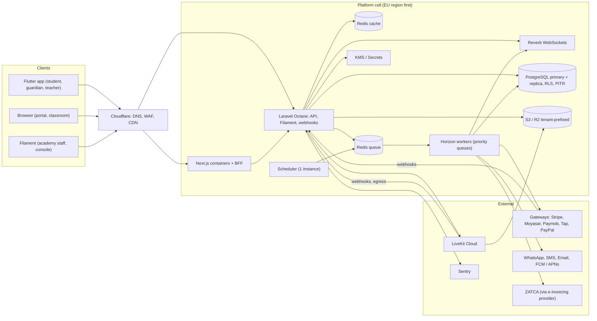
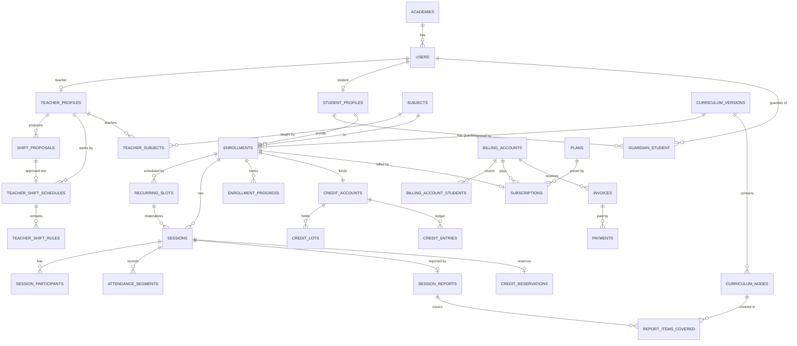

# 03 — المعمارية التقنية

[← الفهرس](README.md)

---

## 1. الـ Stack

| الطبقة | الاختيار | ليه |
|---|---|---|
| Backend | **Laravel** (أحدث إصدار مستقر وقت البداية، 12 أو أحدث)، PHP 8.4+، **Octane على FrankenPHP** | خبرة الفريق، والـ ecosystem متكامل (Queues، Horizon، Reverb، Pennant، Sanctum)، وOctane بيدّي أداء عالي |
| لوحات الإدارة | **Filament 5** (Livewire 4): لوحة للأكاديمية ولوحة Console للمنصة | CRUD ولوحات بسرعة جدًا، وكل module بيسجل شاشاته كـ plugin |
| قاعدة البيانات | **PostgreSQL 17/18** (managed)، بالإضافات `btree_gist`، و`ltree`، و`pg_trgm`، و`citext` | RLS، و exclusion constraints على الفترات الزمنية، و`tstzmultirange`، وتقسيم الجداول. وPG 18 فيه `uuidv7()` جاهز |
| Cache، Queues، Locks | **Redis**: نسخة للـ cache (LRU) ونسخة للـ queues (من غير eviction) | لو الـ cache اتملى مايمسحش jobs |
| Jobs | **Horizon**، والـ queues مترتبة بالأولوية | مراقبة الـ jobs والتحكم في الأولويات |
| Realtime | **Laravel Reverb** (WebSockets، بروتوكول Pusher) | إشعارات لحظية، ولوحة العمليات، وحالة الحصة |
| التخزين | **S3 / Cloudflare R2** + CDN، مع signed URLs | الواجبات الصوتية، والتسجيلات، والموارد |
| الفيديو | **LiveKit Cloud** في الأول، وبعدين على سيرفراتنا | التفاصيل في القسم 6 |
| الموبايل | **Flutter**: تطبيق واحد بيتغير حسب الدور (dio، flutter_bloc، go_router، livekit_client) | نفس أدوات الفريق في CBOT Fleet |
| الويب | **Next.js** (App Router) + React + Tailwind + LiveKit React | بوابة المدرس والطالب وولي الأمر، والفصل، والمواقع العامة (SEO) |
| عقد الـ API | **OpenAPI** بيتولّد من Laravel (Scramble)، ومنه clients بـ Dart وTypeScript | مفيش اختلاف بين الـ API والتطبيقات |
| الأخطاء والمراقبة | **Sentry**، وLaravel Pulse، و logs منظمة. وOpenTelemetry من المرحلة S2 | — |
| الحماية | **Cloudflare**: DNS، وWAF، وDDoS، وCDN، وبعدين Cloudflare for SaaS للدومينات الخاصة | — |
| الأسرار | KMS أو Secrets Manager | تشفير مفاتيح بوابات كل أكاديمية |

---

## 2. الشكل العام (Topology)



---

## 3. تعدد المستأجرين (Multi-tenancy)

### الاختيار: Schema مشتركة + `academy_id` + Global Scope + **RLS**

| الطبقة | الآلية |
|---|---|
| التطبيق | Trait اسمه `BelongsToTenant`: بيضيف global scope وبيملا `academy_id` تلقائيًا |
| قاعدة البيانات | **RLS بيقفل افتراضيًا**: لو المستأجر مش متحدد، مفيش أي صف بيرجع |
| العلاقات | **foreign keys مركّبة** في العلاقات الأساسية: `(academy_id, teacher_id) → users(academy_id, id)`. الـ RLS لوحده مش بيمنع إنك تدخل ID تابع لأكاديمية تانية، لأن فحص الـ foreign keys مابيمرش على الـ RLS |
| المعرفات | UUIDv7: مرتبة زمنيًا، وبتسهّل نقل أكاديمية لـ Cell تانية |

```sql
ALTER TABLE sessions ENABLE ROW LEVEL SECURITY;
ALTER TABLE sessions FORCE ROW LEVEL SECURITY;
CREATE POLICY tenant_isolation ON sessions
  USING      (academy_id = nullif(current_setting('app.tenant_id', true), '')::uuid)
  WITH CHECK (academy_id = nullif(current_setting('app.tenant_id', true), '')::uuid);
ALTER TABLE sessions ALTER COLUMN academy_id
  SET DEFAULT nullif(current_setting('app.tenant_id', true), '')::uuid;
```

### قواعد التشغيل
- **أدوار قاعدة البيانات**:
  - التطبيق بيتصل بـ role مش هو المالك.
  - الـ migrations بتشتغل بالـ owner.
  - connection منفصلة اسمها `pgsql_platform` بـ role عنده `BYPASSRLS`، ومسموحة **بس** في Platform والـ sweepers والـ Reporting. **Pest arch tests** بتفرض ده.
- **تحديد المستأجر لكل request**:
  - middleware بينفذ `SET app.tenant_id = …` في أول الـ request، و terminate hook بيمسحه.
  - ده آمن مع PHP-FPM ومع Octane على FrankenPHP أو RoadRunner، لأن كل worker بيخدم request واحد في المرة.
  - **ماتستخدمش Swoole coroutines.**
- **PgBouncer**: الـ transaction pooling مابينقلش الـ session settings. الحلول:
  - Octane يتصل بقاعدة البيانات مباشرة (عدد الاتصالات = عدد الـ workers + Horizon، وده رقم معقول).
  - أو session pooling.
  - أو `SET LOCAL` جوه transactions صريحة.
  - **لازم نقرر قبل التوسع، مش بعده.**
- **إزاي بنعرف المستأجر**:
  - الـ API لمستخدم مسجل دخوله: **الـ token هو مصدر الحقيقة**، لأن المستخدم تابع لأكاديمية واحدة. لو الـ host أو الـ header مختلف، يرجع 403.
  - من غير تسجيل دخول: من الـ host (subdomain أو دومين خاص).
  - `TenantContext` scoped binding، وبيتمسح مع كل request.
- **الـ Queues**: `tenant_id` بيتحط في **Laravel Context**، وده بيتنقل تلقائيًا مع الـ job، وبيرجع بـ `Context::hydrated()`. job middleware بيظبط `app.tenant_id` وبيمسحه في `finally`.
- **الـ Scheduler**:
  - المهام الحساسة للوقت (التذكيرات، والمواعيد النهائية، وقفل الحصص) = query واحد على كل الأكاديميات من `pgsql_platform`، وبيبعت jobs لكل أكاديمية.
  - المهام اللي بتعتمد على الوقت المحلي (زي التقرير الشهري) = dispatcher كل 15 دقيقة بيشوف الساعة كام عند كل أكاديمية.
- **باقي الطبقات**: مفاتيح الـ cache، ومسارات S3 (`tenants/{id}/…`)، وقنوات الـ broadcast (`private-academy.{id}.user.{id}`)، والـ rate limits، والـ logs، كلها فيها المستأجر (الـ Context بيضيف `tenant_id` للـ logs تلقائيًا).

### الهوية: المستخدم تابع لأكاديمية واحدة
- `UNIQUE(academy_id, lower(email))`. الأكاديمية هي المسؤولة عن البيانات، والمنصة بتعالجها لحسابها.
- **مدرس شغال في أكاديميتين = حسابين** (صاحبين شغل مختلفين).
- **ولي أمر عنده أولاد في أكاديميتين**: بيتنقل بين الحسابين في التطبيق (أكتر من token متخزن على الجهاز).
- **اكتشاف الحسابات بعد التحقق** في التطبيق العام: الإيميل أو الموبايل، ثم OTP، ثم قائمة الحسابات. **مابنكشفش أي عضوية قبل الـ OTP.**
- **Super Admins** في جدول منفصل `platform_admins` بـ guard خاص و 2FA، ومابيشوفوش بيانات الأكاديميات إلا بـ **الدخول بحساب مستخدم مع تسجيله**.
  - **المنفّذ**: guard اسمه `platform` ولوحة Filament لوحدها (`console`) من غير `ResolveTenant`، وتطبيق مصادقة إجباري. `platform_admins` عليه RLS من غير policy، فالـ connection بتاع الأكاديميات مابيشوفش منه ولا صف.
  - **الدخول بحساب مستخدم** (`impersonations` في Identity، جدول tenant): الأدمن بيطلب من اللوحة بسبب ومدة، والـ Action بيشتغل جوه `TenantContext::run` للأكاديمية دي. اللينك بيشتغل مرة واحدة ولمدة دقيقتين، على عنوان الأكاديمية بس (الـ RLS بيمنع أي أكاديمية تانية تلاقيه). كل request بعدها بيعدّي على `WatchImpersonation`: بيسجّل العمليات باسم فريق المنصة "بحساب" الشخص (`AuditActor` في الـ Context)، وبيقفل الجلسة لما وقتها يخلص أو تتقفل من اللوحة.
- **الأدوار ثابتة في الـ MVP**: `owner, admin, supervisor, scheduler, accountant, sales, teacher, student, guardian`.
  - مابنستخدمش "teams" بتاعة spatie/permission، لأن `setPermissionsTeamId()` حالة عامة ممكن تتسرب من request للتاني تحت Octane.

### Filament
- **من غير الـ tenancy المدمجة في Filament.** الـ `TenantContext` بيتحدد من الدومين، وFilament مابيعرفش حاجة عن المستأجرين.
- لوحة الأكاديمية على `{slug}.<platform-domain>/admin`.
- لوحة Console للمنصة على دومين لوحدها.
- كل module بيسجل شاشاته كـ **Filament plugin**.
- **ترتيب الـ middleware**: `ResolveTenant` أول واحد، قبل ما الـ session تحمّل المستخدم، وكل الـ middleware **persistent** عشان تشتغل تاني في كل طلب Livewire. لون الأكاديمية بيتسجل بعد ما الأكاديمية تتعرف (`ApplyAcademyColours`)، لأن Filament بيسجل الألوان قبل كده.
- الألوان بتتحول لدرجات (50–950) واللون نفسه بيفضل في درجة 600 اللي الأزرار بتستخدمها (`BrandPalette`)، والشاشات المخصصة بتستخدم متغيرات CSS بتاعة Filament (`--primary-600` وغيرها)، فبتتبع هوية الأكاديمية لوحدها.
- صور المستخدمين بتترسم من الحروف الأولى على السيرفر، مش من خدمة خارجية (Filament افتراضيًا بيبعت اسم كل مستخدم لـ ui-avatars).
- **الإجازات** (Scheduling):
  - `teacher_time_off`: فيه `starts_at` و`ends_at` بتوقيت UTC، والتوقيت اللي الإجازة اتطلبت بيه، و`all_day`، والحالة.
  - قيد `exclude using gist` على `tstzrange(starts_at, ends_at)` لكل مدرس، للطلبات المستنية واللي اتوافق عليها، فمفيش طلبين لنفس الوقت.
  - `academy_holidays`: فيه `first_day` و`last_day` (أيام بتوقيت الأكاديمية)، ومعاهم `starts_at` و`ends_at` محسوبين.
  - قيد `exclude` على `daterange` الأيام، فمفيش إجازتين في نفس الأيام.
  - `AvailabilityQuery` بيطرح الإجازات اللي اتوافق عليها وإجازات الأكاديمية من الشفتات.
  - `MaterializeSessions` بيسيب أيام إجازة الأكاديمية فاضية.
  - `CreditsApi::extend` بيمد صلاحية اللوتات اللي لسه مخلصتش.
- **الإطار المشترك** (`SharedKernel`، `shared::chrome.*`): كل لوحة بتحمّله زي طبقة الحركة (`shared::motion.*`).
  - `chrome/styles` في الـ head، و`chrome/script` بعد Livewire، و`chrome/greeting` في أول القائمة الجانبية (`SIDEBAR_NAV_START`).
  - CSS بتاع Filament جوه `@layer`، فأي CSS برّه الـ layers بيكسبه مهما كانت الـ specificity. وتصميم كل مرحلة (People) بيتكتب في الـ body بعد الإطار، فبيكسبه لما الـ specificity تبقى متساوية، عشان كده خلفية الإطار مكتوبة بـ `:where()`.
- **التنقل بين الصفحات = View Transitions من Livewire**:
  - فيه عنصر مخفي `wire:transition.navigate`، وده بيخلّي Livewire يشغّل `document.startViewTransition` مع كل `wire:navigate`. الـ root نفسه بيتبدل من غير حركة.
  - السكريبت بيدّي اسم (`view-transition-name`) لعنصر واحد بس لكل اسم، في الصفحة القديمة وبعدين في الجديدة، لأن المتصفح بيلغي الانتقال كله لو اسم اتكرر. الأسماء: `lms-page` (‏`.fi-main`، بس لو الصفحة مش نازلة لتحت)، و`lms-nav-side` و`lms-nav-top` و`lms-nav-tab` (الصفحة المفتوحة).
  - **ترتيب الوقت مهم**:
    - Livewire بيفك Alpine من الصفحة القديمة قبل ما المتصفح يصوّرها، وAlpine ساعتها بيرجّع الحاجات اللي كان رابطها (class القائمة المفتوحة، وopacity الصفحة). السكريبت بيرجّعها في microtask قبل الصورة.
    - في الصفحة الجديدة، الأسماء بتتحط ومكان القائمة بيترجع بعد ما Alpine يشيل `x-cloak` (في microtask بعد `livewire:navigated`)، وقبل ما المتصفح يصوّر الصفحة الجديدة. Filament بيرجّع مكان القائمة في `requestAnimationFrame`، وده بيبقى متأخر على الصورة.
  - `html.lms-settled` بتتحط مع أول تبديل جوه اللوحة، فعناصر القائمة بتدخل بالحركة في أول صفحة بس.
- الصلاحيات: كل module بيسأل عن **قدرة** (`SharedKernel\Authorization\Ability`) بـ `Gate::allows()`، وIdentity بس هو اللي بيربط الأدوار بالقدرات.
- اختيارات كل مستخدم (زي شكل لوحة العمليات) بتتعرّف من الـ module صاحب الشاشة (`UserPreferences::define()`)، وبتظهر لوحدها في **إعداداتي**.

---

## 4. نموذج البيانات

### قواعد عامة
- كل جدول تابع لأكاديمية فيه `academy_id uuid NOT NULL` + RLS.
- المعرفات UUIDv7.
- الفلوس `*_minor bigint` + `currency char(3)`.
- الوقت `timestamptz` بتوقيت UTC.
- النصوص اللي ليها لغتين: `name_ar` و`name_en`.
- عمود بحث عربي مُطبَّع:
  - أ/إ/آ ← ا، و ى ← ي، و ة ← ه، والتشكيل بيتشال.
  - عليه index بـ `pg_trgm`.
- **الجداول الكبيرة متقسمة بالشهر**: `attendance_segments`، و`notifications`، و`audit_logs`، و`kpi_events`، وصناديق الـ webhooks.

### الجداول حسب الـ Module

| Module | الجداول الأساسية |
|---|---|
| Platform | `academies`، `academy_domains`، `academy_branding`، `branding_templates`، `saas_plans`، `saas_subscriptions`، `usage_counters`، `platform_admins` |
| Identity | `users`، `roles/permissions`، `devices`، `otp_challenges`، `social_identities`، `consents`، `impersonations` |
| Catalog | `subjects`، `levels`، `categories` |
| People | `teacher_profiles`، `teacher_subjects`، `teacher_subject_categories`، `teacher_languages`، `student_profiles`، `guardian_student`، `supervisor_assignments` |
| Curriculum | `programs`، `curriculum_versions`، `curriculum_nodes`، `node_resources`، `assessment_definitions`، `version_node_mappings` |
| Enrollment | `enrollments`، `enrollment_teacher_assignments`، `enrollment_status_history` |
| Scheduling | `teacher_shift_schedules`، `teacher_shift_rules`، `shift_proposals`، `shift_proposal_rules`، `shift_proposal_comments`، `teacher_time_off`، `availability_overrides`، `academy_holidays`، `recurring_slots`، `booking_holds`، `sessions`، `session_participants`، `attendance_segments`، `session_events`، `policy_sets`، `policy_set_versions`، `scheduling_conflicts`، `schedule_shift_notices` |
| Classroom | `rooms`، `recordings`، `recording_access_logs`، `provider_webhook_inbox`، `tech_issue_reports` |
| Credits | `credit_accounts`، `credit_lots`، `credit_entries`، `credit_reservations` |
| Billing | `billing_accounts`، `billing_account_students`، `price_regions`، `plans`، `plan_prices`، `subscriptions`، `invoices`، `invoice_lines`، `invoice_sequences`، `payments`، `payment_methods`، `manual_payment_proofs`، `refunds`، `credit_notes`، `discount_rules`، `coupons`، `gateway_accounts`، `payment_checkouts`، `gateway_webhook_inbox`، `tax_profiles`، `tax_rates`، `einvoice_units`، `einvoice_documents` |
| Learning | `report_templates`، `report_template_versions`، `session_reports`، `report_items_covered`، `homework_assignments`، `homework_submissions`، `homework_reviews`، `enrollment_progress`، `enrollment_positions`، `assessment_attempts`، `certificates`، `report_cards` |
| Evaluation | `lesson_ratings`، `kpi_exclusions`، و(P2) `kpi_events`، `qa_rubrics`، `qa_audits`، `kpi_snapshots`، `scoring_configs` |
| Payroll | `rate_cards`، `rate_card_lines`، `teacher_rate_cards`، `teacher_earnings`، `payroll_periods`، و(P2) `payroll_statements`، `payouts` |
| CRM | `leads`، `lead_activities`، `lead_trials` (ومعاها تقييم المدرس)، `retention_tasks`، `referrals` |
| Import | `import_runs` (الملف، وقراءة أعمدته، والخيارات، والأرقام)، `import_rows` (كل صف، وحكم المعاينة، ونتيجة الاستيراد) |
| Communication | `notification_templates`، `notification_preferences`، `notifications`، `notification_deliveries`، `conversations`، `messages`، `announcements` |
| Support | `tickets`، `ticket_messages` |
| Reporting | `fact_sessions_daily`، `fact_revenue_daily`، `fact_subscriptions_monthly`، `fact_teacher_utilization_weekly`، `fact_funnel_daily` |
| Infra | `audit_logs` (ممنوع عليه UPDATE وDELETE، بـ trigger؛ الصفوف من غير أكاديمية للمنصة بس)، `media` |

### أهم الأعمدة في الجداول الأساسية

```text
academy_branding(academy_id UNIQUE, template_ref "builtin:{key}"|"saved:{id}"|null, tokens jsonb, logo_path, favicon_path)
branding_templates(academy_id, name UNIQUE per academy, tokens jsonb)
  -- tokens = {primary, attention, danger, info, neutral, heading_font, body_font, radius}
-- جلسات الويب في http_sessions، لأن sessions هو جدول الحصص
teacher_shift_schedules(id, teacher_id, version, effective daterange, status active|superseded,
                        approved_by, source_proposal_id)   -- نسخة واحدة سارية لكل مدرس (EXCLUDE)
teacher_shift_rules(schedule_id, teacher_id, weekday, local_start, duration_min, tz, kind work|break)
shift_proposals(id, teacher_id, base_schedule_id, author_role teacher|admin,
                status draft|submitted|changes_requested|countered|approved|rejected|withdrawn|superseded,
                effective_from, note, min_weekly_min, max_weekly_min, submitted_at,
                decided_by, decided_at, decision_note, override_reason, impact jsonb, version)
shift_proposal_rules(proposal_id, revision, weekday, local_start, duration_min, tz, kind)  -- revision لكل عرض مضاد
shift_proposal_comments(proposal_id, author_id, body, created_at)
recurring_slots(enrollment_id, teacher_id, weekday, local_start, duration_min, anchor, anchor_tz,
                minute_of_week int4multirange, effective daterange, status)  -- EXCLUDE: نفس المدرس، دقايق متداخلة في الأسبوع، وفترة متداخلة
leads(contact_name, phone_e164, email, country, timezone, locale, for_child, learner_name, learner_birth_year, subject_id,
      preferred_days jsonb, preferred_from, preferred_to, source, utm_*, notes, owner_id,
      stage new|contacted|trial_booked|attended|assessed|won|lost, stage_changed_at, lost_reason, last_contact_at,
      learner_id?, contact_id?, enrollment_id?)          -- الرقم بصيغة E.164، وحساب الطالب بيتعمل وقت ما يتحتاج
lead_activities(lead_id, kind, body, data jsonb, actor_id, created_at)
lead_trials(lead_id, session_id UNIQUE, teacher_id, starts_at, status booked|attended|missed|cancelled,
            level, recommended_plan_id, recommended_per_week, assessment, assessed_by, assessed_at)
schedule_shift_notices(slot_id, enrollment_id UNIQUE+changes_at, teacher_id, student_id, anchor_tz, other_tz, cause_tz,
                       changes_at, reverts_at, before_weekday/time, after_weekday/time, delta_min, lessons,
                       decision pending|keep_teacher|keep_student, decided_by, notified_early_at, notified_late_at)
sessions(id, academy_id, type, enrollment_id?, lead_id?, teacher_id, original_teacher_id, slot_id?,
         occurrence_key UNIQUE, starts_at, ends_at, blocked_until, status, review_reason,
         funding_status, makeup_for_session_id, reschedule_count, is_detached,
         anchor_tz, anchor_local_date, anchor_local_time, policy_version_id, decision jsonb, version)
session_participants(session_id, user_id, role, block_period tstzrange, is_active, first_join_at, attended_min)
attendance_segments(session_id, user_id, period tstzrange, source webhook|reconcile, quality jsonb)
teacher_profiles(user_id, gender, dialect, employment_type, max_weekly_min, max_daily_sessions,
                 accepts_new, accepts_trials, age_groups[], tier, rate_card_id, status)
guardian_student(guardian_id, student_id, relationship, is_primary, can_manage, receives_reports)
student_profiles(user_id PK, birth_date, stage kids|middle|teen|classic NULL)   -- شكل حساب الطالب: من السن، أو اللي الأكاديمية اختارته
session_reports(session_id UNIQUE, template_version_id, payload jsonb, engagement, overall, status,
                due_at, submitted_at)
report_items_covered(report_id, node_id, outcome, score, range_from, range_to, mistakes)
enrollment_progress(enrollment_id, node_id, status, mastery, sessions_count, mastered_at, next_review_at)
lesson_ratings(session_id, rater_id UNIQUE+session, student_id, teacher_id, stars 1–5, tags jsonb, comment, via app|link)
kpi_exclusions(session_id UNIQUE, teacher_id, reason platform|provider|academy|other, note, excluded_by)
rate_cards(name, currency, is_default)   -- جدول افتراضي واحد لكل أكاديمية
rate_card_lines(rate_card_id, subject_id NULL, session_type NULL, unit hour|lesson, amount_minor)   -- UNIQUE NULLS NOT DISTINCT
teacher_rate_cards(teacher_id UNIQUE, rate_card_id)
teacher_earnings(teacher_id, period, kind lesson|reversal|bonus|deduction, session_id, reverses_id UNIQUE, lesson_on, outcome, rule,
                 session_type, subject_id, booked_min, pay_pct, unit, rate_minor, amount_minor, currency, rate_card_id, note, created_by)
                 -- بيتضاف عليه بس، ومفيش قيد في شهر مقفول (trigger)
payroll_periods(month UNIQUE, closed_at, closed_by)   -- صف = شهر مقفول
import_runs(kind teachers|families|schedules, file_name, status staged|checked|done, headers, mapping, options, counts, created_by)
import_rows(run_id, line UNIQUE+run, cells jsonb, status new|update|skip|error → created|updated|skipped|failed, message, refs)
kpi_events(subject_type, subject_id, session_id, metric, value, severity, fault, occurred_at)   -- P2: مع الصور الشهرية
```

### مخطط العلاقات (ERD) للجداول الأساسية



---

## 5. المدفوعات والضرائب وZATCA

### الأكاديمية هي التاجر الرسمي (Merchant of Record)
المنصة **مابتمسكش فلوس الأكاديميات خالص**. لو مسكتها، هتبقى ميسّر مدفوعات (payment facilitator) وهتدخل في ترخيص SAMA وتحويل الأموال ومسؤوليات ضريبية.

| الحالة | الحل |
|---|---|
| **Stripe** | **Connect Standard** بـ direct charges. الأكاديمية صاحبة حساب Stripe، ومفيش أسرار نخزنها، وممكن ناخد رسوم منصة (application fee). ⚠️ Stripe غالبًا مش متاح لشركات مسجلة في مصر أو السعودية، فلازم نتأكد من قائمة الدول وقتها |
| **باقي البوابات** (Moyasar، Paymob، Tap، PayPal، HyperPay) | مفاتيح الأكاديمية نفسها، متشفرة بـ envelope encryption عن طريق KMS. **لكل حساب بوابة مسار webhook خاص**: `/webhooks/{gateway}/{gateway_account_public_id}`، عشان نعرف المستأجر والسر قبل ما نتحقق من التوقيع |
| **اشتراك الأكاديمية في المنصة** (SaaS) | كيان المنصة هو التاجر هنا. Stripe Billing لو كيان المنصة في دولة Stripe بيدعمها، وإلا فواتير يدوية أو مزوّد MoR |

### محرك فوترة خاص بينا فوق tokenization البوابات
مابنستخدمش الاشتراكات الجاهزة في البوابات، لأن نظام البلوك بيعتمد على الرصيد، والبوابات كتير، ولازم يبقى فيه مصدر حقيقة واحد. **كل فاتورة ليها لينك دفع (hosted pay link)**. ده الحل اللي بيشتغل في كل الحالات: الأسواق اللي بتدفع يدوي، والدفع التلقائي اللي بيفشل في التحقق الإضافي (SCA/3DS).

```php
interface PaymentGateway
{
    public function capabilities(): GatewayCapabilities; // currencies, methods (mada, Apple Pay, KNET…), tokenize, MIT, refunds
    public function createCheckout(Invoice $invoice, ReturnUrls $urls, bool $saveMethod): CheckoutSession; // hosted + 3DS
    public function chargeSaved(Invoice $invoice, PaymentMethodToken $token, string $idempotencyKey): ChargeResult; // MIT
    public function refund(Payment $payment, Money $amount, string $idempotencyKey): RefundResult;
    public function parseWebhook(Request $request): VerifiedGatewayEvent; // signature verified + normalized
}
```

| البوابة | المرحلة | الاستخدام | ملاحظات |
|---|---|---|---|
| **يدوي** (تحويل بنكي، InstaPay، فودافون كاش، كاش) | MVP | في كل مكان | رفع الإثبات، ثم موافقة، ثم تسجيل الدفعة |
| **Stripe Connect Standard** | MVP | أكاديميات مسجلة في الإمارات أو أوروبا أو بريطانيا أو أمريكا | كروت محفوظة للدفع التلقائي |
| **Moyasar** | MVP | السعودية | مدى، والكروت، وApple Pay، وSTC Pay، وtokenization |
| **Paymob** | MVP لو أول أكاديمية مصرية | الأكاديميات المسجلة في مصر | كروت بالجنيه ومحافظ |
| **Tap** | P2 | الخليج كله | KNET وBENEFIT |
| **PayPal** | P2 | بديل عالمي | — |
| **HyperPay** | عند الطلب | مؤسسات سعودية | — |

لازم نتأكد من دعم الكروت المحفوظة والدفع التلقائي لكل طريقة دفع وقت التعاقد، وخصوصًا مدى وApple Pay.

### قواعد الفلوس
- **المبالغ**: `amount_minor` + عملة ISO، بمكتبة `brick/money`.
  - **الدينار الكويتي والبحريني والعُماني والأردني بـ 3 خانات عشرية.**
  - مفيش تحويل عملة تلقائي. الأسعار من قوائم المناطق، والتحليلات بتحوّل بجدول `fx_rates`.
- **ترقيم الفواتير**: متسلسل من غير فجوات لكل أكاديمية، من صف في `invoice_sequences` عليه lock (مش Postgres sequence لأنها ممكن تسيب فجوات).
  - الفاتورة بعد ما تصدر مابتتعدلش، والتصحيح بـ **credit note**.
- **الـ Webhooks**: inbox فيه `UNIQUE(gateway_account_id, event_id)`، وjob بيعالجها ومابيتأثرش بالتكرار.

### المنفّذ دلوقتي (Billing)
- **`gateway_accounts`**:
  - حسابات الأكاديمية في Stripe وMoyasar وTap، والبوابة التجريبية.
  - المفاتيح متشفرة بمفتاح التطبيق (`encrypted:array`). الـ envelope encryption بـ KMS لسه.
  - الـ webhook بييجي على `/webhooks/payments/{academy}/{account}`، فالمستأجر والسر بيتعرفوا قبل ما نتحقق من التوقيع.
  - **Stripe** بمفتاح الأكاديمية نفسها، أو **حساب الأكاديمية مربوط بالمنصة** (`stripe_connect`، تحت).
  - **Paymob** بمفاتيح الأكاديمية: المفتاح السري والعام، ومفتاح الـ API، وسر الـ HMAC، وأرقام الـ Integrations (الكارت والمحافظ).
  - رقم الحساب المربوط في Stripe (`acct_…`) مش سر، فبيتحفظ في عمود عادي (`external_id`) عشان webhook المنصة يلاقيه.
- **`PaymentGateway`**:
  - `refuses`، و`createCheckout` (صفحة البوابة نفسها)، و`fetch`، و`parseWebhook`، و`check`.
  - الـ adapters من غير SDKs (Laravel HTTP client)، فالـ tests بتستخدم `Http::fake`.
  - **Stripe**: Checkout Sessions، والتوقيع بـ `Stripe-Signature` ومدة سماح 5 دقايق، والدينارات بمضاعفات 10.
  - **Moyasar**: Invoices بـ Basic auth، والـ webhook بيتعرف بـ `secret_token`.
  - **Tap**: Charges بـ `src_all`، والمبالغ بالوحدة الكبيرة. الـ webhook مجرد تنبيه، والحقيقة دايمًا من `GET /v2/charges/{id}`.
  - **Paymob**: intention بالمفتاح السري (`POST /v1/intention/`) فيها المبلغ بالقرش وأرقام الـ Integrations و`special_reference` = رقم المحاولة، والعميل بيروح على Unified Checkout. رقم الـ order عند Paymob هو مرجعنا. إشعار العملية بييجي على رابط الـ webhook بتاع الحساب، ومعاه HMAC-SHA512 على 20 حقل بترتيب ثابت (في `?hmac=`). ومع ذلك، الحقيقة دايمًا من Paymob نفسه: token من مفتاح الـ API، وبعدين `transaction_inquiry` بالـ order.
  - **Stripe Connect Standard** (`stripe_connect`):
    - مفاتيح المنصة في الإعدادات: `STRIPE_PLATFORM_SECRET` و`STRIPE_CONNECT_CLIENT_ID` و`STRIPE_CONNECT_WEBHOOK_SECRET`، ونسبة المنصة `STRIPE_APPLICATION_FEE_BP`.
    - الربط بـ OAuth: المالك بيروح على `connect.stripe.com/oauth/authorize`، وStripe بيرجّعه على عنوان واحد على المنصة (`/billing/stripe/connected`). الأكاديمية اللي طلبت بتيجي في `state` متشفّر وصالح 20 دقيقة، وبعدين بيرجع على صفحة الدفع الإلكتروني في الأكاديمية نفسها.
    - الدفع: Checkout Session بمفتاح المنصة وheader `Stripe-Account` (direct charge على حساب الأكاديمية)، و`application_fee_amount` لو فيه نسبة للمنصة. والـ metadata فيها الأكاديمية ورقم المحاولة.
    - webhook واحد لكل الحسابات المربوطة (`/webhooks/stripe-connect`) موقّع بسر المنصة: الأكاديمية من الـ metadata، والحساب من `account` في الـ event، وبعد كده نفس الـ inbox والتسوية.
    - "افصل الحساب" بينادي `oauth/deauthorize` ويقفل الحساب عندنا، والمدفوعات القديمة بتفضل.
- **`payment_checkouts`**:
  - كل محاولة دفع: `open`، أو `paid`، أو `failed`، أو `expired`، أو `refund_due`.
  - **`SettleCheckout`** هو اللي بيسأل البوابة وبيسجل الدفعة عن طريق `RecordPayment` بطريقة `online`.
  - فيه `UNIQUE(academy_id, checkout_id)` على `payments`، فمحاولة الدفع الواحدة مابتتسجلش مرتين.
  - **`billing:sweep`** كل 5 دقايق بيسأل البوابة عن المحاولات اللي وقتها خلص، وبعد نص ساعة سماح بيقفلها `expired`.
- **`gateway_webhook_inbox`**:
  - فيه `UNIQUE(academy_id, gateway_account_id, event_id)`، والسر نفسه مابيتحفظش جوه.
  - الـ webhook بيسوّي المحاولة على طول، ولو حصل خطأ الـ sweeper بيعيد المحاولة.
- **لينك الدفع**:
  - `GET /pay/invoice/{invoice}` موقّع ومؤقت لمدة 60 يوم، وفيه `u` (اللي بيدفع)، وبيتحط مكان `:link` في رسالة الفاتورة (`NotificationLinks::registerPersonal('invoice')`).
  - رجوع العميل بيكون على نفس الـ host اللي بدأ منه، عشان جلسته تفضل شغالة.
  - الـ trigger على `payment_checkouts` بيبعت `payments:{payer}` لصفحة اللي بيدفع، فبتتحدّث لوحدها.
- **الضريبة**: `tax_profiles` لكل أكاديمية: التسجيلات حسب الدولة، والسعر شامل الضريبة أو لأ.
  - أسعار المستهلك في الخليج بتتعرض شاملة الضريبة.
  - هل الضريبة بتتطبق على التدريس عبر الحدود؟ ده إعداد عند الأكاديمية حسب مستشارها الضريبي، مش حاجة ثابتة في الكود.

### ZATCA (للأكاديميات السعودية المسجلة في ضريبة القيمة المضافة)
- **MVP: المرحلة الأولى**: فاتورة مبسطة فيها العربي، والرقم الضريبي، و**QR بصيغة TLV**.
  - **المنفّذ**:
    - إعداد `zatca` في `billing_settings` ومعاه الاسم المسجل (`seller_name`)، وبيتطلب رقم ضريبي سعودي صحيح: 15 رقم، أوله 3 وآخره 3.
    - وقت إصدار الفاتورة (`TaxDocument::stamp`)، الاسم والرقم الضريبي ونوع المستند (`tax_document = simplified`) والـ QR بيتحفظوا على الفاتورة نفسها. والـ QR هو base64 لخمس حقول TLV: الاسم، والرقم الضريبي، ووقت الإصدار UTC، والإجمالي بالضريبة، والضريبة.
    - الكود متجرّب على المثال الرسمي بتاع ZATCA، والـ QR بيترسم SVG على السيرفر.
    - الـ QR بيتعمل للفواتير بالريال بس. الفاتورة بعملة تانية محتاجة الضريبة بالريال كمان، ودي لسه.
    - الإلغاء بـ **إشعار دائن** (`credit_notes`): رقم متسلسل لوحده، والمرجع للفاتورة، والسبب، ونفس المبالغ، وQR بتاعه. الـ trigger بيمنع تعديله أو مسحه.
- **P2: المرحلة التانية**: عن طريق adapter اسمه `EInvoicingProvider`.
  - تسجيل وحدة الفوترة (EGS) لكل أكاديمية من Filament: CSR، ثم OTP، ثم فحوصات الامتثال، ثم شهادة الإنتاج (CSID).
  - **توقيع الفواتير لازم يمشي بالترتيب لكل وحدة** (عداد الفواتير + سلسلة الـ hash)، على queue بيشتغل على فاتورة واحدة في المرة.
  - **الفواتير المبسطة (B2C)**: بتتبلغ خلال 24 ساعة. **الفواتير الضريبية (B2B)**: لازم تتعتمد (clearance) قبل ما تتبعت.
  - الاسترداد بـ credit note بس.
  - XML والـ hash والـ QR بيتحفظوا طول مدة الحفظ القانونية.
  - **قرار مبكر**: مكتبة بيتم صيانتها، ولا مزوّد وسيط معتمد؟ لفريق صغير، المزوّد الوسيط أحسن في الأول.
  - لازم نعرف الأكاديميات اللي هتجرب تابعة لأنهي موجة إلزام.
- إيصالات مصلحة الضرائب المصرية الإلكترونية: adapter بعدين.

### متاجر التطبيقات
- **Apple 3.1.3(d)**: الخدمات الحية **بين شخصين (1:1)** زي التدريس مسموح تتباع برّه الـ in-app purchase.
- الخدمات **لعدد صغير أو كبير** (one-to-few / one-to-many) لازم تتباع بـ in-app purchase. يعني **الحصص الجماعية والمحتوى المسجل لازم يتباعوا من الويب**.
- سياسة Google Play مختلفة، ولازم نتأكد منها.
- الحل البديل: لينكات دفع في الأماكن اللي مسموح فيها بده.

---

## 6. الفصل المباشر (Live Classroom)

### مقارنة مزوّدي الفيديو

| | LiveKit | Zoom Video SDK | Agora | 100ms | Jitsi / BBB |
|---|---|---|---|---|---|
| Flutter SDK | رسمي (`livekit_client`) | رسمي | رسمي وناضج | جيد | Jitsi عنده SDK، وBBB WebView بس |
| Web SDK | JS + React رسمي | موجود | موجود | موجود | ويب أصلًا |
| التسجيل | Egress على S3 بتاعنا (فيديو مجمّع، أو كل مسار لوحده، أو صوت) | تسجيل سحابي | تسجيل سحابي | موجود | Jibri / BBB (تقيل) |
| تشغيله عندنا وموقع البيانات | **مفتوح المصدر، ونقدر نشغّله في أي منطقة (السعودية، أوروبا)** | لأ | محدود | لأ | آه، بس تشغيله متعب |
| Webhooks | دخول وخروج المشاركين، والغرفة، والتسجيل | موجود | موجود | موجود | محدود |
| سلامة الأطفال | صلاحيات في الـ token: مشرف مخفي، والتحكم في مين يبث، وحجم الغرفة | بعضها | بعضها | بعضها | محدود |
| الارتباط بالمزوّد | منخفض | عالي | عالي | متوسط (لازم نقيّم استمرارية الشركة) | منخفض |

**التوصية**:
- نبدأ بـ **LiveKit Cloud**، وننقل لـ **LiveKit على سيرفراتنا** (فرانكفورت، الرياض، فيرجينيا) لما الحجم يبرر أو أكاديمية تطلب البيانات في بلدها.
- كل ده ورا adapter اسمه `VideoProvider`.
- ومعاه مزوّد **ExternalLink** (لينك Zoom أو Meet والحضور يدوي) كبديل في الـ MVP.

### الغرفة
- Simulcast، وadaptive stream، وصوت بس لو الشبكة ضعيفة (الإنترنت المنزلي في مصر).
- فحص الأجهزة والشبكة قبل الدخول.
- المشرف يدخل من غير ما يظهر للجودة، وولي الأمر يدخل متابع.
- عارض محتوى متزامن (صفحة المصحف أو PDF عن طريق data channel) في P2، والسبورة بعده.

### مصدر الحقيقة في الحضور
- الـ Webhooks بتتخزن في `attendance_segments`، وبنطابقها مع **الـ room participant API** عند المواعيد النهائية وعند قفل الحصة.
- **الوقت المدرَّس** = تقاطع فترات المدرس مع فترات الطالب. ده expression واحد بـ `tstzmultirange` في Postgres.
- **كل مشكلة ليها مسؤول**: `fault ∈ {teacher, student, platform, provider, unknown}`. بنحدده من أحداث جودة الاتصال، وتشخيص الجهاز، وحوادث المزوّد.

### المنفّذ دلوقتي
- **module اسمه `Classroom`**، بيعتمد على Contracts بس:
  - Scheduling (`AttendanceApi`: الحصة، والحضور).
  - Learning (`planFor`: خطة اليوم).
  - People (أولياء الأمور).
  - Communication (`NotificationLinks`: لينك كل شخص).
  - Platform (الشعار، ولينك الأكاديمية).
- **`VideoProvider`** وتحته `LiveKitProvider` و`ExternalLinkProvider`، وبيختارهم `ProviderManager` حسب إعداد الأكاديمية (`classroom_settings`).
- **LiveKit**:
  - الـ access token بنعمله بنفسنا (JWT HS256 بالـ video grants)، من غير SDK.
  - الغرفة بنعملها بـ Twirp `RoomService/CreateRoom` (best effort، لأن LiveKit بيعملها لوحده عند أول دخول).
  - قايمة اللي جوه بـ `ListParticipants`.
  - اسم الغرفة `{academy}_{lesson}`، فالـ webhook بيعرف الأكاديمية من غير tenant في الطلب.
- **الـ Webhooks** (`POST /webhooks/livekit`):
  - التوقيع: JWT فيه `sha256` لجسم الطلب.
  - بتتخزن في `provider_webhook_inbox` بـ unique على `event_id`، فالتكرار مابيعملش حاجة.
  - الدخول بيفتح فترة في `attendance_segments`، والخروج بيقفلها. قفل الغرفة بيقفل كل الفترات المفتوحة.
- **`classroom:reconcile`** كل دقيقة: بيقارن الفترات المفتوحة باللي في الغرفة فعلًا، ويصلّح اللي webhook ضاع منه (`source = reconcile`).
- **الكراسي**:
  - المدرس والطالب بيبثوا.
  - ولي الأمر بيقعد مكان ابنه.
  - المشرف `observer:{id}` بـ `hidden` ومن غير بث. مابيتحسبش في الحضور.
- **قاعدة البيانات**:
  - `attendance_segments` فيها فترة مفتوحة واحدة بس لكل شخص في الحصة (partial unique index).
  - الوقت المدرَّس = `range_agg(المدرس) * range_agg(الطالب) * tstzrange(الحصة)`، ولو مفيش فترات بنرجع لتقريب أول دخول.
- **التشغيل على الجهاز**: `docker compose` فيه LiveKit (`livekit/livekit-server:v1.13.7`، بورتات 7880 و7881 و7882/udp)، والـ webhooks رايحة للـ API. اتجرّب بحصة حقيقية بين متصفحين ومشرف مخفي، والحضور اتسجل من الـ webhooks.

### التسجيلات والتكلفة
- الافتراضي:
  - فيديو مجمّع بجودة منخفضة للحصص اللي فيها أطفال، وصوت بس للكبار.
  - **الاحتفاظ 30 يوم**، وبيتحفظ أكتر لو فيه شكوى (legal hold).
  - المدرس مايقدرش ينزّل التسجيل، وكل مشاهدة بتتسجل.
- **الحجم**:
  - فيديو حوالي 500kbps: حوالي 170MB لحصة 45 دقيقة. صوت 32kbps: حوالي 11MB.
  - عند 800 ألف حصة في الشهر: حوالي 135TB فيديو أو 9TB صوت.
- **دقائق المشاركين** عند 100 ألف طالب: 8 حصص × 45 دقيقة × 2 مشاركين = **حوالي 72 مليون دقيقة في الشهر**. دي أكبر تكلفة متغيرة، وعشانها لازم نخطط ننقل LiveKit لسيرفراتنا.

---

## 7. الـ API والـ Realtime

### قواعد الـ API
- REST على `/api/v1`.
- الأخطاء بصيغة **RFC 7807 Problem Details** (رسائل بالعربي والإنجليزي حسب `Accept-Language`).
- Cursor pagination.
- **`Idempotency-Key` إجباري** في الدفع والحجز والإلغاء.
- `If-Match` أو `version` عند التعديل.
- الوقت UTC بصيغة ISO-8601 وفي آخره `Z`. القواعد المتكررة `{weekday, local_time, tz}`.
- **كل وقت بيظهر بتوقيت المستخدم اللي بيشوفه:**
  - التطبيقات وبوابة الويب بتبعت توقيت الجهاز في header اسمه `X-Timezone` (اسم IANA زي `Asia/Dubai`).
  - التوقيت المستخدم في الرد بالترتيب: توقيت الجهاز، ثم توقيت الحساب، ثم توقيت الأكاديمية، ثم UTC. والرد بيرجع نفس الـ header ومعاه `Vary: X-Timezone`.
  - كل لحظة زمنية بتطلع بالشكل ده: `{utc, local, timezone, label}` (عن طريق `LocalTimePresenter`)، مثلًا `"label": "الاثنين 5 أكتوبر · 22:00"`. ونفس الشكل بيستخدم لتوقيت الطرف التاني ("عند الطالب 20:00 لندن").
  - لو توقيت الجهاز مختلف فعلًا عن توقيت الحساب (مسافر)، `/me` بيرجع `timezone_mismatch: true`، والتطبيق بيسأل المستخدم، ولو وافق بيبعت `PATCH /me` بالتوقيت الجديد.
  - التحويل من وقت محلي متكرر لـ UTC بيعدّي على `LocalTimeResolver`: الساعة اللي مش موجودة بتتأجل بمقدار الفرق، والساعة المتكررة بتاخد أول مرة.
- كل رد فيه وقت الطرف التاني جاهز للعرض ("18:00 الرياض").

### OpenAPI
- Scramble بيولّد `openapi.json`، والملف ده **بيتعمل له commit في الريبو**.
- **`oasdiff` في الـ CI** بيمنع أي تغيير بيكسر التوافق.
- منه بيتولّد `api-client-dart` (dart-dio) و`api-client-ts`.

### تسجيل الدخول
- **الموبايل**: Sanctum tokens ليها مدة صلاحية، ومتخزنة في secure storage (زي CBOT Fleet). وفيه أكتر من token متخزن للتنقل بين الحسابات.
- **الويب (Next.js)**: **BFF**. الـ token في httpOnly cookie على دومين الأكاديمية، والمتصفح مابيشوفش الـ bearer token. Next.js بيمرر `/api/*` للـ Laravel.

### Realtime (Reverb)
- القنوات:
  - `private-academy.{id}.user.{id}`: إشعارات المستخدم.
  - `private-academy.{id}.session.{id}`: حالة الحصة.
  - `private-academy.{id}.ops`: لوحة العمليات.
- مسموح بس للأعضاء في نفس الأكاديمية (`routes/channels.php` بيتحقق من `academy_id`).

**المنفّذ دلوقتي (لوحة العمليات، والجرس، وحصص المدرس النهارده):** الشاشات دي بتتحدث لما حاجة تتغير بس، من غير أي تحديث كل فترة.
- **التغيير بيطلع من قاعدة البيانات نفسها**: triggers على الجداول بتعمل `pg_notify('lms_live', '{topic}:{id}')`.
  - `board:{academy}`: من أي كتابة على `sessions` أو `session_participants` أو `session_events`.
  - `lessons:{teacher}`: من أي تغيير في ميعاد الحصة أو حالتها أو مدرسها. ولو الحصة اتنقلت لمدرس تاني، الاتنين بيوصلهم.
  - `inbox:{user}`: من رسالة جديدة أو اتقرت، على `notifications`.
  - Postgres بيبعتها **بعد الـ commit بس**، وبيدمج التكرار جوه الـ transaction الواحدة في رسالة واحدة. فإلغاء حصة أو دخول طالب = إشارة واحدة، ومفيش كتابة ممكن تفلت، سواء من Eloquent أو query builder أو SQL مباشر.
- **`live:relay`** (في SharedKernel) بروسيس صغيرة:
  - بتعمل `LISTEN` وتستنى على الـ socket، فلو مفيش تغيير مابتعملش أي query.
  - بتدمج الدفعة اللي بتيجي ورا بعض في ربع ثانية، وأقصى إشارة واحدة في الثانية لكل مفتاح (`SignalFolder`).
  - كل module بيقول الـ topic بتاعه يتحوّل لأنهي event (`LiveSignals::on`)، والـ events كلها من غير بيانات:
    - `BoardChanged` على `private-academy.{id}.board`.
    - `TeacherLessonsChanged` و`InboxChanged` على قناة الشخص نفسه `private-user.{id}` (`PersonalChannel`). محدش بيسمعها غير صاحبها.
  - كل شاشة بتجيب اللي هتعرضه بنفسها، بصلاحيات وتوقيت اللي فاتحها.
  - على القناة العامة `lms.live` بتبعت "alive" كل دقيقة، و"resync" لما تبدأ.
  - بتقف لوحدها بعد `queue:restart`، عشان تشتغل تاني على الكود الجديد.
- **الصلاحية**:
  - قناة اللوحة لحد من نفس الأكاديمية (من الـ host) وعنده `ViewLiveBoard`.
  - قناة الشخص لصاحبها بس.
  - `/broadcasting/auth` بيعدّي على الـ middleware بتاع المستأجر.
- **المتصفح**:
  - Echo بيتفتح في كل صفحات اللوحتين (`EnableBrowserEcho`)، على نفس host الأكاديمية والبورت 8080: اتصال واحد بيستنى، بدل timer الجرس اللي كان كل دقيقة في كل صفحة.
  - `LmsLive.watch()` (في `shared/live.blade.php`) مشترك بين الشاشات: الإشارة، واللحظة الجاية (`data-live-next`)، والتبويب المخفي، والرجوع للـ timer.
  - **الجرس**: بيتحدث لما رسالة توصل أو تتقري من جهاز تاني. ولما تفتحه والقايمة بقالها أكتر من دقيقة، بيحدّث مرة عشان "من 5 دقايق" تبقى صح.
  - **حصصي النهارده**: بتتحدث لما حصة من حصص المدرس تتغير، وفي اللحظة اللي الفصل بيفتح أو يقفل فيها.
  - التحديث بيحصل في الحالات دي:
    - لما توصل إشارة (بعد 300ms، عشان الدفعة تتجمع).
    - في **اللحظة اللي الوقت لوحده بيغيّر فيها اللوحة**: بداية حصة، أو تأخير المدرس عند T+2، أو تذكير الطالب، أو حصة داخلة في الساعة الجاية، أو نص الليل. السيرفر بيحسب اللحظة دي ويبعتها مع الصفحة (`BoardClassifier::nextChange`).
  - العدّادات (بدأت من كام دقيقة، وفاضل كام، والحضور، والساعة) بتتحسب في المتصفح.
  - التبويب المخفي مابيحدّثش، وبيحدّث مرة واحدة لما يرجع يظهر.
  - **لو مفيش اتصال**، أو `live:relay` ساكتة أكتر من دقيقتين ونص، كل شاشة بترجع للـ timer بتاعها زي الأول: اللوحة كل 30 ثانية وبتكتب كده للمستخدم، والجرس كل دقيقة. ولما الاتصال يرجع، بتتحدث مرة وتسكت.
- **اتقاس على Docker**:
  - تغيير من برّه المتصفح ظهر في أقل من ثانية، بطلب واحد.
  - اللوحة الفاضية مابعتتش أي طلب في 125 ثانية، وده كان هيبقى 4 طلبات قبل كده (كل طلب بيعيد رسم اللوحة كلها: حوالي 120–400ms و6 queries للبيانات).
  - **10 مشرفين فاتحين اللوحة 8 ساعات = حوالي 9,600 رسمة في اليوم قبل كده.** دلوقتي الرسمات بعدد التغييرات الفعلية بس.

---

## 8. التطبيقات

### Flutter (تطبيق واحد بيتغير حسب الدور)
- **ثلاث واجهات** على go_router:
  - **الطالب**: الجدول، والدخول للحصة، والـ roadmap، والواجبات (تسجيل صوتي)، والتقارير.
  - **ولي الأمر**: يتنقل بين أولاده، وفواتيره، ولينكات الدفع.
  - **المدرس**: الجدول، و**اقتراح شفتاته ومتابعة حالتها**، والدخول، والتقرير، وتصحيح الواجبات، والأرباح.
- **إجبار التحديث** + remote config، وpush (FCM/APNs)، وdeep links للحصة.
- العربي والإنجليزي بـ RTL كامل، بنفس أسلوب `core/l10n` في CBOT Fleet.
- **White-label (P3)**: flavors + `--dart-define-from-file tenants/<slug>.json`.
  - ⚠️ **Apple 4.2.6**: كل تطبيق white-label لازم يتنشر من **حساب مطوّر الأكاديمية نفسها**.
  - البديل المسموح: التطبيق العام اللي فيه اختيار الأكاديمية.

### Next.js
- **البوابة**: المدرس هو أكتر حد بيستخدم الويب، بس الطالب وولي الأمر كمان.
- **الفصل**: `app/(classroom)/[locale]/session/[id]` بـ LiveKit React.
- **المواقع العامة لكل أكاديمية (P2)**: ISR بـ tag لكل أكاديمية، وSEO، ونموذج lead.
- `middleware.ts` بيحدد المستأجر واللغة من الـ host.

### Filament
- **لوحة الأكاديمية**: كل التشغيل (الشفتات، والبحث عن مدرس، ولوحة العمليات، والفواتير، والمرتبات، والـ CRM، والجودة).
- **Console**: المنصة.
- كل module بيسجل `Resources` و`Pages` و`Widgets` بتوعه عن طريق plugin.

---

## 9. البنية التحتية والبيئات وCI/CD

### البيئات

| البيئة | الوصف |
|---|---|
| `local` | Docker / Sail، ومعاها Postgres وRedis وMinIO وMailpit |
| `ci` | Postgres مؤقت فيه RLS والـ migrations |
| `staging` | زي الإنتاج، وفيها sandbox للبوابات ومشروع LiveKit منفصل. **بيانات وهمية بس، ومانسخش بيانات أطفال من الإنتاج أبدًا** |
| `production` | فيها **أكاديمية تجريبية** ببيانات وهمية للمبيعات |
| Mobile flavors | `dev`، `staging`، `prod` |

### المنطقة
- نبدأ بـ **منطقة أوروبية واحدة (فرانكفورت)**: قريبة من مصر والخليج، ومناسبة لـ GDPR. وPDPL السعودي بيسمح بالنقل بضمانات.
- **Cell سعودي** لما عميل يطلب إن البيانات تفضل جوه المملكة.

### CI/CD (GitHub Actions، والـ workflow بيشتغل حسب الفولدر اللي اتغير)
- **API**:
  - Pint، وLarastan، وPest (unit، وfeature، و**arch**، و**عزل المستأجرين**، و**DST**).
  - `oasdiff` على الـ OpenAPI.
- **Mobile**: `flutter analyze`، و`flutter test`، والـ build. النشر بـ Fastlane أو Codemagic.
- **Web**: lint، وtypecheck، والاختبارات، والـ build.
- **النشر**:
  - الصور بتتبني وتتخزن في الـ registry.
  - الـ merge على `main` بيعمل deploy على staging.
  - الإنتاج بـ tag + موافقة يدوية.
- **الـ Migrations**: بأسلوب expand/contract، عشان مايبقاش فيه توقف.

---

## 10. خطة التوسع

| المرحلة | الطلاب | الحصص في الشهر | أقصى عدد غرف في نفس الوقت | اللي بيتغير |
|---|---|---|---|---|
| **S1** | لحد 1,000 | حوالي 8 آلاف | 30–50 | API ×2 (Octane)، Horizon ×2، Scheduler ×1، Reverb ×1. Postgres managed (2 vCPU + PITR). Redis ×2. LiveKit Cloud |
| **S2** | حوالي 10,000 | حوالي 80 ألف | 300–600 | autoscale للـ API من 3 لـ 6. **queues منفصلة**: `critical`، `realtime`، `notifications`، `webhooks`، `einvoice` (فاتورة واحدة في المرة)، `reports`، `low`. Postgres 4–8 vCPU + **read replica** لجداول Filament والتقارير. تقسيم الجداول الكبيرة بالشهر. Reverb ×2 بـ Redis. التسجيلات ورا CDN. نتفاوض على سعر LiveKit. OpenTelemetry |
| **S3** | حوالي 100,000 | حوالي 800 ألف | 3–6 آلاف (ذروة الخليج 13–19 UTC، وذروة أمريكا 22–03 UTC، والويك إند) | **Cells**: نسخ مستقلة في أوروبا والسعودية (وأمريكا لو احتجنا)، والأكاديمية متثبّتة على Cell عن طريق دليل عام. **LiveKit على سيرفراتنا** + egress في نفس المنطقة. التحليلات في ClickHouse أو BigQuery عن طريق CDC. الأكاديميات الكبيرة في Cell خاص بيها. Session pooling |

**ليه Postgres كفاية لحد S3**: حوالي 10 مليون حصة في السنة مع تقسيم الجداول ده حجم عادي جدًا. مافيش داعي نقسّم قاعدة البيانات (sharding) قبل الـ Cells.

**امتى نفصل module لـ service؟**
- لما يبقى ليه نمط حمل مختلف خالص، زي استقبال webhooks الفيديو أو الإشعارات.
- أو لما يحتاج فريق مستقل.
- قبل كده الـ monolith أسرع وأرخص.

---

## 11. الأمن والخصوصية والامتثال

### عزل المستأجرين
- [ ] RLS بيقفل افتراضيًا + global scope + foreign keys مركّبة.
- [ ] `BYPASSRLS` على connection المنصة بس، وarch tests بتفرض ده.
- [ ] **اختبار تلقائي**: أكاديميتين، وكل endpoint، والمتوقع 403 أو 404.
- [ ] المستأجر موجود في مفاتيح الـ cache، ومسارات S3، والقنوات، والـ logs.

### الهوية والوصول
- [ ] 2FA إجباري للـ Super Admin والـ Owner والـ Admin. (فريق المنصة منفّذ: تطبيق مصادقة إجباري على `/console`. المالك والمدير لسه.)
- [ ] rate limit على الـ OTP، وقائمة الأجهزة، وتسجيل الخروج عن بعد، وصلاحية للـ tokens.
- [x] الدخول بحساب مستخدم: بسبب، ولوقت محدد، ومتسجل، وبيظهر في نشاط المستخدم. (لينك مرة واحدة على عنوان الأكاديمية، وشريط فيه الوقت الباقي، وتغيير كلمة السر مقفول، و"دخول فريق المنصة على حسابك" في إعداداته.)
- [x] سجل مراجعة مابيتعدلش ومابيتمسحش (trigger)، معزول بالـ RLS لكل أكاديمية، ومابيتسجلش فيه أسرار.

### المدفوعات (PCI)
- [ ] checkout مستضاف عند البوابة، أو redirect، أو SDK البوابة بس: **PCI SAQ A**. (لو JS من صفحتنا بيبعت بيانات الكارت، غالبًا هيبقى SAQ A-EP).
- [ ] مفيش بيانات كروت في الـ logs.
- [ ] أسرار البوابات متشفرة بـ KMS.
- [ ] التحقق من توقيع الـ webhooks.
- [ ] idempotency في كل عمليات الفلوس.
- [ ] مفيش محفظة نقدية.

### الأطفال وسلامتهم
- [ ] **موافقة ولي الأمر موثّقة** قبل ما نجمع بيانات الطفل.
  - COPPA: تعديلات FTC في 2025 بتطلب سياسة احتفاظ مكتوبة وبرنامج أمن معلومات.
  - GDPR Art. 8: السن من 13 لـ 16 حسب الدولة.
  - UK Children's Code.
- [ ] **المدرس مابيشوفش موبايل أو إيميل الطالب أو ولي الأمر.**
- [ ] المحادثة بين المدرس والطفل على المنصة بس، وولي الأمر فيها.
- [ ] زرار "الإبلاغ عن مخاوف".
- [ ] مستندات فحص المدرسين (الفيش الجنائي).
- [ ] خيار جنس المدرس، والكاميرا اختيارية للطالب.

### التسجيلات
- [ ] موافقة عند التسجيل (من ولي الأمر) وفي عقد المدرس.
- [ ] تشفير وهي متخزنة، وsigned URLs بعمر قصير، وكل مشاهدة بتتسجل، ومفيش تنزيل للمدرس.
- [ ] الاحتفاظ 30 يوم افتراضيًا، وأكتر لو فيه شكوى، وخيار صوت بس.
- [ ] DPIA (تقييم أثر على حماية البيانات) يشمل القُصّر.

### PDPL السعودي
- [ ] إشعار خصوصية بالعربي، وأساس قانوني لمعالجة البيانات، وإجراءات لطلبات أصحاب البيانات.
- [ ] **الإبلاغ عن أي تسريب لسدايا (SDAIA) خلال 72 ساعة.**
- [ ] ضمانات لنقل البيانات برّه المملكة، ونشوف هل التسجيل ومسؤول حماية البيانات (DPO) إلزامي.
- [ ] اتفاقية معالجة بيانات (DPA): الأكاديمية مسؤولة عن البيانات، والمنصة بتعالجها لحسابها.

### GDPR
- [ ] DPA حسب المادة 28، وقائمة منشورة بالمزودين الفرعيين.
- [ ] **SCCs + تقييم أثر النقل**، لأن مدرسين في مصر بيوصلوا لبيانات أوروبية.
- [ ] موافقة الكوكيز في المواقع العامة، وحذف وتصدير البيانات لكل أكاديمية.

### قانون حماية البيانات المصري (151 لسنة 2020)
- [ ] نشوف التراخيص والتصاريح المطلوبة للمعالجة في مصر ولنقل البيانات برّه.

### أمن التطبيق
- [ ] OWASP ASVS L2، وCSP، وrate limits، وCloudflare WAF وحماية DDoS.
- [ ] `composer audit` و`npm audit` وDependabot، وsecret scanning.
- [ ] فحص فيروسات للملفات المرفوعة (الواجبات الصوتية، وإثباتات الدفع).
- [ ] اختبار اختراق قبل الإطلاق.

---

## 12. المراقبة والتشغيل

| البند | الهدف |
|---|---|
| توافر الـ API | 99.9% |
| زمن الاستجابة | p95 أقل من 300ms |
| نجاح الدخول للحصة | أكتر من 99% |
| التذكيرات | توصل قبل الحصة بـ 10 دقايق |
| أقصى بيانات ممكن تضيع (RPO) | 5 دقايق (PITR) |
| أقصى وقت للرجوع (RTO) | 4 ساعات، ومعاها تجربة استرجاع كل 3 شهور |
| نافذة الصيانة | حوالي 05:00–10:00 UTC (أقل وقت فيه حصص) |

- إخفاء البيانات الشخصية في الـ logs وفي Sentry.
- Runbooks لـ: البوابة مش شغالة، وLiveKit مش شغال (التحويل لـ ExternalLink)، وتأخر الـ queue، وتحديث tzdata.

---

## 13. استراتيجية الاختبار

| النوع | التغطية |
|---|---|
| Unit | `LocalTimeResolver` (القاهرة، لندن، نيويورك، سيدني، الدار البيضاء)، و`WeekBitset`، ومحرك السياسات (كل قاعدة في الجدول)، والـ ledger، وحساب الـ KPIs |
| Feature | كل Action: الحجز، والإلغاء، والتعويض، والقفل، والتجديد، والـ webhooks (بـ fixtures من كل بوابة) |
| **Arch** | حدود الـ modules (الكتابة عن طريق Contracts بس)، ومين مسموح له يستخدم `pgsql_platform`، ومفيش اعتماديات دائرية |
| **عزل المستأجرين** | أكاديميتين، وكل endpoint، والمتوقع 403 أو 404. وقراءة مباشرة من غير `app.tenant_id` المتوقع ترجّع صفر صفوف |
| **DST** | سيناريوهات 2027 الحقيقية (14 مارس، 28 مارس، 30 أبريل، 28 أكتوبر، 31 أكتوبر، 7 نوفمبر) على مواعيد ثابتة على توقيت المدرس وعلى توقيت الطالب |
| Concurrency | اتنين بيحجزوا في نفس الوقت، والمتوقع: واحد ينجح والتاني ياخد 409 |
| Contract | `oasdiff`، واختبارات الـ adapters على sandbox كل بوابة |
| E2E | Playwright للويب، وintegration_test للموبايل في التدفقات الأساسية |
