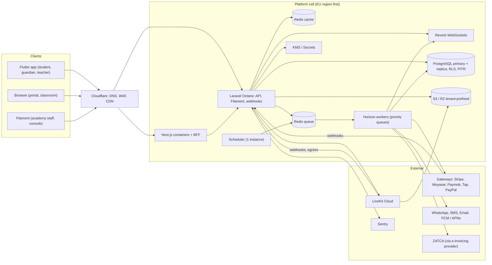
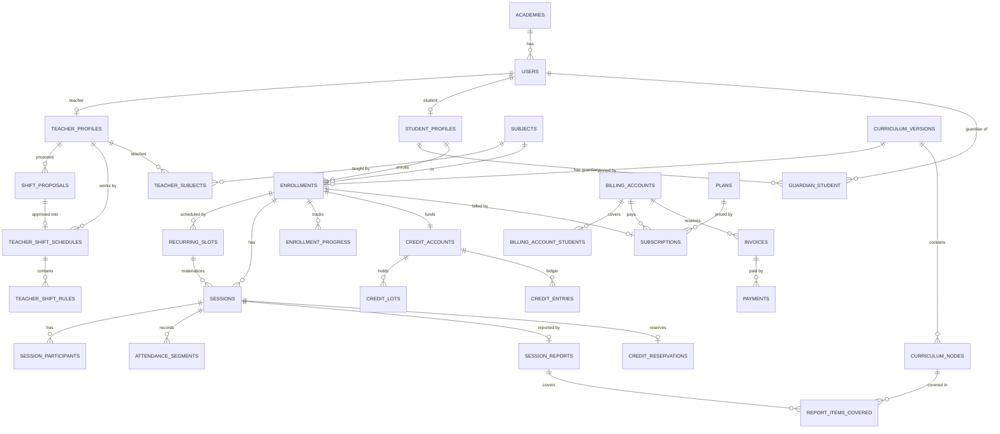

# 03 — المعمارية التقنية

[← الفهرس](README.md)

---

## 1. الـ Stack

| الطبقة | الاختيار | ليه |
|---|---|---|
| Backend | **Laravel** (أحدث إصدار مستقر وقت البداية، 12 أو أحدث)، PHP 8.4+، **Octane على FrankenPHP** | خبرة الفريق، والـ ecosystem متكامل (Queues، Horizon، Reverb، Pennant، Sanctum)، وOctane بيدّي أداء عالي |
| لوحات الإدارة | **Filament 5** (Livewire 4): لوحة للأكاديمية ولوحة Console للمنصة | CRUD ولوحات بسرعة جدًا، وكل module بيسجل شاشاته كـ plugin |
| قاعدة البيانات | **PostgreSQL 17/18** (managed)، بالإضافات `btree_gist`، و`ltree`، و`pg_trgm`، و`citext` | RLS، و exclusion constraints على الفترات الزمنية، و`tstzmultirange`، وتقسيم الجداول. وPG 18 فيه `uuidv7()` جاهز |
| Cache، Queues، Locks | **Redis**: نسخة للـ cache (LRU) ونسخة للـ queues (من غير eviction) | لو الـ cache اتملى مايمسحش jobs |
| Jobs | **Horizon**، والـ queues مترتبة بالأولوية | مراقبة الـ jobs والتحكم في الأولويات |
| Realtime | **Laravel Reverb** (WebSockets، بروتوكول Pusher) | إشعارات لحظية، ولوحة العمليات، وحالة الحصة |
| التخزين | **S3 / Cloudflare R2** + CDN، مع signed URLs | الواجبات الصوتية، والتسجيلات، والموارد |
| الفيديو | **LiveKit Cloud** في الأول، وبعدين على سيرفراتنا | التفاصيل في القسم 6 |
| الموبايل | **Flutter**: تطبيق واحد بيتغير حسب الدور (dio، flutter_bloc، go_router، livekit_client) | نفس أدوات الفريق في CBOT Fleet |
| الويب | **Next.js** (App Router) + React + Tailwind + LiveKit React | بوابة المدرس والطالب وولي الأمر، والفصل، والمواقع العامة (SEO) |
| عقد الـ API | **OpenAPI** بيتولّد من Laravel (Scramble)، ومنه clients بـ Dart وTypeScript | مفيش اختلاف بين الـ API والتطبيقات |
| الأخطاء والمراقبة | **Sentry**، وLaravel Pulse، و logs منظمة. وOpenTelemetry من المرحلة S2 | — |
| الحماية | **Cloudflare**: DNS، وWAF، وDDoS، وCDN، وبعدين Cloudflare for SaaS للدومينات الخاصة | — |
| الأسرار | KMS أو Secrets Manager | تشفير مفاتيح بوابات كل أكاديمية |

---

## 2. الشكل العام (Topology)



---

## 3. تعدد المستأجرين (Multi-tenancy)

### الاختيار: Schema مشتركة + `academy_id` + Global Scope + **RLS**

| الطبقة | الآلية |
|---|---|
| التطبيق | Trait اسمه `BelongsToTenant`: بيضيف global scope وبيملا `academy_id` تلقائيًا |
| قاعدة البيانات | **RLS بيقفل افتراضيًا**: لو المستأجر مش متحدد، مفيش أي صف بيرجع |
| العلاقات | **foreign keys مركّبة** في العلاقات الأساسية: `(academy_id, teacher_id) → users(academy_id, id)`. الـ RLS لوحده مش بيمنع إنك تدخل ID تابع لأكاديمية تانية، لأن فحص الـ foreign keys مابيمرش على الـ RLS |
| المعرفات | UUIDv7: مرتبة زمنيًا، وبتسهّل نقل أكاديمية لـ Cell تانية |

```sql
ALTER TABLE sessions ENABLE ROW LEVEL SECURITY;
ALTER TABLE sessions FORCE ROW LEVEL SECURITY;
CREATE POLICY tenant_isolation ON sessions
  USING      (academy_id = nullif(current_setting('app.tenant_id', true), '')::uuid)
  WITH CHECK (academy_id = nullif(current_setting('app.tenant_id', true), '')::uuid);
ALTER TABLE sessions ALTER COLUMN academy_id
  SET DEFAULT nullif(current_setting('app.tenant_id', true), '')::uuid;
```

### قواعد التشغيل
- **أدوار قاعدة البيانات**:
  - التطبيق بيتصل بـ role مش هو المالك.
  - الـ migrations بتشتغل بالـ owner.
  - connection منفصلة اسمها `pgsql_platform` بـ role عنده `BYPASSRLS`، ومسموحة **بس** في Platform والـ sweepers والـ Reporting. **Pest arch tests** بتفرض ده.
- **تحديد المستأجر لكل request**:
  - middleware بينفذ `SET app.tenant_id = …` في أول الـ request، و terminate hook بيمسحه.
  - ده آمن مع PHP-FPM ومع Octane على FrankenPHP أو RoadRunner، لأن كل worker بيخدم request واحد في المرة.
  - **ماتستخدمش Swoole coroutines.**
- **PgBouncer**: الـ transaction pooling مابينقلش الـ session settings. الحلول:
  - Octane يتصل بقاعدة البيانات مباشرة (عدد الاتصالات = عدد الـ workers + Horizon، وده رقم معقول).
  - أو session pooling.
  - أو `SET LOCAL` جوه transactions صريحة.
  - **لازم نقرر قبل التوسع، مش بعده.**
- **إزاي بنعرف المستأجر**:
  - الـ API لمستخدم مسجل دخوله: **الـ token هو مصدر الحقيقة**، لأن المستخدم تابع لأكاديمية واحدة. لو الـ host أو الـ header مختلف، يرجع 403.
  - من غير تسجيل دخول: من الـ host (subdomain أو دومين خاص).
  - `TenantContext` scoped binding، وبيتمسح مع كل request.
- **الـ Queues**: `tenant_id` بيتحط في **Laravel Context**، وده بيتنقل تلقائيًا مع الـ job، وبيرجع بـ `Context::hydrated()`. job middleware بيظبط `app.tenant_id` وبيمسحه في `finally`.
- **الـ Scheduler**:
  - المهام الحساسة للوقت (التذكيرات، والمواعيد النهائية، وقفل الحصص) = query واحد على كل الأكاديميات من `pgsql_platform`، وبيبعت jobs لكل أكاديمية.
  - المهام اللي بتعتمد على الوقت المحلي (زي التقرير الشهري) = dispatcher كل 15 دقيقة بيشوف الساعة كام عند كل أكاديمية.
- **باقي الطبقات**: مفاتيح الـ cache، ومسارات S3 (`tenants/{id}/…`)، وقنوات الـ broadcast (`private-academy.{id}.user.{id}`)، والـ rate limits، والـ logs، كلها فيها المستأجر (الـ Context بيضيف `tenant_id` للـ logs تلقائيًا).

### الهوية: المستخدم تابع لأكاديمية واحدة
- `UNIQUE(academy_id, lower(email))`. الأكاديمية هي المسؤولة عن البيانات، والمنصة بتعالجها لحسابها.
- **مدرس شغال في أكاديميتين = حسابين** (صاحبين شغل مختلفين).
- **ولي أمر عنده أولاد في أكاديميتين**: بيتنقل بين الحسابين في التطبيق (أكتر من token متخزن على الجهاز).
- **اكتشاف الحسابات بعد التحقق** في التطبيق العام: الإيميل أو الموبايل، ثم OTP، ثم قائمة الحسابات. **مابنكشفش أي عضوية قبل الـ OTP.**
  - **المنفّذ**: `otp_challenges` في Identity، من غير RLS زي `personal_access_tokens`، لأن تحدي الاكتشاف مالوش أكاديمية، والتحدي بيتلاقي بالـ id العشوائي بتاعه بس.
    - بيتخزن: الكود كـ HMAC، والرقم أو الإيميل متشفر ومعاه HMAC عشان نعدّ الأكواد لكل شخص، و token الاكتشاف كـ hash. وكله بيتمسح بعد يوم (`model:prune`).
    - `POST /auth/code` و`/auth/code/verify` جوه الأكاديمية. الاكتشاف من غير أكاديمية: `POST /accounts/code` و`/accounts/code/verify`، والقائمة جاية من `Platform\Contracts\AccountDirectory` (على `pgsql_platform`: الحسابات الشغالة في الأكاديميات الشغالة بس). بعدها `POST /accounts/sign-in` بـ `X-Academy` لكل حساب.
    - الإرسال: Identity تحت Communication، فـ Identity بتعرّف `OtpSender`، وCommunication بتربطه (dependency inversion): واتساب بقالب authentication، وSMS عن طريق Twilio (ومعاه سطر WebOTP)، والإيميل. ومفيش حاجة من الأكواد بتدخل سجل الرسائل.
- **Super Admins** في جدول منفصل `platform_admins` بـ guard خاص و 2FA، ومابيشوفوش بيانات الأكاديميات إلا بـ **الدخول بحساب مستخدم مع تسجيله**.
  - **المنفّذ**: guard اسمه `platform` ولوحة Filament لوحدها (`console`) من غير `ResolveTenant`، وتطبيق مصادقة إجباري. `platform_admins` عليه RLS من غير policy، فالـ connection بتاع الأكاديميات مابيشوفش منه ولا صف.
  - **الدخول بحساب مستخدم** (`impersonations` في Identity، جدول tenant): الأدمن بيطلب من اللوحة بسبب ومدة، والـ Action بيشتغل جوه `TenantContext::run` للأكاديمية دي. اللينك بيشتغل مرة واحدة ولمدة دقيقتين، على عنوان الأكاديمية بس (الـ RLS بيمنع أي أكاديمية تانية تلاقيه). كل request بعدها بيعدّي على `WatchImpersonation`: بيسجّل العمليات باسم فريق المنصة "بحساب" الشخص (`AuditActor` في الـ Context)، وبيقفل الجلسة لما وقتها يخلص أو تتقفل من اللوحة.
- **باقات المنصة** (`saas_plans`، و`saas_subscriptions`، و`usage_counters` في Platform): الـ modules بتسأل عقد SharedKernel `AcademyPlan` (`has(Feature)`، و`limit(Limit)`، و`ensureRoom()`، و`requireFeature()`)، وPlatform هو اللي بيربطه (`PlatformAcademyPlan`، بيقرا الباقة مرة واحدة في الـ request على `pgsql_platform`). كل module بيعدّ اللي يخصه في `UsageMeters`. الجداول دي بيكتب فيها Platform بس: الأكاديمية بتقرا اشتراكها وعدّاتها (RLS)، ومابتشوفش الباقات خالص. التفاصيل في [02 — القسم 11](02-domain-rules.md#11-باقات-المنصة-saas-وحدودها).
- **الدخول بخطوتين للمستخدمين** (`Identity\TwoFactor`): تطبيق مصادقة من Filament (`AppAuthentication`) على `users`:
  - العمودين `app_authentication_secret` (متشفر) و`app_authentication_recovery_codes` (أكواد hash، متشفرة)، ومخفيين من أي JSON.
  - `TwoFactor::REQUIRED_FOR` = المالك والمدير والمحاسب: middleware اسمه `RequireTwoFactor` في لوحة الإدارة بيحوّلهم لصفحة التشغيل. الحساب اللي فريق المنصة داخل بيه مستثنى، والـ model نفسه بيرفض أي تغيير في العمودين طول ما `AuditActor::current()->onBehalfOf` موجود.
  - في اللوحات: نفس شاشة Filament بعد كلمة السر، وبعد الكود لمرة واحدة كمان (`SignIn`، والخطوة التانية متقفلة بـ `codePassed` متشفر لعشر دقايق).
  - في الـ API: `IssueAccessToken` هو اللي بيقرر لكل طرق الدخول (`auth/login`، و`auth/code/verify`، و`accounts/sign-in`). الحساب اللي شغّلها بياخد 403 من نوع `two-factor-required` ومعاه `two_factor_token` و`expires_at`، والـ token ده بيتبدّل بـ token الدخول في `POST /auth/two-factor` (الكود، أو كود استرجاع). الـ token متخزن hash في الـ cache، لمدة 5 دقايق، و5 محاولات، ومرة واحدة، وعلى نفس الأكاديمية (`PendingSignIns`). والدور اللي لازم يشغّلها ولسه ماشغّلهاش بياخد `two-factor-setup-required` من غير token: بيشغّلها من لوحة الإدارة الأول.
  - فريق المنصة بيصفّرها لشخص ضيّع موبايله وأكواده (`ResetTwoFactor`، بسبب، من "الدخول بحساب مستخدم")، وكل تغيير بيتسجل في `audit_logs` (`identity.two_factor_*`).
- **الدعم والشكاوى** (`modules/Support`، فوق الكل زي CRM): التذاكر ومحادثتها ومواعيد الرد، والشكوى المؤكدة بتوصل لمؤشرات Evaluation عن طريق عقد Evaluation ‏`TeacherComplaints` اللي Support بيربطه. الطابور بيتحدث لحظيًا على قناة الأكاديمية (`academy.{id}.support`، لللي معاه `tickets.handle`)، وصاحب التذكرة على قناته (`tickets.changed`). التفاصيل في [02 — القسم 12](02-domain-rules.md#12-الدعم-والشكاوى).
- **بوابة الدخول** (`Identity\Contracts\SignInGate`): أي حد عايز يمنع دخول، بيقول السبب من غير ما Identity يعرف هو مين. People بيربطها بموافقة ولي الأمر (`ConsentSignInGate`). والبوابة بتتسأل في `IssueAccessToken::handle()` (403 من نوع `guardian-consent-required`)، و`canAccessPanel('family')`، وصفحة الدخول. فريق المنصة داخل بحساب حد بيعدّي. وتفاصيل الموافقة في [02 — القسم 10](02-domain-rules.md#10-موافقة-ولي-الأمر-على-حساب-الطفل).
- **الأدوار ثابتة في الـ MVP**: `owner, admin, supervisor, scheduler, accountant, sales, teacher, student, guardian`.
  - مابنستخدمش "teams" بتاعة spatie/permission، لأن `setPermissionsTeamId()` حالة عامة ممكن تتسرب من request للتاني تحت Octane.

### Filament
- **من غير الـ tenancy المدمجة في Filament.** الـ `TenantContext` بيتحدد من الدومين، وFilament مابيعرفش حاجة عن المستأجرين.
- لوحة الأكاديمية على `{slug}.<platform-domain>/admin`.
- لوحة Console للمنصة على دومين لوحدها.
- كل module بيسجل شاشاته كـ **Filament plugin**.
- **ترتيب الـ middleware**: `ResolveTenant` أول واحد، قبل ما الـ session تحمّل المستخدم، وكل الـ middleware **persistent** عشان تشتغل تاني في كل طلب Livewire. لون الأكاديمية بيتسجل بعد ما الأكاديمية تتعرف (`ApplyAcademyColours`)، لأن Filament بيسجل الألوان قبل كده.
- الألوان بتتحول لدرجات (50–950) واللون نفسه بيفضل في درجة 600 اللي الأزرار بتستخدمها (`BrandPalette`)، والشاشات المخصصة بتستخدم متغيرات CSS بتاعة Filament (`--primary-600` وغيرها)، فبتتبع هوية الأكاديمية لوحدها.
- صور المستخدمين بتترسم من الحروف الأولى على السيرفر، مش من خدمة خارجية (Filament افتراضيًا بيبعت اسم كل مستخدم لـ ui-avatars).
- **الإجازات** (Scheduling):
  - `teacher_time_off`: فيه `starts_at` و`ends_at` بتوقيت UTC، والتوقيت اللي الإجازة اتطلبت بيه، و`all_day`، والحالة.
  - قيد `exclude using gist` على `tstzrange(starts_at, ends_at)` لكل مدرس، للطلبات المستنية واللي اتوافق عليها، فمفيش طلبين لنفس الوقت.
  - `academy_holidays`: فيه `first_day` و`last_day` (أيام بتوقيت الأكاديمية)، ومعاهم `starts_at` و`ends_at` محسوبين.
  - قيد `exclude` على `daterange` الأيام، فمفيش إجازتين في نفس الأيام.
  - `AvailabilityQuery` بيطرح الإجازات اللي اتوافق عليها وإجازات الأكاديمية من الشفتات.
  - `MaterializeSessions` بيسيب أيام إجازة الأكاديمية فاضية.
  - `CreditsApi::extend` بيمد صلاحية اللوتات اللي لسه مخلصتش.
- **الإطار المشترك** (`SharedKernel`، `shared::chrome.*`): كل لوحة بتحمّله زي طبقة الحركة (`shared::motion.*`).
  - `chrome/styles` في الـ head، و`chrome/script` بعد Livewire، و`chrome/greeting` في أول القائمة الجانبية (`SIDEBAR_NAV_START`).
  - CSS بتاع Filament جوه `@layer`، فأي CSS برّه الـ layers بيكسبه مهما كانت الـ specificity. وتصميم كل مرحلة (People) بيتكتب في الـ body بعد الإطار، فبيكسبه لما الـ specificity تبقى متساوية، عشان كده خلفية الإطار مكتوبة بـ `:where()`.
- **التنقل بين الصفحات = View Transitions من Livewire**:
  - فيه عنصر مخفي `wire:transition.navigate`، وده بيخلّي Livewire يشغّل `document.startViewTransition` مع كل `wire:navigate`. الـ root نفسه بيتبدل من غير حركة.
  - السكريبت بيدّي اسم (`view-transition-name`) لعنصر واحد بس لكل اسم، في الصفحة القديمة وبعدين في الجديدة، لأن المتصفح بيلغي الانتقال كله لو اسم اتكرر. الأسماء: `lms-page` (‏`.fi-main`، بس لو الصفحة مش نازلة لتحت)، و`lms-nav-side` و`lms-nav-top` و`lms-nav-tab` (الصفحة المفتوحة).
  - **ترتيب الوقت مهم**:
    - Livewire بيفك Alpine من الصفحة القديمة قبل ما المتصفح يصوّرها، وAlpine ساعتها بيرجّع الحاجات اللي كان رابطها (class القائمة المفتوحة، وopacity الصفحة). السكريبت بيرجّعها في microtask قبل الصورة.
    - في الصفحة الجديدة، الأسماء بتتحط ومكان القائمة بيترجع بعد ما Alpine يشيل `x-cloak` (في microtask بعد `livewire:navigated`)، وقبل ما المتصفح يصوّر الصفحة الجديدة. Filament بيرجّع مكان القائمة في `requestAnimationFrame`، وده بيبقى متأخر على الصورة.
  - `html.lms-settled` بتتحط مع أول تبديل جوه اللوحة، فعناصر القائمة بتدخل بالحركة في أول صفحة بس.
- الصلاحيات: كل module بيسأل عن **قدرة** (`SharedKernel\Authorization\Ability`) بـ `Gate::allows()`، وIdentity بس هو اللي بيربط الأدوار بالقدرات.
- اختيارات كل مستخدم (زي شكل لوحة العمليات) بتتعرّف من الـ module صاحب الشاشة (`UserPreferences::define()`)، وبتظهر لوحدها في **إعداداتي**.

---

## 4. نموذج البيانات

### قواعد عامة
- كل جدول تابع لأكاديمية فيه `academy_id uuid NOT NULL` + RLS.
- المعرفات UUIDv7.
- الفلوس `*_minor bigint` + `currency char(3)`.
- الوقت `timestamptz` بتوقيت UTC.
- النصوص اللي ليها لغتين: `name_ar` و`name_en`.
- عمود بحث عربي مُطبَّع:
  - أ/إ/آ ← ا، و ى ← ي، و ة ← ه، والتشكيل بيتشال.
  - عليه index بـ `pg_trgm`.
- **الجداول الكبيرة متقسمة بالشهر**: `attendance_segments`، و`notifications`، و`audit_logs`، و`kpi_events`، وصناديق الـ webhooks.

### الجداول حسب الـ Module

| Module | الجداول الأساسية |
|---|---|
| Platform | `academies`، `academy_domains`، `academy_branding`، `branding_templates`، `saas_plans`، `saas_subscriptions`، `usage_counters`، `platform_admins` |
| Identity | `users`، `roles/permissions`، `devices`، `otp_challenges`، `social_identities` (ربط حساب بجوجل أو أبل، بالـ `sub`)، `social_sign_ins` (تذاكر واكتشاف لدقايق، من غير RLS زي `otp_challenges`)، `impersonations` |
| Catalog | `subjects`، `levels`، `categories` |
| People | `teacher_profiles`، `teacher_subjects`، `teacher_subject_categories`، `teacher_languages`، `student_profiles`، `guardian_student`، `guardian_consents` (بتتضاف بس، والسحب مرة واحدة)، `people_settings` (سن الموافقة)، `supervisor_assignments` |
| Curriculum | `programs`، `curriculum_versions`، `curriculum_nodes`، `node_resources`، `assessment_definitions`، `version_node_mappings` |
| Enrollment | `enrollments`، `enrollment_teacher_assignments`، `enrollment_status_history` |
| Scheduling | `teacher_shift_schedules`، `teacher_shift_rules`، `shift_proposals`، `shift_proposal_rules`، `shift_proposal_comments`، `teacher_time_off`، `availability_overrides`، `academy_holidays`، `recurring_slots`، `booking_holds`، `sessions`، `session_participants`، `attendance_segments`، `session_events`، `policy_sets`، `policy_set_versions`، `scheduling_conflicts`، `schedule_shift_notices` |
| Classroom | `rooms`، `classroom_settings`، `recording_consents` (بتتضاف بس، والسحب مرة واحدة)، `recordings` (السطر بيفضل بعد مسح الملف)، `recording_access_logs` (بتتضاف بس)، `provider_webhook_inbox`، `tech_issue_reports` |
| Credits | `credit_accounts`، `credit_lots`، `credit_entries`، `credit_reservations` |
| Billing | `billing_accounts`، `billing_account_students`، `price_regions`، `plans`، `plan_prices`، `subscriptions`، `invoices`، `invoice_lines`، `invoice_sequences`، `payments`، `payment_methods`، `manual_payment_proofs`، `refunds`، `credit_notes`، `coupons`، `coupon_redemptions`، `gateway_accounts`، `payment_checkouts`، `gateway_webhook_inbox`، `tax_profiles`، `tax_rates`، `einvoice_units`، `einvoice_documents` |
| Learning | `report_templates` (صف لكل إصدار)، `session_reports`، `report_items_covered`، `homework_assignments`، `homework_submissions`، `homework_reviews`، `enrollment_progress`، `enrollment_positions`، `assessment_attempts`، `certificates`، `report_cards`، `challenge_claims`، `cheers` |
| Evaluation | `lesson_ratings`، `kpi_exclusions`، و(P2) `kpi_events`، `qa_rubrics`، `qa_audits`، `kpi_snapshots`، `scoring_configs` |
| Payroll | `rate_cards`، `rate_card_lines`، `teacher_rate_cards`، `teacher_earnings`، `payroll_periods`، و(P2) `payroll_statements`، `payouts` |
| CRM | `leads`، `lead_activities`، `lead_trials` (ومعاها تقييم المدرس)، `retention_tasks`، `referrals` |
| Import | `import_runs` (الملف، وقراءة أعمدته، والخيارات، والأرقام)، `import_rows` (كل صف، وحكم المعاينة، ونتيجة الاستيراد) |
| Communication | `notification_templates`، `notification_preferences`، `notifications`، `notification_deliveries`، `conversations`، `messages`، `announcements` |
| Support | `tickets` (الرقم، والنوع، والأولوية، والدور على مين، ومواعيد الرد، وقرار الشكوى)، و`ticket_messages` (مابتتعدلش ولا بتتمسح)، و`support_settings` (مواعيد الرد بالأولوية) |
| Reporting | `fact_sessions_daily`، `fact_revenue_daily`، `fact_subscriptions_monthly`، `fact_teacher_utilization_weekly`، `fact_funnel_daily` (لسه: لوحة الإيرادات في الـ MVP بتقرا `payments` و`invoices` و`invoice_lines` على طول من `Billing\Queries\RevenueBoard`، وبالـ indexes الموجودة؛ جداول الحقائق لما الحجم يحتاجها) |
| Infra | `audit_logs` (ممنوع عليه UPDATE وDELETE، بـ trigger؛ الصفوف من غير أكاديمية للمنصة بس)، `media` |

### أهم الأعمدة في الجداول الأساسية

```text
academy_branding(academy_id UNIQUE, template_ref "builtin:{key}"|"saved:{id}"|null, tokens jsonb, logo_path, favicon_path)
branding_templates(academy_id, name UNIQUE per academy, tokens jsonb)
  -- tokens = {primary, attention, danger, info, neutral, heading_font, body_font, radius}
-- جلسات الويب في http_sessions، لأن sessions هو جدول الحصص
teacher_shift_schedules(id, teacher_id, version, effective daterange, status active|superseded,
                        approved_by, source_proposal_id)   -- نسخة واحدة سارية لكل مدرس (EXCLUDE)
teacher_shift_rules(schedule_id, teacher_id, weekday, local_start, duration_min, tz, kind work|break)
shift_proposals(id, teacher_id, base_schedule_id, author_role teacher|admin,
                status draft|submitted|changes_requested|countered|approved|rejected|withdrawn|superseded,
                effective_from, note, min_weekly_min, max_weekly_min, submitted_at,
                decided_by, decided_at, decision_note, override_reason, impact jsonb, version)
shift_proposal_rules(proposal_id, revision, weekday, local_start, duration_min, tz, kind)  -- revision لكل عرض مضاد
shift_proposal_comments(proposal_id, author_id, body, created_at)
recurring_slots(enrollment_id, teacher_id, weekday, local_start, duration_min, anchor, anchor_tz,
                minute_of_week int4multirange, effective daterange, status)  -- EXCLUDE: نفس المدرس، دقايق متداخلة في الأسبوع، وفترة متداخلة
leads(contact_name, phone_e164, email, country, timezone, locale, for_child, learner_name, learner_birth_year, subject_id,
      preferred_days jsonb, preferred_from, preferred_to, source, utm_*, notes, owner_id,
      stage new|contacted|trial_booked|attended|assessed|won|lost, stage_changed_at, lost_reason, last_contact_at,
      learner_id?, contact_id?, enrollment_id?)          -- الرقم بصيغة E.164، وحساب الطالب بيتعمل وقت ما يتحتاج
lead_activities(lead_id, kind, body, data jsonb, actor_id, created_at)
lead_trials(lead_id, session_id UNIQUE, teacher_id, starts_at, status booked|attended|missed|cancelled,
            level, recommended_plan_id, recommended_per_week, assessment, assessed_by, assessed_at)
schedule_shift_notices(slot_id, enrollment_id UNIQUE+changes_at, teacher_id, student_id, anchor_tz, other_tz, cause_tz,
                       changes_at, reverts_at, before_weekday/time, after_weekday/time, delta_min, lessons,
                       decision pending|keep_teacher|keep_student, decided_by, notified_early_at, notified_late_at)
sessions(id, academy_id, type, enrollment_id?, lead_id?, teacher_id, original_teacher_id, slot_id?,
         occurrence_key UNIQUE, starts_at, ends_at, blocked_until, status, review_reason,
         funding_status, makeup_for_session_id, reschedule_count, is_detached,
         anchor_tz, anchor_local_date, anchor_local_time, policy_version_id, decision jsonb, version)
session_participants(session_id, user_id, role, block_period tstzrange, is_active, first_join_at, attended_min)
attendance_segments(session_id, user_id, period tstzrange, source webhook|reconcile, quality jsonb)
teacher_profiles(user_id, gender, dialect, employment_type, max_weekly_min, max_daily_sessions,
                 accepts_new, accepts_trials, age_groups[], tier, rate_card_id, status)
guardian_student(guardian_id, student_id, relationship, is_primary, can_manage, receives_reports)
student_profiles(user_id PK, birth_date, stage kids|middle|teen|classic NULL)   -- شكل حساب الطالب: من السن، أو اللي الأكاديمية اختارته
session_reports(session_id UNIQUE, template_id → report_templates, answers jsonb, engagement, overall, status,
                due_at, submitted_at)
report_templates(subject_id, version UNIQUE+subject, fields jsonb ≤ 12, created_by)   -- إصدار مابيتعدلش (update/delete مسحوبين)
node_resources(node_id → curriculum_nodes, ordinal, kind file|link, title_ar, title_en, audience all|teachers,
               file_path, file_name, mime, size, url)   -- ملف أو لينك، مش الاتنين (check)
report_items_covered(report_id, node_id, outcome, score, range_from, range_to, mistakes)
enrollment_progress(enrollment_id, node_id, status, mastery, sessions_count, mastered_at, next_review_at)
lesson_ratings(session_id, rater_id UNIQUE+session, student_id, teacher_id, stars 1–5, tags jsonb, comment, via app|link)
kpi_exclusions(session_id UNIQUE, teacher_id, reason platform|provider|academy|other, note, excluded_by)
rate_cards(name, currency, is_default)   -- جدول افتراضي واحد لكل أكاديمية
rate_card_lines(rate_card_id, subject_id NULL, session_type NULL, unit hour|lesson, amount_minor)   -- UNIQUE NULLS NOT DISTINCT
teacher_rate_cards(teacher_id UNIQUE, rate_card_id)
teacher_earnings(teacher_id, period, kind lesson|reversal|bonus|deduction, session_id, reverses_id UNIQUE, lesson_on, outcome, rule,
                 session_type, subject_id, booked_min, pay_pct, unit, rate_minor, amount_minor, currency, rate_card_id, note, created_by)
                 -- بيتضاف عليه بس، ومفيش قيد في شهر مقفول (trigger)
payroll_periods(month UNIQUE, closed_at, closed_by)   -- صف = شهر مقفول
import_runs(kind teachers|families|schedules, file_name, status staged|checked|done, headers, mapping, options, counts, created_by)
import_rows(run_id, line UNIQUE+run, cells jsonb, status new|update|skip|error → created|updated|skipped|failed, message, refs)
kpi_events(subject_type, subject_id, session_id, metric, value, severity, fault, occurred_at)   -- P2: مع الصور الشهرية
```

### مخطط العلاقات (ERD) للجداول الأساسية



---

## 5. المدفوعات والضرائب وZATCA

### الأكاديمية هي التاجر الرسمي (Merchant of Record)
المنصة **مابتمسكش فلوس الأكاديميات خالص**. لو مسكتها، هتبقى ميسّر مدفوعات (payment facilitator) وهتدخل في ترخيص SAMA وتحويل الأموال ومسؤوليات ضريبية.

| الحالة | الحل |
|---|---|
| **Stripe** | **Connect Standard** بـ direct charges. الأكاديمية صاحبة حساب Stripe، ومفيش أسرار نخزنها، وممكن ناخد رسوم منصة (application fee). ⚠️ Stripe غالبًا مش متاح لشركات مسجلة في مصر أو السعودية، فلازم نتأكد من قائمة الدول وقتها |
| **باقي البوابات** (Moyasar، Paymob، Tap، PayPal، HyperPay) | مفاتيح الأكاديمية نفسها، متشفرة بـ envelope encryption عن طريق KMS. **لكل حساب بوابة مسار webhook خاص**: `/webhooks/{gateway}/{gateway_account_public_id}`، عشان نعرف المستأجر والسر قبل ما نتحقق من التوقيع |
| **اشتراك الأكاديمية في المنصة** (SaaS) | كيان المنصة هو التاجر هنا. Stripe Billing لو كيان المنصة في دولة Stripe بيدعمها، وإلا فواتير يدوية أو مزوّد MoR |

### محرك فوترة خاص بينا فوق tokenization البوابات
مابنستخدمش الاشتراكات الجاهزة في البوابات، لأن نظام البلوك بيعتمد على الرصيد، والبوابات كتير، ولازم يبقى فيه مصدر حقيقة واحد. **كل فاتورة ليها لينك دفع (hosted pay link)**. ده الحل اللي بيشتغل في كل الحالات: الأسواق اللي بتدفع يدوي، والدفع التلقائي اللي بيفشل في التحقق الإضافي (SCA/3DS).

```php
interface PaymentGateway
{
    public function capabilities(): GatewayCapabilities; // currencies, methods (mada, Apple Pay, KNET…), tokenize, MIT, refunds
    public function createCheckout(Invoice $invoice, ReturnUrls $urls, bool $saveMethod): CheckoutSession; // hosted + 3DS
    public function chargeSaved(Invoice $invoice, PaymentMethodToken $token, string $idempotencyKey): ChargeResult; // MIT
    public function refund(Payment $payment, Money $amount, string $idempotencyKey): RefundResult;
    public function parseWebhook(Request $request): VerifiedGatewayEvent; // signature verified + normalized
}
```

| البوابة | المرحلة | الاستخدام | ملاحظات |
|---|---|---|---|
| **يدوي** (تحويل بنكي، InstaPay، فودافون كاش، كاش) | MVP | في كل مكان | رفع الإثبات، ثم موافقة، ثم تسجيل الدفعة |
| **Stripe Connect Standard** | MVP | أكاديميات مسجلة في الإمارات أو أوروبا أو بريطانيا أو أمريكا | كروت محفوظة للدفع التلقائي |
| **Moyasar** | MVP | السعودية | مدى، والكروت، وApple Pay، وSTC Pay، وtokenization |
| **Paymob** | MVP لو أول أكاديمية مصرية | الأكاديميات المسجلة في مصر | كروت بالجنيه ومحافظ |
| **Tap** | P2 | الخليج كله | KNET وBENEFIT |
| **PayPal** | P2 | بديل عالمي | — |
| **HyperPay** | عند الطلب | مؤسسات سعودية | — |

لازم نتأكد من دعم الكروت المحفوظة والدفع التلقائي لكل طريقة دفع وقت التعاقد، وخصوصًا مدى وApple Pay.

### قواعد الفلوس
- **المبالغ**: `amount_minor` + عملة ISO، بمكتبة `brick/money`.
  - **الدينار الكويتي والبحريني والعُماني والأردني بـ 3 خانات عشرية.**
  - مفيش تحويل عملة تلقائي. الأسعار من قوائم المناطق، والتحليلات بتحوّل بجدول `fx_rates`.
- **ترقيم الفواتير**: متسلسل من غير فجوات لكل أكاديمية، من صف في `invoice_sequences` عليه lock (مش Postgres sequence لأنها ممكن تسيب فجوات).
  - الفاتورة بعد ما تصدر مابتتعدلش، والتصحيح بـ **credit note**.
- **الـ Webhooks**: inbox فيه `UNIQUE(gateway_account_id, event_id)`، وjob بيعالجها ومابيتأثرش بالتكرار.

### المنفّذ دلوقتي (Billing)
- **`gateway_accounts`**:
  - حسابات الأكاديمية في Stripe وMoyasar وTap، والبوابة التجريبية.
  - المفاتيح متشفرة بمفتاح التطبيق (`encrypted:array`). الـ envelope encryption بـ KMS لسه.
  - الـ webhook بييجي على `/webhooks/payments/{academy}/{account}`، فالمستأجر والسر بيتعرفوا قبل ما نتحقق من التوقيع.
  - **Stripe** بمفتاح الأكاديمية نفسها، أو **حساب الأكاديمية مربوط بالمنصة** (`stripe_connect`، تحت).
  - **Paymob** بمفاتيح الأكاديمية: المفتاح السري والعام، ومفتاح الـ API، وسر الـ HMAC، وأرقام الـ Integrations (الكارت والمحافظ).
  - رقم الحساب المربوط في Stripe (`acct_…`) مش سر، فبيتحفظ في عمود عادي (`external_id`) عشان webhook المنصة يلاقيه.
- **`PaymentGateway`**:
  - `refuses`، و`createCheckout` (صفحة البوابة نفسها)، و`fetch`، و`parseWebhook`، و`check`.
  - الـ adapters من غير SDKs (Laravel HTTP client)، فالـ tests بتستخدم `Http::fake`.
  - **Stripe**: Checkout Sessions، والتوقيع بـ `Stripe-Signature` ومدة سماح 5 دقايق، والدينارات بمضاعفات 10.
  - **Moyasar**: Invoices بـ Basic auth، والـ webhook بيتعرف بـ `secret_token`.
  - **Tap**: Charges بـ `src_all`، والمبالغ بالوحدة الكبيرة. الـ webhook مجرد تنبيه، والحقيقة دايمًا من `GET /v2/charges/{id}`.
  - **Paymob**: intention بالمفتاح السري (`POST /v1/intention/`) فيها المبلغ بالقرش وأرقام الـ Integrations و`special_reference` = رقم المحاولة، والعميل بيروح على Unified Checkout. رقم الـ order عند Paymob هو مرجعنا. إشعار العملية بييجي على رابط الـ webhook بتاع الحساب، ومعاه HMAC-SHA512 على 20 حقل بترتيب ثابت (في `?hmac=`). ومع ذلك، الحقيقة دايمًا من Paymob نفسه: token من مفتاح الـ API، وبعدين `transaction_inquiry` بالـ order.
  - **Stripe Connect Standard** (`stripe_connect`):
    - مفاتيح المنصة في الإعدادات: `STRIPE_PLATFORM_SECRET` و`STRIPE_CONNECT_CLIENT_ID` و`STRIPE_CONNECT_WEBHOOK_SECRET`، ونسبة المنصة `STRIPE_APPLICATION_FEE_BP`.
    - الربط بـ OAuth: المالك بيروح على `connect.stripe.com/oauth/authorize`، وStripe بيرجّعه على عنوان واحد على المنصة (`/billing/stripe/connected`). الأكاديمية اللي طلبت بتيجي في `state` متشفّر وصالح 20 دقيقة، وبعدين بيرجع على صفحة الدفع الإلكتروني في الأكاديمية نفسها.
    - الدفع: Checkout Session بمفتاح المنصة وheader `Stripe-Account` (direct charge على حساب الأكاديمية)، و`application_fee_amount` لو فيه نسبة للمنصة. والـ metadata فيها الأكاديمية ورقم المحاولة.
    - webhook واحد لكل الحسابات المربوطة (`/webhooks/stripe-connect`) موقّع بسر المنصة: الأكاديمية من الـ metadata، والحساب من `account` في الـ event، وبعد كده نفس الـ inbox والتسوية.
    - "افصل الحساب" بينادي `oauth/deauthorize` ويقفل الحساب عندنا، والمدفوعات القديمة بتفضل.
- **`payment_checkouts`**:
  - كل محاولة دفع: `open`، أو `paid`، أو `failed`، أو `expired`، أو `refund_due`.
  - **`SettleCheckout`** هو اللي بيسأل البوابة وبيسجل الدفعة عن طريق `RecordPayment` بطريقة `online`.
  - فيه `UNIQUE(academy_id, checkout_id)` على `payments`، فمحاولة الدفع الواحدة مابتتسجلش مرتين.
  - **`billing:sweep`** كل 5 دقايق بيسأل البوابة عن المحاولات اللي وقتها خلص، وبعد نص ساعة سماح بيقفلها `expired`.
- **`gateway_webhook_inbox`**:
  - فيه `UNIQUE(academy_id, gateway_account_id, event_id)`، والسر نفسه مابيتحفظش جوه.
  - الـ webhook بيسوّي المحاولة على طول، ولو حصل خطأ الـ sweeper بيعيد المحاولة.
- **لينك الدفع**:
  - `GET /pay/invoice/{invoice}` موقّع ومؤقت لمدة 60 يوم، وفيه `u` (اللي بيدفع)، وبيتحط مكان `:link` في رسالة الفاتورة (`NotificationLinks::registerPersonal('invoice')`).
  - رجوع العميل بيكون على نفس الـ host اللي بدأ منه، عشان جلسته تفضل شغالة.
  - الـ trigger على `payment_checkouts` بيبعت `payments:{payer}` لصفحة اللي بيدفع، فبتتحدّث لوحدها.
- **`manual_payment_proofs`** (الدفع اليدوي بإثبات):
  - الفاتورة، واللي بعته (`payer_id`، لازم يكون اللي بيدفع الفاتورة)، و`channel` (`family` من حسابه في اللوحة أو التطبيق أو البوابة، أو `link` من لينك الدفع)، والطريقة (`bank_transfer`، `instapay`، `wallet`، `other`)، والمبلغ، و`paid_on` (يوم تقويمي)، ورقم التحويل، والملاحظة، والإيصال (`file_path` على الـ disk الخاص تحت `academies/{academy}/payment-proofs/{invoice}`).
  - `status`: `pending` ← `approved` (ومعاها `payment_id`) أو `rejected` (ومعاها `decision_note`). constraint بيربط الحالة بالقرار، و**unique index جزئي على الإثبات المستني** لكل فاتورة، ومفيش delete لـ `lms_app`.
  - الإيصال بيتعرض من `billing/proofs/{proof}/file` لصاحبه ولمن عنده `billing.view` بس، و`no-store`.
  - **trigger** بيرفع `payments:{payer}` لما إثبات يتبعت أو يتحسم، وtrigger على `invoices` بيرفعه لما المدفوع أو الحالة يتغيروا (حتى الدفع اللي بيتسجل من الإدارة)، فصفحات اللي بيدفع بتتحدث لوحدها.
  - في الـ API: `POST /v1/family/invoices/{invoice}/proofs` (multipart، `Idempotency-Key`؛ الـ middleware بياخد بصمة الحقول ومحتوى الملفات)، وكل فاتورة في `GET /v1/family/invoices` معاها `proof` و`can_send_proof`، وفوقهم `manual` (كلام الأكاديمية، وهل بتاخد إثباتات، والطرق).
- **فاتورة العيلة والباقة المشتركة**:
  - `invoice_lines.subscription_id`: الكورس اللي السطر ليه (اتملى للفواتير القديمة من `invoices.subscription_id`). `invoices.subscription_id` بيفضل للفاتورة اللي لكورس واحد، وفاضي في فاتورة العيلة. أي سؤال عن "فواتير الكورس ده" بيمشي من السطور (`Invoice::forSubscription`)، والطلاب والمواد اللي الفاتورة ليهم من `Queries\InvoiceCourses` (القوايم، والمستند، ولينك الدفع، والرسايل، و`/my`، والـ API).
  - `InvoiceIssued` و`InvoicePaid` بيشيلوا `subscriptionIds` (كل كورسات الفاتورة).
  - `billing_settings.family_invoice_days` (0–14، الافتراضي 7): `IssueRenewal` بيضم تجديدات الإخوات اللي جاية في المدة دي على نفس الفاتورة (`IssueBlockInvoice::together`، بيقفل الاشتراكات بترتيب ثابت).
  - `plans.credit_scope`: `enrollment` أو `student_pool`. الباقة المشتركة ليها حساب رصيد واحد (`scope_type = student_pool`)، وكل كورسات الطالب عليها بتشاور عليه (`enrollments.credit_account_id`)؛ و index فريد بيمنع اشتراكين شغالين على نفس حساب الرصيد. `BillingApi::sharedPackage` بيرجّع باقة الطالب الشغالة مع اللي بيدفع، و`EnrollStudent` بيدخّل الكورس عليها من غير فاتورة.
- **الضريبة**: `tax_profiles` لكل أكاديمية: التسجيلات حسب الدولة، والسعر شامل الضريبة أو لأ.
  - أسعار المستهلك في الخليج بتتعرض شاملة الضريبة.
  - هل الضريبة بتتطبق على التدريس عبر الحدود؟ ده إعداد عند الأكاديمية حسب مستشارها الضريبي، مش حاجة ثابتة في الكود.

### ZATCA (للأكاديميات السعودية المسجلة في ضريبة القيمة المضافة)
- **MVP: المرحلة الأولى**: فاتورة مبسطة فيها العربي، والرقم الضريبي، و**QR بصيغة TLV**.
  - **المنفّذ**:
    - إعداد `zatca` في `billing_settings` ومعاه الاسم المسجل (`seller_name`)، وبيتطلب رقم ضريبي سعودي صحيح: 15 رقم، أوله 3 وآخره 3.
    - وقت إصدار الفاتورة (`TaxDocument::stamp`)، الاسم والرقم الضريبي ونوع المستند (`tax_document = simplified`) والـ QR بيتحفظوا على الفاتورة نفسها. والـ QR هو base64 لخمس حقول TLV: الاسم، والرقم الضريبي، ووقت الإصدار UTC، والإجمالي بالضريبة، والضريبة.
    - الكود متجرّب على المثال الرسمي بتاع ZATCA، والـ QR بيترسم SVG على السيرفر.
    - الـ QR بيتعمل للفواتير بالريال بس. الفاتورة بعملة تانية محتاجة الضريبة بالريال كمان، ودي لسه.
    - الإلغاء بـ **إشعار دائن** (`credit_notes`): رقم متسلسل لوحده، والمرجع للفاتورة، والسبب، ونفس المبالغ، وQR بتاعه. الـ trigger بيمنع تعديله أو مسحه.
- **P2: المرحلة التانية**: عن طريق adapter اسمه `EInvoicingProvider`.
  - تسجيل وحدة الفوترة (EGS) لكل أكاديمية من Filament: CSR، ثم OTP، ثم فحوصات الامتثال، ثم شهادة الإنتاج (CSID).
  - **توقيع الفواتير لازم يمشي بالترتيب لكل وحدة** (عداد الفواتير + سلسلة الـ hash)، على queue بيشتغل على فاتورة واحدة في المرة.
  - **الفواتير المبسطة (B2C)**: بتتبلغ خلال 24 ساعة. **الفواتير الضريبية (B2B)**: لازم تتعتمد (clearance) قبل ما تتبعت.
  - الاسترداد بـ credit note بس.
  - XML والـ hash والـ QR بيتحفظوا طول مدة الحفظ القانونية.
  - **قرار مبكر**: مكتبة بيتم صيانتها، ولا مزوّد وسيط معتمد؟ لفريق صغير، المزوّد الوسيط أحسن في الأول.
  - لازم نعرف الأكاديميات اللي هتجرب تابعة لأنهي موجة إلزام.
- إيصالات مصلحة الضرائب المصرية الإلكترونية: adapter بعدين.

### متاجر التطبيقات
- **Apple 3.1.3(d)**: الخدمات الحية **بين شخصين (1:1)** زي التدريس مسموح تتباع برّه الـ in-app purchase.
- الخدمات **لعدد صغير أو كبير** (one-to-few / one-to-many) لازم تتباع بـ in-app purchase. يعني **الحصص الجماعية والمحتوى المسجل لازم يتباعوا من الويب**.
- سياسة Google Play مختلفة، ولازم نتأكد منها.
- الحل البديل: لينكات دفع في الأماكن اللي مسموح فيها بده.

---

## 6. الفصل المباشر (Live Classroom)

### مقارنة مزوّدي الفيديو

| | LiveKit | Zoom Video SDK | Agora | 100ms | Jitsi / BBB |
|---|---|---|---|---|---|
| Flutter SDK | رسمي (`livekit_client`) | رسمي | رسمي وناضج | جيد | Jitsi عنده SDK، وBBB WebView بس |
| Web SDK | JS + React رسمي | موجود | موجود | موجود | ويب أصلًا |
| التسجيل | Egress على S3 بتاعنا (فيديو مجمّع، أو كل مسار لوحده، أو صوت) | تسجيل سحابي | تسجيل سحابي | موجود | Jibri / BBB (تقيل) |
| تشغيله عندنا وموقع البيانات | **مفتوح المصدر، ونقدر نشغّله في أي منطقة (السعودية، أوروبا)** | لأ | محدود | لأ | آه، بس تشغيله متعب |
| Webhooks | دخول وخروج المشاركين، والغرفة، والتسجيل | موجود | موجود | موجود | محدود |
| سلامة الأطفال | صلاحيات في الـ token: مشرف مخفي، والتحكم في مين يبث، وحجم الغرفة | بعضها | بعضها | بعضها | محدود |
| الارتباط بالمزوّد | منخفض | عالي | عالي | متوسط (لازم نقيّم استمرارية الشركة) | منخفض |

**التوصية**:
- نبدأ بـ **LiveKit Cloud**، وننقل لـ **LiveKit على سيرفراتنا** (فرانكفورت، الرياض، فيرجينيا) لما الحجم يبرر أو أكاديمية تطلب البيانات في بلدها.
- كل ده ورا adapter اسمه `VideoProvider`.
- ومعاه مزوّد **ExternalLink** (لينك Zoom أو Meet والحضور يدوي) كبديل في الـ MVP.

### الغرفة
- Simulcast، وadaptive stream، وصوت بس لو الشبكة ضعيفة (الإنترنت المنزلي في مصر).
- فحص الأجهزة والشبكة قبل الدخول.
- المشرف يدخل من غير ما يظهر للجودة، وولي الأمر يدخل متابع.
- عارض محتوى متزامن (صفحة المصحف أو PDF عن طريق data channel) في P2، والسبورة بعده.

### مصدر الحقيقة في الحضور
- الـ Webhooks بتتخزن في `attendance_segments`، وبنطابقها مع **الـ room participant API** عند المواعيد النهائية وعند قفل الحصة.
- **الوقت المدرَّس** = تقاطع فترات المدرس مع فترات الطالب. ده expression واحد بـ `tstzmultirange` في Postgres.
- **كل مشكلة ليها مسؤول**: `fault ∈ {teacher, student, platform, provider, unknown}`. بنحدده من أحداث جودة الاتصال، وتشخيص الجهاز، وحوادث المزوّد.

### المنفّذ دلوقتي
- **module اسمه `Classroom`**، بيعتمد على Contracts بس:
  - Scheduling (`AttendanceApi`: الحصة، والحضور).
  - Learning (`planFor`: خطة اليوم).
  - People (أولياء الأمور).
  - Communication (`NotificationLinks`: لينك كل شخص).
  - Platform (الشعار، ولينك الأكاديمية).
- **`VideoProvider`** وتحته `LiveKitProvider` و`ExternalLinkProvider`، وبيختارهم `ProviderManager` حسب إعداد الأكاديمية (`classroom_settings`).
- **LiveKit**:
  - الـ access token بنعمله بنفسنا (JWT HS256 بالـ video grants)، من غير SDK.
  - الغرفة بنعملها بـ Twirp `RoomService/CreateRoom` (best effort، لأن LiveKit بيعملها لوحده عند أول دخول).
  - قايمة اللي جوه بـ `ListParticipants`.
  - اسم الغرفة `{academy}_{lesson}`، فالـ webhook بيعرف الأكاديمية من غير tenant في الطلب.
- **الـ Webhooks** (`POST /webhooks/livekit`):
  - التوقيع: JWT فيه `sha256` لجسم الطلب.
  - بتتخزن في `provider_webhook_inbox` بـ unique على `event_id`، فالتكرار مابيعملش حاجة.
  - الدخول بيفتح فترة في `attendance_segments`، والخروج بيقفلها. قفل الغرفة بيقفل كل الفترات المفتوحة.
- **`classroom:reconcile`** كل دقيقة: بيقارن الفترات المفتوحة باللي في الغرفة فعلًا، ويصلّح اللي webhook ضاع منه (`source = reconcile`).
- **الكراسي**:
  - المدرس والطالب بيبثوا.
  - ولي الأمر بيقعد مكان ابنه.
  - المشرف `observer:{id}` بـ `hidden` ومن غير بث. مابيتحسبش في الحضور.
- **قاعدة البيانات**:
  - `attendance_segments` فيها فترة مفتوحة واحدة بس لكل شخص في الحصة (partial unique index).
  - الوقت المدرَّس = `range_agg(المدرس) * range_agg(الطالب) * tstzrange(الحصة)`، ولو مفيش فترات بنرجع لتقريب أول دخول.
- **التشغيل على الجهاز**: `docker compose` فيه LiveKit (`livekit/livekit-server:v1.13.7`، بورتات 7880 و7881 و7882/udp)، والـ webhooks رايحة للـ API. اتجرّب بحصة حقيقية بين متصفحين ومشرف مخفي، والحضور اتسجل من الـ webhooks.

### تسجيل الحصة (المنفّذ)
- **`Recorder`** (عقد جوه Classroom، و`LiveKitProvider` بينفذه، و`ProviderManager::recorder()` بيرجّعه. اللينك الخارجي مالوش recorder):
  - `startRecording`: بـ Twirp `Egress/StartRoomCompositeEgress` (grant ‏`roomRecord`)، layout ‏`speaker`، ملف واحد: MP4 ‏640×360 ‏15fps ‏500kbps، أو OGG ‏Opus ‏32kbps للصوت بس.
  - `stopRecording`: ‏`StopEgress`، والتسجيل اللي خلص خلاص (`not_found` / `failed_precondition`) مش غلطة.
  - `announceRecording`: ‏`RoomService/UpdateRoomMetadata` بـ `{"recording":true}`، فالمتصفح والتطبيق بيعرضوا "بيسجل" حتى قبل ما الـ egress يشتغل. وبيعرضوها كمان من `room.isRecording`.
- **الإعدادات**: ‏`LIVEKIT_EGRESS_URL` (لو الـ egress على عنوان غير الـ API)، و`RECORDINGS_DISK` (‏`local` أو disk ‏S3: الـ egress بيكتب بمفاتيحه في نفس الـ bucket)، و`RECORDINGS_RECORDER_ROOT` (لو disk محلي: المسار اللي الـ egress شايفه من نفس الـ volume). المسار `academies/{academy}/recordings/{lesson}/{id}.mp4|ogg`.
- **الحالات**: `starting → recording → ending → ready | failed`، و`ready → deleted`.
  - التسجيل الشغال واحد بس لكل حصة (partial unique index)، و`egress_id` ‏unique لكل أكاديمية.
  - الـ webhooks (`egress_started` / `egress_updated` / `egress_ended`) بتدخل نفس الـ inbox، والأكاديمية من `egressInfo.roomName`. ‏`HandleEgressEvent` مابيرجّعش الحالة لورا (حدث متأخر بعد الإيقاف مابيرجّعهاش "بيسجل").
  - `classroom:recordings` كل 5 دقايق (`SweepRecordings`): بيوقف تسجيل الحصة اللي خلصت أو اتلغت، وبيحسم اللي الـ egress سكت عنه ساعة (الملف موجود = جاهز)، وبيمسح الملفات اللي أيامها خلصت.
- **التشغيل**: `POST recordings/{id}/watch` (أو زرار في الشاشة) بيسجل الفتحة في `recording_access_logs` وبيرجّع لينك موقّع نسبي على عنوان الأكاديمية (`classroom.recording.media`)، صالح مدة التسجيل + 30 دقيقة. الملف بيتبعت inline بـ Range (‏`BinaryFileResponse`)، أو redirect لـ `temporaryUrl` على S3.
- **الـ API**: `recordings/consents` (و`/{person}` و`/{person}/withdraw`)، و`family/recordings` (بـ `learner_id`)، و`teacher/recordings`، و`recordings/{id}/watch`، و`lessons/{id}/recording` (و`/stop`). وتذكرة الدخول (`lessons/{id}/join`) بترجع `recording` جنبها: الوضع، ومين يتحكم، وشغال ولا لأ، ومين لسه ماوافقش.
- **لحظي**: trigger على `recording_consents` بيبعت `consents` لعيلة الطالب و`lessons` للمدرس، وtrigger على `recordings` بيبعت `lessons` للمدرس وللعيلة لما الحالة أو الحفظ يتغير.
- **باقة المنصة**: الملفات الجاهزة بتتحسب في مساحة التخزين (`UsageMeters`، ‏`StorageMb`).

### التسجيلات والتكلفة
- الافتراضي:
  - فيديو مجمّع بجودة منخفضة للحصص اللي فيها أطفال، وصوت بس للكبار.
  - **الاحتفاظ 30 يوم**، وبيتحفظ أكتر لو فيه شكوى (legal hold).
  - المدرس مايقدرش ينزّل التسجيل، وكل مشاهدة بتتسجل.
- **الحجم**:
  - فيديو حوالي 500kbps: حوالي 170MB لحصة 45 دقيقة. صوت 32kbps: حوالي 11MB.
  - عند 800 ألف حصة في الشهر: حوالي 135TB فيديو أو 9TB صوت.
- **دقائق المشاركين** عند 100 ألف طالب: 8 حصص × 45 دقيقة × 2 مشاركين = **حوالي 72 مليون دقيقة في الشهر**. دي أكبر تكلفة متغيرة، وعشانها لازم نخطط ننقل LiveKit لسيرفراتنا.

---

## 7. الـ API والـ Realtime

### قواعد الـ API
- REST على `/api/v1`.
- الأخطاء بصيغة **RFC 7807 Problem Details** (رسائل بالعربي والإنجليزي حسب `Accept-Language`).
- Cursor pagination.
- **`Idempotency-Key`** في الدفع والحجز والإلغاء. **المنفّذ**: middleware اسمه `idempotent` في SharedKernel: نفس المفتاح (لنفس الأكاديمية والشخص والـ route) بيرجّع أول رد لمدة يوم بدل ما ينفّذ مرتين، ونفس المفتاح مع body مختلف بيرجع 409. على: إلغاء الحصة، ورفض البديل، وطلب الإجازة، والدفع أونلاين.
- `If-Match` أو `version` عند التعديل.
- الوقت UTC بصيغة ISO-8601 وفي آخره `Z`. القواعد المتكررة `{weekday, local_time, tz}`.
- **كل وقت بيظهر بتوقيت المستخدم اللي بيشوفه:**
  - التطبيقات وبوابة الويب بتبعت توقيت الجهاز في header اسمه `X-Timezone` (اسم IANA زي `Asia/Dubai`).
  - التوقيت المستخدم في الرد بالترتيب: توقيت الجهاز، ثم توقيت الحساب، ثم توقيت الأكاديمية، ثم UTC. والرد بيرجع نفس الـ header ومعاه `Vary: X-Timezone`.
  - كل لحظة زمنية بتطلع بالشكل ده: `{utc, local, timezone, label}` (عن طريق `LocalTimePresenter`)، مثلًا `"label": "الاثنين 5 أكتوبر · 22:00"`. ونفس الشكل بيستخدم لتوقيت الطرف التاني ("عند الطالب 20:00 لندن").
  - لو توقيت الجهاز مختلف فعلًا عن توقيت الحساب (مسافر)، `/me` بيرجع `timezone_mismatch: true`، والتطبيق بيسأل المستخدم، ولو وافق بيبعت `PATCH /me` بالتوقيت الجديد.
  - التحويل من وقت محلي متكرر لـ UTC بيعدّي على `LocalTimeResolver`: الساعة اللي مش موجودة بتتأجل بمقدار الفرق، والساعة المتكررة بتاخد أول مرة.
- كل رد فيه وقت الطرف التاني جاهز للعرض ("18:00 الرياض").

### OpenAPI
- Scramble بيولّد `openapi.json`، والملف ده **بيتعمل له commit في الريبو**.
- **`oasdiff` في الـ CI** بيمنع أي تغيير بيكسر التوافق.
- **الـ clients**: تطبيق Flutter بيكلّم الـ API بـ repositories مكتوبة باليد لكل ميزة (مش متولّدة)، وفيه **contract test** بيقرا كل نداء في كود التطبيق (`_api.get('family/lessons')`…) ويتأكد إنه موجود في `openapi.json` بنفس الـ method. ولو اتغير route أو حد كتبه غلط، الاختبار بيقع قبل ما يوصل لموبايل. والويب (Next.js) بيولّد أنواع الـ paths من نفس الملف (`openapi-typescript` ← `apps/web/src/lib/api/schema.ts`)، وأي نداء لـ path أو method مش موجود في الملف بيوقع الـ typecheck. والـ CI بتاع الويب بيتأكد إن الأنواع مطابقة للملف.
- **المنفّذ**:
  - الملف في `packages/openapi/openapi.json`، وبيتولّد بـ `composer openapi`. والملف ثابت: نفس الكود بيطلّع نفس الملف في أي بيئة (الـ server ثابت `/api`).
  - `App\OpenApi`: الأخطاء بصيغة RFC 7807 زي ما الـ API بيبعتها فعلًا (`ProblemDetails`)، والـ headers (`X-Academy` في routes الأكاديمية، و`Accept-Language`، و`X-Timezone`، و`Idempotency-Key` في الـ routes اللي عليها `idempotent`)، والـ bearer token على الـ routes اللي عليها `auth:sanctum` بس، وtag لكل module.
  - الـ CI: الملف لازم يطابق الكود (`git diff --exit-code`)، وفي أي PR `oasdiff breaking` ضد الفرع الأساسي. التغيير اللي بيكسر عن قصد بياخد label اسمه `api-breaking`.
  - محليًا: `/docs/api` (في البيئة المحلية بس).
  - الـ CI بتاع الموبايل (`mobile.yml`) بيشتغل كمان لما `packages/openapi` يتغير، فالـ contract test بيتأكد إن التطبيق لسه ماشي مع الـ API.

### الـ API المنفّذ (`/api/v1`، 75 route)
- **الدخول والحساب** (Identity): `auth/login`، و`auth/code` و`auth/code/verify`، و`accounts/code` و`accounts/code/verify` و`accounts/sign-in`، و`auth/two-factor` (الخطوة التانية بعد أي واحد فيهم)، و`me` (ومعاه `plan_features`: الميزات اللي في باقة الأكاديمية)، و`me/sessions` (الأجهزة وتخريج جهاز)، و`auth/logout`.
- **الأسرة**:
  - `family/learners` (People): الطالب نفسه وأولاده، ومرحلة كل واحد. كل endpoint للأسرة بياخد `learner_id`، ولو مابعتوش بياخد أول واحد (`FamilyView::learner`).
  - `family/lessons` (القادمة أو اللي فاتت، ومعاها الإجازات وتغييرات الساعة)، و`lessons/{id}/cancellation` (هيحصل إيه لو ألغيت، بالسياسة)، و`lessons/{id}/cancel`، و`lessons/{id}/refuse-substitute`. الطفل في شكل kids مابيلغيش.
  - `lessons/{id}/rating` (Evaluation): GET وPUT.
  - `family/balance` (رصيد لكل كورس، أو مرة واحدة للباقة المشتركة بموادها و`shared`؛ ولكل كورس اللي بيدفع له: الحصص الزيادة وسعرها والفاتورة المستنية)، و`family/enrollments/{id}/extra-lessons` (فاتورة حصص زيادة، `Idempotency-Key`)، و`family/invoices` (ومعاها لينك المستند الموقّع وطرق الدفع وسطور الفاتورة بالخصومات، ولكل كورس سطوره مع بعض، و`family` و`student_ids` لفاتورة العيلة)، و`family/invoices/{id}/checkout` (Billing). الطالب اللي مابيدفعش مابيشوفش فلوس.
  - `family/consents` (People): أولاد ولي الأمر اللي محتاجين موافقة، والنص اللي هيوافق عليه، و`family/consents/{student}` (موافق: `agree` و`version`) و`family/consents/{student}/withdraw`. لولي الأمر بس.
  - `learning/*`: الـ roadmap والتقارير والواجبات (كانت موجودة)، و`learning/journey`: رئيسية الطالب في شكل مرحلته (النجوم، والنقاط والرتبة، والأيام ورا بعض، والإنجازات، ومستويات كل كورس وحالة كل درس، والجاي، والميعاد المتوقع للإنهاء). الطالب نفسه أو أول ابن لولي الأمر (`FamilyView::learner`).
- **الدعم** (Support، للأسرة والمدرس): `support/new` (الأنواع المسموحة لللي بيسأل، والحصص)، و`support/tickets` (تذاكري، وكتابة تذكرة multipart مع صورة أو PDF و`Idempotency-Key`)، و`support/tickets/{id}` (المحادثة من غير ملاحظات الإدارة ولا قراراتها)، و`.../messages` (الرد)، و`.../reopen`، و`.../close`، و`.../messages/{message}/file`. الأسرة بتبعت `learner_id`.
- **الأخطاء**: الـ route بتاع ميزة مش في الباقة بيرد 403 `feature-not-in-plan` (ومعاه `feature`)، وحد مقفول بيرد 403 `plan-limit-reached` (ومعاه `limit` و`max`). وعنوان الخطأ بلغة `Accept-Language` حتى لو الخطأ حصل قبل ما الأكاديمية تتعرف (كود أكاديمية غلط، route مش موجود). و404 مابيقولش أي تفاصيل (لا اسم class، ولا route، ولا أنهي أكاديمية).
- **المدرس**: `teacher/lessons` (من يوم لعدد أيام)، و`teacher/students`، و`teacher/time-off` (عرض، وطلب، وسحب)، و`teacher/earnings?month=` (Payroll)، و`teacher/performance` (Evaluation، التقييمات من غير أسماء)، و`teacher/trials` وتقييم الحصة التجريبية (CRM)، و`teacher/shifts`، و`teacher/reports`، و`teacher/homework`. وتقرير المدرس (`teacher/reports/{id}`) بيرجّع أسئلة المادة في `template` (النوع، والاختيارات، والحدود، والوحدة، ولازم ولا لأ، والأسرة بتشوف ولا لأ)، والإجابات بتتبعت في `answers` بالمفتاح. والـ roadmap (`learning/enrollments/{id}/roadmap`) فيه `materials` لكل درس (للمدرس والإدارة كمان اللي للمدرسين بس)، و`learning/students` فيه `current_materials` للدرس الحالي، و`teacher/students` فيه `materials`؛ لينك الملف موقّع 12 ساعة وبيتفتح من غير token. وكل تقرير (للمدرس وللأسرة) فيه `answers`: السؤال وإجابته مكتوبة (`text`)، وللأسرة من غير اللي للأكاديمية بس.
- كل endpoint بيستخدم نفس الـ Actions والـ queries اللي الشاشات بتستخدمها (`FamilyNotices`، و`FamilyCancellation`، و`TeacherStudents`، و`TeacherTrials`، ...).

### تسجيل الدخول
- **الموبايل**: Sanctum tokens ليها مدة صلاحية، ومتخزنة في secure storage (زي CBOT Fleet). وفيه أكتر من token متخزن للتنقل بين الحسابات.
- **الويب (Next.js)**: **BFF**. الـ token في httpOnly cookie (`lms_session`، و`Secure` ورا https، و`SameSite=Lax`) على دومين الأكاديمية، والمتصفح مابيشوفش الـ bearer token أبدًا.
  - الدخول (بكود أو بكلمة سر) بيحصل في Server Actions بتكلّم `auth/code/verify` أو `auth/login`، ولو الحساب شغّل الدخول بخطوتين، خانة لكود التطبيق بتكلّم `auth/two-factor`. حساب الإدارة مابياخدش session في البوابة، بيتحوّل لـ `/admin` (وكمان لو لسه لازم يشغّل الدخول بخطوتين هناك).
  - سيرفر Next بس هو اللي بيكلّم الـ API (`lib/api/server.ts`، ‏`server-only`)، ومعاه الـ token و`Accept-Language` و`X-Timezone` (توقيت المتصفح من cookie بتكتبها الصفحة)، و`X-Forwarded-Host` (الـ host اللي الصفحة اتطلبت عليه، فالأكاديمية بتتحدد زي اللوحات بالظبط).
  - لو الـ API رفض الـ token (انتهى، أو اتخرّج من جهاز تاني)، الصفحة بتروح `/bff/session-ended` اللي بيمسح الـ cookie ويرجّع لصفحة الدخول.
  - الملفات اللي الطالب سلّمها (تسجيل أو صورة) بتعدّي من `/bff/submissions/{id}/file` بـ token المدرس، والتسجيل بيتقدّم ويرجع (`Range`).

- **جوجل وأبل** ([02 — القسم 14](02-domain-rules.md#14-الدخول-بجوجل-وأبل)):
  - حسابات المنصة نفسها عند جوجل وأبل (`GOOGLE_CLIENT_ID`/`GOOGLE_CLIENT_SECRET` وApple Services ID للويب، و`GOOGLE_APP_CLIENT_IDS`/`APPLE_APP_IDS` للتطبيقات)، و**عنوان رجوع واحد** على المنصة (`SOCIAL_REDIRECT_BASE` + `/auth/social/{provider}/callback`) متسجل عندهم لكل الأكاديميات.
  - التحقق من الـ ID token من غير SDK (`IdTokens`: JWKS وRS256 بـ OpenSSL). كود جوجل بيتبدّل بـ PKCE، وأبل بيرد بـ `form_post` فالـ callback من غير session ولا CSRF.
  - اللوحات: `GET /auth/social/{provider}/start?panel=…` على عنوان الأكاديمية، والـ callback على المنصة، و`/auth/social/finish?ticket=…` على الأكاديمية، وصفحة الدخول بتكمّل (والخطوة التانية لو شغالة). روابط الأزرار full page load (`spa-mode=false`)، لأن الـ SPA navigation مايقدرش يتبع redirect لموقع تاني.
  - البوابة: `/bff/social/{provider}/start` بيحط السر في httpOnly cookie ويطلب العنوان من `POST /v1/auth/social/{provider}/start` (أو `me/social/{provider}/start` للربط)، والرجوع على `/bff/social/finish` بيبدّل التذكرة بالسر (`POST /v1/auth/social/ticket` أو `me/social/ticket`). لو الخطوة التانية مطلوبة، الـ token بتاعها بيستنى في httpOnly cookie لدقايق وصفحة الدخول بتسأل الكود.
  - التطبيقات: `POST /v1/auth/social` (جوه أكاديمية)، و`POST /v1/accounts/social` (الاكتشاف)، و`GET`/`POST`/`DELETE /v1/me/social`، و`GET /v1/auth/social` (المتاح للويب وللتطبيقات). إعدادات التطبيق من `--dart-define` (`GOOGLE_SERVER_CLIENT_ID`، `GOOGLE_IOS_CLIENT_ID`).

### Realtime (Reverb)
- القنوات:
  - `private-academy.{id}.user.{id}`: إشعارات المستخدم.
  - `private-academy.{id}.session.{id}`: حالة الحصة.
  - `private-academy.{id}.ops`: لوحة العمليات.
- مسموح بس للأعضاء في نفس الأكاديمية (`routes/channels.php` بيتحقق من `academy_id`).

**المنفّذ دلوقتي (لوحة العمليات، والجرس، وحصص المدرس النهارده):** الشاشات دي بتتحدث لما حاجة تتغير بس، من غير أي تحديث كل فترة.
- **التغيير بيطلع من قاعدة البيانات نفسها**: triggers على الجداول بتعمل `pg_notify('lms_live', '{topic}:{id}')`.
  - `board:{academy}`: من أي كتابة على `sessions` أو `session_participants` أو `session_events`.
  - `lessons:{person}`: من أي تغيير في ميعاد الحصة أو حالتها أو مدرسها. بيوصل للمدرس (ولو الحصة اتنقلت لمدرس تاني، الاتنين بيوصلهم)، وللطالب ولكل ولي أمر ليه. ولما طالب يتحجزله في حصة أو يتشال منها (`session_participants`) بيوصلهم برضه، لكن تحديث الحضور مابيبعتش حاجة، عشان صفحات العيلة ماتفضلش تتحدث طول الحصة.
  - `homework:{person}`: لما واجب يتدّي، أو يتسلّم (كل تسليم، حتى التاني)، أو يتصحح. بيوصل للمدرس وللطالب ولأولياء أمره.
  - `inbox:{user}`: من رسالة جديدة أو اتقرت، على `notifications`.
  - الوصول لأولياء الأمر بيحصل من function في قاعدة البيانات ملك People: `lms_notify_family(topic, academy, student)`، بتبعت الإشارة للطالب ولكل ولي أمر ليه. وكده الـ triggers بتاعة Scheduling وLearning مابتقراش جدول People بنفسها.
  - Postgres بيبعتها **بعد الـ commit بس**، وبيدمج التكرار جوه الـ transaction الواحدة في رسالة واحدة. فإلغاء حصة أو دخول طالب = إشارة واحدة، ومفيش كتابة ممكن تفلت، سواء من Eloquent أو query builder أو SQL مباشر.
- **`live:relay`** (في SharedKernel) بروسيس صغيرة:
  - بتعمل `LISTEN` وتستنى على الـ socket، فلو مفيش تغيير مابتعملش أي query.
  - بتدمج الدفعة اللي بتيجي ورا بعض في ربع ثانية، وأقصى إشارة واحدة في الثانية لكل مفتاح (`SignalFolder`).
  - كل module بيقول الـ topic بتاعه يتحوّل لأنهي event (`LiveSignals::on`)، والـ events كلها من غير بيانات:
    - `BoardChanged` على `private-academy.{id}.board`.
    - `LessonsChanged` و`HomeworkChanged` و`InboxChanged` و`PaymentsChanged` على قناة الشخص نفسه `private-user.{id}` (`PersonalChannel`). محدش بيسمعها غير صاحبها.
  - كل شاشة بتجيب اللي هتعرضه بنفسها، بصلاحيات وتوقيت اللي فاتحها.
  - على القناة العامة `lms.live` بتبعت "alive" كل دقيقة، و"resync" لما تبدأ.
  - بتقف لوحدها بعد `queue:restart`، عشان تشتغل تاني على الكود الجديد.
- **الصلاحية**:
  - قناة اللوحة لحد من نفس الأكاديمية (من الـ host) وعنده `ViewLiveBoard`.
  - قناة الشخص لصاحبها بس.
  - `/broadcasting/auth` بيعدّي على الـ middleware بتاع المستأجر.
  - **التطبيقات والبوابة بالـ token**: `GET /v1/realtime` بيقول تتصل فين (المفتاح، والـ host لو مش نفس host الصفحة، والبورت، وTLS) وقناة الشخص. و`POST /v1/realtime/auth` بيوقّع الاشتراك بالـ token، ومابيوقّعش غير قناة صاحب الـ token. ولو السيرفر مابيبثّش، `enabled` بيبقى false.
- **المتصفح**:
  - Echo بيتفتح في كل صفحات اللوحتين (`EnableBrowserEcho`)، على نفس host الأكاديمية والبورت 8080: اتصال واحد بيستنى، بدل timer الجرس اللي كان كل دقيقة في كل صفحة.
  - `LmsLive.watch()` (في `shared/live.blade.php`) مشترك بين الشاشات: الإشارة، واللحظة الجاية (`data-live-next`)، والتبويب المخفي، والرجوع للـ timer.
  - **الجرس**: بيتحدث لما رسالة توصل أو تتقري من جهاز تاني. ولما تفتحه والقايمة بقالها أكتر من دقيقة، بيحدّث مرة عشان "من 5 دقايق" تبقى صح.
  - **حصصي النهارده**: بتتحدث لما حصة من حصص المدرس تتغير، وفي اللحظة اللي الفصل بيفتح أو يقفل فيها.
  - التحديث بيحصل في الحالات دي:
    - لما توصل إشارة (بعد 300ms، عشان الدفعة تتجمع).
    - في **اللحظة اللي الوقت لوحده بيغيّر فيها اللوحة**: بداية حصة، أو تأخير المدرس عند T+2، أو تذكير الطالب، أو حصة داخلة في الساعة الجاية، أو نص الليل. السيرفر بيحسب اللحظة دي ويبعتها مع الصفحة (`BoardClassifier::nextChange`).
  - العدّادات (بدأت من كام دقيقة، وفاضل كام، والحضور، والساعة) بتتحسب في المتصفح.
  - التبويب المخفي مابيحدّثش، وبيحدّث مرة واحدة لما يرجع يظهر.
  - **لو مفيش اتصال**، أو `live:relay` ساكتة أكتر من دقيقتين ونص، كل شاشة بترجع للـ timer بتاعها زي الأول: اللوحة كل 30 ثانية وبتكتب كده للمستخدم، والجرس كل دقيقة. ولما الاتصال يرجع، بتتحدث مرة وتسكت.
- **اتقاس على Docker**:
  - تغيير من برّه المتصفح ظهر في أقل من ثانية، بطلب واحد.
  - اللوحة الفاضية مابعتتش أي طلب في 125 ثانية، وده كان هيبقى 4 طلبات قبل كده (كل طلب بيعيد رسم اللوحة كلها: حوالي 120–400ms و6 queries للبيانات).
  - **10 مشرفين فاتحين اللوحة 8 ساعات = حوالي 9,600 رسمة في اليوم قبل كده.** دلوقتي الرسمات بعدد التغييرات الفعلية بس.

---

## 8. التطبيقات

### Flutter (تطبيق واحد بيتغير حسب الدور)
- **ثلاث واجهات** على go_router:
  - **الطالب**: الجدول، والدخول للحصة، والـ roadmap، والواجبات (تسجيل صوتي)، والتقارير.
  - **ولي الأمر**: يتنقل بين أولاده، وفواتيره، ولينكات الدفع.
  - **المدرس**: الجدول، و**اقتراح شفتاته ومتابعة حالتها**، والدخول، والتقرير، وتصحيح الواجبات، والأرباح.
- **إجبار التحديث** + remote config، وpush (FCM/APNs)، وdeep links للحصة.
- العربي والإنجليزي بـ RTL كامل، بنفس أسلوب `core/l10n` في CBOT Fleet.
- **المنفّذ (المرحلتين A وB، في `apps/mobile`)**:
  - **الدخول**: الإيميل أو الموبايل بكود الدولة، ثم الكود (واتساب، أو SMS، أو إيميل)، ثم كل حسابات الشخص في كل الأكاديميات. يختار اللي عايزه، والتطبيق بيدخل في كل واحد بـ token لوحده. وفيه دخول بكلمة السر (كود الأكاديمية + الإيميل أو الموبايل أو اسم المستخدم). حساب الإدارة بس بيروح لصفحة "افتح الموقع".
  - **أكتر من حساب على الموبايل**: الحسابات وتوكناتها في الـ Keychain/Keystore (`flutter_secure_storage`). الانتقال من "حسابي" من غير دخول تاني. ولو الـ token اترفض (401)، الحساب بيخرج لوحده والتطبيق بيقول كده.
  - **شكل الأكاديمية**: الألوان والزوايا والخط من `GET /branding`، ومحفوظة عشان التطبيق يفتح بألوانها من أول لحظة. **وشكل كل مرحلة للطالب**: kids (خط Baloo، زوايا مدوّرة، 4 تبويبات منها "مهماتي"، خريطة رحلة)، middle (Rubik، المستوى والنقاط، و"تحدياتي" فيها الإنجازات)، teen (خطة وهدف ومحطات، و"أهدافي"). ولي الأمر والكبار بالشكل الكلاسيكي. المرحلة بتتعرف قبل أول شاشة، عشان الطفل مايشوفش شكل الكبار.
  - **ولي الأمر**: الرئيسية (الحصة الجاية بالعدّاد وزرار الدخول، والرصيد، واللي عليه، وآخر تقرير، والواجب)، والحصص (الجاية واللي فاتت، **الإلغاء بعد ما يشوف نتيجة السياسة**، ورفض المدرس البديل، والتقييم)، والتقدم والتقارير، والفلوس (الدفع في صفحة بوابة الأكاديمية، والفاتورة الضريبية)، وحسابي (الحسابات، واللغة، والتوقيت لو الموبايل مختلف عن الحساب، والأجهزة وتخريج جهاز). ولو عنده أكتر من ابن بيختار من فوق.
  - **المدرس**: النهارده (الحصص والساعات والجاية، والتقارير والواجبات اللي مستنياه)، وأسبوعي، وطلابي، وأرباحي بالشهر، وطلب إجازة وسحبه.
  - **الحصة**: `POST lessons/{id}/join`: غرفة LiveKit جوه التطبيق (`livekit_client`: المايك، والكاميرا، والصوت بس، والخروج، وتنبيه النت الضعيف)، أو اللينك الخارجي يفتح في تطبيقه. اتجربت حصة حقيقية بين نسختين من التطبيق على LiveKit محلي.
  - **الشبكة**: كل طلب عليه `X-Academy` و`Accept-Language` و`X-Timezone` (توقيت الموبايل، أو توقيت الحساب لو الشخص اختاره). والطلبات اللي بتحرك حصص أو فلوس عليها `Idempotency-Key` واحد بيفضل نفسه في كل المحاولات لما النت يقطع. الأوقات بتتعرض زي ما الـ API كتبها، والتطبيق مابيحوّلش بين التوقيتات.
  - **التحديات**: `GET learning/challenges` (للطالب نفسه، أو `learner_id` لولي الأمر)، و`POST learning/challenges/claim` بـ `Idempotency-Key`، و`POST learning/cheers`، و`POST learning/cheers/seen`. البورد بيتحمّل مع منطقة الطالب (`LoadCubit<ChallengeBoard>` على مستوى الـ shell)، فالتاب بيعرض عدد الجوايز المستنية، والتشجيع بيظهر على أي تاب (`CheersListener`). صندوق الكنز مرسوم بـ `CustomPainter`، والستيكرز أيقونات Material في دواير (مش emoji، عشان تبان زي بعض على كل جهاز).
  - **الحركة (`shared/motion`)**: `flutter_animate` للدخول ورا بعض (`appear`/`staggered`) والتمايل والمعة، و`CountUp` للأرقام، و`Pressable` للدوسة، و`Celebration` (جزيئات confetti أو نجوم أو جواهر في overlay، من غير مكتبة)، و`fadeScalePage` للشاشات، و`AnimatedBranches` للتابات (كل تاب بيفضل بحالته، واللي مش ظاهر `Offstage` ومن غير ticker). الانتظار جوه الـ timeline بتاع الحركة مش timer، فمفيش timers معلّقة في الاختبارات. كله بيقف لو `MediaQuery.disableAnimations`.
  - **الأصوات (`Juice`)**: 5 أصوات قصيرة بنعملها بنفسنا (`tool/sounds.py`، WAV) عن طريق `audioplayers`، ومعاها `HapticFeedback`. بتتقفل من "حسابي" (`AppPrefs.sounds`)، ومقفولة في الاختبارات (`Juice.enabled = false`). أي جهاز مفيهوش صوت بيسكت وبس.
  - **الاختبارات**: unit (الأخطاء، والأوقات، والحسابات، والجلسة، والـ client)، وwidget على API مزيّف: الدخول بكود، وإلغاء حصة، والتحديات (الطفل يفتح الصندوق، والإعدادي يطلع رتبة، وولي الأمر يشجع)، والمدرس (تقرير، وتصحيح، وقبول تعديل الإدارة واقتراح جديد)، والإشعارات (الصندوق، والاختيارات، والـ deep link، وإجبار التحديث، وتسجيل الجهاز). ومعاهم الـ contract test. ونسخة الويب بتتجرب في المتصفح على الـ API المحلي، وده شامل تسجيل صوت حقيقي من مايك وهمي في Chromium.
  - **تسليم الواجب (المرحلة B)**: حسب اللي الواجب بيقبله (`accepts`: نص، أو صوت، أو ملف). التسجيل بـ `record` كـ PCM16 ‏16kHz mono، والتطبيق بيحطه في WAV بنفسه (نفس الصيغة على كل الأجهزة والويب، وبحد أقصى 10 دقايق)، ويسمعه قبل ما يبعته، ويقدر يسجّل تاني. والملف بـ `file_picker`. وبيتبعت multipart على `POST learning/homework/{id}/submissions`. اللي اتسلّم بيظهر تحت الواجب: الصوت بمشغّل (`AudioClip`، بيحمّل لما يدوس بس، من `GET learning/submissions/{id}/file`)، والصورة بتتعرض، وأي ملف تاني باسمه.
  - **المدرس من الموبايل (المرحلة B)**:
    - **التقارير**: `teacher/reports`، فيه المستني منه الأول. والفورم بيتملي بـ "خطة النهارده" (أهداف كل درس، ونتيجته، ودرجته بالنجوم)، والتركيز والمستوى العام، وملاحظة للطالب وملاحظة داخلية، أو "الطالب غاب" بملاحظة. وكمان الواجب الجاي (العنوان، والتعليمات، وبيقبل إيه، وبعد كام يوم)، إلا لو الواجب اتسلّم خلاص فبيتقفل. وبيتبعت بـ `PUT teacher/reports/{id}`، ونفس الـ Action بتاع `/teach`.
    - **التصحيح**: `teacher/homework?status=submitted|reviewed`. يسمع التسجيل، ويدّي نجوم وكلمة، ويبعت بـ `POST teacher/homework/{id}/review`.
    - **مواعيدي**: الأسبوع المعتمد على توقيت المدرس. والمقترح المفتوح بيبان فيه الفرق عن الأسبوع اللي قبله (المضاف والمشال)، ومعاه المحادثة مع الإدارة. يقدر يوافق على تعديل الإدارة، أو يسحب المقترح، أو يعدّل ويبعت. والمحرر بيضيف فترات لكل يوم، وتاريخ البداية بيحترم أقرب يوم مسموح (`earliest_start`: للزيادة غير التقليل).
    - شاشات المدرس دي بتفتح فوق التابات (`/teach/reports`، و`/teach/marking`، و`/teach/hours`)، وكروت "مستنيك" في النهارده بتوديها.
  - **الإشعارات (المرحلة B)**: الجرس على كل رئيسية بعدد اللي ماتقراش، وصندوق (`GET notifications`، وقراية الكل)، واختيارات كل نوع لكل قناة. ولما تدوس على إشعار بيفتح مكانه: `action: {screen, id}` بيتحول لمسار في التطبيق بـ `targetOf` (`app/router/targets.dart`) حسب المنطقة، وأي حاجة مش معروفة بتروح الرئيسية. والمسار اللي هو تاب بيتفتح بـ `go`، والباقي بـ `push`، عشان go_router مايكررش صفحة التاب (`openTarget`).
  - **Push**: `firebase_messaging`، وإعداداته كلها من `--dart-define` (‏`FCM_API_KEY`، و`FCM_APP_ID`، و`FCM_SENDER_ID`، و`FCM_PROJECT_ID`، و`FCM_VAPID_KEY` للويب، ومعاه `web/firebase-messaging-sw.js` بإعدادات المشروع، وده مش في الريبو). من غيرها الـ push بيبقى مقفول والتطبيق شغال عادي. الجهاز بيتسجل للحساب المفتوح (`POST devices`) مع كل فتح ولما الـ token يتغير، وبيتشال (`DELETE devices`) قبل الخروج. والـ push فيه `notification_id` والـ action، ومعاهم `academy` و`user`. فالدوسة بتفتح نفس المكان، ولو الإشعار لحساب تاني على نفس الموبايل بيفتح الحساب ده الأول (`openMessage`)، ولو الحساب مابقاش على الموبايل مابيفتحش حاجة. ولو التطبيق مفتوح بيطلع snack فيه "افتح".
  - **Deep links**: ‏`academyapp://app/open/{screen}/{id}` (intent-filter في Android، و`CFBundleURLTypes` في iOS). الـ router بيحوّل `/open/...` بنفس `targetOf`. وعلى الويب `/#/open/...`.
  - **إجبار التحديث**: `GET branding` بيرجّع جنب `data` مفتاح `app` (‏`min_version`، و`android_url`، و`ios_url`، من `APP_MIN_VERSION` وأخواتها في Platform). ومحفوظ مع شكل الأكاديمية. ولو نسخة التطبيق (`package_info_plus`) أقدم، كل المسارات بتروح `/update`، وفيها زرار المتجر بس.
  - **الشاشات الحية (المرحلة C)**: زي البوابة واللوحات. التطبيق بيفتح اتصال واحد بـ Reverb على قناة الحساب المفتوح، وده بس وهو قدام المستخدم.
    - الاتصال بيتعمل بعميل صغير من بتوعنا لبروتوكول Pusher فوق `web_socket_channel` (`core/realtime/pusher_socket.dart`). بيعمل الاتصال، والاشتراك بتوقيع `POST realtime/auth`، والـ ping/pong، ولو النت قطع بيرجع يتصل لوحده وبيستنى أكتر كل مرة.
    - `Live` بيتابع الحساب المفتوح: لو اتغير حساب أو حصل خروج، بيقفل الاتصال ويفتح واحد جديد. ولو التطبيق راح في الخلفية بيقفل، ولما يرجع كل الشاشات بتتحدث مرة.
    - كل شاشة بتقول هي بتسمع أنهي إشارات (`LoadCubit(refreshOn: live.on({Live.lessons, ...}))`). والجرس وصندوق الإشعارات بيسمعوا `inbox.changed`.
    - وفي اللحظات اللي الوقت لوحده بيغيّر فيها الشاشة (فتح الفصل، وبداية الحصة، وقفل الفصل) الشاشة بتتحدث في وقتها (`refreshAt`).
    - لو مفيش اتصال، أو الـ relay ساكتة دقيقتين ونص، الشاشات بتتحدث كل دقيقة.
    - اتجرب على نسخة الويب مع Reverb محلي: الشاشة اتحدثت لوحدها في حوالي ثانية ونص لما الواجب اتسلّم من مكان تاني واتصحح.
  - **لسه**: الوضع الليلي، وإعداد Firebase وAPNs الحقيقي لكل بيئة (الكود جاهز).
- **White-label (P3)**: flavors + `--dart-define-from-file tenants/<slug>.json`.
  - ⚠️ **Apple 4.2.6**: كل تطبيق white-label لازم يتنشر من **حساب مطوّر الأكاديمية نفسها**.
  - البديل المسموح: التطبيق العام اللي فيه اختيار الأكاديمية.

### Next.js
- **البوابة**: المدرس هو أكتر حد بيستخدم الويب، بس الطالب وولي الأمر كمان.
- **الفصل**: صفحة الحصة بـ LiveKit React (أو لينك المدرس البره).
- **المواقع العامة لكل أكاديمية (P2)**: ISR بـ tag لكل أكاديمية، وSEO، ونموذج lead.
- **المنفّذ (المرحلة A، بوابة المدرس)** في `apps/web` (`/teach`): Next.js 16 (App Router)، وReact 19، وTailwind 4، وnext-intl (عربي افتراضي، وإنجليزي، واللغة في الـ path: `/ar/...`، `/en/...`).
  - `proxy.ts` (اللي كان اسمه middleware): أي صفحة محتاجة الـ session cookie ما عدا الدخول. والأكاديمية مابتتحددش في Next: الـ API هو اللي بيحددها من الـ host اللي جاي في `X-Forwarded-Host`، أو من الـ token.
  - الصفحات server components بتقرا من الـ API (`get`)، وكل كتابة Server Action بتنادي نفس الـ endpoint اللي التطبيق بيناديه (ومنه نفس الـ Action)، وبعدها الصفحة بتتحدث (`refresh()`). ورسالة الـ API (RFC 7807) وأخطاء الحقول بترجع للفورم زي ما هي.
  - الشاشات: النهارده (والحصة الجاية، واللي مستنيك)، والأسبوع، والتقارير (خطة النهارده، والتركيز والمستوى، والواجب)، وتصحيح الواجبات (التسجيل بيشتغل في الصفحة)، والطلاب ومنهج كل واحد، والحصص التجريبية وتقييمها، ومواعيدي (المقترح، وتعديل الأكاديمية ملوّن، والمحادثة)، والإجازات، والأرباح، والأداء، والإشعارات، والحصة الحية.
  - شكل الأكاديمية من `GET /branding`: الألوان متغيرات CSS على `<html>` وكل الدرجات متخلّطة منها، والزوايا والخطوط. والأوقات بتتعرض زي ما الـ API كتبها (`label`)، والبوابة مابتحوّلش مناطق زمنية أبدًا.
  - على السيرفر: نفس صورة الإنتاج (stage فيها Node بيبني البوابة)، وجزء اسمه `portal`. الـ web container بيعدّي له `/ar` و`/en` و`/_next` و`/bff`، والمتصفح اللي بيفتح العنوان من غير path بيروح `/ar`. والبوابة بتكلّم الـ API من جوه الـ stack (`http://web:8080`).
  - الاختبارات: unit (vitest)، وend-to-end بـ Playwright على الـ API الحقيقي والبيانات التجريبية (الدخول بأنواعه، وكل صفحة على عرض موبايل، وتقرير، وتصحيح، وإجازة، ومقترح مواعيد)، في `.github/workflows/web.yml`.
- **المنفّذ (المرحلة B، بوابة الطالب وولي الأمر)** في `/family`، بنفس الـ BFF ونفس الـ endpoints بتاعة التطبيق:
  - **الشكل** هو شكل اللي داخل (`viewer_stage` من `GET family/learners`، زي `FamilyView::stage()`): الطالب بشكل مرحلته، وولي الأمر والكبار بالشكل الكلاسيك. الشكل بيتطبق بـ `data-stage` على إطار الصفحة: الخط (Baloo للأطفال، وRubik للإعدادي، وPlex للثانوي)، والزوايا، ولون الخلفية، وألوان الأكاديمية زي ما هي. وكل مرحلة ليها أسماء أماكنها (`nav.{stage}`) وتابات الموبايل بتاعتها، والأطفال التابات بتاعتهم أكبر.
  - **الطالب اللي الصفحات عنه**: ولي الأمر اللي عنده أكتر من ابن بيختار، والاختيار بيتحفظ في cookie (`lms_learner`، httpOnly)، وكل نداء بيبعت `learner_id`، والـ API بيتأكد إنه ابنه (`FamilyView::learner()`).
  - **اللي كل شكل يسمح بيه** (`lib/family/rules`): الفلوس للشكل الكلاسيك بس، والأطفال مابيلغوش ولا بيقيّموا. والـ API بيرفضها برضه.
  - الشاشات: الرئيسية (أربع رئيسيات: خريطة الرحلة للأطفال، والنقاط والمستويات للإعدادي، والخطة والهدف للثانوي، والحصة الجاية والرصيد والفلوس والواجبات لولي الأمر)، والحصص (الإلغاء بعد ما يشوف السياسة هتعمل إيه وبـ idempotency key، ورفض المدرس البديل، والتقييم)، والتقدم (منهج كل مادة وتقارير المدرس)، والواجبات (نص، أو تسجيل صوت من المتصفح بـ MediaRecorder لحد 10 دقايق، أو صورة أو PDF، multipart على نفس الـ endpoint)، والفلوس (المطلوب والدفع على صفحة بوابة الأكاديمية، والحصص الفاضلة، والفواتير بالمستند الضريبي)، والتحديات (الطالب بيستلم جوايزه، وولي الأمر بيتابع ويشجّع)، والإشعارات (كل إشعار بيفتح مكانه بنفس قواعد `targetOf` في التطبيق).
  - الاختبارات: وحدات لقواعد كل شكل وأماكنه ووجهات الإشعارات، وend-to-end كولي أمر (كل صفحة على الموبايل، ومعاينة الإلغاء، والتقييم، والدفع، والتشجيع) وكطفل (مفيش فلوس ولا إلغاء ولا تقييم، واستلام جايزة) وكطالب إعدادي (تسليم واجب).
- **المنفّذ (المرحلة C، الصفحات الحية)**: البوابتين بيتحدثوا لوحدهم زي اللوحات. إطار كل بوابة فيه اتصال واحد بـ Reverb على قناة الشخص. والاشتراك بيتوقّع من البوابة (`/bff/realtime/auth`)، فالـ token مابيوصلش للصفحة.
  - أي إشارة (`lessons.changed`، `homework.changed`، `inbox.changed`، `payments.changed`) بتعمل `router.refresh()`، وده بيحافظ على اللي المستخدم بيكتبه.
  - التبويب المخفي بيتحدث لما يرجع يظهر.
  - في اللحظات اللي الوقت لوحده بيغيّر فيها الصفحة (فتح الفصل، وبداية الحصة، وقفل الفصل) الصفحة بتتحدث في وقتها (`RefreshAt`).
  - لو مفيش اتصال، أو الـ relay ساكتة دقيقتين ونص، بيرجع لـ timer كل دقيقة.
  - ورقم الرسايل اللي ماتقرتش بيظهر جنب الإشعارات، وبيتحدث معاها.
  - **لسه**: المواقع العامة.

### Filament
- **لوحة الأكاديمية**: كل التشغيل (الشفتات، والبحث عن مدرس، ولوحة العمليات، والفواتير، والمرتبات، والـ CRM، والجودة).
- **Console**: المنصة.
- كل module بيسجل `Resources` و`Pages` و`Widgets` بتوعه عن طريق plugin.

---

## 9. البنية التحتية والبيئات وCI/CD

### البيئات

| البيئة | الوصف |
|---|---|
| `local` | Docker / Sail، ومعاها Postgres وRedis وMinIO وMailpit |
| `ci` | Postgres مؤقت فيه RLS والـ migrations |
| `staging` | زي الإنتاج، وفيها sandbox للبوابات ومشروع LiveKit منفصل. **بيانات وهمية بس، ومانسخش بيانات أطفال من الإنتاج أبدًا** |
| `production` | فيها **أكاديمية تجريبية** ببيانات وهمية للمبيعات |
| Mobile flavors | `dev`، `staging`، `prod` |

### المنطقة
- نبدأ بـ **منطقة أوروبية واحدة (فرانكفورت)**: قريبة من مصر والخليج، ومناسبة لـ GDPR. وPDPL السعودي بيسمح بالنقل بضمانات.
- **Cell سعودي** لما عميل يطلب إن البيانات تفضل جوه المملكة.

### CI/CD (GitHub Actions، والـ workflow بيشتغل حسب الفولدر اللي اتغير)
- **API**:
  - Pint، وLarastan، وPest (unit، وfeature، و**arch**، و**عزل المستأجرين**، و**DST**).
  - `oasdiff` على الـ OpenAPI.
- **Mobile**: `flutter analyze`، و`flutter test`، والـ build. النشر بـ Fastlane أو Codemagic.
- **Web**: lint، وtypecheck، والاختبارات، والـ build.
- **النشر**:
  - الصور بتتبني وتتخزن في الـ registry.
  - الـ merge على `main` بيعمل deploy على staging.
  - الإنتاج بـ tag + موافقة يدوية.
- **المنفّذ دلوقتي (`infra/deploy`، و`.github/workflows/deploy.yml`)**:
  - **الصورة**: صورة إنتاج واحدة (`apps/api/Dockerfile.prod`): FrankenPHP بـ PHP 8.3، من غير مكتبات التطوير، وبتشتغل بـ `www-data`. الأمر هو اللي بيحدد هي هتشغّل إيه: الويب (ومعاه Reverb تحت `/app/`)، أو Reverb، أو الـ worker، أو الـ scheduler، أو `live:relay`، أو الـ migrations، أو البيانات التجريبية.
  - **الخطوات**: بعد ما اختبارات الـ API تعدّي على `main`، الـ workflow بيبني الصورة ويجرّب النشر كله على جهاز GitHub:
    - `deploy.sh` بالبيانات التجريبية.
    - اللوحات.
    - الدخول بالـ API (ودي بتختبر الأدوار والـ RLS والبيانات مع بعض).
    - الروابط إنها https ورا الـ proxy.
    - اتصال WebSocket لـ Reverb.
    - إن مفيش بورت مفتوح غير بورت الويب.
    
    وبعدها بيرفع الصورة على GHCR ويشغّل `deploy.sh` على السيرفر بـ SSH.
  - **السيرفر مشترك مع مشاريع تانية**:
    - Docker project لوحده (`academy-lms`)، بالـ network والـ volumes بتوعه.
    - حدود ميموري ومعالج.
    - logs بتتلف.
    - بورت واحد على `127.0.0.1`.
    - الـ nginx بتاع السيرفر بيوصّل `progma.store` و`*.progma.store` للبورت ده (`setup-nginx.sh`، مرة واحدة).
  - **الأسرار**: `deploy.sh` بيعملها عشوائي في أول نشر، في `.env` على السيرفر (قراية لصاحبه بس) ومابتتكتبش فوقها بعد كده. ده شامل باسورد البيانات التجريبية وسر الـ 2FA بتاع الـ console (`app.demo`). وأي نشر جديد مابيوصلش للصفحة، النظام بيرجع للنسخة اللي قبله.
- **الـ Migrations**: بأسلوب expand/contract، عشان مايبقاش فيه توقف.

---

## 10. خطة التوسع

| المرحلة | الطلاب | الحصص في الشهر | أقصى عدد غرف في نفس الوقت | اللي بيتغير |
|---|---|---|---|---|
| **S1** | لحد 1,000 | حوالي 8 آلاف | 30–50 | API ×2 (Octane)، Horizon ×2، Scheduler ×1، Reverb ×1. Postgres managed (2 vCPU + PITR). Redis ×2. LiveKit Cloud |
| **S2** | حوالي 10,000 | حوالي 80 ألف | 300–600 | autoscale للـ API من 3 لـ 6. **queues منفصلة**: `critical`، `realtime`، `notifications`، `webhooks`، `einvoice` (فاتورة واحدة في المرة)، `reports`، `low`. Postgres 4–8 vCPU + **read replica** لجداول Filament والتقارير. تقسيم الجداول الكبيرة بالشهر. Reverb ×2 بـ Redis. التسجيلات ورا CDN. نتفاوض على سعر LiveKit. OpenTelemetry |
| **S3** | حوالي 100,000 | حوالي 800 ألف | 3–6 آلاف (ذروة الخليج 13–19 UTC، وذروة أمريكا 22–03 UTC، والويك إند) | **Cells**: نسخ مستقلة في أوروبا والسعودية (وأمريكا لو احتجنا)، والأكاديمية متثبّتة على Cell عن طريق دليل عام. **LiveKit على سيرفراتنا** + egress في نفس المنطقة. التحليلات في ClickHouse أو BigQuery عن طريق CDC. الأكاديميات الكبيرة في Cell خاص بيها. Session pooling |

**ليه Postgres كفاية لحد S3**: حوالي 10 مليون حصة في السنة مع تقسيم الجداول ده حجم عادي جدًا. مافيش داعي نقسّم قاعدة البيانات (sharding) قبل الـ Cells.

**امتى نفصل module لـ service؟**
- لما يبقى ليه نمط حمل مختلف خالص، زي استقبال webhooks الفيديو أو الإشعارات.
- أو لما يحتاج فريق مستقل.
- قبل كده الـ monolith أسرع وأرخص.

---

## 11. الأمن والخصوصية والامتثال

### عزل المستأجرين
- [x] RLS بيقفل افتراضيًا + global scope + foreign keys مركّبة. (`$table->tenant()` و`TenantTable::enableRls()` و`tenantForeign()` في كل جدول للأكاديمية.)
- [x] `BYPASSRLS` على connection المنصة بس، وarch tests بتفرض ده.
- [x] **اختبار تلقائي**: أكاديميتين، وكل endpoint، والمتوقع 403 أو 404. (`tests/Feature/Security/TenantIsolationSweepTest`: الديمو بكل بياناته، وأكاديمية تانية بكل أدوارها بتجرّب أكتر من 700 طريقة توصل بيها لسجلات الديمو: كل route في الـ API بياخد سجل، وكل route للأسرة والطفل من الديمو، وصفحات اللوحات والملفات اللي في عنوانها سجل، ولينكات الديمو الموقّعة على عنوان الأكاديمية التانية، وقنوات الديمو اللايف. المطلوب رفض (401، 403، 404، 410، 422)، ومفيش 5xx، ومفيش اسم أو إيميل أو رقم فاتورة من الديمو في أي رد. اتصلح بيه: تقييم حصة من أكاديمية تانية بقى 404 بدل "مش من حقك"، واللينك الموقّع لشخص مش من الأكاديمية بقى 404.)
- [x] المستأجر موجود في مفاتيح الـ cache، ومسارات S3، والقنوات، والـ logs. (مفاتيح الـ cache فيها الأكاديمية أو بتتأكد منها؛ كل ملف تحت `academies/{academy}/…` والاختبار بيتأكد من ده لكل جدول فيه ملفات؛ القنوات `academy.{id}.*` والقناة الشخصية؛ وكل سطر log فيه الأكاديمية من Laravel Context.)

### الهوية والوصول
- [x] 2FA إجباري للـ Super Admin والـ Owner والـ Admin. (تطبيق مصادقة إجباري على `/console` لفريق المنصة، وفي لوحة الإدارة للمالك والمدير والمحاسب (`RequireTwoFactor`)، ومتاح لأي حد من "إعداداتي". بيتطلب في كل طرق الدخول، والـ API بيرد `two-factor-required` ومعاه token للخطوة التانية `POST /v1/auth/two-factor`.)
- [x] rate limit على الـ OTP، وقائمة الأجهزة، وتسجيل الخروج عن بعد، وصلاحية للـ tokens. (كود كل دقيقة، و5 في الساعة لكل رقم أو إيميل، و20 لكل IP، و5 محاولات للكود؛ `me/sessions`؛ الـ tokens صلاحيتها من `sanctum.expiration`.)
- [x] الدخول بحساب مستخدم: بسبب، ولوقت محدد، ومتسجل، وبيظهر في نشاط المستخدم. (لينك مرة واحدة على عنوان الأكاديمية، وشريط فيه الوقت الباقي، وتغيير كلمة السر مقفول، و"دخول فريق المنصة على حسابك" في إعداداته.)
- [x] سجل مراجعة مابيتعدلش ومابيتمسحش (trigger)، معزول بالـ RLS لكل أكاديمية، ومابيتسجلش فيه أسرار.

### المدفوعات (PCI)
- [ ] checkout مستضاف عند البوابة، أو redirect، أو SDK البوابة بس: **PCI SAQ A**. (لو JS من صفحتنا بيبعت بيانات الكارت، غالبًا هيبقى SAQ A-EP).
- [ ] مفيش بيانات كروت في الـ logs.
- [ ] أسرار البوابات متشفرة بـ KMS.
- [ ] التحقق من توقيع الـ webhooks.
- [ ] idempotency في كل عمليات الفلوس.
- [ ] مفيش محفظة نقدية.

### الأطفال وسلامتهم
- [x] **موافقة ولي الأمر موثّقة** قبل ما نجمع بيانات الطفل. (`guardian_consents`: مين وافق، وعلى أنهي إصدار من النص، وإمتى، ومنين. الطفل اللي تحت سن الموافقة مابيدخلش لحد ما ولي أمره يوافق، والسحب بيخرّجه من كل الأجهزة. [02 — القسم 10](02-domain-rules.md#10-موافقة-ولي-الأمر-على-حساب-الطفل).)
  - COPPA: تعديلات FTC في 2025 بتطلب سياسة احتفاظ مكتوبة وبرنامج أمن معلومات.
  - GDPR Art. 8: السن من 13 لـ 16 حسب الدولة.
  - UK Children's Code.
- [x] **المدرس مابيشوفش موبايل أو إيميل الطالب أو ولي الأمر.** (`tests/Feature/Security/TeacherContactPrivacyTest`: كل مدرس في الديمو بيفتح كل حاجة متاحة للمدرس، يعني الـ API اللي بيستخدمه التطبيق والبوابة، وشاشات `/teach`، وصفحة الحصة، والحصص التجريبية، على حصصه وطلابه وتقاريره وواجباته وتذاكره. والمطلوب إن مفيش رد فيه إيميل أو رقم لطالب أو ولي أمر أو عميل محتمل. وعشان نتأكد إن الفحص نفسه شغال، المبيعات بتفتح صفحة العميل وبتشوف رقمه.)
- [ ] المحادثة بين المدرس والطفل على المنصة بس، وولي الأمر فيها.
- [ ] زرار "الإبلاغ عن مخاوف".
- [ ] مستندات فحص المدرسين (الفيش الجنائي).
- [ ] خيار جنس المدرس، والكاميرا اختيارية للطالب.

### التسجيلات
- [x] موافقة عند التسجيل (من ولي الأمر) وفي عقد المدرس. (`recording_consents`: المدرس والطالب الكبير بنفسهم، والطفل عن طريق ولي أمره، والعقد الورقي تسجله الإدارة بملاحظة. ومفيش تسجيل يبدأ من غير موافقة كل اللي في الحصة. [02 — القسم 13](02-domain-rules.md#13-تسجيل-الحصص).)
- [ ] تشفير وهي متخزنة (على الـ bucket نفسه في الإنتاج).
- [x] signed URLs بعمر قصير، وكل مشاهدة بتتسجل، ومفيش زرار تنزيل. (لينك لكل فتحة صالح مدة التسجيل + نص ساعة، و`recording_access_logs` مابيتعدلش.)
- [x] الاحتفاظ 30 يوم افتراضيًا، وأكتر لو فيه شكوى، وخيار صوت بس. (من 7 لـ 365 يوم، والحفظ اليدوي بسبب، والشكوى المفتوحة بتحفظ تسجيلات حصتها، والوسيط حسب السن.)
- [ ] DPIA (تقييم أثر على حماية البيانات) يشمل القُصّر.

### PDPL السعودي
- [ ] إشعار خصوصية بالعربي، وأساس قانوني لمعالجة البيانات، وإجراءات لطلبات أصحاب البيانات.
- [ ] **الإبلاغ عن أي تسريب لسدايا (SDAIA) خلال 72 ساعة.**
- [ ] ضمانات لنقل البيانات برّه المملكة، ونشوف هل التسجيل ومسؤول حماية البيانات (DPO) إلزامي.
- [ ] اتفاقية معالجة بيانات (DPA): الأكاديمية مسؤولة عن البيانات، والمنصة بتعالجها لحسابها.

### GDPR
- [ ] DPA حسب المادة 28، وقائمة منشورة بالمزودين الفرعيين.
- [ ] **SCCs + تقييم أثر النقل**، لأن مدرسين في مصر بيوصلوا لبيانات أوروبية.
- [ ] موافقة الكوكيز في المواقع العامة، وحذف وتصدير البيانات لكل أكاديمية.

### قانون حماية البيانات المصري (151 لسنة 2020)
- [ ] نشوف التراخيص والتصاريح المطلوبة للمعالجة في مصر ولنقل البيانات برّه.

### أمن التطبيق
- [x] headers الأمان على كل رد (`SharedKernel\Http\SecurityHeaders`، ونفس المجموعة في `apps/web/next.config.ts`، وCaddy في الصورة بيحطها على الملفات الثابتة):
  - `nosniff`
  - `X-Frame-Options: SAMEORIGIN`
  - `Referrer-Policy: strict-origin-when-cross-origin`، لأن اللينكات الموقّعة فيها توقيعها
  - CSP فيها `base-uri 'self'; object-src 'none'; frame-ancestors 'self'`
  - `Permissions-Policy` بتقفل الحاجات اللي المنتج مابيستخدمهاش
  - HSTS لمدة 6 شهور على https، على العنوان نفسه بس، لأن الدومين ممكن يكون تحته مواقع تانية.

  ده بيتأكد منه `HttpHardeningTest` وتجربة الـ deploy.
- [ ] CSP للسكريبتات (`script-src` بـ nonce). لوحات Filament وLivewire فيها سكريبتات inline، فمحتاجة nonce في كل اللوحات قبل ما نقفلها.
- [x] rate limits على كل باب مفتوح:
  - كل باب حساس عليه حد ضيق خاص بيه: الدخول، والأكواد، والـ 2FA، وإثباتات الدفع، والتذاكر، واللينكات الموقّعة.
  - وفوقهم سقف بأسماء ماتتشاركش العدّ مع بعض:
    - `api`: 600 في الدقيقة للشخص، و240 للعنوان قبل الدخول.
    - `links`: 120 في الدقيقة لصفحات اللينكات الموقّعة وصفحة الحصة.
  - البوابة بتبعت عنوان الزائر (`X-Forwarded-For`)، فالعدّ بيبقى لكل زائر لوحده مش للبوابة كلها.
- [x] الكوكيز: كوكي الجلسة `Secure` في الإنتاج (`SESSION_SECURE_COOKIE=true` في الـ `.env` الأول) و`HttpOnly` و`SameSite=Lax`. وكوكيز البوابة `httpOnly`، و`secure` على https.
- [x] الملفات المرفوعة:
  - أنواعها محددة بالمحتوى نفسه مش بالامتداد: صور وPDF وصوت وفيديو، ومفيش SVG ولا HTML (والشعار PNG/JPEG/WebP بس).
  - بتتخزن على الـ disk الخاص تحت مجلد الأكاديمية.
  - بتتقدّم بنوعها المتخزن ومعاها `nosniff`، ولصاحبها ولمين له الصلاحية بس.
- [x] `composer audit` و`npm audit` وDependabot، وsecret scanning:
  - `composer audit` في `api.yml`، و`npm audit --omit=dev --audit-level=high` في `web.yml`.
  - `.github/dependabot.yml` كل أسبوع: composer وnpm وpub، والـ actions والـ Docker كل شهر.
  - gitleaks على التاريخ كله مع كل push (`secrets.yml`، والقيم اللي شبه المفاتيح ومش مفاتيح في `.gitleaks.toml`).
- [x] مفيش بيانات شخصية في الـ logs (`SharedKernel\Logging\RedactPersonalData` على كل قناة بتكتب سطور):
  - الإيميل بيفضل منه الدومين بس، والرقم آخر رقمين.
  - التوكنات، و`signature` في العناوين، وقيم الحقول اللي اسمها زي الأسرار (`password`، `token`، `code`، …) بتبقى `[redacted]`.
  - ده بيشمل الاستثناءات والـ SQL بتاعها.
- [ ] OWASP ASVS L2، وCloudflare WAF وحماية DDoS.
- [ ] فحص فيروسات للملفات المرفوعة (الواجبات الصوتية، وإثباتات الدفع).
- [ ] اختبار اختراق قبل الإطلاق.

---

## 12. المراقبة والتشغيل

| البند | الهدف |
|---|---|
| توافر الـ API | 99.9% |
| زمن الاستجابة | p95 أقل من 300ms |
| نجاح الدخول للحصة | أكتر من 99% |
| التذكيرات | توصل قبل الحصة بـ 10 دقايق |
| أقصى بيانات ممكن تضيع (RPO) | 5 دقايق (PITR) |
| أقصى وقت للرجوع (RTO) | 4 ساعات، ومعاها تجربة استرجاع كل 3 شهور |
| نافذة الصيانة | حوالي 05:00–10:00 UTC (أقل وقت فيه حصص) |

- إخفاء البيانات الشخصية في الـ logs وفي Sentry. (الـ logs: `RedactPersonalData`، [القسم 11](#أمن-التطبيق). وSentry لما يدخل لازم يمشي على نفس القواعد.)
- Runbooks لـ: البوابة مش شغالة، وLiveKit مش شغال (التحويل لـ ExternalLink)، وتأخر الـ queue، وتحديث tzdata. ✅ (`infra/deploy/RUNBOOKS.md`، ومعاهم: الاسترجاع وتجربته، وأرشيف التغييرات لما يفشل، والمساحة لما تخلص، والمهام المجدولة، والتحديث اللحظي، وتغيير سر.)

**المنفّذ دلوقتي (على السيرفر الواحد):**

- **النسخ الاحتياطي، والرجوع لأي لحظة (RPO حوالي 5 دقايق)**:
  - Postgres بينسخ كل تغيير (WAL) مضغوط في volume اسمه `backups` أول ما يخلص، أو كل 5 دقايق على الأقل لو فيه تغيير (`postgres-start.sh`).
  - جزء `backup` في الـ stack (`backup.sh`، على صورة Postgres نفسها) بيعمل كل يوم الساعة `BACKUP_AT` بتوقيت UTC (الافتراضي 05:30، في نافذة الصيانة):
    - نسخة كاملة (`pg_basebackup`)
    - تصدير (`pg_dump`) والأدوار
    - ملفات الأكاديميات (من غير التسجيلات افتراضيًا)
  - بيحتفظ بيهم `BACKUP_KEEP_DAYS` يوم (7 افتراضيًا، وآخر اتنين دايمًا)، وبيشيل من الأرشيف اللي مابقاش له لازمة.
  - أي نسخة أو تجربة بتتسجل في `platform_backups`.
- **تجربة الاسترجاع** (`./restore.sh check [وقت]`): بترجّع قاعدة البيانات زي ما كانت في اللحظة دي، جنب الحقيقية ومن غير ما تلمسها. وبتتأكد إنها بتفتح وفيها الأكاديميات والناس والحصص والفواتير، وإن آخر تصدير بيتقري، وبتسجل النتيجة.
- **الرجوع للحظة بجد** (`./restore.sh to "وقت"`): القاعدة اللي في اللحظة دي بتتعمل في volume جديد، والـ stack بيتحوّل عليه (`PG_VOLUME`)، وبعدها migrations ونسخة جديدة على طول. القاعدة اللي قبلها بتفضل زي ما هي، والرجوع ليها بـ `./restore.sh back`.
- **تجربة النشر على GitHub بتجرّب ده كله في كل مرة**:
  - نسخة، وبعدها تغيير.
  - تجربة استرجاع لآخر لحظة، والتغيير لازم يكون فيها.
  - تجربة للحظة قبل التغيير، والتغيير لازم مايكونش فيها.
  - رجوع بجد للحظة دي والدخول بالـ API شغال، وبعدين `back` والتغيير يرجع.
- **صحة النظام** (`Platform\Health\SystemHealth`):
  - **الفحوصات**:
    - قاعدة البيانات، والكاش.
    - نبضة من المهام المجدولة والمنفّذ وناقل التحديثات اللحظية، كل دقيقة. المنفّذ كمان بيقول آخر مهمة استنت قد إيه.
    - الطابور والمهام اللي فشلت، وReverb.
    - آخر نسخة، وأرشيف التغييرات (`pg_stat_archiver`)، وآخر تجربة استرجاع.
    - المساحة، والأخطاء.
  - كل فحص يا "تمام"، يا "انتبه"، يا "واقف".
  - صفحة "صحة النظام" في لوحة المنصة بتعرضهم، ومعاهم النسخ وآخر الأخطاء (`RecentErrors`: كل نوع خطأ بعدده وآخر مرة، والرسالة متشالة منها البيانات الشخصية).
  - `GET /health` لأي أداة مراقبة من برّه، بـ `HEALTH_TOKEN`، وبيرجّع الحالات بس: 200، أو 503 لو فيه حاجة واقفة.
  - `platform:health --alert` كل 5 دقايق بيبعت إيميل لفريق المنصة لما فحص يقع في مرتين ورا بعض (فإعادة تشغيل أو stack لسه قايم مابتصحّيش حد)، وكل 6 ساعات طول ما هو واقع، ولما يرجع.
- **لسه**:
  - نسخة برّه السيرفر. النسخ دلوقتي على نفس السيرفر، والـ runbook بيقول إزاي تتنقل.
  - Sentry.
  - p95 والتوافر بأداة من برّه (`/health` جاهز ليها).
  - إيميل حقيقي للتنبيهات. لحد ما يتظبط، التنبيهات بتروح للـ log.

---

## 13. استراتيجية الاختبار

| النوع | التغطية |
|---|---|
| Unit | `LocalTimeResolver` (القاهرة، لندن، نيويورك، سيدني، الدار البيضاء)، و`WeekBitset`، ومحرك السياسات (كل قاعدة في الجدول)، والـ ledger، وحساب الـ KPIs |
| Feature | كل Action: الحجز، والإلغاء، والتعويض، والقفل، والتجديد، والـ webhooks (بـ fixtures من كل بوابة) |
| **Arch** | حدود الـ modules (الكتابة عن طريق Contracts بس)، ومين مسموح له يستخدم `pgsql_platform`، ومفيش اعتماديات دائرية |
| **عزل المستأجرين** | أكاديميتين، وكل endpoint، والمتوقع 403 أو 404. وقراءة مباشرة من غير `app.tenant_id` المتوقع ترجّع صفر صفوف |
| **DST** | سيناريوهات 2027 الحقيقية (14 مارس، 28 مارس، 30 أبريل، 28 أكتوبر، 31 أكتوبر، 7 نوفمبر) على مواعيد ثابتة على توقيت المدرس وعلى توقيت الطالب |
| Concurrency | اتنين بيحجزوا في نفس الوقت، والمتوقع: واحد ينجح والتاني ياخد 409 |
| Contract | `oasdiff`، واختبارات الـ adapters على sandbox كل بوابة |
| E2E | Playwright للويب، وintegration_test للموبايل في التدفقات الأساسية |
