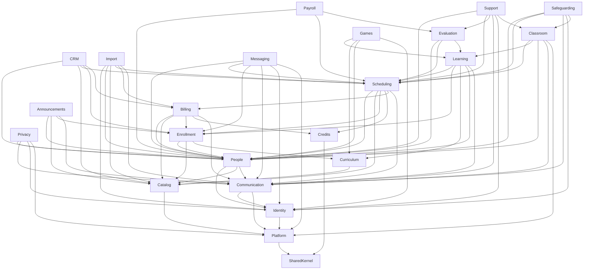

# 04 — الأنماط المعمارية والـ Design Patterns وهيكل الكود

[← الفهرس](README.md)

---

## 1. ليه Modular Monolith؟

| | Modular Monolith (اختيارنا) | Microservices |
|---|---|---|
| القيود اللي محتاجة transaction واحدة (الدفع ← الرصيد ← الحجز) | transaction واحدة في قاعدة البيانات | Sagas، وتعويضات، و eventual consistency |
| فريق من 4 لـ 6 أشخاص | مناسب | تكلفة تشغيل عالية جدًا |
| النشر والمراقبة | خدمة واحدة | خدمات كتير، وtracing موزّع |
| فصله بعدين | ممكن، لأن الحدود واضحة | — |

**الشكل**: Monolith واحد في Laravel، متقسم لـ **17 module** حسب الـ Bounded Contexts (DDD-lite). لكل module:
- **واجهة عامة** (`Contracts/`) هي الطريقة الوحيدة اللي الـ modules التانية تكلمه بيها.
- **events عامة** بيبعتها.
- **جداول** هو المسؤول عنها.

---

## 2. الـ Modules والاعتماديات

| # | Module | المسؤولية | أهم الـ Events |
|---|---|---|---|
| M1 | **Platform** | الأكاديميات، والدومينات، والـ branding، وباقات SaaS، والحدود، والاستخدام، والـ Cells | `AcademyCreated`، `AcademySuspended`، `AcademyPlanChanged`، `DomainVerified` (الباقة دلوقتي بتتقرا وقت الطلب، فمحدش محتاج يسمع تغييرها) |
| M2 | **Identity** | تسجيل الدخول، والدخول بخطوتين، والأدوار، والأجهزة، والـ OTP، والدخول بحساب مستخدم، وبوابة الدخول (`SignInGate`)، وتغيير الإيميل والموبايل بكود | `UserCreated`، `UserInvited`، `RoleAssigned`، `ContactChanged` |
| M3 | **Catalog** | المواد، والمستويات، والتصنيفات | — |
| M4 | **People** | ملفات المدرسين والطلاب، وعلاقات أولياء الأمور، وموافقة ولي الأمر على حساب الطفل | `TeacherOnboarded`، `TeacherSubjectsChanged`، `TeacherTierChanged`، `StudentCreated`، `GuardianLinked`، `UserTimezoneChanged`، `ConsentRequested`، `ConsentGranted`، `ConsentWithdrawn` |
| M5 | **Curriculum** | البرامج، والإصدارات، وعُقد المنهج، والموارد، وتعريفات الاختبارات | `CurriculumVersionPublished` |
| M6 | **Enrollment** | الاتفاق التعليمي، وتغيير المدرس | `EnrollmentCreated`، `EnrollmentActivated`، `EnrollmentPaused`، `EnrollmentResumed`، `EnrollmentEnded`، `TeacherReassigned` |
| M7 | **Scheduling** | **قلب النظام**: الشفتات ومقترحاتها، والإجازات، والتوافر، والمطابقة، والحجز، ودورة حياة الحصة، والسياسات، وتغيير التوقيت | `SessionScheduled`، `SessionRescheduled`، `SessionTeacherSubstituted`، `SessionCancelled`، `SessionStarted`، `SessionFinalized`، `SessionFlaggedForReview`، `TeacherLate`، `DstShiftUpcoming`، `DstShiftDecided`، `SlotTimesShifted`، `TeacherLessonsShifted`، `SchedulingConflictDetected`، `ShiftProposalSubmitted`، `ShiftProposalChangesRequested`، `ShiftProposalCountered`، `ShiftProposalApproved`، `ShiftProposalRejected`، `ShiftRulesChanged`، `TimeOffRequested`، `TimeOffDecided`، `HolidayDeclared`، `TrialLessonBooked` |
| M8 | **Classroom** | غرف الفيديو، والتسجيلات، والـ webhooks، وبلاغات المشاكل التقنية | `ParticipantJoined`، `ParticipantLeft`، `RecordingReady`، `TechnicalIssueReported` |
| M9 | **Credits** | الـ ledger والدفعات والحجوزات | `CreditsGranted`، `CreditsReserved`، `CreditsConsumed`، `CreditsReleased`، `CreditsExpired`، `CreditBalanceLow` |
| M10 | **Billing** | الباقات والأسعار، والاشتراكات، والفواتير، والمدفوعات، والبوابات، والضرايب، وZATCA | `InvoiceIssued`، `PaymentSucceeded`، `PaymentFailed`، `InvoicePaid`، `PaymentProofSubmitted`، `PaymentProofDecided`، `SubscriptionRenewed`، `SubscriptionPastDue`، `SubscriptionPaused`، `RefundIssued`، `EInvoiceReported` |
| M11 | **Learning** | التقارير، والواجبات، والتقدم، والاختبارات، والشهادات، والتقارير الشهرية، والتحديات | `SessionReportSubmitted`، `SessionReportOverdue`، `HomeworkAssigned`، `HomeworkSubmitted`، `HomeworkReviewed`، `NodeMastered`، `LevelCompleted`، `CertificateIssued`، `CheerSent` |
| M12 | **Evaluation** | أحداث الأداء، والتقييمات، ومراجعات الجودة، والدرجات، والفئات | `LessonRated`، `LessonRatingDue`، و(P2) `QaAuditCompleted`، `TeacherScoreComputed`، `StudentAtRiskDetected` |
| M13 | **Payroll** | جداول الأسعار، والأرباح، وفترات المرتبات، والكشوف | `PayrollMonthClosed`، و(P2) `StatementPublished` |
| M14 | **CRM** | الـ leads، والتجارب، وتقييمها، والاستبقاء، والإحالات | `LeadCreated`، `LeadAssigned`، `TrialCompleted`، `TrialMissed`، `TrialAssessed`، `LeadConverted`، `LeadLost` |
| M14ب | **Import** | استيراد المدرسين والطلاب وأولياء الأمور والجداول من الشيتات | `PeopleImported` |
| M15 | **Communication** | القوالب، والقنوات، والتفضيلات، والإشعارات | `NotificationFailed` |
| M16 | **Support** | التذاكر والشكاوى ومواعيد الرد ✅ | `TicketOpened`، `TicketReplied`، `TicketAssigned`، `TicketResolved`، `TicketOverdue`، `ComplaintValidated` |
| M15ب | **Messaging** | المحادثة بين المدرس والطالب وأولياء أمره، وإخفاء وسائل التواصل، والمراقبة ✅ | `MessageSent` |
| M15ج | **Games** | الألعاب على رحلة الطالب (الرحلة نفسها عند Learning): جولات الطالب على تدريبات منهجه، والكائنات، وحدود اللعب (العالم نفسه واستوديو التصميم عند Platform) ✅ | — |
| M15د | **Announcements** | إعلانات الأكاديمية للأسر أو المدرسين: مين هيوصله الإعلان (الأسر، أولياء الأمور، الطلاب بمرحلتهم، أسر مادة، المدرسين)، والحد اليومي ✅ | — |
| M16ج | **Safeguarding** | بلاغات حماية الأطفال ومتابعتها (مسؤولين الحماية بس) ✅ | `ConcernReported`، `ConcernEscalated`، `ConcernClosed` |
| M16ب | **Privacy** | نسخة من بيانات الشخص، وتصحيح البيانات (على طول، أو بطلب للأكاديمية)، ومسح الحساب بموافقة الأكاديمية، والصفحات العامة (الخصوصية، والشروط، ومسح الحساب) ✅ | `DataExportReady`، `ErasureRequested`، `ErasureApproved`، `ErasureRefused`، `AccountErased`، `CorrectionRequested`، `CorrectionAnswered` |
| M17 | **Reporting** | جداول الحقائق والمؤشرات (للقراءة بس) | — |
| Infra | **Audit**، **Files**، **SharedKernel** | سجل المراجعة (منفّذ في `SharedKernel\Audit`: `AuditTrail` بيكتب، و`AuditActor` بيقول مين، و`AuditEntries` بيقرا)، والملفات، والأنواع المشتركة (Money، Time، Tenancy) | — |

### مخطط الاعتماديات (الاستدعاءات المتزامنة عن طريق Contracts)



### القواعد
1. **الكتابة بين الـ modules** عن طريق `Contracts/` بس (interfaces + DTOs + events عامة). ممنوع تستخدم Model بتاع module تاني عشان تكتب.
2. **القراءة** (جداول Filament والـ Query objects) مسموح فيها `JOIN` بين جداول الـ modules، لأن ده monolith وقاعدة بيانات واحدة، والقراءة مابتكسرش أي قيود.
   - مثال: لوحة الإيرادات (`Billing\Queries\RevenueBoard`) بتعمل `JOIN` مع `enrollments` و`subjects` و`users` عشان أسماء الطلاب والمواد، وبتاخد أرصدة الكورسات كلها مرة واحدة من `CreditsApi::balances()` (مش رصيد رصيد) عشان التجديدات الجاية. وتقسيم الدفعة على الكورسات حساب صافي من غير قاعدة بيانات (`Billing\Domain\Revenue\Split`)، والفترة على تقويم الأكاديمية في `Billing\Support\RevenuePeriod` (بتستخدم `LocalTimeResolver`، فمش في Domain).
3. **الرسم لازم يفضل من غير دوائر**، و**Pest arch tests** بتفرض ده.
4. **القيود الحساسة** (الدفع ← إضافة الرصيد، الحجز ← حجز الرصيد) بتتنفذ في **transaction واحدة بين الـ modules**. الـ Events للحاجات الجانبية بس، و**مفيش Sagas**.
   - **المنفّذ دلوقتي**: خطوة التسجيل (`EnrollStudent` في Scheduling) بتنادي Enrollment وCredits وBilling عن طريق الـ Contracts في transaction واحدة: التسجيل، وحساب الرصيد، والاشتراك، وأول فاتورة، والمواعيد الأسبوعية، والحصص. عشان كده Scheduling بيعتمد على Contracts بتوع Billing (وده كان موجود أصلًا لما Scheduling بيسمع events بتوع Billing). Billing مابيعرفش Scheduling خالص. وفي الباقة المشتركة، `EnrollStudent` بيسأل `BillingApi::sharedPackage` الأول: لو الطالب عنده باقة شغالة على نفس الخطة ومع نفس اللي بيدفع، التسجيل الجديد بيتربط بحساب رصيدها بس (من غير اشتراك ولا فاتورة)، وBilling بيعرف كورسات الاشتراك من حساب الرصيد نفسه، فمش محتاج يعرف حاجة جديدة.
   - قفل الحصة بيخصم أو يرجّع الرصيد **في نفس transaction القفل** (`SettleSessionCredits` بينادي `CreditsApi`)، بدل ما Credits يسمع `SessionFinalized`. كده Credits بيفضل معتمد على SharedKernel بس.
   - شاشات "الطلاب المسجلين" وحساب الطالب في Scheduling، مش في Enrollment، لأن الإجراءات اللي عليها (إلغاء، تأجيل، تعويض، تغيير المدرس) بتاعة Scheduling، وEnrollment مايقدرش يعتمد عليه. Scheduling بيقرا جدول `enrollments` عن طريق read model خاص بيه (`EnrolledStudent`) بيرفض الكتابة، والكتابة بتفضل عن طريق `EnrollmentApi`.
5. **الاشتراك في events module تاني مسموح** طالما مابيعملش دايرة في الكود:
   - Billing بيسمع `CreditBalanceLow` (فاتورة التجديد).
   - Scheduling بيسمع `SubscriptionPastDue` و`SubscriptionPaused` (بيوقف الحصص)، و`ParticipantJoined` و`ParticipantLeft` (الحضور)، و`CreditsGranted` (بيأكّد الحصص المستنية بالترتيب).
     - **المنفّذ دلوقتي (الحضور)**: Classroom بينادي `AttendanceApi` بتاع Scheduling مباشرة بدل الـ events، لأن الحضور لازم يتسجل قبل ما مهمة المواعيد النهائية تحكم على الحصة. Classroom فوق Scheduling في الرسم، ومفيش module بيعتمد عليه غير Support (عن طريق عقد `RecordingHolds` بس، تحت). والعمليات اللحظية بتفتح صفحة الفصل باسم الـ route (`classroom.page`) بس، من غير ما تعرف الـ module.
   - Payroll وEvaluation وLearning بيسمعوا `SessionFinalized`.
     - **المنفّذ دلوقتي (Payroll)**: بيسمع `SessionFinalized` و`SessionCancelled` و`SessionFlaggedForReview`، وبيقرا الحصة من جدولها ونسبة الأجر من قرار السياسة. مفيش module بيعتمد عليه. وبيبعت للمدرسين إجمالي الشهر لما يسمع `PayrollMonthClosed` بتاعه.
   - **الإشعارات** عكس اتجاه السماع: الـ module اللي حصل عنده الحدث (Learning، Billing، Scheduling) بيسمع الـ events بتاعته ويبعت رسالة عن طريق `NotificationsApi` بقالب معرّف في الـ provider بتاعه، والصيغة في ملفات الـ lang بتاعته. Communication مابيعرفش حد غير Identity وPlatform (الاسم والشعار في الإيميل)، فبيفضل تحت في الرسم. وفين الإشعار بيفتح في اللوحات، كل module بيسجّله في `NotificationLinks`.
     - **المنفّذ دلوقتي**: Learning بيفتح التقرير لما يسمع `SessionFinalized`، وبيعيد حساب التقدم لما يسمع `CurriculumAttached` من Enrollment. ولأن Scheduling مايعرفش Learning، قسم "المنهج والتقدم" في حساب الطالب بيدخل الصفحة عن طريق **render hook** باسم ثابت (`scheduling::enrollment.account`) بيسجّله Learning.
   - Evaluation بيسمع `SessionReportSubmitted` و`RatingSubmitted`.
     - **المنفّذ دلوقتي (الشكاوى)**: Support فوق Evaluation زي CRM، ومحدش بيعتمد عليه. Evaluation بيعرّف عقد `TeacherComplaints` عنده (من غيره محدش عنده شكاوى)، وSupport بيربط `ConfirmedComplaints`، فمؤشر "الشكاوى المؤكدة لكل 100 حصة" بيتقري وقت ما يتطلب زي باقي المؤشرات. و`ComplaintValidated` بيفضل event داخلي لـ Support (إشعار المدرس).
     - **المنفّذ دلوقتي (بيانات الشخص)**: Privacy فوق كل الموديولات ومحدش بيعتمد عليه. كل موديول بيقول هو شايل إيه عن الشخص من خلال `SharedKernel\Privacy\PersonalDataSource` (النسخة، والموانع، والمسح للجزء بتاعه)، وبيسجّله في `PersonalData` من الـ provider بتاعه. فـ Privacy بيلف على المصادر من غير ما يعرف جداول حد، وكل موديول بيفضل صاحب جداوله. والـ arch test بيتأكد إن كل `*\Privacy` بيطبّق العقد. الحساب بيتعمل له export الأول، وبيتمسح آخر واحد.
     - **المنفّذ دلوقتي (تسجيلات الحصة اللي عليها شكوى)**: بنفس الطريقة، Classroom بيعرّف عقد `RecordingHolds` عنده (من غيره محدش بيحفظ تسجيل)، وSupport بيربط `ComplaintRecordingHolds`، فالتسجيل مابيتمسحش طول ما فيه شكوى مفتوحة على حصته. Support بيستخدم `Classroom\Contracts` بس، والـ arch test بيمنعه من باقي Classroom. و`RecordingReady` بيطلع بعد الـ commit لما الملف يبقى جاهز.
     - **أكتر من مصدر بيحفظ**: Classroom بيربط `AllRecordingHolds`، اللي بيسأل كل class متعلّم بـ `RecordingHolds::SOURCES` (Support بيعلّم `ComplaintRecordingHolds`، وSafeguarding بيعلّم `ConcernRecordingHolds`: بلاغ حماية مفتوح على الحصة). كده كل module فوق بيضيف سببه من غير ما Classroom يعرفه.
     - **المنفّذ دلوقتي (حماية الأطفال)**: Safeguarding فوق ومحدش بيعتمد عليه. فحص المدرسين والإيقاف عند People (`PeopleApi::clearances()` و`mayTeach()`)، وScheduling بيسأل People في كل باب حجز عن طريق `MinorsGuard` (ومن غير ما يعرف Safeguarding). والإيقاف بسبب بلاغ بيروح من Safeguarding لـ `PeopleApi::pauseForMinors()`.
     - **المنفّذ دلوقتي (المحادثة)**: Messaging فوق ومحدش بيعتمد عليه. كانت مكتوبة تحت Communication، بس Communication مابيعرفش غير Identity وPlatform، والمحادثة محتاجة تعرف مين بيدرّس لمين (الكورسات والحصص) ومين ولي أمر مين ومين مسموحله بالأطفال (`PeopleApi::mayTeach()`)، فبقت module لوحدها. بتبعت إشعاراتها عن طريق `NotificationsApi` زي الباقي، وإخفاء وسائل التواصل حساب صافي (`Messaging\Domain\ContactMasker`: نص داخل ونص خارج، والـ arch test بيمنع أي حاجة تانية فيه).
     - **المنفّذ دلوقتي (الإعلانات)**: Announcements فوق ومحدش بيعتمد عليه. الإعلان كان مكتوب تحت Communication، بس Communication مابيعرفش غير Identity وPlatform، والإعلان محتاج يعرف مين ولي أمر ومين طالب ومرحلته ومين لسه مستني موافقة ولي أمره (`PeopleApi::stages` و`consentStates`، يعني `LearnerStage` و`ConsentRules` من غير ما يلمسهم)، وكورسات المادة (جدول `enrollments` للقراية بس، وحالاته من `EnrollmentStatus`)، فبقى module لوحده. مين هيوصله حساب واحد (`Queries\AudienceMembers`) للعدد اللي على الشاشة وللإرسال. وبيبعت عن طريق `NotificationsApi` بقالبين متعرّفين عنده (`announcements.families` و`announcements.teachers`)، و`Message::channels` بيقصّر قنوات القالب على اللي الأكاديمية اختارته (Push وإيميل، من غير واتساب). وقواعد الكلام والفئة حساب صافي (`Announcements\Domain`، والـ arch test بيمنع أي حاجة تانية فيه).
     - **الرحلة** (`Learning\Queries\Journey\JourneyMap`): رحلة الطالب ملك Learning، لأنها المنهج والتقارير والواجبات والحصص (عن طريق `AttendanceApi`). طبقة الألعاب بتيجي من contract بتاع Learning (`JourneyGames`)، والربط الافتراضي `NoJourneyGames`، وGames بيربطه بـ `GamesForJourney`. ده نفس شكل `TrialConversionRates` بين Scheduling والـ CRM، فمفيش حاجة بتعتمد على Games، والرحلة بتشتغل من غيره. وGames بيسأل Learning عن محطات الرحلة (`journeyStations`) ونجومها (`stars`).
     - **المنفّذ دلوقتي (الألعاب)**: Games فوق ومحدش بيعتمد عليه. بياخد إيه اللي يتدرب عليه من `LearningApi::practiceFocus` وكلام التدريب من `CurriculumApi::practiceItems` ومرحلة الطالب من `PeopleApi`، وبيرجّع الجولة لـ Learning بـ `LearningApi::recordPractice` (هي اللي بتسلّم الواجب وبتجمع التدريب على الدرس)، وبيسمع `NodeMastered` عشان الكائنات. العالم نفسه (الجزر والألعاب وإصداراتها) عند Platform، والأكاديمية بتقراه بس عن طريق عقد في الـ SharedKernel (`Games\GameCatalog`، اللي Platform بيربطه بـ `PlatformGameCatalog`)، فمفيش موديول أكاديمية بيلمس Platform. وقواعد الجولة حساب صافي (`Games\Domain\Round`، والـ arch test بيمنع أي حاجة تانية فيه). وبيشجّع من شاشة ولي الأمر بـ `LearningApi::cheer`. ولعبة الواجب عند Learning (`ChoosePracticeGame`): بتقرا الألعاب من `GameCatalog` والحصة الجاية من `AttendanceApi`، وبتكتب `homework.practice_game` اللي `PracticeFocusQuery` بيرجّعه في `PracticeFocus::game` عشان Games يقدّمها الأول. ورسومات العالم وصوته (`shared::games.*`) في الـ SharedKernel عشان Games وLearning وPlatform يرسموا نفس الجزر والكائنات من غير ما يعتمدوا على بعض.
   - Evaluation بيسمع `SessionFinalized` عشان يطلب تقييم الحصة من الأسرة. المؤشرات نفسها بتتقري من الجداول وقت ما تتطلب (القراءة مسموح فيها join)، ونجوم التقييم تحت الحصة بتدخل صفحة الأسرة عن طريق **render hook** باسم ثابت (`scheduling::family.lesson-card`)، زي Learning.
   - **Import** فوق الكل زي CRM، ومحدش بيعتمد عليه. بيعمل كل حاجة عن طريق contracts الـ modules: الحسابات من `IdentityApi`، والملفات وأولياء الأمور من `PeopleApi`، والمواد من `CatalogApi`، والجدول الشغال من عقد Scheduling `ScheduleImport`، اللي بيفتح التسجيل والرصيد ويعمل `BillingApi::adopt` (اشتراك أول فاتورة فيه هي الباقة الجاية).
     - **المعاينة** بتشغّل الاستيراد كله في transaction واحدة وبعدين `rollBack`، وكل صف في savepoint لوحده. فالمعاينة بتقول بالظبط إيه اللي هيحصل، وحتى الصفوف اللي معتمدة على صفوف قبلها (ولي الأمر اللي اتعمل في صف ومستخدم في اللي بعده). الرسايل مابتطلعش لأنها بتستنى الـ commit.
     - لما الاستيراد يخلص بيطلّع `PeopleImported`، والـ listener بتاعه بيبعت رسالة الترحيب. اللينك الخاص بكل شخص بيتسجل بـ `registerPersonal('welcome')`، وبيشاور على صفحة Identity اللي بيتحدد فيها كلمة السر.
   - CRM بيسمع `TrialLessonBooked` و`SessionRescheduled` و`SessionCancelled` و`SessionFinalized` من Scheduling، و`EnrollmentCreated` من Enrollment. وبيطلّع `TrialCompleted` (المدرس يقيّم) و`TrialAssessed` (المبيعات تكمّل).
     - **المنفّذ دلوقتي**: محدش بيعتمد على CRM. ترتيب "ابحث عن مدرس" محتاج نسبة تحويل التجارب، فـ Scheduling بيعرّف عقد `TrialConversionRates` عنده، والـ CRM بيسجّل التنفيذ بتاعه (dependency inversion). من غير CRM محدش بيتقدم على حد.
     - صفحة العميل بتفتح "ابحث عن مدرس" باسم الـ route وparameters في الـ URL، وده بيفضل داخل حدود الـ module.
6. **الدخول بكود والـ API بتاع التطبيقات**:
   - Identity تحت Communication، فمينفعش تبعت رسالة بنفسها. Identity بتعرّف `OtpSender` في Contracts بتاعتها (ومعاه `LogOtpSender` افتراضي)، وCommunication بتربط التنفيذ الحقيقي (واتساب، SMS، إيميل). نفس فكرة `TrialConversionRates`.
   - **باقات المنصة**: Platform تحت الكل، فمحدش يقدر يسألها مباشرة (Enrollment وCredits مثلًا ممنوع عليهم Platform خالص). العقد `AcademyPlan` والـ enums (`Feature`، `Limit`) والعدّادات (`UsageMeters`) في SharedKernel، وPlatform بيربط التنفيذ، زي الـ abilities اللي بيربطها Identity. وكل ability ليها ميزتها (`Ability::feature()`)، فالـ Gate نفسه بيقفل الشاشات والـ routes لما الميزة تخرج من الباقة.
   - **موافقة ولي الأمر** بنفس الفكرة: Identity بتعرّف `SignInGate` (ومعاه `OpenSignInGate` اللي مابيمنعش حد)، وPeople بيربط `ConsentSignInGate`. Identity بتسأل البوابة في كل طرق الدخول من غير ما تعرف حاجة عن الأولاد والأعمار. وClassroom بيسأل People (`PeopleApi::consentState`) قبل ما يدّي الطفل مكانه في الحصة. وPeople بقى فوق Communication عشان يبعت طلب الموافقة بنفسه (`NotificationsApi`)، وCommunication مابيعرفش People.
   - الاكتشاف محتاج يدوّر على الشخص في كل الأكاديميات، ودي قراءة على `pgsql_platform`، فبتعدّي على عقد Platform `AccountDirectory`. Identity مابتلمسش الـ connection ده. والاكتشاف بجوجل أو أبل نفس الكلام (`AccountDirectory::withSocialIdentity`: الحسابات المربوطة بحساب جوجل أو أبل ده).
   - الـ endpoints بتاعة التطبيقات كل واحد في الـ module صاحب البيانات (`routes/api.php` بتاعه)، وبتنادي نفس الـ Actions والـ queries اللي الشاشات بتناديها. اللي كان جوه صفحة Filament واتحتاج في الـ API اتنقل لـ query مشتركة (`FamilyNotices`، `FamilyCancellation`، `TeacherStudents`، `TeacherTrials`).
   - `Idempotency-Key` middleware في SharedKernel (`idempotent`)، بيتحط على الـ route نفسه.
   - توثيق الـ API (Scramble) في `app/OpenApi`، لأنه تجميع مش منطق: شكل الأخطاء، والـ headers، والـ auth.
7. **سجل المراجعة ولوحة المنصة**:
   - السجل في SharedKernel، فأي module يقدر يكتب فيه من غير ما يعتمد على حد: `AuditTrail::record()` جوه الـ Action اللي فيها العملية الحساسة، في نفس الـ transaction. مين عمل العملية بييجي من `AuditActor` (في الـ Laravel Context): الشخص اللي داخل، أو فريق المنصة (ولو داخل بحساب حد، مين)، أو النظام.
   - **لوحة المنصة** (`console`) شاشاتها من اتنين modules: Platform (الأكاديميات، والإيقاف، والسجل) بالـ connection اللي بيعدّي الـ RLS، وIdentity (أكاديمية جديدة، والدخول بحساب مستخدم) بالـ contracts بتاعة Platform بس: `PlatformApi` و`TenantDirectory` و`ConsoleApi`. Identity بيوصل لبيانات الأكاديمية عن طريق `TenantContext::run` على الـ connection العادي، فالـ RLS بيفضل شغال.
   - Platform مابيعرفش Identity: الصفحات بتشاور على بعض باسم الـ route بس.

---

## 3. الهيكل الداخلي للـ Module

بنستخدم PSR-4 عادي (`"Modules\\": "apps/api/modules/"`)، ولكل module ServiceProvider متسجل في `bootstrap/providers.php`. مابنستخدمش package خارجي لإدارة الـ modules.

```text
modules/Scheduling/
  src/
    Contracts/              ← الواجهة العامة الوحيدة
      SchedulingApi.php       interface: reserveFor(), sessionsFor(), isTeacherFree()...
      DTOs/                   SessionData, SlotData (spatie/laravel-data)
      Events/                 SessionFinalized, SessionCancelled... (events عامة)
    Domain/
      Models/                 Session, SessionParticipant, RecurringSlot, ShiftRule, TimeOff, Closure, BookingHold
      States/Session/         Scheduled, InProgress, Completed, Cancelled, StudentAbsent, TeacherAbsent,
                              NeedsReview, Transitions/
      States/ShiftProposal/   Draft, Submitted, ChangesRequested, Countered, Approved, Rejected, Withdrawn, Superseded
      Rules/                  PolicyEngine, RuleSet, Rule, Conditions/, Decision   (قواعد عمل، مش Laravel Policies)
      Availability/           AvailabilityCalculator, Matching/{Filters/*, Scorers/*, PatternAssembler}
      Enums/  ValueObjects/
    Actions/                CreateEnrollmentSchedule, MaterializeHorizon, RescheduleSession, CancelSession,
                            BookMakeup, SubstituteTeacher, FinalizeSession, ResolveReview, ShiftSlotTimes, ShiftTeacherLessons,
                            SubmitShiftProposal, ReviewShiftProposal, CounterShiftProposal, ApproveShiftProposal,
                            TimeOff/{RequestTimeOff, DecideTimeOff, WithdrawTimeOff, AssignSubstitutes, CancelUncoveredLessons},
                            Holidays/{DeclareHoliday, RemoveHoliday}, RefuseSubstitute,
                            Dst/{PlanDstChanges, SendDstNotices, DecideDstChange}
    Queries/                TeacherCalendarQuery, LiveBoardQuery, FindTeachersQuery
    Listeners/
    Jobs/                   FinalizeDueSessionsSweeper, JoinNudgesSweeper, MaterializeNightly
    Http/V1/                Controllers/, Requests/, Resources/
    Authorization/          Laravel Policies (مين يقدر يعمل إيه)
    Filament/               SchedulingPlugin.php, Resources/, Pages/FindTeacher.php, Pages/LiveBoard.php
    Infrastructure/         AvailabilityCache.php
    Providers/              SchedulingServiceProvider.php
  database/                 migrations/, factories/, seeders/
  routes/                   api.php, channels.php
  lang/                     ar/, en/
  tests/                    Unit/, Feature/
```

| الفولدر | فيه إيه | ممنوع فيه |
|---|---|---|
| `Contracts/` | interfaces وDTOs وevents عامة | منطق عمل |
| `Domain/` | الـ Models، والحالات، والقواعد، والـ Value Objects، والحسابات البحتة | HTTP، والـ queues، والـ SDKs الخارجية |
| `Actions/` | حالة استخدام واحدة لكل class، فيها الـ transaction، وبتبعت الـ events | منطق عرض |
| `Queries/` | قراءات معقدة مُحسّنة (Query Objects) | كتابة |
| `Http/` | Controllers رفيعة (validate ← action ← resource) | منطق عمل |
| `Filament/` | شاشات الإدارة، وبتنادي نفس الـ Actions | منطق عمل مكرر |
| `Infrastructure/` | Adapters للأنظمة الخارجية، والـ cache، والـ SDKs | — |

**مهم**: الـ Controller وصفحة Filament والـ Job والـ CLI **كلهم بينادوا نفس الـ Action**. المنطق في مكان واحد.

---

## 4. كتالوج الـ Design Patterns

### 4.1 Action / Use Case
- **المشكلة**: منطق العمل بيتفرق بين الـ Controllers والـ Filament والـ Jobs.
- **الحل**: class لكل حالة استخدام، بـ method واحدة اسمها `handle()`، والـ transaction والـ events جواها.
- **الاستخدام**: كل الأوامر، زي `CancelSession` و`CreateEnrollmentSchedule` و`FinalizeSession` و`IssueInvoice`.

```php
final class CancelSession
{
    public function __construct(
        private PolicyEngine $policies,
        private CreditsApi $credits,          // Contract من module Credits
    ) {}

    public function handle(Session $session, CancelRequest $req): Decision
    {
        return DB::transaction(function () use ($session, $req) {
            $decision = $this->policies->evaluate(PolicyInput::forCancel($session, $req));
            $session->status->transitionTo(Cancelled::class, $req, $decision);
            $this->credits->apply($decision->creditAction, $session->id, idempotencyKey: "cancel:{$session->id}");
            SessionCancelled::dispatch($session->id, $decision);   // بيتبعت بعد الـ commit
            return $decision;
        });
    }
}
```

### 4.2 DTO / Data Objects (spatie/laravel-data)
- **المشكلة**: arrays من غير نوع بتتنقل بين الطبقات.
- **الحل**: كائنات بيانات typed، بتتعمل لها validation، ومنها بيتولّد TypeScript وOpenAPI.
- **الاستخدام**: مدخلات الـ Actions، والـ Contracts، وردود الـ API.

### 4.3 State Machine (spatie/laravel-model-states)
- **المشكلة**: حالات كتير وانتقالات مسموحة ومش مسموحة، و`if` متفرقة في كل حتة.
- **الحل**: class لكل حالة، وكل انتقال class ليه شروطه وتأثيراته.
- **الاستخدام**:
  - **الحصة** (القسم 5 في [02](02-domain-rules.md#5-دورة-حياة-الحصة)).
  - الاشتراك (`active | past_due | paused | cancelled`).
  - الفاتورة (`draft | issued | paid | void`).
  - **مقترح الشفتات** (`draft | submitted | changes_requested | countered | approved | rejected | withdrawn | superseded`).
  - الواجب، وطلب الإجازة، وإصدار المنهج، والـ lead.

```php
abstract class SessionState extends State
{
    abstract public function creditEffect(): CreditEffect;   // Reserved | Consumed | Released | Policy

    public static function config(): StateConfig
    {
        return parent::config()
            ->default(Scheduled::class)
            ->allowTransition(Scheduled::class, InProgress::class)
            ->allowTransition(Scheduled::class, Cancelled::class, ToCancelled::class)
            ->allowTransition(InProgress::class, Completed::class, ToCompleted::class)
            ->allowTransition([InProgress::class, Scheduled::class], NeedsReview::class);
    }
}
```

### 4.4 Strategy
- **المشكلة**: نفس العملية ليها كذا طريقة، وكل أكاديمية تختار.
- **الاستخدام**:
  - `RenewalStrategy`: بالبلوك أو شهري.
  - `MatchScorer`: عوامل ترتيب المدرسين وأوزانها.
  - `PayrollRateStrategy`: بالدقيقة، أو بالحصة، أو ثابت + متغير.
  - `ProrationStrategy`.
  - `KpiNormalizer`.

```php
interface RenewalStrategy
{
    public function shouldRenew(Subscription $s, CreditAccount $a): bool;
    public function nextBlock(Subscription $s): BlockTerms;   // minutes, validity, price
}
// BlockRenewal (الافتراضي) و PeriodRenewal. والاختيار من plans.renewal_mode
```

### 4.5 Specification (قواعد السياسات)
- **المشكلة**: شروط الإلغاء والتعويض بتتغير من أكاديمية للتانية.
- **الحل**: كل شرط class صغيرة `isSatisfiedBy(PolicyInput)` بتتركب مع غيرها. القاعدة = شروط + نتيجة. **أول قاعدة تنطبق هي اللي بتتنفذ**.
- **الاستخدام**: `PolicyEngine` في Scheduling.
- **ليه مش rules engine عام**: القواعد عددها محدود، والمفردات معروفة، وعايزين نختبر كل قاعدة.

```php
final class Rule
{
    /** @param Specification[] $conditions */
    public function __construct(public array $conditions, public Outcome $outcome) {}

    public function matches(PolicyInput $in): bool
    {
        return collect($this->conditions)->every(fn (Specification $c) => $c->isSatisfiedBy($in));
    }
}
// أمثلة على الشروط: ActorIs(student), NoticeAtLeast(hours: 12), QuotaRemaining(), SessionTypeIs(makeup), FaultIs(platform)
```

### 4.6 Pipeline
- **المشكلة**: فلاتر المطابقة كتير، بتتغير، وبعضها اختياري.
- **الحل**: Laravel Pipeline، وكل فلتر class مستقلة.

```php
$candidates = app(Pipeline::class)
    ->send(TeacherQuery::forAcademy())
    ->through([
        ActiveAndAcceptingNew::class,
        TeachesSubjectAtLevel::class,
        MatchesCategories::class,
        GenderPreference::class,
        SpeaksLanguage::class,
        HasWeeklyCapacity::class,
    ])
    ->thenReturn()
    ->get();
```

### 4.7 Adapter + Manager (Factory)
- **المشكلة**: مزودين خارجيين كتير وممكن يتغيروا: بوابات الدفع، والفيديو، والفاتورة الإلكترونية، وقنوات الإرسال.
- **الحل**: interface واحدة (Port)، وadapter لكل مزوّد، و**Manager** بيختار الـ adapter حسب إعدادات الأكاديمية.
- **الاستخدام**:
  - `PaymentGateway`: Stripe (بمفاتيح الأكاديمية أو حسابها المربوط بـ Connect)، وMoyasar، وPaymob، وTap، وPayPal (لسه)، والدفع اليدوي.
  - `VideoProvider`: LiveKit، وExternalLink.
  - `Recorder`: LiveKit Egress (الغرفة كلها في ملف واحد على disk الأكاديمية أو S3). اللينك الخارجي مالوش recorder، فالتسجيل بيترفض بسبب واضح. `ProviderManager::recorder()` بيرجّعه.
  - `EInvoicingProvider`: ZATCA (المرحلة التانية، P2). المرحلة الأولى مش محتاجة adapter: `Billing\Zatca\TaxDocument` بيختم الفاتورة وقت ما تصدر.
  - `MessagingChannel`: WhatsApp، وSMS، والإيميل، وFCM (عن طريق Laravel Notification Channels).

```php
final class GatewayManager
{
    public function for(GatewayAccount $account): PaymentGateway
    {
        return match ($account->gateway) {
            Gateway::Stripe  => new StripeConnectGateway($account->stripe_account_id),
            Gateway::Moyasar => new MoyasarGateway($this->secrets->decrypt($account->credentials)),
            Gateway::Paymob  => new PaymobGateway($this->secrets->decrypt($account->credentials)),
            Gateway::Manual  => new ManualGateway(),
        };
    }
}
```

### 4.8 Domain Events + Listeners (بعد الـ commit، والتكرار مابيأثرش)
- **المشكلة**: لما الحصة تتقفل، 4 modules لازم يتفاعلوا، ومن غير ما Scheduling يعرفهم.
- **الحل**: event واحد `SessionFinalized`، وبيتبعت **بعد الـ commit** (`ShouldDispatchAfterCommit`). كل listener queued، و**مابيتأثرش بالتكرار** (مفتاح `idempotency_key` مبني من الحصة والـ event).
- **الاستخدام**: Credits (الخصم)، وPayroll (الأرباح)، وEvaluation (الـ KPI)، وLearning (التقرير مطلوب).

### 4.9 Inbox (و Outbox بعدين)
- **المشكلة**: البوابات والـ LiveKit بيبعتوا نفس الـ webhook أكتر من مرة، أو بترتيب مختلف.
- **الحل**: كل webhook بيتخزن الأول في جدول inbox فيه `UNIQUE(source, event_id)`، والرد بيرجع 200 على طول، وjob بيعالجه. ماينفعش يتعالج مرتين.
- **Outbox**: لما نفتح webhooks خارجة للأكاديميات (P3)، نضيف جدول outbox بيتكتب في نفس الـ transaction.

### 4.10 Ledger (Append-only)
- **المشكلة**: عمود `balance` بيتعدل = مفيش تاريخ، ونزاعات مش هتتحل، وأخطاء لما عمليتين يحصلوا في نفس الوقت.
- **الحل**: قيود بيتضاف عليها بس (`credit_entries`، و`teacher_earnings`، و`audit_logs`). الرصيد المعروض **نسخة محسوبة** (`credit_accounts`) بتتطابق كل ليلة، وأي تصحيح = **قيد عكسي**.
- **الاستخدام**: الرصيد، وأرباح المدرسين، وسجل المراجعة.

```php
interface CreditsApi
{
    public function reserve(SessionId $s, AccountId $a, int $minutes, string $idempotencyKey): Reservation;
    public function consume(SessionId $s, string $idempotencyKey): void;
    public function release(SessionId $s, ReleaseMode $mode, string $idempotencyKey): void; // refund | makeup_lot
    public function grant(AccountId $a, LotSource $src, int $minutes, ?CarbonImmutable $expiresAt, string $idempotencyKey): Lot;
}
```

### 4.11 Projector / Read Model (CQRS-lite)
- **المشكلة**: حساب التقدم والمؤشرات والتقارير في كل request مكلف ومعقد.
- **الحل**: listeners بتحدّث جداول قراءة جاهزة.
- **الاستخدام**:
  - `ProgressProjector`: `enrollment_progress` و`enrollment_positions`.
  - `KpiProjector`: `kpi_snapshots`.
  - Reporting: جداول `fact_*`.
- **مش CQRS كامل**: نفس قاعدة البيانات، ومفيش event store.

### 4.12 Query Object
- **المشكلة**: الشاشات محتاجة قراءات معقدة (التقويم، ولوحة العمليات، والبحث عن مدرس) ومش لازم تعدّي على الـ Models.
- **الحل**: class لكل قراءة، بتستخدم Query Builder أو SQL مُحسّن، وبترجّع DTOs.
- **الاستخدام**: `TeacherCalendarQuery`، و`LiveBoardQuery`، و`FindTeachersQuery`.

### 4.13 Value Objects
- **المشكلة**: الفلوس والأوقات بتتمثل بأنواع بدائية، فبتحصل أخطاء (عملات بتتجمع مع بعض، وتوقيت بيتنسي).
- **الحل**: أنواع غير قابلة للتعديل وبتتحقق من نفسها:
  - `Money` (brick/money).
  - `WeeklySlot(weekday, localTime, duration, tz)`.
  - `LocalDateTimeInZone`.
  - `IntervalSet`.
  - `WeekBitset`.
  - `PhoneE164`.
  - `Percent`.

### 4.14 Tenant Context (Scoped Service + Middleware)
- **المشكلة**: كل query وكل job لازم يعرف هو تبع أنهي أكاديمية.
- **الحل**:
  - `TenantContext` بيتحدد مرة واحدة: من الـ token أو الـ host في الـ HTTP middleware، ومن Laravel Context في الـ job middleware.
  - بيظبط `app.tenant_id` في Postgres.
  - الـ global scope والـ RLS بيقروا منه.

### 4.15 Policies (الصلاحيات)
- Laravel Policies لكل Model. مثلًا: المدرس يلغي حصته بس، وولي الأمر يشوف أولاده بس.
- Filament وAPI بيستخدموا نفس الـ Policies.

---

## 5. أنماط بنتجنبها عن قصد

| النمط | ليه بنتجنبه |
|---|---|
| Repository فوق كل Eloquent model | طبقة مالهاش فايدة في Laravel. بنستخدم Query Objects للقراءات المعقدة بس |
| Microservices بدري | تكلفة تشغيل عالية، وتعقيد في الـ transactions، والفريق صغير |
| Sagas / Process Managers | قاعدة بيانات واحدة، والقيود المهمة في transaction واحدة |
| CQRS كامل + Event Sourcing | تعقيد كبير. الـ ledger والـ projectors بيدّوا 90% من الفايدة |
| Rules Engine عام (DSL) | القواعد محدودة والمفردات معروفة. نبدأ بـ Specifications |
| طبقات DDD التقليدية الأربعة بالكامل في كل module | مكتوبة بزيادة. الهيكل في القسم 3 أخف ومكفي |
| Multi-database tenancy | تكلفة migrations وتشغيل. الـ Cells بعدين بتحل مشكلة العملاء الكبار |

---

## 6. هيكل المجلدات

### Monorepo

```text
lms/
  apps/
    api/                      Laravel: REST API + Filament panels + workers
    mobile/                   Flutter: تطبيق واحد بيتغير حسب الدور (+ flavors)
    web/                      Next.js: البوابة + الفصل (+ المواقع العامة في P2)
  packages/
    openapi/                  openapi.json (بيتعمل له commit، و oasdiff في الـ CI)
    (api-client-dart)         مش متولّد: Flutter بـ repositories مكتوبة باليد + contract test على openapi.json
    api-client-ts/            بيتولّد تلقائيًا
    design-tokens/            JSON → Flutter ThemeExtension + Tailwind
  infra/                      terraform/, docker/, runbooks/
  docs/                       الوثيقة دي + ADRs/
  .github/workflows/          api.yml, mobile.yml, web.yml, contracts.yml (كل واحد حسب الفولدر)
```

الأدوات: pnpm + Turborepo لـ JS، وDart pub workspaces أو Melos لـ Flutter.

### Laravel

```text
apps/api/
  app/Providers/              AppServiceProvider, HorizonServiceProvider
  app/Filament/               AcademyPanelProvider, ConsolePanelProvider (اللوحات بس)
  modules/
    SharedKernel/src/
      Money/  Ids/  Events/DomainEvent.php
      Time/{Timezone, WeeklySlot, IntervalSet, WeekBitset, LocalTimeResolver}
      Tenancy/{TenantContext, BelongsToTenant, ResolveTenant, SetPgTenant, TenantJobMiddleware}
      Http/{ProblemDetails, IdempotencyMiddleware}
    Platform/  Identity/  Catalog/  People/  Curriculum/  Enrollment/
    Scheduling/  Classroom/  Credits/
    Billing/        (Infrastructure/Gateways/{Stripe, Moyasar, Paymob, Tap, PayPal, Manual},
                     Infrastructure/EInvoicing/Zatca)
    Learning/  Evaluation/  Payroll/  Crm/  Import/
    Communication/  (Channels/{Mail, Fcm, WhatsApp, Sms, InApp})
    Support/  Reporting/  Audit/  Files/
  routes/{api.php, webhooks.php}      (بيضموا routes الـ modules)
  tests/{Arch/ModuleBoundariesTest.php, TenantIsolation/, Dst/}
```

### Flutter (حسب الميزة، بنفس أدوات CBOT Fleet: dio، وflutter_bloc، وgo_router)

```text
apps/mobile/lib/
  app/        bootstrap.dart, app.dart, router/ (shell لكل شكل: family, kids, middle, teen, teach), di/, theme/ (branding + stage)
  core/       network/ (dio: academy, token, locale, timezone, idempotency, retry; ApiProblem)
              auth/ (multi-account store + SessionCubit)  time/ (LocalTime)  l10n/ (ar/en, RTL)  state/ (LoadCubit)  prefs/
              realtime/ (socket Pusher بتاعنا + Live: إشارات الحساب المفتوح)  push/  (لسه: remote_config/)
  features/   auth/  profile/ (الحسابات والأجهزة)  dashboard/ (رئيسية لكل شكل)  schedule/  classroom/ (livekit_client)
              roadmap/ (التقدم والتقارير)  homework/  billing/ (pay links)  teaching/ (المدرس)
              كل ميزة: data/  domain/  presentation/{bloc, pages, widgets}
  shared/widgets/
tool/strings.py               كل كلام التطبيق بالعربي والإنجليزي ← lib/core/l10n/arb
test/                          unit, widget (API مزيّف), contract/ (openapi.json)
tenants/<slug>.json            (إعدادات white-label، P3)
```

### Next.js (App Router)

```text
apps/web/
  messages/{ar,en}.json               كل الكلام (عربي مصري)
  e2e/                                Playwright على الـ API الحقيقي والبيانات التجريبية
  src/
    proxy.ts                          الـ session cookie مطلوبة (ما عدا الدخول)، واللغة في الـ path (next-intl)
    app/[locale]/sign-in/             الدخول بكود أو بكلمة سر (Server Actions)، والـ token في httpOnly cookie
    app/[locale]/teach/               بوابة المدرس: الصفحات (server components) و actions.ts (كل الكتابة)
    app/[locale]/teach/lessons/[id]   الحصة: LiveKit React أو لينك برّه
    app/[locale]/family/              الطالب وولي الأمر بشكل مرحلة اللي داخل (data-stage)، و actions.ts (كل الكتابة)
    app/bff/                          session-ended، والملفات اللي اتسلّمت (بالـ token من السيرفر)
    lib/api/server.ts                 get/send: الـ API من السيرفر بس، والـ paths متكتبة من schema.ts (متولّد من openapi.json)
    lib/family/                       context (الطالب المختار والشكل)، rules (اللي كل شكل يسمح بيه)، nav-items، targets
    lib/actions/shared.ts             كتابة البوابتين: الدخول للحصة، وقراية الإشعارات
    lib/live.ts  components/live-refresh.tsx  app/bff/realtime/   الصفحات الحية: socket واحد على قناة الشخص، وrefresh مع كل إشارة
    lib/teach/  lib/format.ts  lib/time.ts  lib/viewer.ts (الشكل والشخص)
    components/ui.tsx  components/icons.tsx  components/inbox.tsx  components/teach/*  components/family/*
  (P2) app/(public)/[locale]/...      موقع الأكاديمية العام، ISR بـ tag لكل أكاديمية
```

---

## 7. قواعد الكود

| المجال | القاعدة |
|---|---|
| الأسماء | الـ Actions بأفعال (`CancelSession`)، والـ Events بالماضي (`SessionCancelled`)، والـ Queries بـ `…Query` |
| Events | الـ events العامة في `Contracts/Events` بس، ومعاها نسخة (`v1`) لو بقت تطلع برّه النظام |
| Idempotency | كل عملية فلوس أو رصيد أو حجز بتاخد `idempotency_key`، وعليه `UNIQUE` في قاعدة البيانات. وفي الـ API، الكتابة اللي بتحرك فلوس أو حصص عليها middleware `idempotent` (`Idempotency-Key`) |
| الوقت | `CarbonImmutable` في كل مكان، وممنوع `now()` في الـ Domain (بنحقن `Clock`) |
| الفلوس | `Money` بس، وممنوع float |
| الترجمة | كل النصوص في `lang/{ar,en}` جوه الـ module، ورسائل الأخطاء بتترجم حسب `Accept-Language` |
| الاختبارات | كل Action ليه feature test، وكل قاعدة سياسة ليها unit test، وكل module ليه arch test |
| الـ Migrations | expand/contract، ومفيش حذف أعمدة في نفس الإصدار اللي وقف استخدامها |
